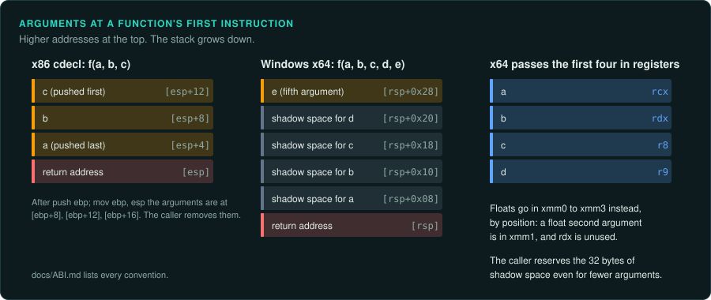
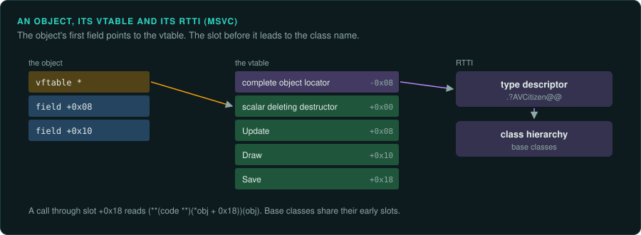
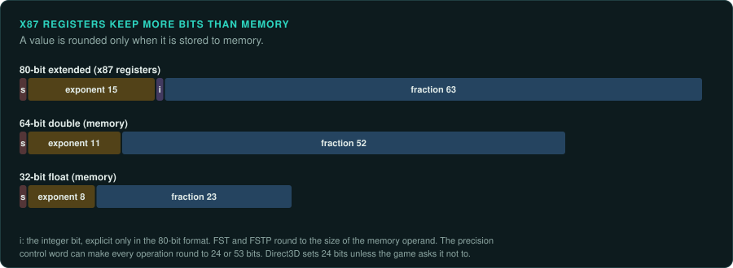
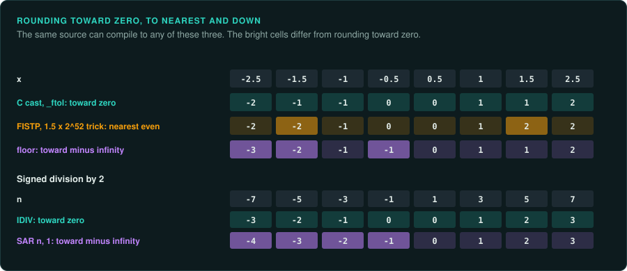

# Calling conventions, data layout and floating point

This page lists what you need to read a game's machine code correctly and to call its functions
under the emulator. The tables list only the details games use. The authoritative sources are
linked at the end.

## Calling conventions

| Platform | Integer and pointer arguments | Float arguments | Return | `this` | Stack |
|---|---|---|---|---|---|
| Windows x64 (all 64-bit Windows games) | rcx, rdx, r8, r9, then stack | xmm0-xmm3 (by position: the 2nd argument is rdx *or* xmm1) | rax, xmm0 | rcx | caller reserves 32 bytes of shadow space; stack 16-byte aligned at the call |
| System V x64 (Linux, macOS) | rdi, rsi, rdx, rcx, r8, r9 | xmm0-xmm7 (counted separately from integers) | rax (rdx:rax), xmm0 | rdi | 16-byte aligned; 128-byte red zone below rsp |
| Windows x86 `__cdecl` | stack, right to left | stack (`float` as 4 bytes, `double` as 8) | eax (edx:eax), x87 st(0) for floats | n/a | caller cleans the stack |
| Windows x86 `__stdcall` (WinAPI) | stack, right to left | stack | eax, st(0) | n/a | callee cleans (`ret N`) |
| Windows x86 `__thiscall` (MSVC C++ methods) | stack | stack | eax, st(0) | ecx | callee cleans |
| Windows x86 `__fastcall` | ecx, edx, then stack | stack | eax, st(0) | n/a | callee cleans |
| ARM64 (consoles, Apple silicon, Android) | x0-x7 | v0-v7 | x0, v0 | x0 | 16-byte aligned |

Structures larger than 8 bytes are usually passed by hidden pointer on Windows x64, and returned
through a hidden pointer passed as the first argument (so `this` moves to rdx).

Callee-saved (non-volatile) registers on Windows x64: rbx, rbp, rdi, rsi, r12-r15, xmm6-xmm15.
If pseudocode seems to use a value from nowhere, it may be one of these, kept across a call.

## C++ layout (MSVC)

- An object with virtual methods starts with a pointer to its vtable (`+0x00`). Multiple
  inheritance adds one vtable pointer per base with virtual methods.
- A vtable is an array of function pointers; MSVC puts a pointer to the RTTI "complete object
  locator" just before it (at `vtable - 8` on x64), which leads to the class name
  (`.?AVCitizen@@`).
- Virtual destructors take a flag argument (scalar deleting destructor): `FUN(this, 1)` deletes.
- `std::string` (MSVC, x64): 32 bytes; up to 15 characters stored inline, otherwise a pointer.
  `std::vector`: three pointers (begin, end, capacity end).
- Member functions are named `?Method@Class@Namespace@@...` when exported; any C++ demangler
  (`c++filt` understands Itanium names; for MSVC use `llvm-undname` or Ghidra) turns them back.

## Floating point

A reimplementation is exact only if it copies these details:

- **SSE (all x64 games).** `float` operations are 32-bit (`addss`, `mulss`), `double` 64-bit
  (`addsd`). Each instruction rounds its result once. Copy the precision of every operation.
- **x87 (many 32-bit games).** The FPU computes in 80-bit precision and rounds only when a
  value is stored to memory as 32 or 64 bits (`fstp dword`). Intermediate results are more
  precise than either float type; match where the original stores. The precision control word
  (set by Direct3D 9 to 24-bit by default unless `D3DCREATE_FPU_PRESERVE` is used) can make x87
  round every result to float precision.
- **Reversed and popping x87 forms.** `fsub` computes `st(0) - src`. `fsubr` computes
  `src - st(0)`, and `fdivr` divides the other way round in the same way. Forms ending in `p`
  pop the stack afterwards. Ghidra usually writes the right order, but check it where a
  result looks negated or inverted. The order is the whole difference.
- **x87 compares.** `fcom`, `fcomp` and `fcompp` set C0, C2 and C3 in the status word, read
  with `fnstsw ax`. `fcomi` and `fucomi` (Pentium Pro and later) set the CPU flags directly,
  so `ja` or `jb` follows. A compare with a NaN is unordered: all three bits set, or ZF, PF
  and CF set. A `jp` after the compare tests for it. The port must take the same branch for
  NaN as the original.
- **Conversions.** `cvttss2si` truncates toward zero (a C cast); `cvtss2si` rounds with the
  current mode (`lrintf`). Ghidra writes both as a cast; the instruction tells you which.
- **min and max.** `minss a, b` returns b when either is NaN, so keep the original's operand order.
- **Fused multiply-add.** A compiler may turn `a * b + c` into one FMA instruction with one
  rounding instead of two. Look for `vfmadd` in the original; avoid accidental FMA in the
  reimplementation (compiler flags such as `-ffp-contract=off`).
- **Maths functions.** `sinf`, `cosf`, `atan2f`, `powf`, `expf` come from the C runtime the game shipped with. They differ in the last bit between runtimes. Emulate them and reimplement the
  original's versions when the simulation depends on them.
- **Denormals and rounding mode** live in MXCSR (SSE) or the x87 control word. Games sometimes
  enable flush-to-zero for speed; check the start-up code for `ldmxcsr` or `_controlfp`.

## Integers

- Division rounds toward zero in C (`-7 / 2 == -3`); Python's `//` rounds down (`-4`).
- `sar` is an arithmetic (signed) shift, `shr` a logical one; Ghidra shows both as `>>`.
- Overflow wraps in machine code; languages that check or widen (Rust debug builds, Python)
  need explicit wrapping.
- `imul`/`idiv` are signed, `mul`/`div` unsigned. Take the type from the instruction, whatever
  type Ghidra declares.
- `movsx` loads a byte or a 16-bit value as signed, `movzx` as unsigned. This shows whether a
  `char` or `short` field is signed.
- C widens `char` and `short` values to `int` before it computes with them. The result is cut
  back only when it is stored. A sum of two 8-bit values can therefore go above 255 inside an
  expression, and a compare sees that full value.
- An operation on two types first converts one operand to the other's type. With an `int` and
  a `float`, the `int` becomes a `float` (`cvtsi2ss`, `fild`) before the operation. Dividing
  two `int` values, then storing the result in a `float`, divides as integers first. With a
  signed and an unsigned value of the same width, the compare is unsigned, so `-1 < 0u` is
  false. Convert at the same point as the original.

## Further reading

- Microsoft: x64 calling convention, https://learn.microsoft.com/cpp/build/x64-calling-convention
- System V AMD64 ABI, https://gitlab.com/x86-psABIs/x86-64-ABI
- Igor Skochinsky, "Compiler internals: exceptions and RTTI" (MSVC C++ layout)
- Bruce Dawson, "Floating-point determinism" and the "Comparing floating point numbers" series
