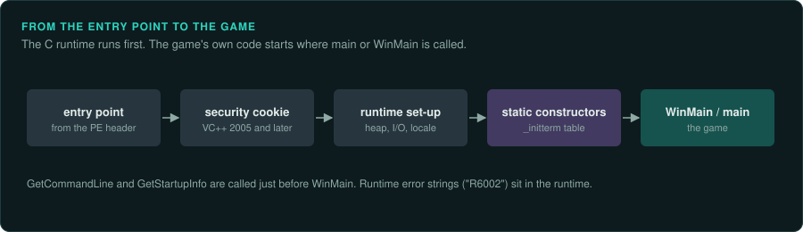
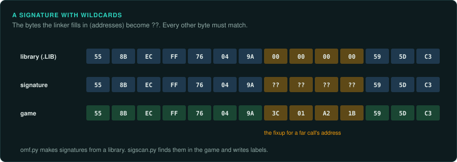
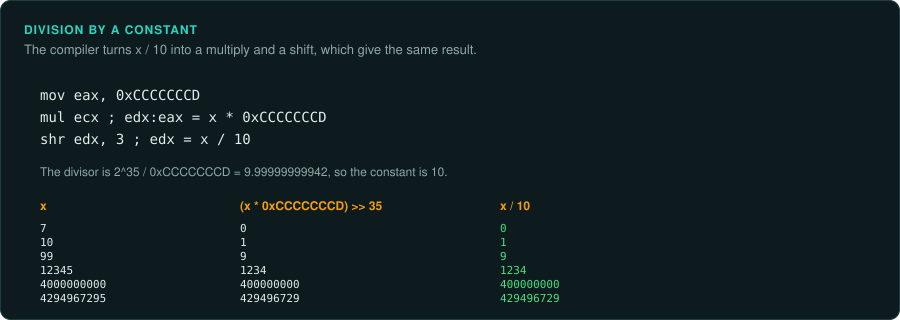
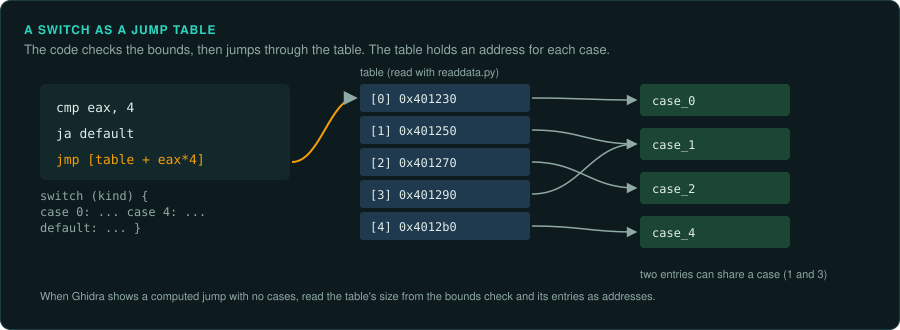
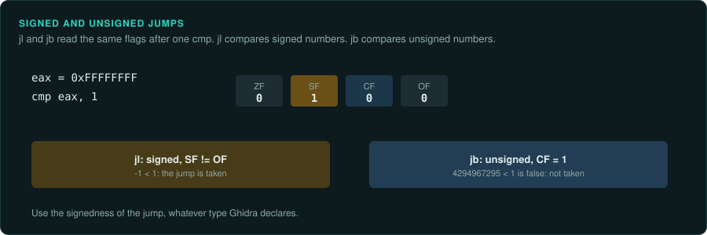

# Reading compiled code

A compiler turns a game's source into machine code. It reorders, merges and rewrites the
source to make it faster or smaller. A decompiler such as Ghidra reverses part of this, and
leaves the rest for you. This page lists the forms compilers produce from common source, so
that you can see the source behind them. It covers x86 from 16-bit DOS to x64. The details of
calling conventions, C++ layout and floating point are on
[Calling conventions and floating point](ABI.md). The game-level structures (the main loop,
random generators, entities) are on [Game patterns](GAME-PATTERNS.md).

## Finding the game's own code



An executable starts in the C runtime's start-up code, which then calls the program's `main`,
`WinMain` or Pascal main block. Skip past the runtime.

| Runtime | How to find the game's entry |
|---|---|
| MSVC (Windows) | The CRT start-up function calls `GetCommandLine` and `GetStartupInfo`, then `WinMain` or `main` with the module handle and the arguments. From Visual C++ 2005 on, the entry first calls `__security_init_cookie` |
| MinGW and GCC | `__main` or `__libc_start_main` receives `main`'s address as its first argument |
| Borland C and Turbo C (DOS) | The start-up code sets up the data segment and the stack, calls the `#pragma startup` list, then `main` |
| Turbo Pascal and Borland Pascal | The main block starts with calls to the System unit's initialisation, then each used unit's initialisation in order |
| Watcom (DOS/4GW) | The entry of the LE program calls `__CMain`, which calls `main` |

Ghidra's Function ID and library signatures name many runtime functions. Strings help too:
a runtime error message ("R6002", "Runtime error") sits in the runtime. The game's own strings lead to the game's own code. `tools/triage/similar.py` against a build of the same
runtime shows how much of an executable is library code.

## Naming library code by signature



A DOS game has no import table for its runtime: printf, the file functions and the long
arithmetic helpers are copied into the executable. The compiler's own libraries can name them.
Those libraries are OMF `.LIB` files. Each holds the code of every runtime function, its public
name, and the fixups: the bytes the linker changes when it places the code. `tools/dos/omf.py`
turns a library into signatures, with the fixup bytes as wildcards. `tools/triage/sigscan.py`
finds them in the game and writes a labels file:

```bash
python3 tools/dos/omf.py BC31/LIB/CL.LIB --sigs > derived/bc31-large.sigs
python3 tools/triage/sigscan.py scan derived/bc31-large.sigs target/GAME.EXE --labels derived/runtime.tsv
scripts/ghidra-run.sh GAME.EXE labels analysis/notes/runtime.txt derived/runtime.tsv
```

Use the library of the same compiler, version and memory model (small, medium, compact,
large). `tools/dos/dosinfo.py` names the compiler. The same tool makes signatures from a build
you have already named (`sigscan.py make BINARY --names labels/names.tsv`), to find those
functions in a patch or another release without exporting it first. A signature covers only a
function's first bytes, so two functions can match one signature. The tool says when it
matches more than once.

## Optimised arithmetic



| In the machine code | In the source |
|---|---|
| `imul` by a large constant, then `sar` or `shr` and an add of the sign bit | Division by a constant. The divisor is about 2^(32+s) / constant, where s is the extra shift |
| `lea eax, [eax+eax*4]`, `shl`, add chains | Multiplication by a small constant (here 5) |
| `and eax, 7` on an unsigned value | `x % 8` |
| `cdq`, then `xor`, `sub` with `edx` | `abs(x)` |
| `cdq`, `and edx, 7`, `add`, `sar eax, 3` | Signed division by 8, rounded toward zero |
| `neg eax`, `sbb eax, eax` | `x != 0 ? -1 : 0`, often then `and` with a value to select it |
| `setcc al`, `movzx eax, al` | A comparison stored as 0 or 1 |
| `cmovcc` | A `?:` or a short `if` without a jump |
| `test eax, eax` then `jz` | `if (x == 0)` |
| `sub eax, 3`, `cmp eax, 5`, `ja` | A range test `if (x < 3 \|\| x > 8)`: subtracting the low bound and comparing unsigned tests both bounds at once |
| `mov dword [ebp-0x10], 0x45564153` and more stores of printable values | A local character array initialised in place: here the text "SAVE" |

When the source divides by a constant, the port should divide by that constant, with the same
signedness. The multiply-and-shift form comes from the compiler. It gives the same result.
Confirm a recovered divisor with `re-emulate` on a few inputs, including negative ones.

On 16-bit code, operations on 32-bit `long` values become calls to helper routines in the
runtime, such as Borland's `LXMUL@`, `LDIV@` and `LUMOD@`, or Microsoft's `__aNlmul` and `__aNldiv`.
Name them once. Then each call reads as one operation.

## Branches and loops



| In the machine code | In the source |
|---|---|
| A compare, a conditional jump over a block | `if` |
| A jump at the end of the `if` block over an `else` block | `if` ... `else` |
| The test at the bottom of the loop, a jump to it at the top | `while` or `for`, compiled to test once at the bottom |
| A test before the loop, then the body, then the test again | A loop the compiler rotated |
| A bounds check, then `jmp [table + reg*4]` | `switch` with a jump table. The table holds one address per case |
| A tree of compares on the same value | `switch` with cases far apart, compiled as a binary search |
| A chain of conditional jumps to the same false target | `&&` |
| A chain of conditional jumps to the same true target | `\|\|` |

Ghidra recovers most jump tables. When a `switch` shows as a computed jump without cases, find
the table's address and size from the bounds check, and read its entries with
`tools/pe/readdata.py`. Each entry is one case.

Text built in place on the stack, as in the last row, is in no string list.
`tools/pe/stackstrings.py BINARY` joins those stores back into text and gives the address of
each.

## Functions

- **Inlined functions.** A small function, or one called once, can be copied into its caller.
  The same few instructions appearing in many places, with the same constants, are usually one
  inlined function. Port it as one function.
- **Inlined library calls.** `rep movsd`, `rep stosd` and unrolled moves are `memcpy` and
  `memset`. Short loops comparing bytes are `strlen`, `strcmp` and similar functions.
- **Tail calls.** A function that ends with `jmp` to another function returns that function's
  result.
- **No frame pointer.** Optimised code addresses locals from `esp` or `rsp`. The offsets change after each `push`. Ghidra tracks this. When a local looks wrong, check the stack depth
  at that instruction.
- **Functions looked up by name.** A program can load a library and look up its functions at
  run time with `LoadLibrary` and `GetProcAddress` (`dlopen` and `dlsym` elsewhere). Those
  functions are not in the import table. The names are usually in the strings: find the
  callers of `GetProcAddress` and their string arguments (`ghidra-run.sh BINARY callargs OUT
  GetProcAddress`). Games did this for optional parts such as DirectX versions, force feedback
  and voice chat.
- **Shared code.** The linker can merge identical functions. One body may then serve two names. Its callers may expect different meanings.

## The flags



Each arithmetic instruction sets the flags: zero, sign, carry and overflow. The conditional
jump after it reads them. The jump names give the signedness of the comparison.

| Signed | Unsigned | Meaning |
|---|---|---|
| `jl`, `jle`, `jg`, `jge` | `jb`, `jbe`, `ja`, `jae` | Less, less or equal, greater, greater or equal |

The port must use the same signedness, whatever type Ghidra declares. On older code, an x87
comparison stores its result with `fnstsw ax`, then tests bits of `ah` (`test ah, 41h`,
`sahf`). [ABI](ABI.md) explains how to read these.

## When the decompiler is wrong

A decompiler rebuilds source from machine code in stages. It separates code from data, finds
the basic blocks and the control flow graph, follows the data through registers and flags,
then rebuilds loops and conditions. Each stage can go wrong on code of this era. Cristina
Cifuentes's thesis *Reverse Compilation Techniques* (1994) describes the stages and their
limits. These are the usual cases, and how to check each one:

| What the decompiler shows | What is often true | Check |
|---|---|---|
| A function that ends early, or junk instructions after a jump | Data inside the code: a jump table, a string, a table of constants | The bytes as data; references to them; `tools/pe/readdata.py` |
| Variables named `unaff_`, `in_` or `extraout_` | Arguments or results passed in registers, as hand-written assembly does | Set the function's calling convention, or custom storage for its parameters, in Ghidra |
| A bool that comes from nowhere after a call | A result returned in the carry flag (`stc` or `clc` before `ret`), common in DOS and BIOS code | The callee's last instructions, and the `jc` or `jnc` after the call |
| `goto` statements and loops entered in the middle | Control flow with no structured form (irreducible), from hand-written code or optimised `switch` code | Read the graph in Ghidra's function graph view. Port it with the same flow, not a guessed loop |
| A long chain of 16-bit operations | 32-bit arithmetic on register pairs (`add`, `adc`; `sub`, `sbb`), or calls to the runtime's long helpers | Treat the pair as one 32-bit value |
| Code that writes to its own instructions | Self-modifying code: patched constants or jump targets, used for speed in many DOS games | Write references into the code segment; run the function under emulation to see both versions |
| Two functions sharing their last instructions | The linker merged tails, or the code jumps into another function | The references into the middle of a function |
| A wrong type everywhere a value goes | One wrong type at the start, propagated through every call | Fix the first type; Ghidra then corrects the rest |

## Debug builds, release builds and symbols

A game may ship with more than one build, such as a debug build on a demo disc or a version for another platform. A debug build keeps local variables on the stack and does not reorder code,
so it is easier to read. A build with symbols (a PDB, a MAP file, Borland debug data) names
functions and types. Look for these before reading an optimised build alone. The same
function in two builds, matched with `similar.py` and its strings, gives the readable version
of the optimised one.

## What to record

- The compiler and runtime, with the evidence (`peinfo.py`, `dosinfo.py`, runtime strings).
- The address of the game's entry past the runtime.
- Each runtime helper you named, in the labels file, so the export reads cleanly.
- Each recovered constant (a divisor, a jump table) with how you confirmed it.
