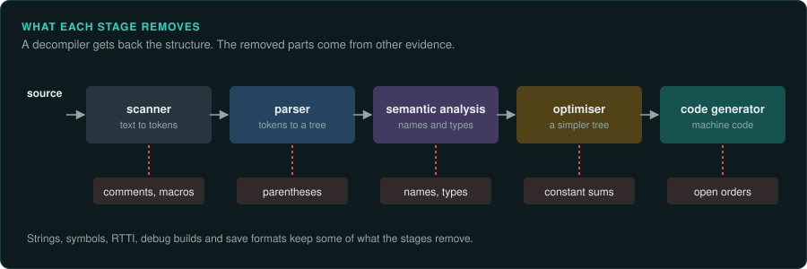
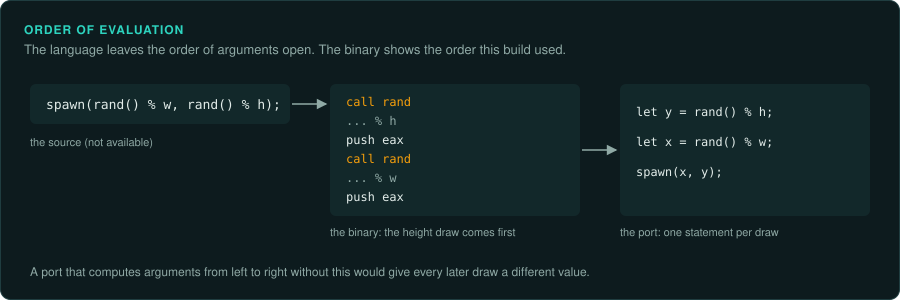
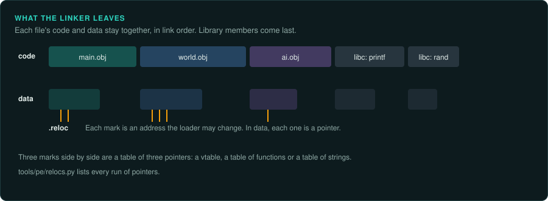

# Reading compiled code

A compiler turns a game's source into machine code. It reorders, merges and rewrites the
source to make it faster or smaller. A decompiler such as Ghidra reverses part of this, and
leaves the rest for you. This page lists the forms compilers produce from common source, so
that you can see the source behind them. It covers x86 from 16-bit DOS to x64. The details of
calling conventions, C++ layout and floating point are on
[Calling conventions and floating point](ABI.md). The game-level structures (the main loop,
random generators, entities) are on [Game patterns](GAME-PATTERNS.md).

## What compiling removes



A compiler works in stages. The front end reads the source. The scanner splits the text into
tokens, and the parser builds a tree from them. Semantic analysis looks up each name in the
symbol table and checks its type. The back end may optimise the tree. Then it chooses machine
instructions for it. Each stage removes something that a decompiler cannot get back from the
code alone.

| Stage | What it removes | Where to look for it |
|---|---|---|
| Scanning | Comments, layout, macro names (`#define`) and the preprocessor's choices (`#if`) | Strings, assert messages, a debug build, other platforms' builds |
| Parsing | Parentheses and precedence: the tree fixes the order of every operation | The order of the instructions |
| Semantic analysis | Names and declared types. Types become sizes, offsets and the choice of instruction (`imul` against `mul`, `jl` against `jb`) | Symbols, RTTI, save formats, the uses of each value ([Types](TYPES.md)) |
| Optimisation | Expressions with constant results, repeated sub-expressions, code that is never reached, small functions (inlined) | Constants that are the result of a sum, code repeated in many places |
| Code generation | Statement boundaries and the order the language left open | The order of calls and memory writes in the binary |

The machine code is the evidence for everything the program does. The source the developers
wrote is only one of many that compile to it. A port copies what the machine code does. Where
the source language left a choice to the compiler, the binary shows the choice it made.

## Finding the game's own code


An executable starts in the C runtime's start-up code, which then calls the program's `main`,
`WinMain` or Pascal main block. Skip past the runtime.

| Runtime | How to find the game's entry |
|---|---|
| MSVC (Windows) | The CRT start-up function calls `GetCommandLine` and `GetStartupInfo`, then `WinMain` or `main` with the module handle and the arguments. From Visual C++ 2005 on, the entry first calls `__security_init_cookie` |
| MinGW and GCC | `__main` or `__libc_start_main` receives `main`'s address as its first argument |
| Borland C and Turbo C (DOS) | The start-up code sets up the data segment and the stack, calls the `#pragma startup` list, then `main` |
| Turbo Pascal and Borland Pascal | The main block starts with calls to the System unit's initialisation, then each used unit's initialisation in order |
| Watcom (DOS/4GW) | The entry of the LE program calls `__CMain`, which calls `main` |

Ghidra's Function ID and library signatures name many runtime functions. Strings help too:
a runtime error message ("R6002", "Runtime error") sits in the runtime. The game's own strings lead to the game's own code. `tools/triage/similar.py` against a build of the same
runtime shows how much of an executable is library code.

## Naming library code by signature


A DOS game has no import table for its runtime: printf, the file functions and the long
arithmetic helpers are copied into the executable. The compiler's own libraries can name them.
Those libraries are OMF `.LIB` files. Each holds the code of every runtime function, its public
name, and the fixups: the bytes the linker changes when it places the code. `tools/dos/omf.py`
turns a library into signatures, with the fixup bytes as wildcards. `tools/triage/sigscan.py`
finds them in the game and writes a labels file:

```bash
python3 tools/dos/omf.py BC31/LIB/CL.LIB --sigs > derived/bc31-large.sigs
python3 tools/triage/sigscan.py scan derived/bc31-large.sigs target/GAME.EXE --labels derived/runtime.tsv
scripts/ghidra-run.sh GAME.EXE labels analysis/notes/runtime.txt derived/runtime.tsv
```

Use the library of the same compiler, version and memory model (small, medium, compact,
large). `tools/dos/dosinfo.py` names the compiler. The same tool makes signatures from a build
you have already named (`sigscan.py make BINARY --names labels/names.tsv`), to find those
functions in a patch or another release without exporting it first. A signature covers only a
function's first bytes, so two functions can match one signature. The tool says when it
matches more than once.

## Optimised arithmetic


| In the machine code | In the source |
|---|---|
| `imul` by a large constant, then `sar` or `shr` and an add of the sign bit | Division by a constant. The divisor is about 2^(32+s) / constant, where s is the extra shift |
| `lea eax, [eax+eax*4]`, `shl`, add chains | Multiplication by a small constant (here 5) |
| `and eax, 7` on an unsigned value | `x % 8` |
| `cdq`, then `xor`, `sub` with `edx` | `abs(x)` |
| `cdq`, `and edx, 7`, `add`, `sar eax, 3` | Signed division by 8, rounded toward zero |
| `neg eax`, `sbb eax, eax` | `x != 0 ? -1 : 0`, often then `and` with a value to select it |
| `setcc al`, `movzx eax, al` | A comparison stored as 0 or 1 |
| `daa` or `das` after an 8-bit `add` or `sub`; `aaa`, `aas`, `aam`, `aad` | Decimal numbers stored two digits to a byte (packed BCD) or one digit to a byte. Scores, money and timers kept in this form are shown digit by digit with no division. The port keeps the stored form, because a save or a memory dump holds it |
| `fbstp` | An x87 value stored as 18 packed BCD digits, usually to print a large number |
| `fprem` in a loop that tests bit C2 of the status word | `fmod`: the remainder with the sign of the dividend, the same result as C's `fmod`. `fprem1` gives the IEEE remainder instead, rounded to the nearest quotient, so the result can be negative where `fmod`'s is positive. Port each with the matching function |
| `cmovcc` | A `?:` or a short `if` without a jump |
| `test eax, eax` then `jz` | `if (x == 0)` |
| `sub eax, 3`, `cmp eax, 5`, `ja` | A range test `if (x < 3 \|\| x > 8)`: subtracting the low bound and comparing unsigned tests both bounds at once |
| `mov dword [ebp-0x10], 0x45564153` and more stores of printable values | A local character array initialised in place: here the text "SAVE" |
| One constant where you expect an expression, such as `0x3eaaaaab` (1/3 as a 32-bit float) or 450 for `15 * 30` | An expression the compiler computed at build time (constant folding), often from a `#define` or `sizeof` |
| `mulss` by a constant where the source probably divides | Division by a constant turned into multiplication by its reciprocal. This is allowed only with fast-maths options. The two give different results |

A folded float constant is exact in the binary. Copy its bits into the port
(`f32::from_bits(0x3eaaaaab)`) or write a literal that gives the same bits. A float expression
in the port's source can be folded with a different precision or a different order. For
integers, write the expression you recovered when you know it, so the port reads like the
original source.

When the source divides by a constant, the port should divide by that constant, with the same
signedness. The multiply-and-shift form comes from the compiler. It gives the same result.
Confirm a recovered divisor with `re-emulate` on a few inputs, including negative ones.

On 16-bit code, operations on 32-bit `long` values become calls to helper routines in the
runtime, such as Borland's `LXMUL@`, `LDIV@` and `LUMOD@`, or Microsoft's `__aNlmul` and `__aNldiv`.
Name them once. Then each call reads as one operation.

## Branches and loops


| In the machine code | In the source |
|---|---|
| A compare, a conditional jump over a block | `if` |
| A jump at the end of the `if` block over an `else` block | `if` ... `else` |
| The test at the bottom of the loop, a jump to it at the top | `while` or `for`, compiled to test once at the bottom |
| A test before the loop, then the body, then the test again | A loop the compiler rotated |
| A bounds check, then `jmp [table + reg*4]` | `switch` with a jump table. The table holds one address per case |
| A tree of compares on the same value | `switch` with cases far apart, compiled as a binary search |
| A table of case values beside a table of addresses, searched by a short loop or a runtime helper | `switch` with cases far apart, in compilers that use one routine for every sparse `switch`. Read both tables: each value goes with the address at the same position |
| A chain of conditional jumps to the same false target | `&&` |
| A chain of conditional jumps to the same true target | `\|\|` |
| A pointer increased by the same amount on each pass | An array index `a[i]`: the compiler replaced the multiplication by `i` with an addition (strength reduction). The amount is the element size |
| A value computed before the loop and used inside it | An expression in the loop body that does not change between passes, moved out of the loop |
| The same body two, four or eight times in a row, with the counter stepped by that number, and a short loop before or after it | One loop, unrolled. The short loop handles the passes left over. Port it as one loop |
| A block at the end of the function, or far away in the binary, reached by a jump and jumping back | Code the compiler expected to run rarely (an error path, a first-time set-up), moved away from the common path. GCC names such parts `function.cold`. Ghidra may show them as separate functions |

Ghidra recovers most jump tables. When a `switch` shows as a computed jump without cases, find
the table's address and size from the bounds check, and read its entries with
`tools/pe/readdata.py`. Each entry is one case.

Text built in place on the stack, as in the last row, is in no string list.
`tools/pe/stackstrings.py BINARY` joins those stores back into text and gives the address of
each.

## Functions

- **Inlined functions.** A small function, or one called once, can be copied into its caller.
  The same few instructions appearing in many places, with the same constants, are usually one
  inlined function. Port it as one function.
- **Inlined library calls.** `rep movsd`, `rep stosd` and unrolled moves are `memcpy` and
  `memset`. Short loops comparing bytes are `strlen`, `strcmp` and similar functions.
- **Tail calls.** A function that ends with `jmp` to another function returns that function's
  result.
- **No frame pointer.** Optimised code addresses locals from `esp` or `rsp`. The offsets change after each `push`. Ghidra tracks this. When a local looks wrong, check the stack depth
  at that instruction.
- **Functions looked up by name.** A program can load a library and look up its functions at
  run time with `LoadLibrary` and `GetProcAddress` (`dlopen` and `dlsym` elsewhere). Those
  functions are not in the import table. The names are usually in the strings: find the
  callers of `GetProcAddress` and their string arguments (`ghidra-run.sh BINARY callargs OUT
  GetProcAddress`). Games did this for optional parts such as DirectX versions, force feedback
  and voice chat.
- **Shared code.** The linker can merge identical functions. One body may then serve two names. Its callers may expect different meanings.
- **Checks the compiler added.** Pascal compilers can check each array index and each
  arithmetic result (Turbo Pascal's `{$R+}` and `{$Q+}`). The check is a compare and a call to
  the runtime's error routine, which stops the program with a run-time error (201 for a range
  error). C++ compilers add stack checks (`__chkstk` for large frames, a security cookie
  compared before `ret`). These checks are part of the compiled game. The port needs them only
  where the game can reach them.

## Registers and stack slots

The compiler keeps a value in a register only while it is needed. The stretch from the moment
a value is computed to its last use is its live range. The register allocator gives each live
range a register. When there are not enough registers, it moves a value to a stack slot (a
spill) and loads it again later. This changes what the decompiler shows.

- **One variable, several places.** A source variable can live in a different register in each
  part of a function. Ghidra joins them when it can. It may also show several variables for
  one.
- **One place, several variables.** A register or a stack slot can hold one variable, then
  another one once the first is no longer used. Ghidra may give them one name and one type.
  When a variable seems to change type halfway through a function, split it (Ghidra's *Split Out
  As New Variable*).
- **Statements mixed together.** The scheduler reorders instructions so that slow ones start
  early. The instructions of two statements can then alternate. Follow the data from each
  instruction to the next one that uses it. The order of the instructions alone does not give
  the order of the statements. Memory writes and calls keep their order relative to each other.
- **Writes that are missing.** The optimiser removes a write that nothing reads afterwards. A
  structure field set in the source and never read may never be written. The port must not
  depend on the value of such a field. If a save file or a later version reads it, look for the
  write elsewhere.
- **Copies of one function.** An optimiser can make a separate copy of a function for one
  caller with a constant argument (procedure cloning). It can also make two copies of a loop,
  one for each value of a condition that does not change inside it (unswitching). Two nearly
  identical functions or loops can be one piece of source.
- **Nested procedures.** Pascal allows a procedure inside another one. The inner procedure
  reads the outer one's locals through the outer frame pointer, passed as a hidden extra
  argument (the static link). In Turbo Pascal code, the caller pushes its own `bp` as the last
  argument of a nested procedure. The callee loads it and reads the outer locals through it.

## Order of evaluation



C and C++ leave some orders to the compiler. The order in which a call's arguments are computed
is one of them. So is the order of the two operands of `+`, and the moment when `x++` writes
`x` before the end of the statement. The compiler chooses each order when it builds the game.
The binary shows the choice. Another compiler, or the same compiler with other options, can
choose differently.

This matters when two parts of one expression change shared state. Examples are two calls to
the random generator in one call's arguments (`spawn(rand() % w, rand() % h)`), two calls that
read and advance the same pointer, and `i++` used twice in one statement. Rust and most modern
languages compute arguments from left to right. Many x86 compilers that pass arguments on the
stack compute them from right to left. In the example above, the port's first draw might then
give the original's height. Every later draw is then different.

In the port, give each such call its own statement, in the order the binary makes the calls.
Name the results. A comment can cite the address of the call that comes first. The tests then
compare the same draws (the `re-verify` skill, "Random draw order").

## The flags


Each arithmetic instruction sets the flags: zero, sign, carry and overflow. The conditional
jump after it reads them. The jump names give the signedness of the comparison.

| Signed | Unsigned | Meaning |
|---|---|---|
| `jl`, `jle`, `jg`, `jge` | `jb`, `jbe`, `ja`, `jae` | Less, less or equal, greater, greater or equal |

The port must use the same signedness, whatever type Ghidra declares. On older code, an x87
comparison stores its result with `fnstsw ax`, then tests bits of `ah` (`test ah, 41h`,
`sahf`). [ABI](ABI.md) explains how to read these.

## When the decompiler is wrong

A decompiler rebuilds source from machine code in stages. It separates code from data, finds
the basic blocks and the control flow graph, follows the data through registers and flags,
then rebuilds loops and conditions. Each stage can go wrong on code of this era. Cristina
Cifuentes's thesis *Reverse Compilation Techniques* (1994) describes the stages and their
limits. These are the usual cases, and how to check each one:

| What the decompiler shows | What is often true | Check |
|---|---|---|
| A function that ends early, or junk instructions after a jump | Data inside the code: a jump table, a string, a table of constants | The bytes as data; references to them; `tools/pe/readdata.py` |
| Variables named `unaff_`, `in_` or `extraout_` | Arguments or results passed in registers, as hand-written assembly does | Set the function's calling convention, or custom storage for its parameters, in Ghidra |
| A bool that comes from nowhere after a call | A result returned in the carry flag (`stc` or `clc` before `ret`), common in DOS and BIOS code | The callee's last instructions, and the `jc` or `jnc` after the call |
| `goto` statements and loops entered in the middle | Control flow with no structured form (irreducible), from hand-written code or optimised `switch` code | Read the graph in Ghidra's function graph view. Port it with the same flow, not a guessed loop |
| A long chain of 16-bit operations | 32-bit arithmetic on register pairs (`add`, `adc`; `sub`, `sbb`), or calls to the runtime's long helpers | Treat the pair as one 32-bit value |
| Code that writes to its own instructions | Self-modifying code: patched constants or jump targets, used for speed in many DOS games | Write references into the code segment; run the function under emulation to see both versions |
| Two functions sharing their last instructions | The linker merged tails, or the code jumps into another function | The references into the middle of a function |
| Code that seems pointless: a second jump that can never be taken, a value stored and stored again | A quirk of the compiler, which a later pass did not clean up. It is rarely a sign of hidden meaning. A real compiler bug that changes a result is the original's behaviour, so the port computes the same result | Run the function under emulation with inputs that reach the code |
| A wrong type everywhere a value goes | One wrong type at the start, propagated through every call | Fix the first type; Ghidra then corrects the rest |
| A call that seems to return twice, or code after a call that runs only after an error | `setjmp` and `longjmp`: an error or a restart far inside the game jumps back to a saved point, such as the main menu | The callers of `setjmp` in the runtime's labels; the buffer passed to it |

## What the linker leaves



The linker joins the compiled object files into one executable. Its rules leave traces that
help with the whole program.

- **Source files stay together.** The linker places the code of each object file in one block,
  in the order the files were given to it. Their data goes into the data section in the same
  order. The functions of one source file are therefore next to each other, and so are its
  globals and strings. A run of functions that call each other and use the same block of data
  is usually one source file. Name the files when you can (a `__FILE__` string in an assert
  helps). Then port each as one module.
- **Library code comes last, in whole members.** The linker takes a member from a library only
  when it defines a name that something still needs. It takes the whole member. Unused
  functions can then sit next to used ones, if they were in the same member. A runtime function
  that is missing was never needed. Some runtimes link floating-point support only when the
  program uses floats (MSVC's `_fltused`). A program without it never prints a float.
- **Relocations mark the pointers.** An image that can load at another base address lists each
  absolute address it holds in its relocation table. The loader adds the difference to each
  one. In the data sections, every entry is a pointer. Runs of pointers are tables: vtables,
  tables of functions, tables of strings, tables of records. `tools/pe/relocs.py BINARY` lists
  them. DLLs keep their relocations. Many 32-bit EXEs were linked without them (`/FIXED`). A
  DOS `MZ` program lists its segment fixups in its header ([DOS](DOS.md)).
- **Functions found only through tables.** Ghidra follows calls and jumps from the entry point
  and from known functions (recursive disassembly). A function reached only through a table of
  pointers is found only when Ghidra finds the table. The relocations show where those tables
  are. A linear disassembler reads every byte in order instead. It finds such functions, but it
  also reads data between functions as code.
- **What can break the link order.** Linkers that remove unused functions (`/OPT:REF`, or
  `--gc-sections` with one section per function) keep only what is called. Identical functions
  can be folded into one, which is common for C++ templates of different pointer types.
  Link-time optimisation (`/LTCG`, `-flto`) can inline across source files and reorder them.
  Profile-guided builds place hot functions together. In such builds, use the link order only
  as a hint.
- **Templates appear once.** Every source file that uses a C++ template compiles its own copy.
  The linker keeps one of them. It can sit with any of those object files, often far from the
  code that calls it.
- **Incremental linking.** A debug build linked incrementally calls each function through a
  table of `jmp` instructions, so that a function can move without changing its callers. The
  gaps between functions are filled with `int3` (`0xCC`) bytes, left free for the next link.
  Follow each jump to the real function. Ghidra names the jumps as thunks.
- **Imports.** Each imported function has a slot in the import address table. The loader fills
  it. A call either goes through a small `jmp [slot]` thunk or calls `[slot]` directly. An
  import can name its function, or give only its number in the DLL (an ordinal, marked by the
  top bit of the entry). For an ordinal, the name comes from the DLL's own export table, or from
  a list for that DLL version. Delay-loaded DLLs are not in the import table. Their slots first
  point to a helper (`__delayLoadHelper2`) that loads the DLL on the first call. Their names
  are in the delay-load directory. `tools/pe/peinfo.py BINARY --imports` lists both kinds.
- **Shared libraries on Linux and macOS.** An ELF program calls a library function through a
  stub in the procedure linkage table (`printf@plt`). The stub jumps through a slot in the
  global offset table, which the dynamic linker fills on the first call. 32-bit
  position-independent code first finds its own address, with a call to
  `__x86.get_pc_thunk.bx` or a `call` to the next instruction and a `pop`. It then reads every
  global through `ebx`. Give `ebx` that value in Ghidra, and the globals resolve. Mach-O
  programs use `__stubs` and lazy pointers the same way. Library constructors (`.init_array`,
  `DllMain`, Mach-O initialisers) run before `main`, so an engine library can set up its
  globals before the game starts. Linux ports often shipped their own copies of libraries.
  Record the exact versions, because a later version can behave differently.
- **Weak and common symbols.** A weak symbol is a default that another definition replaces.
  An uninitialised global declared in several files can become one shared block (common). A
  global that seems to belong to two source files may be one of these.

## Debug builds, release builds and symbols

A game may ship with more than one build, such as a debug build on a demo disc or a version for another platform. A debug build keeps local variables on the stack and does not reorder code,
so it is easier to read. A build with symbols (a PDB, a MAP file, Borland debug data) names
functions and types. Look for these before reading an optimised build alone. The same
function in two builds, matched with `similar.py` and its strings, gives the readable version
of the optimised one.

Code from a compiler that does not optimise has a recognisable form. Every value is loaded from
memory at each use. Intermediate results are pushed on the stack and popped again. The same
expression is computed again in the next statement. Early DOS compilers without optimisation,
and many C compilers for 8-bit machines, produce this code. It keeps the statements of the
source in their order. One statement usually becomes one short group of instructions, so the
structure of the source is easy to read. The reverse also helps. Code that does none of this
was optimised, or was written in assembly.

## Code compiled by the game's own tools

A compiler can translate into a form that another program runs, as well as into machine code.
Many games carry such programs. Their machine code is then an interpreter, and the game's logic
is in its data.

- **Bytecode from the developers' compilers.** Scripting systems such as SCUMM, AGI, QuakeC and
  UnrealScript compile scripts into bytecode with a tool that did not ship. To read the
  bytecode, reverse that compiler's last stage. Find the interpreter's dispatch table and name
  the handler of each opcode. Then write a disassembler. A decompiler for the bytecode rebuilds
  expressions from the stack operations, as the parser built the tree in the other direction.
  [Adventure games](games/adventure.md) and [Engines](engines/README.md) cover these
  interpreters.
- **Tokenised BASIC.** A home computer stores a BASIC program as tokens. Each keyword is one
  byte with its top bit set. The table of keywords is in the machine's BASIC ROM. A Commodore
  64 line starts with a pointer to the next line and a two-byte line number, and ends with a
  zero byte. A ZX Spectrum line starts with a big-endian line number and a length. Each number
  in its text is followed by a hidden binary form after a `0x0E` byte. A program can change the
  hidden form so that the listing shows a different number than the one the program uses.
  Detokenise with the table from the same ROM version.

## What to record

- The compiler and runtime, with the evidence (`peinfo.py`, `dosinfo.py`, runtime strings).
- The address of the game's entry past the runtime.
- Each runtime helper you named, in the labels file, so the export reads cleanly.
- Each recovered constant (a divisor, a jump table, a folded float) with how you confirmed it.
- The order of calls inside expressions that change shared state, such as random draws.
- The source files you recognised from the link order, and the tables found from relocations.
