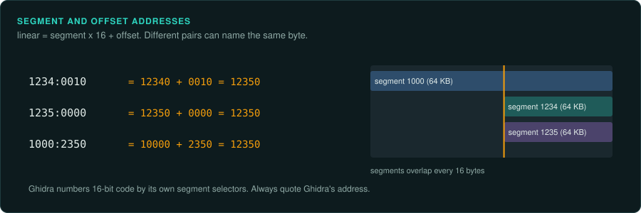

# DOS and 16-bit games

Most of GameFrame was built on a 64-bit Windows game. DOS games (1985-2000) need different
tools at three steps: reading the executable, emulating code, and running the original. This
page covers every DOS step. The skills link here. The tools are tested against
`examples/dos-sample/` (our own 16-bit code) by `tests/run.sh`.

## 1. Which kind of DOS program is it?

```bash
python3 tools/dos/dosinfo.py target/GAME.EXE              # format, segments, imports, fingerprints
python3 tools/dos/dosinfo.py target/GAME.EXE --pstrings 6 # Pascal strings, with their addresses
```

| dosinfo says | What it is | Ghidra | Emulate one function | Run it all |
|---|---|---|---|---|
| `MZ` | Real-mode DOS (Turbo Pascal, Turbo C, Microsoft C, QuickBASIC) | "Old-style DOS Executable", loaded at segment `1000` | `dos_emu` (real mode) | DOSBox-X |
| `NE` | 16-bit protected mode: Windows 3.x, OS/2 1.x, Borland Pascal 7 or Borland C++ with DPMI16 (`RTM.EXE`, `DPMI16BI.OVL`) | "New Executable", selectors `1000`, `1008`, ... | `dos_emu` (protected mode, same selectors) | DOSBox-X (or Windows 3.1 inside it) |
| `LE` / `LX` | 32-bit flat code behind a DOS extender (Watcom + DOS/4GW, PMODE/W) | needs an LE/LX loader extension | not yet in the toolkit | DOSBox-X |
| `PE` | A Windows program | use `tools/pe/peinfo.py` | `pe_emu.py` | Windows or Wine |

Packed executables (LZEXE, PKLITE, EXEPACK, DIET: dosinfo's fingerprints) must be unpacked
first, for example with UNP or by dumping memory from DOSBox-X after the unpacker has run.

Data appended after the MZ load image is an overlay (Borland `.OVR` data starts with `FBOV`),
a packed payload, or debug symbols.

### Overlays



A program larger than conventional memory could keep parts of its code on disk and load each
part when it was called, into a region shared with other parts. These are overlays. Borland's
VROOMM, Microsoft's linkers and others such as RTLink and Blinker each had their own scheme.
They all work the same way in outline. The overlaid code sits in a separate file (`.OVR`) or
after the load image. A call into it goes through a small stub in the resident code, which
loads the part if needed, then jumps to it. Several parts can occupy the same addresses at
different times.

- Find the overlay manager and its stubs: interrupt `3Fh` calls in Microsoft-style overlays,
  stub segments in Borland's. The stubs name each part and the offset of each entry point.
- Load each part into Ghidra at the address where it runs, as an overlay block, so parts that
  share an address range stay apart (`tools/ghidra/AddMemoryBlocks.java`;
  [Getting more from Ghidra](working/ghidra.md#code-that-is-not-an-executable-file)).
- Label each stub with the entry point it leads to. Calls through stubs then read as calls to
  the real functions.
- The port has no need for overlays. Port the functions. Record each part's number and file
  offset, so that every address in the findings can be traced to its bytes.

## 2. Addresses: always Ghidra's numbering



Write every address as `seg:off` the way Ghidra prints it, in docs, labels and tests:

- **NE**: segment N of the file has selector `0x1000 + 8 * (N - 1)`. Segment 1 is `1000:`,
  segment 10 is `1048:`. Imports go after the last segment.
- **MZ**: the load image starts at segment `1000`, so `1000:0000` is the first byte after
  the header; a second segment in the image is `1000 + paragraphs`.

`dosinfo.py` prints Ghidra's selector for each segment. `readseg.py`, `dos_emu`,
`tdinfo.py` and `decomp_query.py` all accept and print these addresses. The *running* program
uses other numbers: real-mode segments where DOS loaded it, or the DPMI host's selectors.
Only the DOSBox-X debugger shows those (section 7).

## 3. Debug symbols: check before anything else

Borland compilers wrote Turbo Debugger symbols into the program (TPC/BPC `/V`, TLINK `/v`),
and many shipped games kept them. They give the original names of every procedure and global,
the parameters and locals of each procedure, record layouts, and code-to-source-line maps.

```bash
python3 tools/dos/tdinfo.py target/GAME.EXE summary          # units, counts
python3 tools/dos/tdinfo.py target/GAME.EXE procs makeenemy  # address, size, parameters, locals
python3 tools/dos/tdinfo.py target/GAME.EXE types enemy      # record fields with offsets
python3 tools/dos/tdinfo.py target/GAME.EXE labels > analysis/td-labels.tsv
scripts/ghidra-export.sh --labels analysis/td-labels.tsv target/GAME.EXE
```

With `--labels`, Ghidra names every function and global, and creates the functions it missed.

`tdinfo.py` turns the record types into reimplementation code. `tdinfo.py BINARY rust TYPE ...` writes
Rust structs with readers in the original's field order, each field commented with its Pascal
type and offset, and `tdinfo.py BINARY rust-reader` the `PascalReader` they use (little-endian
integers, one-byte Boolean, 6-byte Real kept exact, `string[N]`). Generated names that clash
with Rust's prelude get `Rec` (`Optiontype` -> `OptionRec`). Records also get `write`, the
inverse of `read`.

`tdinfo.py BINARY rust-globals` writes one `Globals` struct holding every variable of the data
segment at its original offset, with `load` and `store` to and from a 64 KB image of the
segment (Booleans stay `u8`, so `store` writes every byte back unchanged). Ported code then works on `Globals`. A test can load the DS image from before an emulated run of the original, run the port, store,
and compare with the DS image from after. One test then checks every variable.

`tdinfo.py BINARY rust-locals PROC` does the same for one procedure's local variables and
parameters, at their BP offsets in the stack segment: for code nested in a big procedure (a
main loop's helpers that use its locals through the static link).

The runtime library (`System`, `Crt`, `Dos`) has no symbols of its own. Borland Pascal 7's
random generator, for example, is `RandSeed := RandSeed * $08088405 + 1` (a near `NextRand`
built from 16-bit multiplies and shifts), `Random(n)` = (new seed * n) >> 32 using all 32
bits, and `Randomize` seeds from INT 21h AH=2Ch (CX low word, DX high word). Find it by the
constant `0x8405` and the global `RandSeed`, and measure it before trusting this.
Record field offsets are summed from field sizes: tdinfo says when a record's fields do not add
up to its size (a variant record), so check one offset in the code before relying on it.

## 4. Decompiling 16-bit code with Ghidra

`scripts/ghidra-export.sh` works for MZ and NE as it does for PE. Things that differ:

- **Library search crashes the import.** An NE program that imports a module (`RTM`) whose
  file sits next to it (`RTM.EXE`, a plain DOS program) made Ghidra's loader throw "Invalid
  index". The export script passes `-loader-libraryLoadDepth 0`, so Ghidra never searches.
- **No-return calls.** Ghidra does not know that `INT 21h` with `AH=4Ch` (exit) or Pascal's
  `Halt`/`RunError` never return: the next procedure's code is joined to the end of the
  caller. Split it by creating the function at the right address (labels do this).
- **Missed functions.** Procedures reached only through relocations or tables are not found.
  Debug-symbol labels fix this; otherwise use `scripts/ghidra-run.sh BINARY decompile`.
- **Pascal calling convention.** Arguments are pushed left to right and the callee removes
  them (`retf N`). Ghidra shows these as `__stdcall16far` with `param_1` being the *last*
  Pascal argument. Read parameters from `[bp+6]` upwards: the first at the highest offset.
- **Parameter numbers drift.** Ghidra may split one far-pointer parameter into two
  `param_N` halves, so every later number is off by one; `in_stack_X` and `local_X` names
  are offsets from a frame base two bytes away from BP. Take each parameter's BP offset from
  the disassembly, and name it from the caller's push list (`mov di, 0x649e; push ds; push
  di` is the global at 0x649e), not from how the pseudocode uses it: a "change" counter may
  really be a speed.
- **A big procedure's helpers see its frame.** A nested procedure reads its parent's locals
  and `var` parameters through the static link (`mov di, [bp+4]`, then `[di+...]`); map those
  offsets to the parent's names before reading the helper.
- **Scans with string instructions.** `repe scasb` over an array finds the next element that
  differs from AL; the loop then resumes the scan with the saved CX and DI. Port it as a loop over the array. Check how it stops (often `or cl, cl` on the low byte only).
- **Which carry counts.** In `add dx, bx; add dx, 1180h; add dx, ax; jae ok`, only the last
  add sets the carry the jump tests; the sum wraps freely before it. Port the test on the
  same instruction, not on the whole sum.
- **Stale globals are inputs.** A routine may test a temporary that another routine set
  earlier in the frame (a `tempi2` left by the movement code). Keep the read, because the
  original's result depends on it. A test catches it only if the port leaves the global as the original
  does.
- **Strings.** Pascal strings (a length byte, then the text) are not found by Ghidra's string
  search. Use `dosinfo.py --pstrings` and `readseg.py BINARY pstr ADDR`.
- **Segment arithmetic.** `DAT_1048_12de` is offset `0x12de` in the data segment; a far
  pointer is offset then segment in memory (`readseg.py ... ptr`).
- **String constants sit just before their procedure.** Borland Pascal emits a procedure's
  string literals right before its first instruction, so the procedure that starts after a
  string usually uses it. Code refers to a Pascal string by its *length byte*: search for the
  address one before the text that `dosinfo.py --pstrings` prints.
- **Constants that look like globals.** A 16-bit constant equal to an offset in DS shows up in
  pseudocode as `&someGlobal` (a `BlockRead` count of 0x138a printed as `&tempdat3`). Check
  the instruction (`tools/dos/nedis.py`) before believing a pointer.
- **Floating point by interrupt.** Borland's FPU emulator replaces each x87 instruction with
  `INT 34h`-`3Dh` followed by the instruction's bytes; disassemblers show `int 0x3c` and
  nonsense after it. Read those runs as floating-point code (Real, Double), not as interrupts.
- **Calls through placeholders.** Disassembling the file directly shows every far call as
  `lcall 0:ffff`: the relocation fills it in. `tools/dos/nedis.py BINARY SEG:OFF LEN` applies
  the relocations and prints label names for call targets and DS globals.
- **Text files are buffered in the record.** `ReadChar` takes the next byte of the 128-byte
  buffer inside the `TextRec` (`BufPos`, `BufEnd`), and refills it with one DOS read of
  `BufSize` bytes when it is empty. That buffer sits in the data segment, so a port that
  reads the file another way leaves different bytes there: port the runtime's routines over
  the record, with a table of open DOS handles and their positions.
- **Text files end at ^Z.** On a Turbo Pascal `Text` file, `Eof` is true when the next byte is
  0x1A, not only at the real end, and `Read` at the end returns 0x1A. A game that stores
  binary data in a Text file (demo recordings, scripts) stops early at a 0x1A byte in the
  right place: model it, and check which positions `Eof` can see.
- **Finding the game clock.** Look for writes to ports 43h/40h (the PIT: `mov al, 36h; out
  43h, al`, then the divisor's two bytes to 40h) and for `SetIntVec(8, ...)`: the new IRQ 0
  handler and the divisor give the tick rate (1,193,182 / divisor Hz), and the loop that
  waits for a counter the handler decrements gives ticks per frame. A handler that also
  calls the old vector when a running sum carries keeps the BIOS clock at 18.2 Hz.
- **Turbo Pascal types**: `Real` is 6 bytes and not IEEE (`readseg.py ... real48`), `Comp` is a
  64-bit integer kept in the FPU, `string[N]` takes N+1 bytes, sets are bit arrays of up to 32
  bytes, `Boolean` is one byte. Records are not padded.
- **Real arithmetic is in the runtime library, with registers.** Without `{$N+}`, `Real` maths
  calls the System unit's helpers: the first operand and the result in `DX:BX:AX`, the second
  in `CX:SI:DI` (the low byte of `AX` or `CX` is the exponent). A typical block is
  `call int-to-real; mov cx/si/di, constant; call multiply; call round`. Two helpers that
  differ only by `mov ch, 0` (Trunc) or `mov ch, 1` (Round) before the same near call tell
  Trunc from Round. Measured in one Borland Pascal 7 program: multiply rounds the 80-bit
  product to 40 bits, halves up; Round rounds halves away from zero. Do not use floats for
  this: emulate the helpers over every input the game can give (`emu.call(helper,
  regs={'ax': ..., 'dx': ...})`) and port the exact algorithm.

## 5. Emulating one function: dos_emu

```python
import sys; sys.path.insert(0, 'tools/emu')
from dos_emu import DosEmu, Long, FarPtr
emu = DosEmu('target/GAME.EXE')               # NE: protected mode with Ghidra's selectors
emu.call('1000:873a', 5, Long(100000))         # Pascal order; returns AX (call_long: DX:AX)
emu.u16(FarPtr(0x1048, 0x12de))                # read a global after the call
emu.trace({'1040:0a12': 'Random'}, args=1)     # record calls (the random draws) with call sites
```

- Relocations are applied: selector, far-pointer and offset fixups to the program's own
  segments, chained or additive. Imports become stubs.
- DS and SS are the auto data segment, as in a Pascal program. Pass `regs={'ds': ...}` for
  code that expects something else, and other registers (`regs={'ax': ..., 'cx': ...}`) for
  runtime helpers that take their arguments in registers.
- An import or interrupt without a handler stops the run with its name and the caller's
  address. Add `stubs={'KERNEL.3': fn}` or `interrupts={0x21: fn}`; a handler reads and sets registers (`emu.reg('ax')`, `emu.set(ax=...)`). An import handler returns the number of argument bytes to remove.
- Not emulated: DOS itself, DPMI services, timers, VGA, sound, the x87 (Borland's FPU
  emulator fixups are left alone). Code that needs them runs in DOSBox-X instead.

## 5b. Running the whole program headless: dos_env

`tools/emu/dos_env/` gives `dos_emu` a small DOS, BIOS, DPMI host and PC, so a whole Borland
Pascal 7 DPMI16 program can start and run, with no DOSBox and no window:

```python
from dos_emu import DosEmu, ProgramStopped
from dos_env import DosEnv
emu = DosEmu('target/game/GAME.EXE', max_steps=2_000_000_000)
env = DosEnv(emu, root='target/game', overlay='derived/run', program='C:\\GAME\\GAME.EXE')
emu.run_range(emu.entry, '1000:ca59')            # start-up, until the main loop
env.save_screen('derived/run/frame.png')         # VGA memory + the DAC palette
emu.run_to('1000:ca59')                          # the next frame: carry on as it is
```

- **Carry on with `run_to`, never `run_range`.** `run_range(start, end)` starts afresh: it
  puts SS:SP back at the start-up stack. If you use it to continue a running program, every call moves the stack above the live frames. Deep calls then overwrite the main procedure's
  locals and return address (seen as stray file names in a local array, and the program
  "exiting" after some thousands of frames). `run_to(end)` keeps every register.

- Files come from `root` (names without case); writes go to `overlay`. `env.log` lists what
  the program asked for, in order: compare it with DOSBox-X's file log.
- The timer: IRQ 0 reaches the program's INT 8 handler at the rate it programs on the PIT,
  counted in instructions (`ips`, default 25 million per second), so frame-paced loops run.
- Keys: `env.keys` (scan << 8 | ascii). A read with none queued stops the run and says so.
- Each stop names what is missing (an interrupt, a DPMI call, an import): add it to dos_env,
  with a test against the sample. Things it needed for a real game: the NE header's own stack
  segment, a PSP with an environment, the BIOS data area (CRT port, mode, columns), a BIOS
  tick that advances, a PIT counter that counts, Borland RTM's memory calls (RTM.5/6/21).
- Then capture state frame by frame: `emu.read((0x1048, 0), 0x10000)` is the data segment
  for `Globals::load`; any segment a pointer names can be dumped the same way.
  `tools/emu/fragments.py` does this for chosen fragments of the main loop: the state before
  and after each one, every frame, ready for the port's tests (re-verify).

## 6. Running the original: DOSBox-X

A store release usually ships its own DOSBox configuration (GOG: `__support/app/*.conf`). Start
from it so runs use the publisher's settings: `scripts/dosbox-run.sh --conf THAT.conf ...`
(the script turns fullscreen off and keeps its own logging and autoexec).

`scripts/setup.sh --install` installs DOSBox-X (on macOS `brew install --formula dosbox-x`; the
cask fails Gatekeeper). Homebrew's build has the heavy debugger (CPU logs, memory breakpoints);
`brew install --HEAD --formula dosbox-x` adds the newest debugger commands (`STEPIN`,
`SAVESTATE`).

```bash
scripts/dosbox-run.sh target/game GAME.EXE                   # no window; prints the exit code
scripts/dosbox-run.sh --fileio --time 20 target/game GAME.EXE
python3 tools/dos/fileio_trace.py analysis/dosbox/dosbox.log --game target/game
```

- The game runs on a fresh copy of its folder (`analysis/dosbox/drive`), so saves and settings
  it writes never change your copy. `--in-place` mounts the folder itself.
- `--fileio` logs every open, read, seek and write. `fileio_trace.py` turns that into a map per
  file: offsets and sizes in reading order, with repeated patterns collapsed
  (`[2, 1, 4] x 120 (stride 7)` is a table of 120 seven-byte records). When a program reads a
  file field by field, the read sizes give its record layout (*measured*).
- A program that reads through a Pascal **text** file (Assign/Reset on a `Text` variable) is
  read in 128-byte blocks: the log shows the buffer, not the fields. Read the code instead.
- `--cycles N` fixes the CPU speed. Use the same value for every run you compare.
- Exit codes come back through `IF ERRORLEVEL` (DOSBox-X's shell does not expand
  `%ERRORLEVEL%`, and a redirect inside a false `IF` still creates the file).
- Windowless runs use `-silent` with SDL's dummy drivers, so there is no window and no sound.

## 7. The debugger, from an agent or a script

DOSBox-X can connect its debugger to an external controller (setting `mcp_server=PORT`, the
`--mcp PORT` option of dosbox-run.sh). Two controllers:

- **For agents**: `dosbox-x-mcp-server` (https://github.com/caiiiycuk/dosbox-x-mcp-server),
  registered in `.mcp.json` as `dosbox`. Install it with
  `cargo install --git https://github.com/caiiiycuk/dosbox-x-mcp-server --tag v0.1.2 --locked`.
  It listens on 58991; ask it with its `dosbox_mcp_port` tool, then start DOSBox-X with
  `--mcp 58991`. Tools: `debug_break`, `debug_exec` (any debugger command), `debug_snapshot`,
  `debug_run`. It has no licence file: use it, do not copy its code.
- **For scripts and tests**: `tools/dos/dbx_control.py` speaks the same line protocol
  (`REQ id EXEC command` -> `BEGIN id OK`, output, `END id`). Use another port than the MCP
  server's.

Useful debugger commands (type `HELP` for the build's own list): `BP seg:off` (breakpoint),
`BPINT 21 3D` (break on an interrupt and AH), `BPM seg:off` (break when memory changes),
`D seg:off` (dump memory), `MEMDUMPBIN seg:off len` (to a file), `SR reg value` (set a
register), `LDT`/`GDT` (selectors), `LOGS`/`LOGL` (CPU trace to a file), `STEPIN`, `RUN`.

**Finding a selector at run time.** A protected-mode program's selectors are chosen by the DPMI
host. To map Ghidra's `1000` to the live one: break anywhere in the program, read `CS` (the
segment being executed), list `LDT`, and dump the first bytes at each code selector; compare
them with the file's segment bytes (`readseg.py BINARY hex 1000:0000 --count 2`). Bytes at
relocations differ; everything else matches.
