# Patterns you will meet in game code

Most games are built from the same few parts. When you recognise a part, you know what to look
for next and which details an exact reimplementation must copy.

Start with the kind of game. Who drives (the game or the player), the families of games and
their rule sets, and the systems they share are in [the taxonomy](games/README.md) and
[Who drives](games/interaction.md). This page describes the parts themselves. To capture
them from the running original, see [Observing the original](observe/README.md).

## The main loop

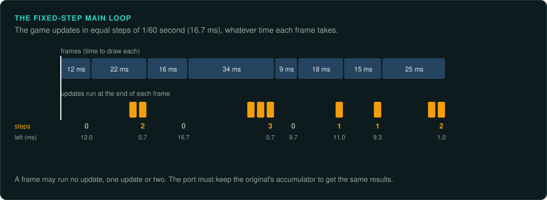

`WinMain` → engine set-up → a loop that, each frame, reads input, updates the game, draws, and
presents. Find it from the entry point, or from `PeekMessage`/`GetMessage` (the Windows message
pump sits inside it) and the present call (`IDirect3DDevice9::Present`, `IDXGISwapChain::Present`,
`SwapBuffers`).

- **Fixed step:** the update runs at a constant rate (often 30 or 60 per second) and an
  accumulator decides how many steps a frame runs. Game speed settings usually multiply the
  number of steps, not the step size. Reimplement the accumulator exactly, because the number of
  steps per frame changes the game's results.
- **Variable step:** the update takes the frame time (`dt`). Exact replay is then impossible
  without recording `dt`; tests feed a fixed `dt`.
- **Loop objects:** engines often have a stack or state machine of loops (menu, loading, game),
  each with load, start, update, draw, input and stop methods in a vtable.

The order of systems inside one update changes the results, because a later system sees the
changes an earlier system made in the same step. Record the order early, in a table, from the
update function's callees.

## Random number generators


Random number generators are usually small and self-contained. Emulate them first.

| Kind | How to recognise it |
|---|---|
| LCG (MSVC `rand`) | `state = state * 214013 + 2531011; return (state >> 16) & 0x7fff` |
| LCG (glibc, Java, numerical recipes) | multipliers 1103515245, 0x5DEECE66D, 1664525 |
| xorshift | `x ^= x << 13; x ^= x >> 17; x ^= x << 5` and variants |
| Mersenne Twister | a 624-word state, the constant 0x9908B0DF, tempering masks 0x9D2C5680, 0xEFC60000 |
| WELL, PCG, SplitMix | constants such as 0x5851F42D4C957F2D (PCG), 0x9E3779B97F4A7C15 (SplitMix) |
| LCG (Borland C, Turbo Pascal and Delphi) | multipliers 22695477 (Borland C) and 134775813 (`0x08088405`, Pascal `Random`) |

`tools/triage/constants.py BINARY` searches a binary for these constants and many others
(checksums, hashes, decompressors). In 16-bit code it also finds a 32-bit constant loaded as
two 16-bit halves. The address of a hit is the place to start reading.

Games often have several generators (one for the simulation, one for effects or sound) and
may seed them from the clock. Find every instance and who draws from each. A draw from the wrong
generator changes the results as much as a draw out of order. Helpers built on the generator (a float in [0,1), a
range, a "tolerance" around a value) each have their own rounding; emulate them too.

## Entities and components

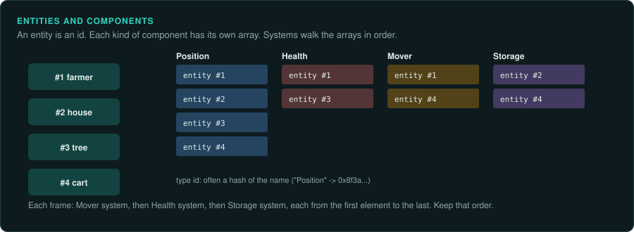

- **Class hierarchies:** `Entity` → `Unit` → `Soldier`, with behaviour in virtual methods.
  Recover the hierarchy from vtables (shared early slots) and RTTI.
- **Entity-component systems:** an entity is an id or a small object holding a list of
  components; each component type has a type id (often a hash of its name) and a vtable with
  lifecycle slots (create, attach, update, serialize, destroy). Systems iterate components of
  one type in a fixed order. Keep that order in the reimplementation.
- **Handles:** an index plus a generation counter, packed into 32 or 64 bits.

## Update order

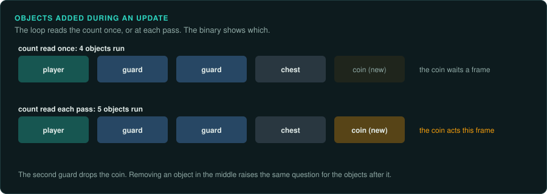

A game updates its objects one at a time, even when they seem to act together. The small
decisions around that loop decide what the player sees. Every one of them is in the binary,
and a port must copy each.

| Decision | What changes with it | Where to find it |
|---|---|---|
| An object added during the update | Whether it acts in the frame it was made. A loop that reads the count once at the start stops before new objects. A loop that compares with the current count each pass reaches them | Where the loop reads the count: before the loop or at each test |
| An object removed during the update | Whether the next object is skipped. Removal by moving the last object into the gap changes the order of all later passes. Marking the object dead and removing it after the loop keeps the order | The remove function: a copy from the last slot, a shift of the array, or a flag |
| State read by other objects | Whether object B sees A's new state or the state from the last frame. A double-buffered game writes into a second copy and swaps after the loop | Two copies of the same structure, and a swap or copy at the end of the frame |
| A pool of fixed size | Which slot a new object takes, and so its id and its place in the update order. A free list reuses the last freed slot first. A scan reuses the lowest free slot | The allocate function. The full case matters too: refuse, remove the oldest or quietest, or grow |
| An event or message queue | Whether a reaction happens at once or at a later point in the frame. Events sent while the queue is processed may run in the same pass or the next one. Listeners run in the order they registered | The send function: a direct call, or a write into a ring buffer read later |
| A value cached with a dirty flag | When the value is computed again: when it is read, or at a fixed point in the frame. If the computation uses random numbers or rounds floats, the moment matters | A flag set by the setters and tested before the computation |
| Groups updated in turn | Whether a rider sees its vehicle's new position. Some engines update objects in groups (buckets): vehicles and platforms, then characters, then objects attached to them. An object read by one in an earlier group is a frame behind | A loop over a short list of lists, or several update passes with a group number |
| A spatial grid | The order of objects found near a point: the order of the cells, then the order within each cell. A list that adds at its head returns objects in reverse order of insertion | The query function's loops, and how objects are linked into a cell |

Record each decision with the address that shows it. A port that gets one of these wrong can
look right for minutes, then drift once an object dies in the middle of a frame.

## Resources and data

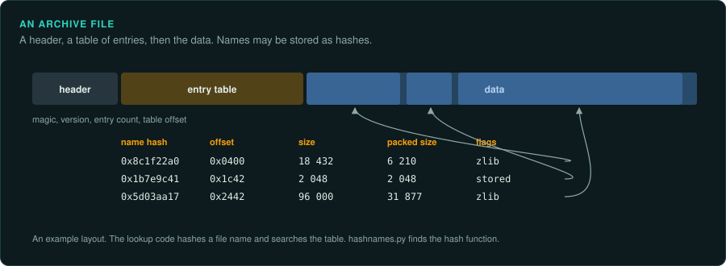

- **Packages:** an archive (header, entry table, data), possibly compressed per entry. Entry
  names may be stored as hashes; the hash function is in the lookup code.
- **Type ids by hash:** a CRC32 or FNV-1a of the class name, sometimes of the name in UTF-16.
  Compute candidates from strings in the binary and match them against the constants in the
  registration table.
- **Serializers:** a `Serialize(Stream&)` or `Load(Reader&)` per class, base class first, with
  version checks. The same function often both reads and writes, depending on a flag in the
  stream.
- **Scripts and tables:** rules may live in data (XML, JSON, Lua, custom binary tables) rather
  than code. Read the data before reimplementing a rule by hand.
- **Types defined in data:** a monster or building type is often a record in a data file, with
  a parent type for the values it does not set. Many loaders copy the parent's values into the
  child once, when the file is read. Two details then become rules of the game. A loader that
  treats 0 or an empty string as "not set" gives the parent's value to a child that set 0. The
  order the loader reads the types decides which parent values exist yet. Copy both.
- **Start-up order:** an engine starts its subsystems in a fixed order, usually by explicit
  calls from `main` or the engine's start function. A subsystem that reads another's value
  before that one has started sees a default value. That is the original's behaviour. Copy the
  order from the start function's calls.
- **Tables in place of maths:** sine and cosine tables, square roots, reciprocals, distances.
  The table decides the result, including its rounding and how the angle becomes an index.
  Copy the table from the binary, and copy the index arithmetic.
- **Actors as coroutines:** some games give each actor or script its own small stack. The actor
  runs until it waits for something, then saves its stack pointer and switches to the next
  one. In the code, a `mov` into `esp` or `sp` from an object's field marks the switch. The
  order in which the actors are resumed is their update order.
- **Objects made from a template:** a spawner can copy a whole template object, then change a
  few fields. Every field the template holds, including counters and timers, starts with the
  template's value. The port must copy all of them.

## Time

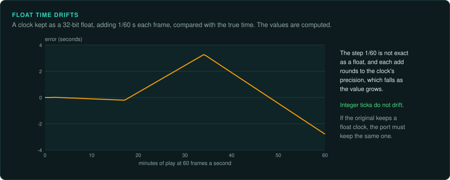

Games keep time as integer ticks (milliseconds or microseconds) or as float seconds, and the
calendar of a simulation (days, seasons, years) is derived from it. Float time gathers
rounding error. If the original keeps time as a float, the reimplementation must do the same.

Many games keep more than one clock. Real time drives the menus, the cursor and the sound.
Game time drives the simulation. It stops when the game is paused and runs faster or slower
with the speed setting. The game loop keeps running while game time is stopped. Record which
clock each system reads. A port that pauses the whole loop stops animations that the original
kept running.

Use the game's own calendar and its own names. A game's year may have twelve "months" that are
seasons (Early Spring to Late Winter), or eight, or none; its tenth month is not October. Read the names from the game's string tables. Use them in docs, tests and examples.

## Physics

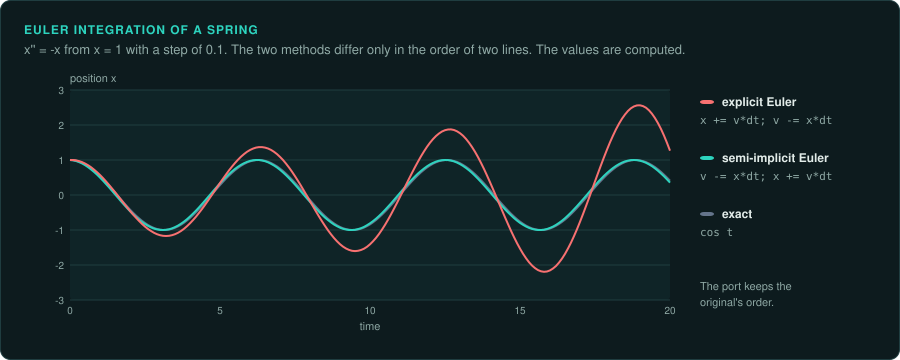

Movement, collisions and forces run in a fixed order of small steps. The port must take the
same steps in the same order with the same numbers, or objects drift apart within seconds.

| Integrator | How to recognise it | What changes the result |
|---|---|---|
| Explicit Euler | Position updated from the old velocity, then velocity from the acceleration | Swapping the two lines gives semi-implicit Euler, a different result |
| Semi-implicit (symplectic) Euler | Velocity updated first, then position from the new velocity | The order of the two updates |
| Verlet | The new position from the current and the previous position, with no velocity stored | Where the previous position is kept, and how a changing time step is handled |
| Runge-Kutta (fourth order) | Four evaluations of the forces per step, combined with weights 1/6, 1/3, 1/3 and 1/6 (the constants 0.5 and 0.1666) | Each evaluation's time and state |

- **The time step.** A fixed step (often 1/30 or 1/60 of a second) repeats the same results
  every run. A variable step follows the frame time, and the results depend on the machine.
  Look for the step in the main loop ([The main loop](#the-main-loop)). A port that must
  replay recordings needs the original's steps exactly.
- **Sub-steps.** Many games split each frame into several physics steps. Count them.
- **Collision order.** Pairs of objects are tested and resolved in an order: by list, by grid
  cell, or after sorting along an axis (sweep and prune). Resolving A against B before C
  against B gives different positions from the reverse. Record the order and the sort.
- **Iterations.** Solvers for stacked or jointed objects repeat a fixed number of times. The
  count is part of the rule.
- **Angles as integers.** Many games store an angle as a fraction of a full turn, not in
  degrees or radians. Doom uses 32 bits for one turn, so an angle wraps by itself when it
  overflows. The PlayStation's geometry hardware uses 4096 units for one turn. 8-bit and 16-bit
  games often use 256. A shift turns the angle into an index into a sine table. Keep the
  original's unit and its wrap. A port that converts to floating-point radians rounds
  differently and drifts.
- **The order of rotations.** Yaw, pitch and roll give different results depending on the
  order they are applied. Read the order from the code that builds the matrix, and from which
  sine and cosine meet in each element. Quaternions and matrices give the same rotation in
  theory, but each conversion rounds. Keep the form the original stores, and convert where it
  converts.

## Passwords, level codes and cheat codes

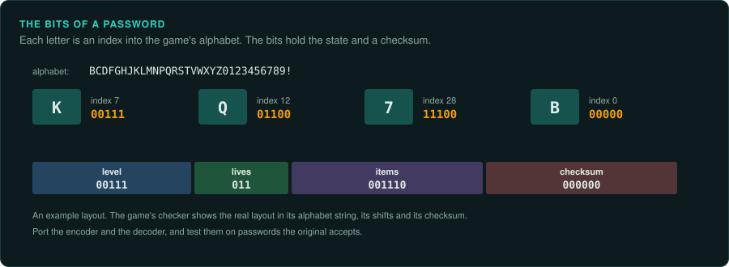

Before memory cards and save files, many games gave the player a password to continue from a
level. The password encodes the game state: the level, the lives, the items, often with a
checksum so that a typed password can be checked. Cheat codes are input sequences, compared
with a table as the player types.

- **Find the checker.** Look for the code that runs after the player enters a code: a loop
  over the typed characters, a lookup in an alphabet string ("BCDFGHJKLMNPQRSTVWXYZ0123456789"
  and similar), bit shifts that pack values, and a comparison with a checksum.
- **Port the encoder and the decoder.** The port must accept every password the original
  accepts, and give the same password for the same state. Port both directions with their bit
  layout and their checksum, and test them against passwords from the original.
- **Measure, then generate.** Run the checker in an emulator ([re-emulate](../.claude/skills/re-emulate/SKILL.md))
  with chosen codes to confirm the layout. A checker with a small key space can be run over
  every code. A checker that is a set of equations can be solved with a solver such as Z3 or
  angr, which find the inputs that pass. The original's accepted codes become the port's test
  cases.
- **Cheat codes.** Find the input buffer and the table it is compared with. List every entry.
  A port keeps them, as they are part of the game.

## Messages and text

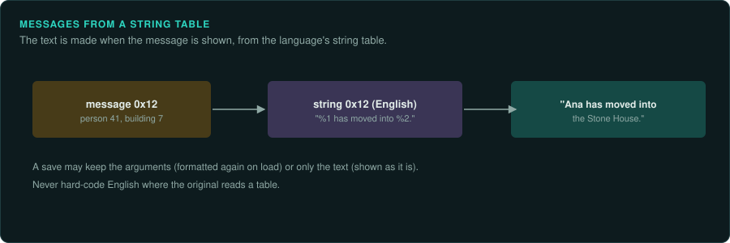

Event logs, notifications and tooltips usually store a message type and its arguments (a
person, a building, a number), and format the text from a string table when it is shown. Saves
may keep only the formatted text. A reimplementation that keeps the arguments formats the text
the same way; one that loads a save shows the stored text as it is. Text in the player's
language comes from data, so never hard-code an English string where the original reads a
table.

## Saves


A save is the serialized world: often the same serializers as the data files, plus the random
generator states, the clock, and object references written as indices or ids. Pointers between
objects need a fix-up pass on load. Loading a real save is the best test of a reimplementation,
because a save holds the state of every system.

## Rendering and UI

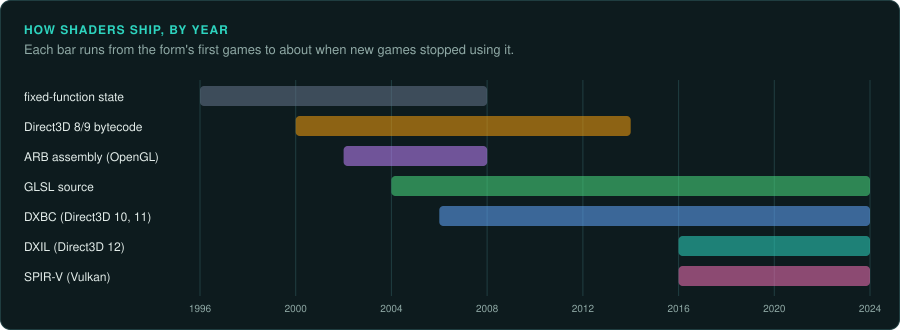

- Shaders ship compiled (DXBC for Direct3D 9-11, DXIL for 12, SPIR-V for Vulkan): disassemble
  them (fxc's `/dumpbin`, `dxc -dumpbin`, `spirv-dis`) to read the maths. Check constant buffer layouts against the CPU code that fills them.
- UI is often custom code in older games and data-driven in newer ones (layouts in data files,
  a widget tree, events by id), with screens as loop objects. See
  [Capturing the interface](observe/ui.md).
- Frame capture tools (RenderDoc, PIX, apitrace) show the draw calls, their states and the
  constant values of a real frame. A capture is the fastest way to understand a rendering pass.

## Networking (if any)

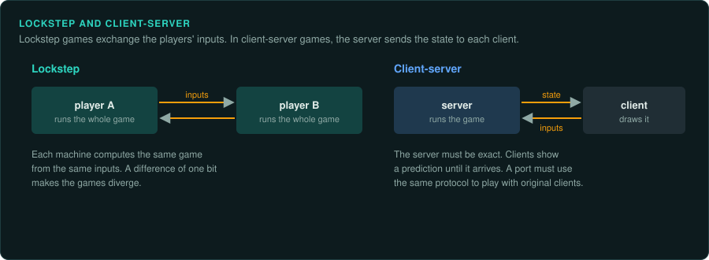

Messages are usually serialized with the same stream classes as saves. Lockstep games send only
inputs and depend on exact determinism; client-server games send state. Never test against a
live service without its owner's permission.

If you add lockstep multiplayer to a single-player game, look for state that belongs to one
player but is read by the simulation: settings, unlocked achievements, difficulty options, the
local clock, the window size. Two players with different values then compute different game states.
Give every player the same values for a shared game (for example, count achievements from none in multiplayer). Check with digests that two players stay identical.
