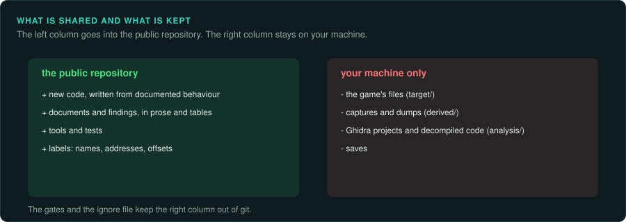

# Working within the law and with respect for the original

This is practical guidance, not legal advice. Laws differ between countries; before you publish a
project, ask a lawyer who knows software law where you live.

These are GameFrame's defaults and the reasons for them. The user decides what their own
project does. An agent gives this advice when it bears on a choice. Then it follows the user's decision ([The user decides](working/agents.md#the-user-decides)).

## What GameFrame assumes

- **You own a legitimate copy of the game.** You analyse it on your own computer.
- **Nothing from the game is redistributed.** Binaries, data files, extracted art, sound, text,
  saves, decompiled code and disassembly stay on the local machine, in folders git ignores.
- **The result is new work.** A reimplementation is written from your understanding of the
  behaviour, recorded in your own words, not translated from decompiled code. Documents describe
  findings in prose, tables, addresses and constants.
- **Players bring their own copy.** A reimplementation reads the player's game files at run
  time, as projects such as OpenRCT2, OpenMW, DevilutionX and Un-Banished do.

## Why each default exists

| Default | Reason |
|---|---|
| Keep game files and extracted assets out of git | They are the copyright holder's work; distributing them is infringement, whatever the purpose |
| Keep decompiled code and disassembly out of git | Decompiled code is a derivative of the original program; publishing it can infringe. It is also hard to read |
| Describe behaviour in your own words | Facts about how a program behaves (a formula, a file layout, a constant) are generally not protected the way expression is; describing them in your own words avoids copying the original's expression |
| Cite the original function for every finding | Anyone can check the finding against the original. The citation also shows that the reimplementation came from analysis rather than a leak |
| Leave protection and online services alone | Circumventing copy protection is restricted in many places (for example the DMCA in the US and the EU Copyright Directive), even when the purpose is lawful; online services also have terms you agreed to |

## Interoperability

Many legal systems allow reverse engineering for interoperability (for example Article 6 of the
EU Software Directive, and US case law such as Sega v. Accolade and Sony v. Connectix), within
limits. A game's end-user licence may say otherwise; whether such a clause holds depends on the
country.

The rules differ a great deal between countries. Some allow decompiling only for interoperability. Others give it no express cover. [Your own copy and the law](preservation/law/README.md)
summarises 35 countries, with one page per region.

## Clean room, or not

A *clean-room* reimplementation separates the people who study the original from the people
who write the new code: one group writes a specification, the other implements it without
seeing the original. It gives the strongest legal protection but needs two separate groups. When the
same agent studies and writes (as in Un-Banished), say so in the project's documents. Then follow the defaults above: no copied code, findings in your own words, every claim traceable to evidence.

## Respect

Credit the original developers. Point players to where they can buy the game. Take down
anything a rights holder reasonably objects to, and talk to them: many developers welcome
preservation and modding work that keeps their game playable.
