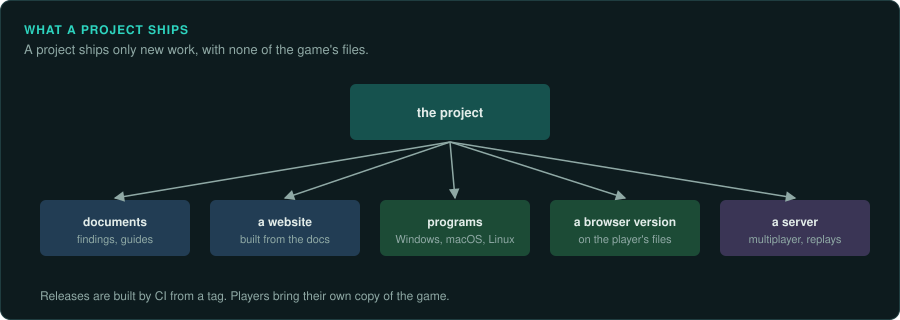

# What a project can ship

This page lists what a project can give to
players and to other developers, and how to build and publish each one. Nothing here ever
contains the game's own files: every output reads the player's own copy (see
[LEGAL.md](LEGAL.md)).

## Findings

- **Documents** in `docs/`, in the evidence style of `re-land`: formats, rules, constants, with
  addresses and labels. They are useful on their own to modders and to other projects.
- **A website** made from those documents (VitePress, MkDocs or similar), built by CI on every
  push. Pictures and short videos made by the reimplementation itself, never screenshots of the
  original's assets.
- **Readers for the formats** as a small library with no other dependencies, so modding tools
  can use them.

## A reimplementation



### Ready-made programs for each system

Most players will not build from source. A CI workflow can build the program on each system
when you release a version, and attach one zip per system to the release:

| System | GitHub Actions runner | Program |
|---|---|---|
| Windows x64 | `windows-latest` | `game.exe` |
| macOS, Apple silicon | `macos-15` | `game` |
| macOS, Intel | `macos-15-intel` | `game` |
| Linux x64 | `ubuntu-latest` | `game` |

Runner names change over time: check them with `actionlint`, which knows the current list.

A sketch of the job, run after the release is tagged:

```yaml
binaries:
  needs: release
  strategy:
    fail-fast: false
    matrix:
      include:
        - { os: windows-latest, name: windows-x64, exe: game.exe }
        - { os: macos-15, name: macos-arm64, exe: game }
        - { os: macos-15-intel, name: macos-x64, exe: game }
        - { os: ubuntu-latest, name: linux-x64, exe: game }
  runs-on: ${{ matrix.os }}
  steps:
    - uses: actions/checkout@v4
      with: { ref: "v${{ inputs.version }}" }
    - run: cargo build --release --locked --bin game     # or your language's release build
      shell: bash
    - run: |                                              # the program, the licences, a README
        dir="game-${{ inputs.version }}-${{ matrix.name }}"
        mkdir "$dir" && cp "build/release/${{ matrix.exe }}" LICENSE* "$dir/"   # build/: new-project.sh's target-dir
        if [[ "$RUNNER_OS" == Windows ]]; then 7z a "$dir.zip" "$dir"; else zip -qr "$dir.zip" "$dir"; fi
        gh release upload "v${{ inputs.version }}" "$dir.zip" --clobber
      shell: bash
      env: { GH_TOKEN: "${{ github.token }}" }
```

Details of the job:

- **Build from the tag**, not from the branch: a release commit may be followed by a "start the
  next version" commit.
- **Put the build id in the program** (the short commit hash) so a bug report says exactly which
  build it came from.
- **Install system headers on Linux** that your libraries' build scripts need (sound: ALSA's
  `libasound2-dev`).
- **Unsigned programs:** macOS quarantines them (`xattr -d com.apple.quarantine game` allows one)
  and Windows SmartScreen warns. Say so in the zip's README. Signing needs a paid certificate
  for each system.
- **A dry run** that builds everything and keeps the zips as workflow artifacts, without tagging
  or publishing, lets you test the workflow itself.
- **No game files in the zip.** The README says how to point the program at the player's copy.

### A browser version

If the reimplementation compiles to WebAssembly, it can run in a browser on the player's own
files: the page asks for them, keeps them in the browser's storage, and never uploads them.
Host it on the project's website. Check that the browser and the desktop compute the same game
(`re-verify`, "Every platform").

### Additions to the original

A reimplementation that matches the original can still add things (multiplayer, mod support,
a debug probe). Ship one program, with the additions on by default, and a switch (for example
`--vanilla`) that turns every addition off for a run, so players can always play the original.
Keep additions still in development behind build options that no release uses (`re-port`,
"Additions the original does not have").

### A server

When the core runs without a window (`re-port`, "Build it so it can be checked"), the same code
can be a multiplayer server or a headless simulator. Ship it as a program and as a container
image (a Dockerfile in the repository).

## Tools for players and modders

Small programs that need only the format readers: a mod manager, a save viewer or editor, an
asset viewer, converters. Each one is a separate program with its own README.

## Releasing

A version is a commit, a tag and a changelog section. Automate it in one workflow, started by
hand: check the version, run the tests, date the changelog, tag, publish the release with the
changelog section as its notes, build and attach the programs, rebuild the website. Keep the
steps that edit files in a script, so they can be tried on a scratch copy.
