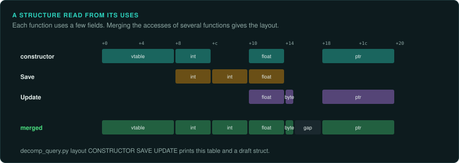
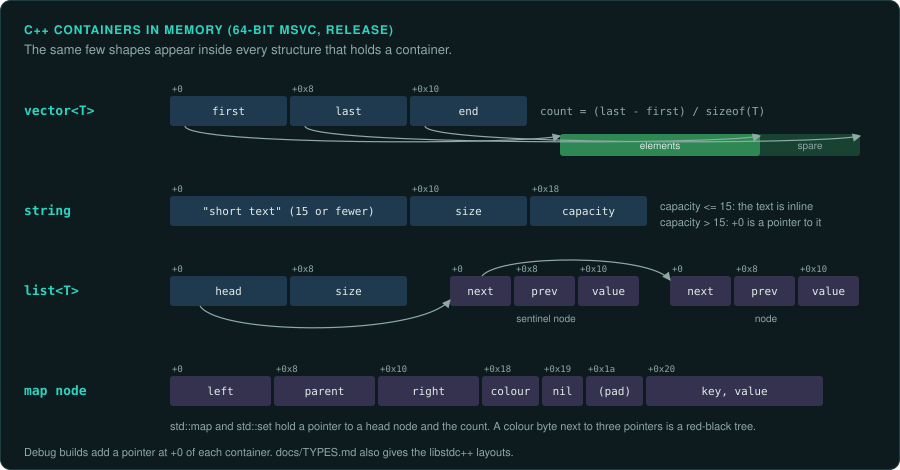

# Recovering types and data structures

A decompiler shows a function. The data it works on shows as `param_1 + 0x24`. Most of the
work of making machine code readable is giving those offsets names and types: the structures,
classes, arrays, lists and enumerations of the original program. Once a structure is named, every
function that uses it reads better at once. This page lists where type information comes from,
the shapes that common structures leave in code, and the layouts of the C++ standard
containers. Names go in `labels/fields.tsv` (structure, offset, name, type, evidence), which the
tools and the next session read.

## Where types come from

Use the best source that exists, in this order:

| Source | What it gives |
|---|---|
| Debug symbols | Everything: a PDB from a demo or a leaked build, Borland Turbo Debugger records ([DOS games](DOS.md)), DWARF in a Linux or Mac build, a linker map file. A related build with symbols (a demo, a port, a sequel on the same engine) carries over with `match_functions.py` |
| RTTI | Class names and the class tree. MSVC writes a type descriptor named `.?AVName@@` for each class with virtual functions. GCC and Clang write `_ZTS` names. Ghidra applies MSVC's RTTI on its own |
| Mangled names | Exports and imports with C++ names give each parameter's type |
| The program's own text | Assertions with expressions (`pUnit->m_health > 0`), log messages that print fields (each `%d`, `%u`, `%f`, `%s` or `%p` in the format string gives the type of one argument), serialisers that write field names to text files, script bindings that register fields by name |
| Data files and saves | A record in a file is often the structure in memory, written whole. Its layout fixes the order and sizes of the fields |
| The code | Every access to a field: its offset, its size, its type, and whether it is read or written. The rest of this page |

## Reading a structure from its uses

- **The size.** The call that allocates an object passes its size: `operator new(0x148)`,
  `malloc(0x30)`, or `size * count` for an array. A `memset` or `memcpy` of an object gives the
  size too.
- **The constructor.** It writes most fields once, in order, with their starting values. The
  first write is often the vtable pointer, which names the class. Destructors free the fields
  that own memory, in reverse order.
- **The serialiser.** A load or save function reads or writes each field in order, with its
  type: `ReadInt`, `ReadFloat`, `ReadString`. It is the best single source of the field list.
- **Every use.** `tools/triage/decomp_query.py layout FN[:VAR] ...` collects the accesses to one
  pointer in several functions, and prints each offset with its sizes, types, reads, writes and
  users, then a draft structure with the gaps marked. Give it the constructor, the serialiser
  and the main users. Ghidra's own "Auto Create Structure" does the same for one function.
- **Two types at one offset.** A field read as both `float` and `int` is a union, a value copied
  as raw bits, or a decompiler guess. A field read as a byte and as a word may be a set of flags.

## Shapes in the code

| Structure | What it looks like |
|---|---|
| Array of structures | An index multiplied by the structure's size (`imul`, or `lea` and shifts for sizes like 12 or 24) and added to a base. The size is the stride |
| Several parallel arrays | The same index into several bases, each scaled by its own element size |
| Linked list | A loop that loads a pointer from a fixed offset of the current node until it reaches null. The offset is the `next` field |
| Tree | Two child pointers and often a parent pointer, with a loop going left or right by a comparison. A colour byte next to them makes it a red-black tree |
| Hash table | A hash of the key, reduced by `%` or `&` with the bucket count, an index into an array of bucket heads, then a list walk comparing keys |
| Bit fields and flags | A shift and a mask (`(x >> 5) & 7`), or tests of single bits. Name each bit |
| Tagged union | A switch on one field, with each case reading the same later offsets as different types |
| Enumeration | Comparisons with small constants, switches, and tables indexed by the value (often a table of name strings, which names every value) |
| Fixed point | Shifts by 8, 12 or 16 after multiplications, and multiplications by 256 or 65536 ([Compiled code](COMPILED-CODE.md)) |
| String | A pointer passed to string functions, or a small buffer passed with its size |
| A header before the data | Reads at negative offsets from a pointer (`[eax-4]`). The pointer points past a header: an allocator's block size, a string's length or reference count, an array's element count. Pascal code can also point one element before an array so that indices start at 1 |

## The C++ standard containers

Games written in C++ use the standard library's containers, and their layouts repeat in every
structure that holds one. These are the release-build layouts of 64-bit programs. A 32-bit
build has the same fields with 4-byte pointers. Check the layout for your compiler with a small
test program built with the same compiler version.

| Container | Microsoft (MSVC 2015 and later) | GNU (libstdc++) |
|---|---|---|
| `std::vector<T>` | Three pointers: first element, one past the last, end of the capacity. The count is `(last - first) / sizeof(T)` | The same three pointers |
| `std::string` | A 16-byte union (the text itself when it is 15 characters or fewer, else a pointer to it), then the length and the capacity: 32 bytes. A capacity above 15 means the pointer is in use | A pointer, the length, then a 16-byte buffer for short text: 32 bytes. Before GCC 5, one pointer to the text, with the length, capacity and reference count stored just before the text |
| `std::list<T>` | A pointer to a sentinel node, then the count. Each node: next, previous, value | The sentinel node itself, then the count |
| `std::map`, `std::set` | A pointer to the head node, then the count. Each node: left, parent, right, a colour byte, an "is sentinel" byte, then the value | The header node inside the container, then the count. Each node: colour, parent, left, right, then the value |
| `std::unordered_map` | A list of all the elements, then a vector of bucket pointers, a mask and a maximum index | An array of bucket pointers, the bucket count, a list head, the count, and the rehash policy |
| `std::shared_ptr<T>` | Two pointers: the object and its control block (the counts) | The same |
| `std::unique_ptr<T>` | One pointer | One pointer |

Debug builds of MSVC programs add a pointer at the start of each container for iterator
checking, which moves every field by 8 bytes. Older compilers have their own layouts: Visual C++
6.0 programs from the late 1990s use a different `std::string`. A game's own containers, which
many engines wrote to avoid the standard library, have their own layouts: find them with
the shapes above.

## Dates and times in data

Saves, archives, high-score tables and replays often hold a date. The load menu shows it, or the
game uses it to order saves. The port must read and write the same form.

| Form | Size | Counts from | Seen in |
|---|---|---|---|
| Unix time | 4 or 8 bytes | seconds since 1970-01-01 | C `time_t`. A 32-bit value ends in January 2038 |
| Unix milliseconds | 8 bytes | milliseconds since 1970-01-01 | Java, JavaScript, many engines' save headers |
| FILETIME | 8 bytes | 100 ns units since 1601-01-01 | Windows file times, `GetSystemTimeAsFileTime` |
| SYSTEMTIME | 16 bytes | eight 16-bit fields: year, month, weekday, day, hour, minute, second, ms | Windows saves that store `GetLocalTime`'s result whole |
| DOS date and time | 2 + 2 bytes | year from 1980 in 7 bits, month, day; hour, minute, seconds halved | FAT, ZIP, DOS games' saves |
| HFS | 4 bytes, big-endian | seconds since 1904-01-01 | Classic Mac OS files and games |
| OLE `DATE` | 8-byte float | days since 1899-12-30 | Windows COM, MFC `COleDateTime` |
| ISO 9660 | 7 bytes | years since 1900, then month, day, hour, minute, second, time zone | CD directory records |

To find one, save the game, note the time, and run `tools/triage/dates.py SAVE --near
2026-10-22T14:30`. It reads every offset in each form and lists the values within a day of that
time. Save again a few minutes later. The offset whose value moved by those minutes is the
date. Check whether the game stores local time or UTC. Their difference is the time zone.

## Working through a program

1. Apply what exists: symbols, RTTI, known library structures. In Ghidra, parse a header
   of the library's types when you have one (DirectX, Windows, the C runtime).
2. Pick the structures that matter most: the ones passed to the most functions, and the ones
   behind the values you are porting.
3. For each, gather its constructor, serialiser and users, run `layout`, and write the
   structure in Ghidra's data type manager. Apply it to the parameters and globals that point
   to it. Re-export, and the pseudocode reads `unit->health` in every function.
4. Name each field from evidence (a string, a saved value, a value watched in memory), and
   record it in `labels/fields.tsv` with the evidence.
5. Leave unknown fields as `field_24`, never as a guess presented as a fact.

The port takes the types it needs, with the same sizes and signedness. Where the original
writes a structure to a file or reads it raw, the port must also keep its exact layout,
including padding.
