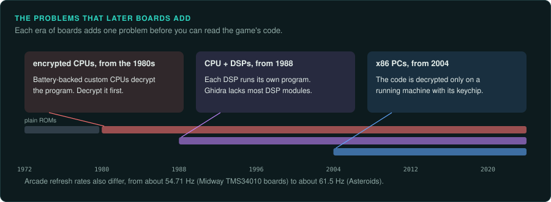

# Arcade games

This section covers arcade boards from discrete logic to the PC-based systems. Each page covers
one era or one family of boards. Many boards were built for one game or a few games. The MAME
driver source for a board lists its chips, its crystals, its clock dividers and its screen
timing. It usually gives more detail than any other public source.

## Across all boards

- [Practices for arcade work](practices.md): MAME driver source, machine flags, ROM sets and
  CHD, NVRAM and DIP settings as test inputs, attract mode, input recording, refresh rates and
  frame drift.
- [Encryption and protection](protection.md): suicide batteries, the Sega, Capcom, Konami and
  SNK ciphers, protection MCUs, Phoenix sets and desuicide work.

## 2D boards

- [Discrete logic and the 8080](discrete-and-8080.md): Pong, Breakout and Space Invaders.
- [Z80 and 6502 boards](z80-and-6502-era.md): Galaxian, Pac-Man, Galaga, Donkey Kong,
  Asteroids, Sega System 1, the VS. System and the PlayChoice-10.
- [Williams and Midway](williams-and-midway.md): the Williams 6809 boards, the Midway Y, T
  and W-units, and Midway Zeus.
- [Atari coin-op boards](atari-coin-op.md): Atari System 1, System 2, Hard Drivin' and GT.
- [Sega 2D boards](sega-2d.md): System 16B, System 18, the X Board and the Y Board.
- [Capcom CPS](capcom-cps.md): CPS-1, CPS-2 and CPS-3.
- [Neo Geo](neo-geo.md): the MVS and the AES.
- [Other 2D makers](other-2d-makers.md): Namco System 1 and 2, Konami, Taito F2 and F3, Irem
  M72 and M92, Data East, Toaplan and Cave.

## 3D, console-derived and PC boards

- [Early 3D boards](early-3d.md): Namco System 21 and 22, Sega Model 1, 2 and 3, Taito JC,
  Konami GTI Club and Hornet, and Gaelco 3D.
- [Console-derived boards](console-derived.md): ZN-1 and ZN-2, Namco System 11 and 12,
  ST-V, NAOMI, Atomiswave, Triforce, Chihiro, System 246 and the Bemani boards.
- [PC-based boards](pc-based.md): the Taito Type X family, Sega Lindbergh, RingEdge to ALLS
  and Namco ES1 and ES3.

## How arcade work differs from console work

A console has one hardware design for every game. An arcade board was often built for one game
or for a short run of games. Each board family has its own memory map, clocks and protection.

Arcade refresh rates are rarely 60 Hz. They run from about 54.71 Hz on Midway's TMS34010
boards to about 61.5 Hz on Atari's Asteroids. A port must run at the board's own rate to stay
in step with a recording of the original. The [practices page](practices.md#refresh-rates-and-frame-drift)
has the table.

Later boards add three problems.

1. From the 1980s, many boards use battery-backed custom CPUs that decrypt the program. A
   disassembly of the raw ROM is unreadable until you decrypt it with the CPU's method.
2. From 1988, 3D boards split the game across a main CPU and one or more DSPs. Each DSP runs
   its own program. Ghidra has no built-in module for most of those DSPs.
3. From 2004, the boards are x86 PCs. The game code is decrypted only on a running machine
   with its keychip.

## Order of work

1. Read the MAME driver for the board. Note the clocks, the screen totals and the machine
   flags.
2. Decrypt the program wherever the board has a custom CPU, before any disassembly
   ([protection](protection.md)).
3. On a 3D board, capture the DSP programs too. They hold part of the game.
4. Record the DIP settings, the BIOS, the region and the NVRAM image with every test case
   ([practices](practices.md#nvram-and-dip-settings-as-test-inputs)).
5. Check MAME's flags before using it as ground truth. If MAME does not run a game, take
   ground truth from another emulator or from owned hardware.

## Page layout

Each family page opens with one short paragraph and a table that compares its boards. Then it
has one section per board. Each board section has the same headings in the same order.

1. **Hardware**: the years, the CPUs and clocks, the sound chips, the screen timing.
2. **Protection**: encryption, protection MCUs and key chips.
3. **Tools**: MAME status, Ghidra and Unicorn support, other emulators.
4. **Projects to learn from**: disassemblies, source releases and re-releases.
5. **For an exact reimplementation**: what to settle before porting.

A refresh rate marked "(computed)" is the pixel clock divided by the horizontal and vertical
totals in the MAME driver. It comes from MAME's model of the board. It is not a separate
measurement. A fact marked "(not confirmed)" has one source and lacks a second. A fact marked
"(secondary source)" comes from a forum, a wiki copy or a press report. MAME's flags and entry
counts change with each release.

Encryption and protection are described factually. The law on working around them differs by
country ([Legal](../LEGAL.md), [the law worldwide](../preservation/law/README.md)). You decide
which route to take.

## Related pages

- [CPU families](../computers/cpu-families.md): byte order, Ghidra and Unicorn support, and
  arithmetic traps for the Z80, 6502, 6809, 68000, x86, SuperH, MIPS and PowerPC.
- [Tools for console work](../consoles/tools.md) and
  [matching decompilation](../consoles/matching-decomp.md).
- [Sound](../hardware/sound.md) and [running the original](../observe/running-the-original.md).
- The skills for each step: [re-inventory](../../.claude/skills/re-inventory/SKILL.md),
  [re-observe](../../.claude/skills/re-observe/SKILL.md),
  [re-ghidra](../../.claude/skills/re-ghidra/SKILL.md),
  [re-emulate](../../.claude/skills/re-emulate/SKILL.md),
  [re-port](../../.claude/skills/re-port/SKILL.md) and
  [re-verify](../../.claude/skills/re-verify/SKILL.md).
