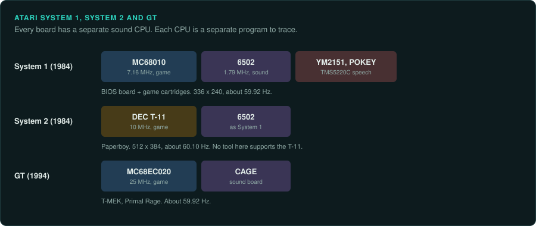
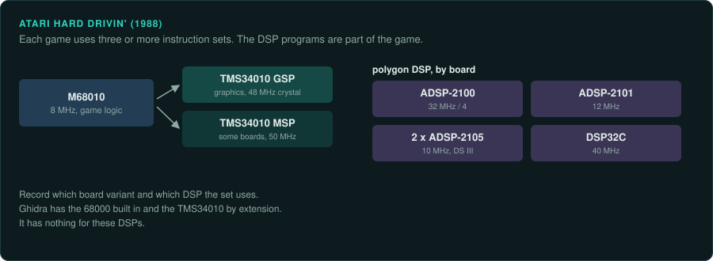

# Atari coin-op boards

Atari moved from the 6502 to the 68000 family and to other CPUs. System 1 is a BIOS board with
game cartridges. System 2 uses a DEC T-11, which no disassembler listed here supports. The GT
board runs a 68EC020. Each Hard Drivin' game runs on a 68010, TMS34010s and polygon DSPs.
The 6502 vector games are on the
[Z80 and 6502](z80-and-6502-era.md#atari-asteroids-and-the-vector-games) page.

| Board | Years | Main CPU and clock | Sound | Refresh | Protection | MAME status | Ghidra |
|---|---|---|---|---|---|---|---|
| Atari System 1 | 1984 | MC68010 at 7.16 MHz | 6502 at 1.79 MHz, YM2151, POKEY, TMS5220C | about 59.92 Hz (computed) | None listed | In MAME | 68000 built in |
| Atari System 2 | 1984 | DEC T-11 at 10 MHz | As System 1 | about 60.10 Hz (computed) | None listed | In MAME | None for the T-11 |
| Atari Hard Drivin' | 1988 | M68010 at 8 MHz | Not covered here | Not covered here | None listed | 55 entries, one not working | 68000 built in; extension for the TMS34010; none for the DSPs |
| Atari GT | 1994 | MC68EC020 at 25 MHz | CAGE board | about 59.92 Hz (computed) | None listed | In MAME | 68000 built in |

## Atari System 1

### Hardware

System 1 (1984) is a BIOS board plus game cartridges. Its first game was Peter Pack Rat. It
uses an MC68010 at 7.16 MHz. A 6502 sound CPU runs at 1.79 MHz with a YM2151, a POKEY and a
TMS5220C speech chip. Its screen is 336 by 240 visible at about 59.92 Hz (computed)
([MAME: atari/atarisy1.cpp](https://github.com/mamedev/mame/blob/master/src/mame/atari/atarisy1.cpp)).

### Protection

None listed.

### Tools

- Ghidra's built-in 68000 module covers the MC68010. Unicorn's M68K backend runs it
  ([CPU families](../computers/cpu-families.md#the-68000)).
- The 6502 sound CPU has a Ghidra module and no Unicorn backend.
- The [re-emulate](../../.claude/skills/re-emulate/SKILL.md) skill covers Unicorn ground truth.

### Projects to learn from

None listed yet.

### For an exact reimplementation

- The ROM set includes a BIOS set. Record which BIOS each test uses
  ([practices](practices.md#rom-sets-and-chd)).
- Treat the 6502 sound program as a second program to trace.

## Atari System 2

### Hardware

System 2 (1984) ran Paperboy. It uses a DEC T-11 at 10 MHz with the same sound chips as
System 1. Its medium-resolution screen shows 512 by 384 at about 60.10 Hz (computed)
([MAME: atari/atarisy2.cpp](https://github.com/mamedev/mame/blob/master/src/mame/atari/atarisy2.cpp)).

### Protection

None listed.

### Tools

The DEC T-11 is related to the PDP-11. Ghidra's bundled processors and Unicorn's architectures
do not include it. Use MAME to produce ground truth.

### Projects to learn from

None listed yet.

### For an exact reimplementation

- Plan for a T-11 disassembler or a small core. Neither tool listed here supports the CPU.

## Atari Hard Drivin'

### Hardware

Hard Drivin' (1988) runs an M68010 at 8 MHz from a 32 MHz crystal. Graphics run on a TMS34010
"GSP" from a 48 MHz crystal. Some boards add a second TMS34010 "MSP" at 50 MHz. The polygon
DSPs differ by board
([MAME harddriv.cpp](https://github.com/mamedev/mame/blob/master/src/mame/atari/harddriv.cpp);
[MAME harddriv.h](https://github.com/mamedev/mame/blob/master/src/mame/atari/harddriv.h)).

- An ADSP-2100 at 32 MHz / 4.
- An ADSP-2101 at 12 MHz.
- Two ADSP-2105 at 10 MHz on the DS III board.
- A DSP32C at 40 MHz on some boards.

### Protection

None listed.

### Tools

- The driver holds 55 entries, starting with "Hard Drivin' (cockpit, rev 7)". One has
  MACHINE_NOT_WORKING.
- Ghidra's 68000 module covers the 68010. The
  [Ghidra_TMS34010](https://github.com/ZPaul2Fresh8/Ghidra_TMS34010) extension covers the GSP
  and MSP. Ghidra has no built-in module for the ADSP-21xx or the DSP32C.

### Projects to learn from

None listed yet.

### For an exact reimplementation

- Expect three or more instruction sets per game. The game logic usually runs on the main CPU.
  A port must also reproduce the DSP programs ([early 3D boards](early-3d.md)).
- Record which board variant and which DSP the set uses.

## Atari GT

### Hardware

The GT board (1994) ran T-MEK and Primal Rage. It uses an MC68EC020 at 25 MHz. Sound is on
Atari's CAGE board. The screen runs at about 59.92 Hz (computed)
([MAME: atari/atarigt.cpp](https://github.com/mamedev/mame/blob/master/src/mame/atari/atarigt.cpp)).

### Protection

None listed.

### Tools

Ghidra's 68000 module is a 68040 superset with 68020 and 68030 languages. Unicorn's M68K
backend runs the code.

### Projects to learn from

None listed yet.

### For an exact reimplementation

- Trace the program on the CAGE sound board separately.

## Atari source releases

The historicalsource account holds original assembly source for many Atari coin-op games:
Asteroids, Asteroids Deluxe, Battlezone, Black Widow, Centipede, Crystal Castles, Food Fight,
Gravitar, Liberator, Lunar Lander, Major Havoc (a disassembly), Millipede, Missile Command,
Pole Position, Quantum, Red Baron, Space Duel, Sprint, Star Wars and Tempest. It also has an
"atari-coin-op-assembler" repository
([GitHub: historicalsource](https://github.com/historicalsource?tab=repositories)). The
repositories give no licence or provenance statement. GameFrame's rule against game material
means a project does not copy this source into its own repository. Treat it as third-party
evidence. Use the shipped ROM for exact behaviour ([Legal](../LEGAL.md)).
