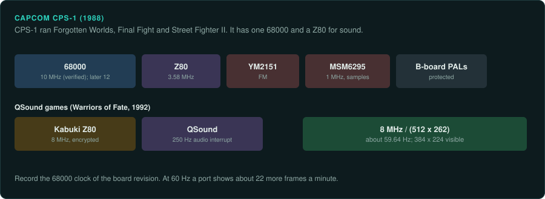
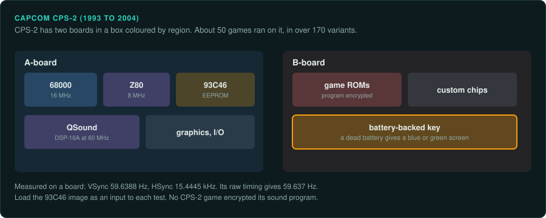
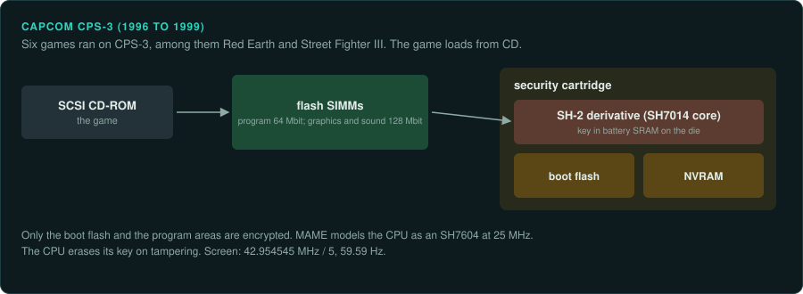

# Capcom CPS

Capcom's CP System boards ran from 1988 to 2004. CPS-1 and CPS-2 are 68000 boards with an 8 MHz
pixel clock and a refresh near 59.64 Hz. CPS-2 encrypts its program with a Feistel cipher keyed
from battery-backed RAM. CPS-3 uses an encrypted SH-2 derivative and loads its games from CD.

| Board | Years | Main CPU and clock | Sound | Refresh | Protection | MAME status | Ghidra |
|---|---|---|---|---|---|---|---|
| CPS-1 | 1988 on | 68000 at 10 MHz, later 12 MHz | Z80 at 3.58 MHz, YM2151, MSM6295; QSound on some | about 59.64 Hz (computed) | Kabuki on QSound games; protected PALs | In MAME | 68000 built in |
| CPS-2 | 1993 to 2004 | 68000 at 16 MHz | Z80 at 8 MHz, QSound DSP-16A at 60 MHz | 59.6388 Hz (measured) | Opcode Feistel cipher | In MAME | 68000 built in (after decryption) |
| CPS-3 | 1996 to 1999 | SH-2 derivative, modelled at 25 MHz | Not covered here | 59.59 Hz | Encrypted CPU on a security cartridge | In MAME | SuperH built in (after decryption) |

## CPS-1

### Hardware

CPS-1 arrived in 1988 with Forgotten Worlds. Final Fight (1989) and Street Fighter II (1991)
followed ([MAME: capcom/cps1.h](https://github.com/mamedev/mame/blob/master/src/mame/capcom/cps1.h);
[cps1.cpp](https://github.com/mamedev/mame/blob/master/src/mame/capcom/cps1.cpp)).

- The 68000 runs at 10 MHz, "verified on pcb". Later boards run it at 12 MHz.
- A Z80 at 3.58 MHz drives a YM2151 and an OKI MSM6295 at 1 MHz.
- QSound CPS-1 games, such as Warriors of Fate (1992), use a Z80 at 8 MHz with a 250 Hz audio
  interrupt.
- The screen uses an 8 MHz pixel clock with 512 by 262 totals and 384 by 224 visible. That gives
  about 59.64 Hz (computed).

### Protection

QSound CPS-1 games use the Kabuki custom Z80 for sound
([protection](protection.md#capcom)). CPS-1 B-boards use protected PALs. MAME's ROM definitions
hold images of the PAL type found on the boards. CPS-1 drivers include MAME's serial EEPROM
device.

### Tools

- Ghidra's 68000 module and Unicorn's M68K backend cover the main program
  ([CPU families](../computers/cpu-families.md#the-68000)).
- The Z80 sound program has a Ghidra module and no Unicorn backend.

### Projects to learn from

None listed yet.

### For an exact reimplementation

- Record the 68000 clock of the board revision: 10 MHz or 12 MHz.
- Run the port at about 59.64 Hz. At 60 Hz it shows about 22 more frames per minute
  ([practices](practices.md#refresh-rates-and-frame-drift)).
- On a QSound game, decrypt the Kabuki sound program first.

## CPS-2

### Hardware

CPS-2 ran from 1993 to 2004. Its first game was Super Street Fighter II. About 50 games in over
170 variants ran on it
([MAME: capcom/cps2.cpp](https://github.com/mamedev/mame/blob/master/src/mame/capcom/cps2.cpp)).

- An A-board holds the 68000, RAM, graphics, sound and I/O. It also has a 93C46 serial EEPROM.
- A B-board holds the game ROMs and custom chips.
- The boards sit in plastic boxes colour-coded by region.
- MAME runs the 68000 at 16 MHz and the Z80 at 8 MHz.
- The QSound DSP is "CAPCOM-Q1", an AT&T DSP-16A at 60 MHz.
- The driver's PCB notes give VSync 59.6388 Hz and HSync 15.4445 kHz. The sound interrupt is
  about 249.93 to 250.07 Hz.

A figure of 59.1 Hz is sometimes quoted for CPS-2. The driver's measured note says 59.6388 Hz.
Its raw timing gives 59.637 Hz (computed).

### Protection

CPS-2 encrypts its main program. Only opcodes are encrypted. The cipher is two 4-round Feistel
networks with a 64-bit key. The key is stored in SRAM inside a battery-powered custom IC. A
board with a dead battery shows only a blue or green screen. No CPS-2 game encrypted its sound
program. The [protection page](protection.md#capcom) has the cipher, the Phoenix sets and the
desuicide work.

### Tools

- Follow MAME's `cps2crypt.cpp` to decrypt the program.
- After decryption, Ghidra's 68000 module and Unicorn's M68K backend work on the program.
- Ghidra has no built-in module for the DSP-16A.

### Projects to learn from

- The CPS-2 decryption team's work in MAME, credited in the driver to Razoola and others.
- The ArcadeHacker desuicide code
  ([Hackaday: desuicide tag](https://hackaday.com/tag/desuicide)).

### For an exact reimplementation

- Use a set with the original encrypted program and its key. A Phoenix set is a modified
  program.
- Run the port at 59.6388 Hz, the measured rate.
- Load the 93C46 EEPROM image as an input to each test
  ([practices](practices.md#nvram-and-dip-settings-as-test-inputs)).

## CPS-3

### Hardware

CPS-3 ran from late 1996 to 1999 and six games were released on it. Among them are Red Earth
(1996) and Street Fighter III (1997)
([MAME: capcom/cps3.cpp](https://github.com/mamedev/mame/blob/master/src/mame/capcom/cps3.cpp)).

- The main board holds custom ASICs and 72-pin custom SIMMs of flash ROM. The program SIMMs are
  64 Mbit. The graphics and sound SIMMs are 128 Mbit.
- A SCSI CD-ROM drive loads the game.
- A security cartridge holds a boot flash ROM, NVRAM and the custom CPU.
- That CPU is an encrypted Hitachi SH-2 derivative. Decapping showed an SH7010-series (SH7014)
  core. MAME models it as an SH7604 at 25 MHz.
- The screen runs at 42.954545 MHz / 5 and 59.59 Hz.

### Protection

The SH-2 derivative decrypts the code. The key is stored in battery-powered SRAM on the CPU die.
The CPU erases the key when it detects tampering. A dead cartridge is thought to fall back to
keys identical to SFIII 2nd Impact. The data on the CD and SIMMs is not encrypted beyond the
boot flash and the program areas.

### Tools

- The CD is stored as a CHD. Extract its files with `chdman` first
  ([practices](practices.md#rom-sets-and-chd)).
- Ghidra's SuperH module holds SH-1, SH-2 and SH-2A. Unicorn has no SH-2 backend. Take ground
  truth from MAME.

### Projects to learn from

The CPS-3 driver credits David Haywood, Andreas Naive, Tomasz Slanina and ElSemi.

### For an exact reimplementation

- Decrypt the boot flash and program areas with MAME's model before disassembly.
- Run the port at 59.59 Hz.
