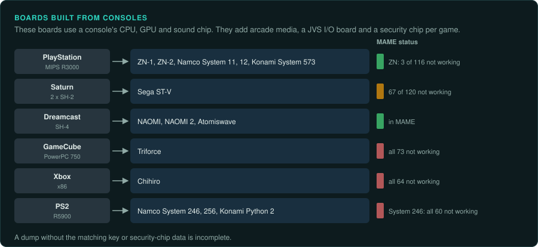
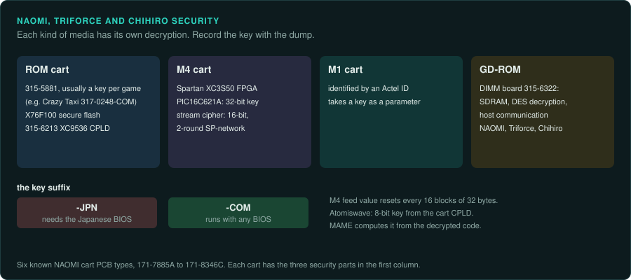

# Console-derived boards

From 1994 to about 2009 many arcade boards reuse a console's CPU, GPU and sound chip. They add
arcade media: ROM boards, GD-ROM, DVD or hard disk. They add a JVS I/O board and a security chip
per game. A dump without the matching key or security-chip data is incomplete. MAME runs the
earlier families. It runs none of the Triforce, Chihiro or System 246 entries.

| Board | Years | Main CPU and clock | Sound | Refresh | Protection | MAME status | Ghidra |
|---|---|---|---|---|---|---|---|
| Sony ZN-1, ZN-2 | Not covered here | CXD8530CQ; CXD8661R | Z80, 68000 or AT89C4051; QSound on Capcom | Not covered here | CAT702 | 3 of 116 not working | MIPS built in |
| Namco System 11 | 1994/1995 | CXD8530CQ | Not covered here | Not covered here | Per-game key chips | In MAME | MIPS built in |
| Namco System 12 | 1996 on | CXD8661R or CXD8606BQ at 100 MHz | Not covered here | Not covered here | Per-game key chips | In MAME | MIPS built in |
| Sega ST-V | 1995 | Two SH7604 at 28.6364 MHz | 68000 at 11.2896 MHz | Not covered here | 315-5881 on some carts | 67 of 120 not working | SuperH built in |
| Sega NAOMI, NAOMI 2 | 1998, 2000 | SH-4 at 200 MHz | AICA | Not covered here | 315-5881, M1 and M4 carts, DIMM DES | In MAME | SuperH4 built in |
| Atomiswave | 2003 | Not covered here | Not covered here | Not covered here | 8-bit key from the cart CPLD | In MAME | Not covered here |
| Triforce | 2002 | PowerPC 750 (MAME uses a PPC603 placeholder) | Not covered here | Not covered here | Key chips, PIC16C621A | All 73 not working | PowerPC built in |
| Sega Chihiro | 2002 | Xbox x86 | Not covered here | Not covered here | DIMM board DES on GD-ROM | All 64 not working | x86 built in |
| Namco System 246, 256, Super 256 | 2001 to 2010 | R5900 at 294 MHz | SPU2 | Not covered here | Security cart per game | All 60 not working | MIPS built in; R5900 by extension |

## Sony ZN-1 and ZN-2

### Hardware

ZN-1 and ZN-2 are "Arcade PlayStation Hardware" in MAME
([MAME zn.cpp](https://github.com/mamedev/mame/blob/master/src/mame/sony/zn.cpp)).

- ZN-1 uses a CXD8530CQ CPU on a 67.7376 MHz crystal and a CXD8561Q GPU.
- ZN-2 uses a CXD8661R on a 100 MHz crystal and a CXD8654Q GPU.
- Sound CPUs vary by licensee: Z80, 68000 or AT89C4051. Capcom uses QSound.

### Protection

Each board has a CAT702 protection chip. On the Capcom ZN-1 board it is labelled 'CP01', next to
a Capcom BIOS (COH1000C.353).

### Tools

Of 116 entries, 3 do not work. Ghidra's MIPS module and Unicorn's MIPS backend cover the CPU
([CPU families](../computers/cpu-families.md#mips)). PlayStation tools work on the code
([tools for console work](../consoles/tools.md)).

### Projects to learn from

None listed yet.

### For an exact reimplementation

- Record the licensee's sound CPU and the BIOS.
- Keep the CAT702 data with the dump.

## Namco System 11 and 12

### Hardware

System 11 (1994/1995) uses the CXD8530CQ with a Namco C76 MCU at 16.9344 MHz for I/O
([MAME namcos11.cpp](https://github.com/mamedev/mame/blob/master/src/mame/namco/namcos11.cpp)).
System 12 (1996 onward) uses a CXD8661R or CXD8606BQ at 100 MHz and an H8/3002 sub CPU
([MAME namcos12.cpp](https://github.com/mamedev/mame/blob/master/src/mame/namco/namcos12.cpp)).

### Protection

Game boards have key chips. Tekken 2 uses C406. Tekken runs on board COH-100, which has no key
chip. Ehrgeiz (1998, COH-700) uses KC021.

### Tools

As for ZN. Ghidra has no H8 module among its bundled processors.

### Projects to learn from

None listed yet.

### For an exact reimplementation

- Keep the key chip data with each dump.
- Model the C76 or H8/3002 I/O CPU as the game sees it.

## Sega ST-V

### Hardware

ST-V (1995) is Saturn-based. It has two SH7604 (SH-2) CPUs at 28.6364 MHz and a 68000 at
11.2896 MHz for sound
([MAME stv.cpp](https://github.com/mamedev/mame/blob/master/src/mame/sega/stv.cpp)).

### Protection

Some cartridges use the 315-5881 chip found on NAOMI M2 carts. Tecmo World Cup '98 is one
([MAME 315-5881_crypt.cpp](https://github.com/mamedev/mame/blob/master/src/mame/sega/315-5881_crypt.cpp)).

### Tools

Of 120 entries, 67 have MACHINE_NOT_WORKING. Ghidra's SuperH module covers the SH-2. Unicorn
has no SH-2 backend ([CPU families](../computers/cpu-families.md#superh)).

### Projects to learn from

None listed yet.

### For an exact reimplementation

- Run both SH-2s interleaved.
- Check the game's MAME flags before using it as ground truth.

## Sega NAOMI, NAOMI 2 and Atomiswave

### Hardware

NAOMI (1998) runs an SH-4 at 200 MHz from a 33.3333 MHz crystal. Its graphics are the
"VideoLogic/NEC 'CLX2/HOLLY' chipset and PowerVR2 GPU". AICA sound runs from a 33.8688 MHz
oscillator. NAOMI 2 (2000) adds a 315-6289 "VideoLogic/NEC 'ELAN' T&L coprocessor"
([MAME naomi.cpp](https://github.com/mamedev/mame/blob/master/src/mame/sega/naomi.cpp)). NAOMI
has 32 MB of main RAM, 16 MB for graphics and 8 MB for sound, with ROM boards and an optional
GD-ROM drive
([Wikipedia, List of Sega arcade system boards](https://en.wikipedia.org/wiki/List_of_Sega_arcade_system_boards)).
The filter board outputs VGA at 15 kHz or 31.5 kHz, chosen by a DIP switch.

### Protection

Sega made six known cart PCB types: 171-7885A, 171-7919A, 171-7930B, 171-7978B, 171-8132B and
171-8346C. Each cart has three security parts
([MAME naomi.cpp](https://github.com/mamedev/mame/blob/master/src/mame/sega/naomi.cpp)).

- A 315-5881, "usually different per game", with a 317-xxxx key number. Crazy Taxi, for
  example, is 840-0002C with key 317-0248-COM. In the key suffix, "-JPN means it requires
  Japanese BIOS, -COM will run with any BIOS".
- An X76F100 secure serial flash.
- A 315-6213 Xilinx XC9536 CPLD.

M4 carts decrypt with a Xilinx Spartan XC3S50 FPGA and a PIC16C621A holding a 32-bit key. The
cipher is a stream cipher on a 16-bit, 2-round SP-network with four 4-to-4 S-boxes. Its feed
value resets every 16 blocks of 32 bytes
([MAME naomim4.cpp](https://github.com/mamedev/mame/blob/master/src/mame/sega/naomim4.cpp)).
M1 carts are identified by an Actel ID. They take a key as a parameter
([MAME naomim1.cpp](https://github.com/mamedev/mame/blob/master/src/mame/sega/naomim1.cpp)).

GD-ROM games load through the DIMM board. Its 315-6322 chip handles "DIMM SDRAM controller, DES
decryption, host system communication" for NAOMI, Triforce and Chihiro. The option board
has a PIC16
([MAME naomigd.cpp](https://github.com/mamedev/mame/blob/master/src/mame/sega/naomigd.cpp)).

Atomiswave (2003) ROM boards decrypt with an 8-bit key derived from the cartridge CPLD. MAME
computes that key from the decrypted code
([MAME awboard.cpp](https://github.com/mamedev/mame/blob/master/src/mame/sega/awboard.cpp)).

### Tools

- Flycast, derived from reicast, emulates the Dreamcast, NAOMI, NAOMI 2 and Atomiswave
  ([Flycast README](https://github.com/flyinghead/flycast)).
- Ghidra's SuperH4 module covers the SH-4. Unicorn has no SH-4 backend.
- A GD-ROM is stored as a CHD. Extract its files with `chdman` first
  ([practices](practices.md#rom-sets-and-chd)).

### Projects to learn from

None listed yet.

### For an exact reimplementation

- Record the BIOS region with each test. A -JPN key needs the Japanese BIOS.
- MAME's default NVRAM applies "usability defaults". It can differ from a factory board
  ([practices](practices.md#nvram-and-dip-settings-as-test-inputs)).
- Record the 15 kHz or 31.5 kHz DIP setting.
- Keep the 317-xxxx key with the dump.

## Triforce

### Hardware

Triforce (2002) is GameCube-based, from Sega, Namco and Nintendo. MAME says the "Correct CPU is
a PowerPC 750 (what Apple called "G3") with paired-single vector instructions added". Its driver
uses a PPC603 placeholder at 64 MHz
([MAME triforce.cpp](https://github.com/mamedev/mame/blob/master/src/mame/sega/triforce.cpp)).

### Protection

Sega titles come on GD-ROM. They load through the DIMM board and use key chips. Virtua Striker
2002 is GDT-0001 with 317-0337-JPN. F-Zero AX is GDT-0004 with 317-0362-COM. Some also have a
PIC16C621A.
Namco titles use ROM carts.

### Tools

- All 73 Triforce entries in MAME have MACHINE_NOT_WORKING.
- Mainline Dolphin removed Triforce support (the AM-Baseboard) in 2016 for lack of a maintainer
  ([Dolphin Progress Report, August 2016](https://dolphin-emu.org/blog/2016/09/01/dolphin-progress-report-august-2016/)).
- Reports say it returned to mainline Dolphin in February 2026 (secondary source)
  ([Time Extension](https://www.timeextension.com/news/2026/02/gamecube-and-wii-emulator-dolphin-adds-support-for-triforce-arcade-platform-from-namco-nintendo-and-sega);
  [RetroHandhelds](https://retrohandhelds.gg/dolphin-emulator-finally-brings-triforce-arcade-support-to-main-branch/)).
- Ghidra's PowerPC module and Unicorn's PPC backend cover the CPU. Check how each tool
  handles the paired-single instructions ([CPU families](../computers/cpu-families.md#powerpc)).

### Projects to learn from

None listed yet.

### For an exact reimplementation

- Do not use MAME as ground truth for any Triforce game. Take ground truth from Dolphin or from
  owned hardware.

## Sega Chihiro

### Hardware

Chihiro (2002) is Xbox-based
([MAME chihiro.cpp](https://github.com/mamedev/mame/blob/master/src/mame/sega/chihiro.cpp)).

- Its bottom board is close to the V1 retail Xbox board, with 128 MB of RAM.
- It has an nVidia MCPX X2 where retail uses the MCPX X3.
- A Sega base board handles JVS and video output.
- A media board with a TSOP48 flash holds an .xbe loader and reads DVD-ROM or GD-ROM.

Wikipedia names The House of the Dead III (2002) as the first game
([Wikipedia, List of Sega arcade system boards](https://en.wikipedia.org/wiki/List_of_Sega_arcade_system_boards)).

### Protection

GD-ROM games load through the DIMM board, which does DES decryption.

### Tools

All 64 MAME entries have MACHINE_NOT_WORKING. Ghidra and Unicorn cover x86.

### Projects to learn from

None listed yet.

### For an exact reimplementation

- Do not use MAME as ground truth for any Chihiro game.
- The media board holds an .xbe loader. Ghidra and Unicorn cover the x86 code once the files
  are decrypted ([re-ghidra](../../.claude/skills/re-ghidra/SKILL.md)).

## Namco System 246, 256 and Super 256

### Hardware

These boards (2001 to 2010) are PS2-based. They have the R5900 "Emotion Engine", an R3000 IOP,
VU0, VU1, the GS and the SPU2. MAME uses an R5000LE placeholder, "actually R5900 @ 294 MHz"
([MAME namcops2.cpp](https://github.com/mamedev/mame/blob/master/src/mame/namco/namcops2.cpp)).

### Protection

Games ship on CD, DVD or a 20 to 80 GB hard disk, each with a security cart (NMxxxxx). Battle
Gear 3 (Taito, 2002) uses a 20 GB disk with cart NM00010. The "Dongle selects region (J/O)
using same HDDs".

### Tools

- All 60 MAME entries have MACHINE_NOT_WORKING.
- The Play! PS2 emulator has a "Namco System 2x6 Arcade Support" section. Arcade files go in an
  `arcaderoms` folder. They boot with `--arcade "arcade id"`
  ([Play! README](https://github.com/jpd002/Play-)).
- Ghidra's MIPS module needs an extension for the R5900. Unicorn's MIPS backend has no R5900.

### Projects to learn from

None listed yet.

### For an exact reimplementation

- Record the security cart with each test. It selects the region.

## Konami Bemani boards

### Hardware

Konami's Bemani games first ran on console-based boards. Later versions ran on PCs.

- System 573 is based on the original PlayStation. It was used mainly for Bemani titles
  ([Wikipedia, System 573](https://en.wikipedia.org/wiki/System_573)).
- Beatmania IIDX moved from the PlayStation-based Twinkle hardware to the Windows XP-based
  "Bemani PC Type 1" with 9th Style. e-Amusement also first appeared with 9th Style
  ([Wikipedia, Beatmania IIDX 9th Style](https://en.wikipedia.org/wiki/Beatmania_IIDX_9th_Style)).
- Python 2 is PS2-based, with an Emotion Engine and 32 MB of Rambus memory. GuitarFreaks
  and DrumMania V to V3 ran on it
  ([Wikipedia, GuitarFreaks and DrumMania](https://en.wikipedia.org/wiki/GuitarFreaks_and_DrumMania);
  [gamerepair.info, Python 1](https://gamerepair.info/hardware/22_python_1)).
- Dance Dance Revolution X ran on Bemani PC Type 4 under Windows XP Embedded
  ([Wikipedia, Dance Dance Revolution X](https://en.wikipedia.org/wiki/Dance_Dance_Revolution_X)).

### Protection

Konami's security plugs are not covered here.

### Tools

For the PlayStation-based boards, use MIPS tools. For the PC-based boards, follow the PE path
([PC-based boards](pc-based.md)).

### Projects to learn from

None listed yet.

### For an exact reimplementation

- Record which hardware generation each version of a game ran on.
