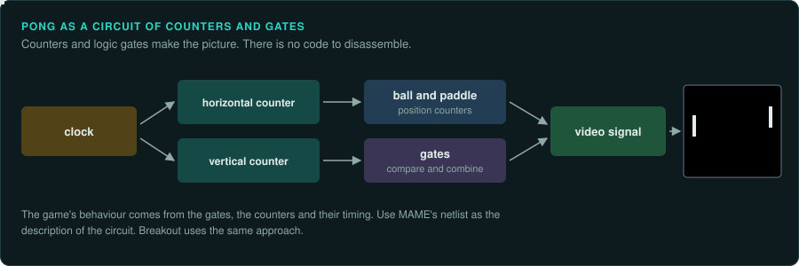
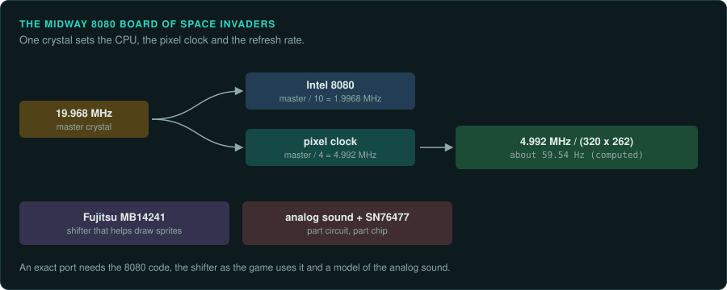

# Discrete logic and the 8080

The first arcade games of 1972 to 1978 come in two kinds. Pong and Breakout have no CPU. To
reimplement them, you simulate the circuit. Space Invaders and the Midway 8080 boards run
an Intel 8080 program beside analog sound circuits.

| Board | Years | Main CPU and clock | Sound | Refresh | Protection | MAME status | Ghidra |
|---|---|---|---|---|---|---|---|
| Atari Pong, Breakout | 1972 on | None (discrete logic) | Not covered here | Not covered here | None | Netlist emulation | Nothing to load |
| Midway 8080 black-and-white | 1978 on | Intel 8080 at 1.9968 MHz | Analog circuits plus TI SN76477 | about 59.54 Hz (computed) | None listed | In MAME | Built in (`8085`) |

## Atari Pong and Breakout

### Hardware

Pong (Atari, 1972) has no CPU. MAME emulates it as a netlist of discrete logic. Breakout uses
the same approach
([MAME: atari/pong.cpp](https://github.com/mamedev/mame/blob/master/src/mame/atari/pong.cpp)).

### Protection

None listed.

### Tools

MAME's netlist driver models the circuit. There is no program to decompile, so Ghidra
and Unicorn do not apply.

### Projects to learn from

MAME's `pong.cpp` netlist.

### For an exact reimplementation

- Simulate the circuit. The game's behaviour comes from the logic gates, the counters and their
  timing.
- Use MAME's netlist as the description of the circuit.

## Midway 8080 boards and Space Invaders

### Hardware

Space Invaders (Taito, 1978; licensed to Midway in the US) uses an Intel 8080 CPU. Tomohiro
Nishikado designed it. The game draws sprites with the help of a Fujitsu MB14241 shifter. Sound
comes from analog circuits plus a TI SN76477
([Wikipedia (mirror): Space Invaders](https://static.hlt.bme.hu/semantics/external/pages/SOAR/en.wikipedia.org/wiki/Space_Invaders.html)).
Giant Bomb gives the Japanese release as 19 June 1978. Another source says November 1978
([Giant Bomb releases](https://giantbomb.com/wiki/Games/Space_Invaders/Releases)).

MAME's Midway 8080 black-and-white hardware uses a 19.968 MHz master clock. The CPU runs at
master / 10, which is 1.9968 MHz. The pixel clock is master / 4. With totals of 320 by 262 the
screen runs at about 59.54 Hz (computed)
([MAME: midw8080/mw8080bw.h](https://github.com/mamedev/mame/blob/master/src/mame/midw8080/mw8080bw.h)).

### Protection

None listed.

### Tools

- Ghidra decodes the 8080 with its built-in `8085` module.
- Unicorn has no 8080 backend. Take ground truth from MAME's debugger or from a small 8080 core
  ([CPU families](../computers/cpu-families.md#the-8080-z80-and-sm83)).
- The [practices page](practices.md#disassembly-and-emulation-support-per-arcade-cpu) has the
  full CPU table.

### Projects to learn from

Computer Archeology hosts commented disassemblies of Space Invaders and Sea Wolf
([Computer Archeology: Arcade](https://www.computerarcheology.com/Arcade/)).

### For an exact reimplementation

- Run the port at about 59.54 Hz, the board's computed rate.
- Reproduce the MB14241 shifter as the game uses it.
- The sound is part circuit and part chip. An exact port needs a model of the analog sound as
  well as the 8080 code ([Sound](../hardware/sound.md)).
