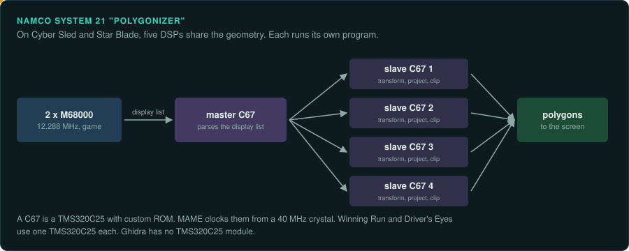
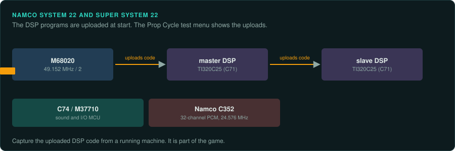
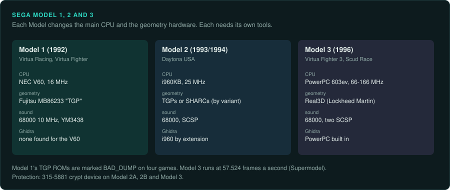
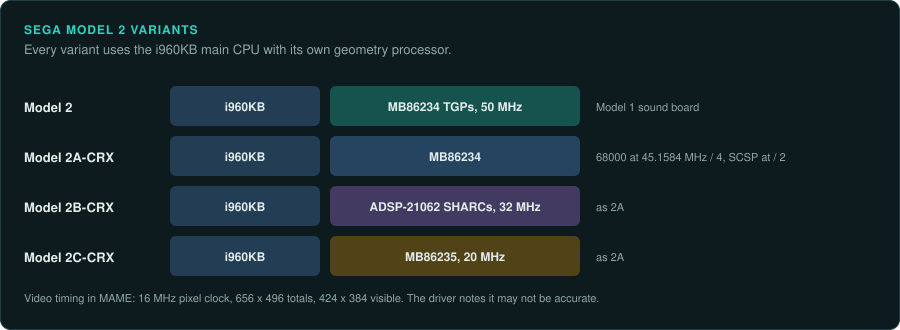
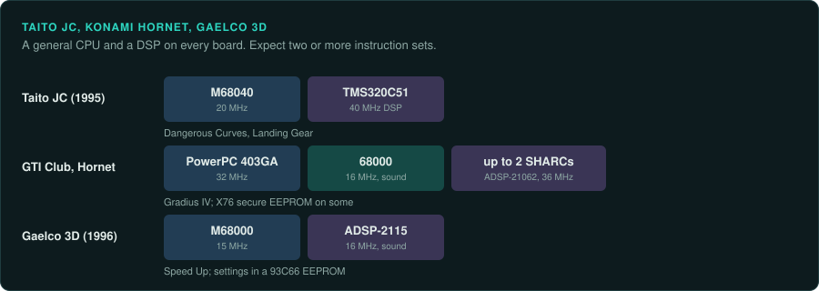

# Early 3D boards

Every early 3D board has a general CPU and one or more DSPs or custom geometry chips. Each
DSP runs its own program. The game logic usually runs on the main CPU. A port must reproduce the
DSP programs too, so expect two or more instruction sets per game. Ghidra has no built-in
module for most of these DSPs. Atari's Hard Drivin' is on the
[Atari](atari-coin-op.md#atari-hard-drivin) page. Midway Zeus is on the
[Williams and Midway](williams-and-midway.md#midway-zeus) page.

| Board | Years | Main CPU and clock | Sound | Refresh | Protection | MAME status | Ghidra |
|---|---|---|---|---|---|---|---|
| Namco System 21 | 1988 on | Two M68000 at 12.288 MHz | MC6809E | Not covered here | None listed | In MAME | 68000 built in; none for the TMS320C25 |
| Namco System 22, Super 22 | 1993 on | M68020 at 49.152 MHz / 2 | C352 on an M37702 or M37710 | Not covered here | None listed | 2 of 42 not working | 68000 built in; none for the DSPs |
| Sega Model 1 | 1992 | NEC V60 at 16 MHz | 68000 at 10 MHz, YM3438 | Not covered here | Not covered here | TGP ROMs BAD_DUMP on four games | None for the V60 |
| Sega Model 2 | 1993/1994 | i960KB at 25 MHz | 68000, SCSP | Not confirmed | 315-5881, 315-5838 | In MAME | Extension for the i960 |
| Sega Model 3 | 1996 | PowerPC 603ev, 66 to 166 MHz | 68000, two SCSP | 57.524 Hz (Supermodel) | 315-5881 | Known faults | PowerPC built in |
| Taito JC | 1995 | M68040 at 20 MHz | Not covered here | Not covered here | Not covered here | 2 of 19 not working | 68000 built in; none for the TMS320C51 |
| Konami GTI Club, Hornet | 1996, 1998 | PowerPC 403GA at 32 MHz | 68000 at 16 MHz | Not covered here | X76 secure EEPROM on some | 58 of 72 Hornet entries not working | PowerPC built in; SHARC extension |
| Gaelco 3D | 1996 | M68000 at 15 MHz | ADSP-2115 at 16 MHz | Not covered here | Not covered here | 1 of 20 not working | 68000 built in |

## Namco System 21

### Hardware

Namco System 21 "Polygonizer" (1988 onward) runs two M68000s at 12.288 MHz and an MC6809E for
sound ([MAME namcos21.cpp](https://github.com/mamedev/mame/blob/master/src/mame/namco/namcos21.cpp)).
The DSP setup varies by game.

- Winning Run and Driver's Eyes each use one TMS320C25.
- Cyber Sled and Star Blade use one master C67 plus four slave C67s. A C67 is a TMS320C25 with
  custom ROM.
- MAME clocks the C67s from a 40 MHz crystal
  ([MAME namcos21_dsp_c67.cpp](https://github.com/mamedev/mame/blob/master/src/mame/namco/namcos21_dsp_c67.cpp)).

The master DSP parses the display list and applies high-level geometry. The slaves transform,
project and clip each primitive's vertices.

### Protection

None listed.

### Tools

Ghidra and Unicorn cover the 68000. Neither has a TMS320 module. Use MAME to run the DSP
programs.

### Projects to learn from

None listed yet.

### For an exact reimplementation

- Record which DSP setup the game uses: one TMS320C25 or five C67s.
- Reproduce the master and slave DSP programs as well as the 68000 code.

## Namco System 22 and Super System 22

### Hardware

System 22 (1993 onward) uses an M68020 at 49.152 MHz / 2
([MAME namcos22.cpp](https://github.com/mamedev/mame/blob/master/src/mame/namco/namcos22.cpp)).

- The Super System 22 board notes list an MC68EC020FG25 at 24.576 MHz.
- The board has "two TI320C25 DSP (printed as C71)".
- The Prop Cycle test menu shows that the main CPU uploads code to the master DSP. The master
  uploads code to the slave.
- Sound and I/O run on a C74, a Mitsubishi M37702 MCU with mask ROM. Super System 22 uses an
  M37710 at 16.384 MHz with no internal ROM.
- Sound output is the Namco C352, a 32-channel PCM chip at 24.576 MHz.

### Protection

None listed.

### Tools

The first entries are Ridge Racer variants from 1993. Of 42 entries, 2 have
MACHINE_NOT_WORKING. Ghidra has no built-in module for the TMS320C25 or the M37702.

### Projects to learn from

Arcade Archives Ridge Racer (Namco, 1993, System 22) came out on 5 June 2025. It was the first
Arcade Archives 2 title, on Switch 2, PS5 and Xbox Series X|S
([Game Developer press release](https://www.gamedeveloper.com/press-release/-arcade-archives-series-announces-first-simultaneous-five-platform-release-with-arcade-archives-ridge-racer-)).
Air Combat 22 followed on 3 July 2025. Rave Racer was announced for 26 February
([VGC, Rave Racer](https://www.videogameschronicle.com/news/namcos-last-arcade-ridge-racer-game-rave-racer-is-getting-a-home-version-for-the-first-time)).

### For an exact reimplementation

- The uploaded DSP code exists only in RAM. Capture it from a running emulator.

## Sega Model 1

### Hardware

Model 1 (1992) runs an "NEC uPD70615GD-16-S V60 CPU, running at 16.000MHz" with a Fujitsu
MB86233 "TGP" coprocessor. The header gives no TGP clock. Sound is a TMP68000N-10 at 10 MHz with
a YM3438 at 8 MHz. The monitor runs at 24 kHz horizontal ("medium resolution")
([MAME model1.cpp](https://github.com/mamedev/mame/blob/master/src/mame/sega/model1.cpp)).

The games are Virtua Racing (1992), Virtua Fighter (1993), Tecwar/Netmerc (1993, Sega and
Virtuality), Star Wars Arcade (1994) and Wing War (1994). Wikipedia puts Model 1 at 180,000
polygons per second and 6,500 per frame
([Wikipedia, List of Sega arcade system boards](https://en.wikipedia.org/wiki/List_of_Sega_arcade_system_boards)).

### Protection

Not covered here.

### Tools

- The TGP program ROMs for Virtua Fighter (315-5724) are marked BAD_DUMP. So are those for Star
  Wars Arcade, Wing War and Netmerc (315-5711). The Virtua Racing TGP ROM (315-5573) is not.
- Virtua Fighter's collision is "significantly broken due to imperfect TGP RAM port emulation
  or hookup".
- No Ghidra module for the V60 is known (not confirmed). Unicorn has none.

### Projects to learn from

M2 developed Sega Ages Virtua Racing for the Switch (Japan April 2019, other regions June 2019).
It runs at 60 fps and up to 1080p. The arcade ran at 30 fps and 496 by 384
([Nintendo Life review](https://www.nintendolife.com/reviews/switch-eshop/sega_ages_virtua_racing)).
Whether that release emulates the Model 1 or reimplements it is not confirmed.

### For an exact reimplementation

- For the games with BAD_DUMP TGP ROMs, do not use MAME as ground truth for the geometry stage.
- Plan for a V60 disassembler.
- The Model 1 TGP clock is unknown.

## Sega Model 2

### Hardware

MAME's header describes Model 2 (1993/1994; Daytona USA 1994) as "i960KB + (5x TGP) or (2x
SHARC) or (2x TGPx4)"
([MAME model2.cpp](https://github.com/mamedev/mame/blob/master/src/mame/sega/model2.cpp)).

| Variant | Main CPU | Geometry | Sound |
|---|---|---|---|
| Model 2 | i960KB at 25 MHz | MB86234 TGPs at 50 MHz | Model 1 sound board |
| Model 2A-CRX | i960KB | MB86234 | 68000 at 45.1584 MHz / 4, SCSP at 45.1584 MHz / 2 |
| Model 2B-CRX | i960KB | ADSP-21062 SHARCs at 32 MHz | As 2A |
| Model 2C-CRX | i960KB | MB86235 at 20 MHz | As 2A |

MAME's video timing uses a 16 MHz pixel clock, 656 by 496 totals and 424 by 384 visible. The
driver notes this may not be accurate. Wikipedia says co-development with GE Aerospace
(Compu-Scene) began in September 1992, with 300,000 textured polygons per second at 60 fps
([Wikipedia, List of Sega arcade system boards](https://en.wikipedia.org/wiki/List_of_Sega_arcade_system_boards)).

### Protection

- A 315-5881 crypt device on the 2A, the 2B and Zero Gunner.
- A 315-5838 compression device, with a 317-0229 variant.
- Simulated PIC protection for "To The MAXX".
- A protection ROM overlay for GTX.

### Tools

- [ghidra_i960](https://github.com/mumbel/ghidra_i960) adds the i960.
- [ghidra-sharc](https://github.com/roblg/ghidra-sharc) targets the ADSP-214xx. The Model 2B
  uses the ADSP-21062.
- Ghidra has no module for the MB8623x TGPs.

### Projects to learn from

None listed yet.

### For an exact reimplementation

- Record the variant. The geometry processor and its instruction set depend on it.
- Do not rely on MAME's video timing.
- "To The MAXX" uses simulated protection in MAME. A port built on that simulation has the
  same errors.

## Sega Model 3

### Hardware

Model 3 (1996; Virtua Fighter 3 and Scud Race) uses a PowerPC 603ev
([MAME model3.cpp](https://github.com/mamedev/mame/blob/master/src/mame/sega/model3.cpp)).

- MAME's header lists "Step 1.0: 66 MHz PPC", "Step 1.5: 100 MHz PPC, faster 3D engine",
  "Step 2.0: 166 MHz PPC, even faster 3D engine" and "Step 2.1: 166 MHz PPC, same 3D engine as
  2.0".
- A Guru readme in the same file says "The CPU on Scud Race runs at 66MHz". That conflicts with
  the Step 1.5 figure.
- The host bridge is a Motorola MPC105 or MPC106, depending on the step.
- The Real3D graphics have PCI IDs 0x16c311db (315-5827, Step 1.x) and 0x178611db (315-6022,
  Step 2). Both use Mitsubishi M5M410092FP 3D-RAM.
- Sound is a 68000-12 with two 315-5687 SCSP chips. The optional Digital Sound Board v1 has a
  Z80 at 4 MHz. The v2 board has a 68EC000 at 11 MHz.

Supermodel states that the Model 3 runs at "57.524 frames per second". It also states that
Real3D, then a Lockheed Martin company, developed the graphics
([Supermodel README](https://github.com/trzy/Supermodel)).

### Protection

Protection is a 315-5881 on a security board (171-7405B) with a 315-6050 Lattice ispLSI 2032.
MAME maps it at 0xf01a0000.

### Tools

- Supermodel emulates the Model 3 under the GPL on Windows, Linux and macOS.
- Ghidra's PowerPC module and Unicorn's PPC backend cover the main CPU
  ([CPU families](../computers/cpu-families.md#powerpc)).
- Known MAME issues include "broken FPU values in matrices" in Magical Truck Adventure ("cpu
  core bug?") and texture faults in Spikeout.

### Projects to learn from

Supermodel's source.

### For an exact reimplementation

- Record the step of the board. The CPU clock and the 3D engine depend on it.
- Run the port at 57.524 Hz, Supermodel's figure.
- Check floating-point results against more than one emulator. MAME has a known FPU fault on
  one game.

## Taito JC System

### Hardware

Taito JC (1995) runs an M68040 at 20 MHz and a TMS320C51 DSP at 40 MHz. Games include Dangerous
Curves and Landing Gear (both 1995)
([MAME taitojc.cpp](https://github.com/mamedev/mame/blob/master/src/mame/taito/taitojc.cpp)).

### Protection

Not covered here.

### Tools

Of 19 entries, 2 have MACHINE_NOT_WORKING. Most have IMPERFECT_GRAPHICS and IMPERFECT_TIMING.

### Projects to learn from

None listed yet.

### For an exact reimplementation

- MAME flags its timing as imperfect on most games. Do not rely on it.

## Konami GTI Club and Hornet

### Hardware

GTI Club (1996) and Hornet (1998) use a PowerPC 403GA at 32 MHz, a 68000 at 16 MHz for sound
and up to two ADSP-21062 SHARCs at 36 MHz. Hornet games include Gradius IV (1998). GTI Club:
Rally Cote D'Azur dates from 1996
([MAME gticlub.cpp](https://github.com/mamedev/mame/blob/master/src/mame/konami/gticlub.cpp);
[MAME hornet.cpp](https://github.com/mamedev/mame/blob/master/src/mame/konami/hornet.cpp)).

### Protection

Some configurations use an X76 secure EEPROM.

### Tools

- Of 72 Hornet entries, 58 have MACHINE_NOT_WORKING. Operation Thunder Hurricane (1997) does
  not work.
- Ghidra's PowerPC module covers the main CPU. ghidra-sharc targets the ADSP-214xx.

### Projects to learn from

None listed yet.

### For an exact reimplementation

- Most Hornet games do not run in MAME. Take ground truth from other emulators or from owned
  hardware.

## Gaelco 3D

### Hardware

Gaelco 3D (1996) runs an M68000 at 15 MHz on Speed Up, with an ADSP-2115 sound DSP at 16 MHz.
Settings are stored in a 93C66 serial EEPROM
([MAME gaelco3d.cpp](https://github.com/mamedev/mame/blob/master/src/mame/gaelco/gaelco3d.cpp)).

### Protection

Not covered here.

### Tools

One of 20 entries does not work.

### Projects to learn from

None listed yet.

### For an exact reimplementation

- Load the 93C66 EEPROM image as an input to each test.

Sega Hikaru (1999) is not covered yet.
