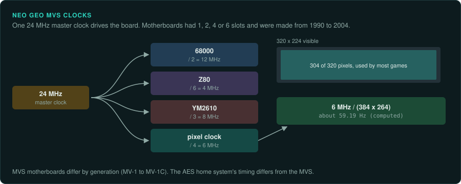

# Neo Geo

SNK's Neo Geo ran as an arcade board (MVS) and as a home system (AES). The two differ in timing
as well as in BIOS. Late games have protection chips. One of these chips contains a random
number generator. Official re-releases run the MVS code under emulation.

| Board | Years | Main CPU and clock | Sound | Refresh | Protection | MAME status | Ghidra |
|---|---|---|---|---|---|---|---|
| Neo Geo MVS | 1990 to 2004 | 68000 at 12 MHz | Z80 at 4 MHz, YM2610 at 8 MHz | about 59.19 Hz (computed) | NEO-CMC, NEO-PCM2, NEO-SMA on late games | In MAME | 68000 and Z80 built in |
| Neo Geo AES | Not covered here | 24.167829 MHz input clock (NTSC) | Not covered here | Not covered here | Not covered here | In MAME; clock marked incorrect | 68000 and Z80 built in |

## Neo Geo MVS

### Hardware

The MVS launched in 1990 and was discontinued in 2004. Alpha Denshi (ADK) designed it. It came
as 1, 2, 4 and 6-slot motherboards
([MAME: snk/neogeo.h](https://github.com/mamedev/mame/blob/master/src/mame/snk/neogeo.h);
[neogeo.cpp](https://github.com/mamedev/mame/blob/master/src/mame/snk/neogeo.cpp)).

- A 24 MHz master clock feeds a 68000 at 12 MHz, a Z80 at 4 MHz, a YM2610 at 8 MHz and a 6 MHz
  pixel clock.
- The 384 by 264 totals give about 59.19 Hz (computed).
- The hardware can show 320 by 224. Most games are designed for 304 pixels wide.
- The board includes NVRAM.

MVS motherboards differ by generation. Memory-card headers, coin lockouts, LED displays and
soldered BIOS vary between MV-1, MV-1F, MV-1A, MV-1B and MV-1C.

### Protection

Late games have protection chips. MAME lists them. Example sets are The King of Fighters
'99, 2000 and 2003.

- NEO-CMC 90G06CF7042 decrypts the C-ROM graphics and bank-switches the S-ROM.
- NEO-CMC 90G06CF7050 adds decryption of the M-ROM sound program.
- NEO-PCM2 decrypts V-ROM samples and decodes the P-ROM.
- NEO-SMA decrypts and bank-switches the P-ROM program. It provides a random number generator.
  It stores 256 kb of game data.

The [protection page](protection.md#snk-neo-geo) has more on each chip.

### Tools

- Ghidra's 68000 and Z80 modules cover the program and the sound code. Unicorn's M68K backend
  runs the 68000 code ([CPU families](../computers/cpu-families.md#the-68000)).
- MAME's driver credits Charles MacDonald's MVS technical notes.

### Projects to learn from

Hamster's ACA Neo Geo series re-releases SNK titles in their MVS arcade form. Its emulator team
is in Hokkaido. ACA2 Neo Geo was announced in May 2024
([Wikipedia: Arcade Archives](https://en.wikipedia.org/wiki/Arcade_Archives);
[Wikipedia: Hamster Corporation](https://en.wikipedia.org/wiki/Hamster_Corporation)).

### For an exact reimplementation

- Run the port at about 59.19 Hz.
- Design for a 304-pixel visible width on most games.
- Record the BIOS, the region and the language with every test. Fatal Fury 3 in MAME crashes in
  the ending unless the language is Japanese
  ([practices](practices.md#nvram-and-dip-settings-as-test-inputs)).
- Record the motherboard generation when the game uses a feature that differs between
  generations, such as the memory card.
- On a NEO-SMA game, reproduce the chip's random number generator from MAME's model.

## Neo Geo AES

### Hardware

The AES home system's input clock is noted as 24.167829 MHz for NTSC. MAME marks its own AES
clock as incorrect
([MAME: snk/neogeo.cpp](https://github.com/mamedev/mame/blob/master/src/mame/snk/neogeo.cpp)).

### Protection

Not covered here.

### Tools

As for the MVS.

### Projects to learn from

None listed yet.

### For an exact reimplementation

- Pick one system per test. The MVS and AES differ in timing as well as in BIOS.
- Do not rely on MAME's AES timing.
