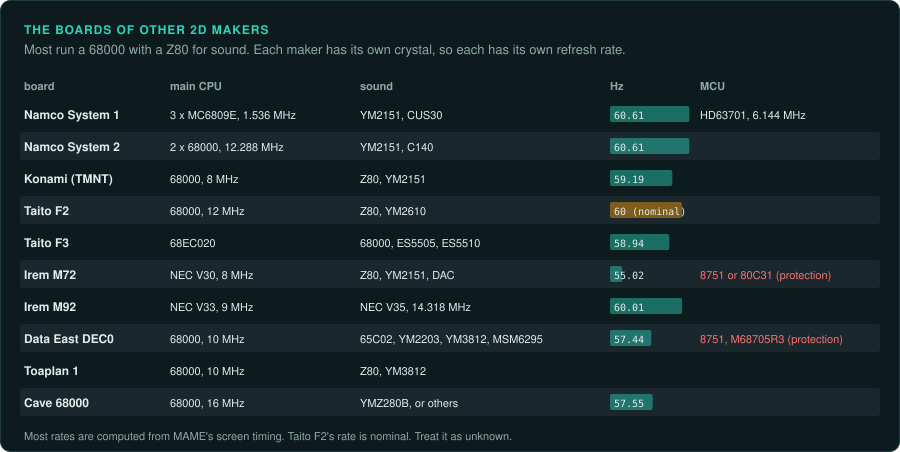
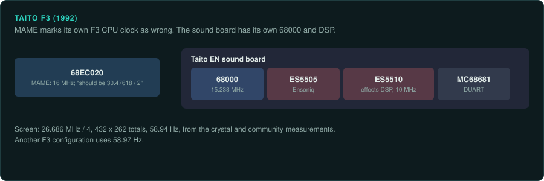

# Other 2D makers

This page covers the 2D boards of Namco, Konami, Taito, Irem, Data East, Toaplan and Cave. Most
run a 68000 with a Z80 for sound. Each maker has its own crystal, so the refresh rates run from
about 55 Hz to about 60.6 Hz. Several boards have a protection MCU.

| Board | Years | Main CPU and clock | Sound | Refresh | Protection | MAME status | Ghidra |
|---|---|---|---|---|---|---|---|
| Namco System 1 | 1987 on | Three MC6809E at 1.536 MHz | YM2151, CUS30 | about 60.61 Hz (computed) | None listed | In MAME | MC6800 module |
| Namco System 2 | Not covered here | Two 68000s at 12.288 MHz | YM2151, C140 | about 60.61 Hz (computed) | None listed | In MAME | 68000 built in |
| Konami 68000 (TMNT) | 1989 | 68000 at 8 MHz | Z80 at 3.58 MHz, YM2151 | about 59.19 Hz (computed) | Not covered here | In MAME | 68000 built in |
| Taito F2 | Not covered here | 68000 at 12 MHz | Z80 at 4 MHz, YM2610 | nominal 60 Hz | Not covered here | In MAME | 68000 built in |
| Taito F3 | 1992 | 68EC020, set to 16 MHz | 68000, ES5505, ES5510 | 58.94 Hz | Not covered here | In MAME; CPU clock marked wrong | 68000 built in |
| Irem M72 | 1987 | NEC V30 at 8 MHz | Z80, YM2151, DAC | about 55.02 Hz (computed) | Intel 8751 or 80C31 | In MAME | x86 16-bit (not confirmed) |
| Irem M92 | 1991 | NEC V33 at 9 MHz | NEC V35 at 14.318 MHz | about 60.01 Hz (computed) | Not covered here | In MAME | x86 16-bit (not confirmed) |
| Data East DEC0 | Not covered here | 68000 at 10 MHz | 65C02, YM2203, YM3812, MSM6295 | about 57.44 Hz (computed) | Intel 8751, M68705R3 | In MAME | 68000 built in |
| Toaplan 1 | 1988 | 68000 at 10 MHz | Z80 at 3.5 MHz, YM3812 | Not covered here | Not covered here | In MAME | 68000 built in |
| Cave 68000 | 1994 on | 68000 at 16 MHz | YMZ280B, or MSM6295, or Z80 and YM2151 | about 57.55 Hz | Not covered here | In MAME | 68000 built in |

## Namco System 1 and 2

### Hardware

Namco System 1 (from 1987) runs three MC6809E at 1.536 MHz for the main, sub and sound tasks.
An HD63701 MCU runs at 6.144 MHz. Sound is a YM2151 plus Namco's CUS30 wavetable. The screen
runs at Namco's usual 60.61 Hz (computed)
([MAME: namco/namcos1.cpp](https://github.com/mamedev/mame/blob/master/src/mame/namco/namcos1.cpp)).

Namco System 2 uses two 68000s at 12.288 MHz, a YM2151 and a C140 PCM chip. It shows 288 by 224
at about 60.61 Hz (computed)
([MAME: namco/namcos2.cpp](https://github.com/mamedev/mame/blob/master/src/mame/namco/namcos2.cpp)).

### Protection

None listed.

### Tools

- Ghidra's MC6800 module holds the 6809 spec. Unicorn has no 6809 backend
  ([CPU families](../computers/cpu-families.md#the-6809)).
- Ghidra's 68000 module and Unicorn's M68K backend cover System 2.

### Projects to learn from

None listed yet.

### For an exact reimplementation

- Run the three System 1 CPUs and the HD63701 interleaved.
- Run the port at about 60.61 Hz.

## Konami 68000 boards

### Hardware

Konami's 68000 boards, such as TMNT (1989), use a 68000 at 8 MHz, a Z80 at 3.58 MHz and a
YM2151. The screen runs at 24 MHz / 4 with 384 by 264 totals, about 59.19 Hz (computed). One
configuration is marked "verified against real hardware"
([MAME: konami/tmnt.cpp](https://github.com/mamedev/mame/blob/master/src/mame/konami/tmnt.cpp)).

### Protection

Not covered here for the 68000 boards. Konami's 6809-based Konami-1 CPU scrambles opcodes
([protection](protection.md#konami)). Konami's other 6809 and Z80 boards are not covered here.

### Tools

Ghidra's 68000 module and Unicorn's M68K backend cover the main program.

### Projects to learn from

None listed yet.

### For an exact reimplementation

- Run the port at about 59.19 Hz.

## Taito F2 and F3

### Hardware

**Taito F2** uses a 68000 at 12 MHz, a Z80 at 4 MHz and a YM2610 at 8 MHz. MAME sets it to a
nominal 60 Hz. Some variants use an OKI MSM6295 and different clocks "verified on pcb"
([MAME: taito/taito_f2.cpp](https://github.com/mamedev/mame/blob/master/src/mame/taito/taito_f2.cpp)).

**Taito F3** ran Ring Rage, Arabian Magic and Riding Fight (all 1992). It uses a 68EC020 main
CPU. MAME sets it to 16 MHz with a note that it "should be 30.47618_MHz_XTAL / 2". The Taito EN
sound board has a 68000 at 15.238 MHz, an Ensoniq ES5505, an ES5510 effects DSP at 10 MHz
and an MC68681 DUART. The screen runs at 26.686 MHz / 4 with 432 by 262 totals and 58.94 Hz.
That rate comes from the crystal and from measurements in an arcade-projects thread. Another F3
configuration uses 58.97 Hz
([MAME: taito/taito_f3.cpp](https://github.com/mamedev/mame/blob/master/src/mame/taito/taito_f3.cpp);
[taito_f3.h](https://github.com/mamedev/mame/blob/master/src/mame/taito/taito_f3.h);
[taito_en.cpp](https://github.com/mamedev/mame/blob/master/src/mame/taito/taito_en.cpp)).

The Taito B System is not covered here. Bubble Bobble's board uses a 6 MHz pixel clock at about
59.19 Hz (computed)
([MAME: taito/bublbobl.cpp](https://github.com/mamedev/mame/blob/master/src/mame/taito/bublbobl.cpp)).

### Protection

Bubble Bobble uses an M68705P3 or an M6801U4 protection MCU
([protection](protection.md#protection-mcus)). How the Taito 68705 ROMs were dumped is not
covered here.

### Tools

- Ghidra's 68000 module covers the 68EC020 and the sound 68000. Unicorn's M68K backend runs them.
- Ghidra has no built-in module for the ES5510 DSP.

### Projects to learn from

None listed yet.

### For an exact reimplementation

- A note in MAME says its F3 CPU clock is wrong. Do not use MAME's timing as ground truth for a
  cycle-exact F3 port.
- Run an F3 port at 58.94 Hz. Check which configuration the game uses. Another configuration
  uses 58.97 Hz.
- Treat the F2's nominal 60 Hz as unknown.

## Irem M72 and M92

### Hardware

**Irem M72** ran R-Type (1987). It uses an NEC V30 at 8 MHz from a 32 MHz master. The driver
comment reads "16 MHz external freq (8MHz internal)". A Z80 drives a YM2151 and an 8-bit DAC.
Some games have an Intel 8751 MCU. The screen runs at about 55.02 Hz (computed)
([MAME: irem/m72.cpp](https://github.com/mamedev/mame/blob/master/src/mame/irem/m72.cpp)).

**Irem M92** ran Blade Master (1991). It uses an NEC V33 at 9 MHz and an NEC V35 sound CPU at
14.318 MHz. It shows 320 by 240 at about 60.01 Hz (computed)
([MAME: irem/m92.cpp](https://github.com/mamedev/mame/blob/master/src/mame/irem/m92.cpp)).

### Protection

M72 uses an Intel 8751 or an 80C31 as a protection MCU.

### Tools

The NEC V-series is 8086-compatible at the instruction level. Ghidra's and Unicorn's x86 16-bit
modes can probably decode most of Irem's code. Check the V-series extra instructions and the
V35's on-chip peripherals by hand (not confirmed)
([CPU families](../computers/cpu-families.md#x86)). Ghidra's 8051 module covers the 8751.

### Projects to learn from

None listed yet.

### For an exact reimplementation

- Run an M72 port at about 55.02 Hz.
- Check every instruction Ghidra fails to decode against the V-series extras.
- The MCU may hold game logic. Check whether MAME runs its dump or a simulation.

## Data East DEC0

### Hardware

DEC0 is the Data East board from the time of Bad Dudes. It uses a 68000 at 10 MHz, verified as
"68000P12 running at 10Mhz". A 65C02 at 1.5 MHz drives a YM2203, a YM3812 and an OKI MSM6295.
Some games add a HuC6280, an Intel 8751 or an M68705R3. The screen runs at about 57.44 Hz
(computed). An older comment gives 57.41 Hz
([MAME: dataeast/dec0.cpp](https://github.com/mamedev/mame/blob/master/src/mame/dataeast/dec0.cpp)).

### Protection

Data East uses an Intel 8751 and an M68705R3 as protection MCUs.

### Tools

Ghidra covers the 68000, the 65C02 and the 8051. Unicorn covers only the 68000.

### Projects to learn from

None listed yet.

### For an exact reimplementation

- Run the port at about 57.44 Hz.
- Treat the protection MCU program as part of the game.

## Toaplan 1

### Hardware

Toaplan 1 ran Truxton (1988). It uses a 68000 at 10 MHz, a Z80 at 3.5 MHz, a YM3812 and a
7 MHz pixel clock. One configuration adds a TMS320-family DSP at 14 MHz
([MAME: toaplan/toaplan1.cpp](https://github.com/mamedev/mame/blob/master/src/mame/toaplan/toaplan1.cpp)).

### Protection

Not covered here.

### Tools

Ghidra and Unicorn cover the 68000. Neither has a TMS320 module.

### Projects to learn from

None listed yet.

### For an exact reimplementation

- On the configuration with the DSP, trace its program as well.

## Cave 68000 boards

### Hardware

Cave's 68000 boards ran Mazinger Z (1994) and DoDonPachi (1997). They run a 68000 at 16 MHz.
Many games use a YMZ280B at 16.9344 MHz. Others use an OKI MSM6295 or a Z80 with a YM2151.
MAME sets the refresh to 15625 / 271.5, about 57.55 Hz
([MAME: atlus/cave.cpp](https://github.com/mamedev/mame/blob/master/src/mame/atlus/cave.cpp)).

### Protection

Not covered here.

### Tools

Ghidra's 68000 module and Unicorn's M68K backend cover the main program.

### Projects to learn from

None listed yet.

### For an exact reimplementation

- Run the port at about 57.55 Hz.
- Record which sound chip the game uses.
