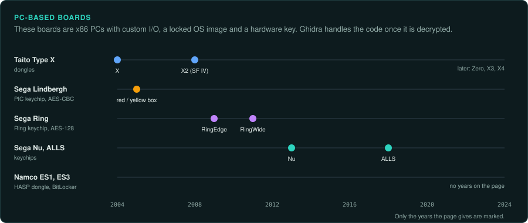
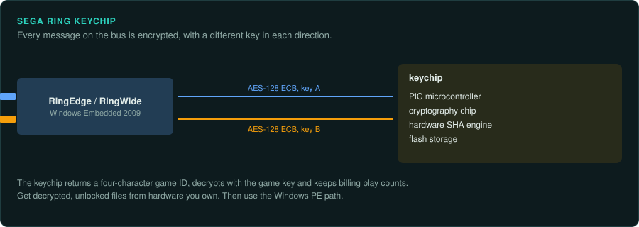

# PC-based boards

From 2004 arcade boards are x86 PCs with custom I/O, a locked OS image and a hardware key.
Ghidra handles the x86 code. Most of the effort goes into getting decrypted, unlocked files from
hardware that you own. Once the files are decrypted, use GameFrame's Windows PE path. For Linux
boards, use an ELF loader.

| Board | Years | Main CPU and clock | Sound | Refresh | Protection | MAME status | Ghidra |
|---|---|---|---|---|---|---|---|
| Taito Type X to X4 | 2004 on | Celeron 2.5 GHz to Core i5-4590(S) | Not covered here | Not covered here | Dongle schemes (not covered here) | Not covered here | x86 built in |
| Sega Lindbergh | 2005/2006 | Celeron D 335 at 2.8 GHz or Pentium 4 at 3.00 GHz | VIA VT1616 AC97 | Not covered here | PIC keychip with AES-CBC; locked CF and HDD | 18 of 19 not working | x86 built in |
| Sega RingEdge, RingWide | 2009, 2011 | Pentium Dual-Core; Celeron | Not covered here | Not covered here | Ring keychip, AES 128 ECB on the bus | Not covered here | x86 built in |
| Sega Nu, Nu 2, ALLS | 2013 on | Core i3-3220; Core i5-6500 | Not covered here | Not covered here | Keychips (not covered here) | Not covered here | x86 built in |
| Namco ES1, ES3 | Not covered here | Core i5-3550S on ES3 | Not covered here | Not covered here | HASP HL Max dongle and BitLocker on ES3 | Not covered here | x86 built in |

## Taito Type X family

### Hardware

| Model | OS | CPU | Graphics | Games |
|---|---|---|---|---|
| Type X (2004) | Windows XP Embedded | Celeron at 2.5 GHz, 256 MB DDR266 | AGP Radeon 9600 SE, 9600 XT or X700 PRO | Not covered here |
| Type X2 | Not covered here | Celeron D 352, Pentium 4 651 or Core 2 Duo E6400; DDR2, 512 MB to 4 GB | PCIe | Street Fighter IV (2008), BlazBlue: Calamity Trigger (2008) |
| Type X Zero | Windows Embedded Standard 7 | Atom 230 at 1.6 GHz | GeForce 9400M | Not covered here |
| Type X3 | WES7 64-bit or XP Embedded SP3 32-bit | Core i5-2400 | Radeon HD 6770 base | Not covered here |
| Type X4 | Windows Embedded 8 Standard or WES7 64-bit | Core i5-4590(S) | GeForce GTX 960 | Street Fighter 6: Type Arcade (2023) |

Type X uses a PATA or SATA disk. NESiCAxLive is an add-on for digital distribution of games to
arcade owners ([Wikipedia, Taito Type X](https://en.wikipedia.org/wiki/Taito_Type_X)).

### Protection

The Type X dongle schemes are not covered here.

### Tools

- TeknoParrot is a closed-source compatibility layer for Windows. It runs PC-based arcade games
  from Lindbergh, RingEdge, Nu, Type X, Namco ES3 and others. OpenParrot and the GUI are open
  source. Some features need Patreon support
  ([Emulation General Wiki, TeknoParrot](https://emulation.gametechwiki.com/index.php/TeknoParrot)).
- Ghidra and Unicorn cover x86 and x86-64. The
  [re-ghidra](../../.claude/skills/re-ghidra/SKILL.md) and
  [re-emulate](../../.claude/skills/re-emulate/SKILL.md) skills cover the PE path.

### Projects to learn from

TeknoParrot and OpenParrot.

### For an exact reimplementation

- Work from decrypted files taken from owned hardware.
- Record the model. The OS and the GPU change between generations.

## Sega Lindbergh

### Hardware

Lindbergh (2005/2006) runs Linux
([MAME lindbergh.cpp](https://github.com/mamedev/mame/blob/master/src/mame/sega/lindbergh.cpp)).

- The red box has a Celeron D 335 at 2.8 GHz with 512 MB.
- The yellow box has a Pentium 4 at 3.00 GHz with 1 GB.
- Both use an Intel 875 northbridge, a 6300ESB southbridge, a custom nVidia GeForce card and
  VIA VT1616 AC97 audio.
- The machine boots a customised MontaVista Linux from a Compact Flash card.
- Games install from DVD to the hard disk through `/usr/sbin/segaboot`.

### Protection

"Both the CF and HDD are locked and unreadable on a regular PC." The PIC keychip has an AES-CBC
engine. Everything on the keychip except its key can be dumped.

1. The CF derives a 176-byte secondary key. It decrypts 16 x 0x00 through 16 x 0x0b through the
   PIC.
2. It then decrypts DVD and HDD files with a custom cipher (`segaboot`, `lxdecrypt_hard`).
3. `lxunlock.hdb` unlocks the disk.

### Tools

- Eighteen of 19 MAME entries do not work.
- lindbergh-loader runs Lindbergh games on modern Linux in place of the original hardware, with
  JVS pass-through
  ([lindbergh-loader README](https://github.com/lindbergh-loader/lindbergh-loader)).
- A Lindbergh game is a Linux ELF program. lindbergh-loader works like GameFrame's Wine path
  for Windows games ([running the original](../observe/running-the-original.md)).

### Projects to learn from

lindbergh-loader.

### For an exact reimplementation

- Do not use MAME as ground truth. Take ground truth from lindbergh-loader or from owned hardware.
- Record the box colour. The red and yellow boxes differ in CPU and memory.

## Sega RingEdge, RingWide, Nu and ALLS

### Hardware

The Ring, Nu and ALLS boards run embedded editions of Windows
([Wikipedia, List of Sega arcade system boards](https://en.wikipedia.org/wiki/List_of_Sega_arcade_system_boards)).

- RingEdge (2009) uses a Pentium Dual-Core on Windows Embedded Standard 2009.
- RingWide (2011) uses a Celeron on Windows Embedded Standard 2009.
- Nu (2013) uses a Core i3-3220 with a GeForce GTX 650 Ti on Windows Embedded 8 Standard.
- Nu 2 uses a Core i5-6500 with a GTX 950.
- ALLS (2018) runs Windows 10 IoT Enterprise LTSC.

The RingEdge, RingWide and ALLS CPU clocks are not confirmed.

### Protection

The Ring keychip contains "a PIC microcontroller, a dedicated cryptography chip, a hardware SHA
engine for authentication, and flash storage". "All bus communication is encrypted using AES 128
ECB, using a different key for each data direction." The keychip returns a four-character game
ID. It decrypts with the game key. It keeps billing play counts
([sega.bsnk.me, Ring Keychip](https://sega.bsnk.me/ringedge/hardware/keychip/)). The ALLS and Nu
keychips are not covered here.

### Tools

- Community keychip emulators exist. micekeychip is open source and incomplete
  ([sega.bsnk.me, Keychip Modding](https://sega.bsnk.me/ringedge/manual/keychip/)).
- TeknoParrot runs RingEdge and Nu games.

### Projects to learn from

The sega.bsnk.me documentation of the Ring keychip.

### For an exact reimplementation

- Work from decrypted files taken from owned hardware.
- The keychip keeps play counts. Record its state with each test where the game reads it.

## Namco ES1 and ES3

### Hardware

ES3 is described as Windows Embedded Standard 7 on a Core i5-3550S with 8 or 16 GB of DDR3 and a
GeForce GTX 650 Ti or GTX 680. ES1 is described as Debian-based Linux. Both descriptions come from
secondary sources
([Emulation General Wiki, Namco](https://emulation.gametechwiki.com/index.php/Namco);
[Wikipedia, Namco System N2](https://en.wikipedia.org/wiki/Namco_System_N2)). A forum post says
ES3 runs Tekken 7, Time Crisis 5 and Mario Kart Arcade GP DX, with custom BIOSes on the graphics
cards (secondary source)
([arcade-projects.com](https://arcade-projects.com/goto/post?id=348615)).

### Protection

ES3 is protected by a HASP HL Max USB dongle and BitLocker (secondary source).

### Tools

TeknoParrot runs Namco ES3 games.

### Projects to learn from

None listed yet.

### For an exact reimplementation

- Work from decrypted files taken from owned hardware.
- On ES3, record the graphics card. The cards have custom BIOSes (secondary source).
