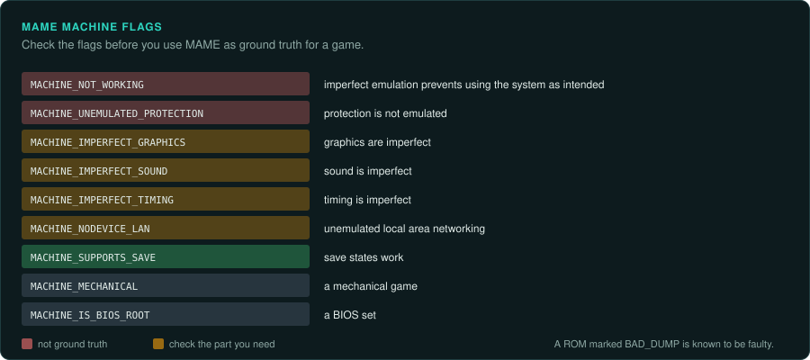
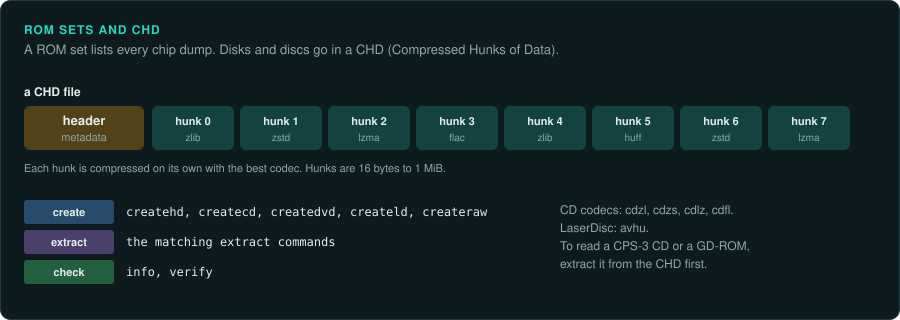
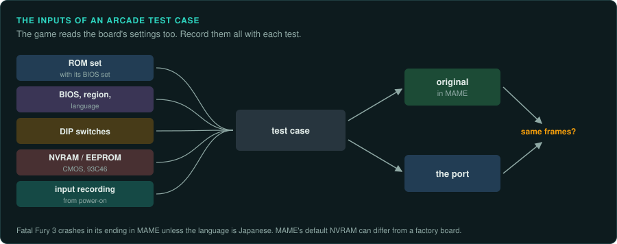
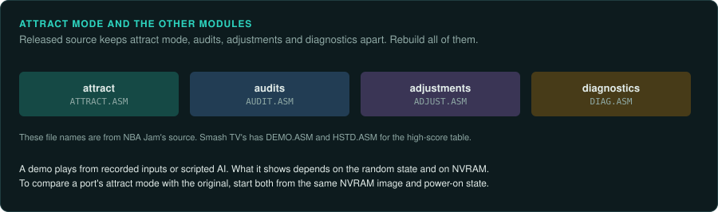
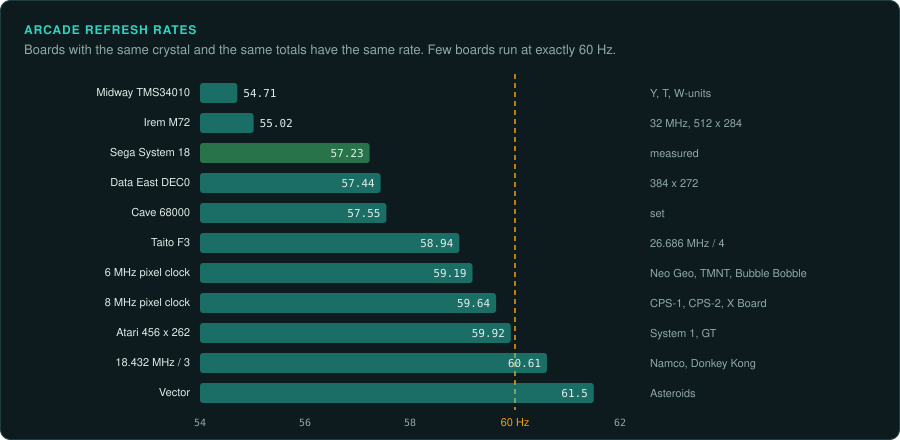
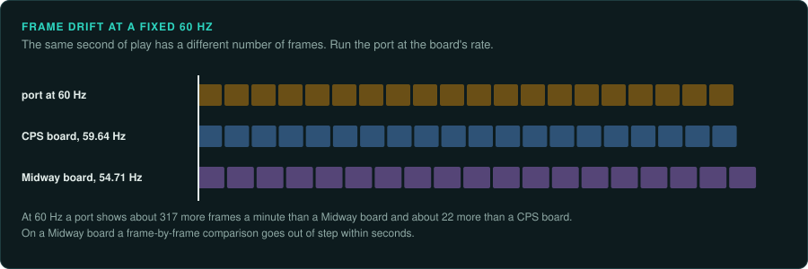
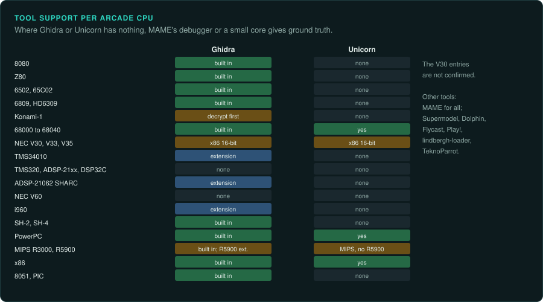
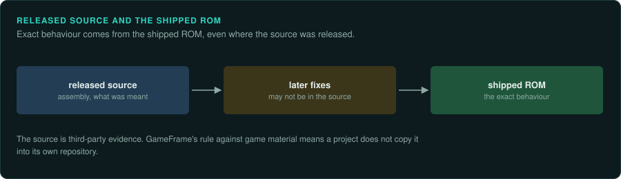

# Practices for arcade work

This page covers the practices that apply to every arcade board. MAME's driver source describes
the hardware. MAME marks each game with flags that show how complete its emulation is. The game
reads the settings stored on the board, so every test case records them.

## MAME driver source

MAME's driver headers give the chip list, the clocks, the ROM names and the known bugs in one
place. They also name the people whose research they use.

- The Neo Geo driver credits Charles MacDonald's MVS technical notes
  ([MAME: snk/neogeo.cpp](https://github.com/mamedev/mame/blob/master/src/mame/snk/neogeo.cpp)).
- The CPS-2 driver credits Razoola and the CPS2 decryption team
  ([MAME: capcom/cps2.cpp](https://github.com/mamedev/mame/blob/master/src/mame/capcom/cps2.cpp)).
- The CPS-3 driver credits David Haywood, Andreas Naive, Tomasz Slanina and ElSemi
  ([MAME: capcom/cps3.cpp](https://github.com/mamedev/mame/blob/master/src/mame/capcom/cps3.cpp)).
- The Taito F3 driver cites arcade-projects.com measurements of F3 sync
  ([MAME: taito/taito_f3.cpp](https://github.com/mamedev/mame/blob/master/src/mame/taito/taito_f3.cpp)).
  MAME takes some of its timing values from such community measurements.

Drivers set clocks with `XTAL(...)` values and divisors. A comment such as "verified on pcb"
marks a measured value. A value without such a comment is MAME's best estimate.

### Machine flags

The flags show whether MAME emulates a game well enough to use as ground truth
([MAME gamedrv.h](https://github.com/mamedev/mame/blob/master/src/emu/gamedrv.h)).

| Flag | Meaning |
|---|---|
| MACHINE_NOT_WORKING | "Imperfect emulation prevents using the system as intended" |
| MACHINE_UNEMULATED_PROTECTION | Protection is not emulated |
| MACHINE_IMPERFECT_GRAPHICS | Graphics are imperfect |
| MACHINE_IMPERFECT_SOUND | Sound is imperfect |
| MACHINE_IMPERFECT_TIMING | Timing is imperfect |
| MACHINE_NODEVICE_LAN | "unemulated local area networking" |
| MACHINE_SUPPORTS_SAVE | Save states work |
| MACHINE_MECHANICAL | A mechanical game |
| MACHINE_IS_BIOS_ROOT | A BIOS set |

MAME also marks a ROM as BAD_DUMP when the dump is known to be faulty. The Sega Model 1 TGP ROMs
for Virtua Fighter and three other games have this mark
([Early 3D boards](early-3d.md#sega-model-1)).

MAME also marks some of its own timing as wrong. The Taito F3 CPU clock is one case
([Other 2D makers](other-2d-makers.md#taito-f2-and-f3)). The Triforce, Chihiro, System 246 and
Lindbergh families do not run in MAME. For those games, take ground truth from other emulators
or from owned hardware.

## ROM sets and CHD

A ROM set lists every chip dump from a board. That includes BIOS sets such as Atari System 1's
([MAME: atari/atarisy1.cpp](https://github.com/mamedev/mame/blob/master/src/mame/atari/atarisy1.cpp)).
It also includes the PAL images on CPS-1 B-boards
([MAME: capcom/cps1.cpp](https://github.com/mamedev/mame/blob/master/src/mame/capcom/cps1.cpp)).

Disks and optical media are stored as **CHD** (Compressed Hunks of Data). MAME's `chdman`
tool works with them ([MAME chdman docs](https://github.com/mamedev/mame/blob/master/docs/source/tools/chdman.rst)).

- Create: `createhd`, `createcd`, `createdvd`, `createld` and `createraw`.
- Extract: the matching `extract*` commands.
- Check: `info` and `verify`.
- Codecs: zlib, zstd, lzma, huff and flac. The CD variants are cdzl, cdzs, cdlz and cdfl.
  LaserDisc uses avhu.
- Hunk size runs from 16 bytes to 1 MiB.

To read the files on a CPS-3 CD or a GD-ROM, extract them from the CHD first.

## NVRAM and DIP settings as test inputs

The game reads NVRAM and DIP switches. A test sets them like any other input.

- Williams 6809 games keep settings and high scores in battery-backed CMOS RAM
  ([MAME: williams/williams.cpp](https://github.com/mamedev/mame/blob/master/src/mame/williams/williams.cpp)).
- CPS-2 A-boards have a 93C46 serial EEPROM. CPS-1 drivers include MAME's serial EEPROM
  device. The Neo Geo includes NVRAM
  ([MAME: capcom/cps2.cpp](https://github.com/mamedev/mame/blob/master/src/mame/capcom/cps2.cpp);
  [capcom/cps1.cpp](https://github.com/mamedev/mame/blob/master/src/mame/capcom/cps1.cpp);
  [snk/neogeo.cpp](https://github.com/mamedev/mame/blob/master/src/mame/snk/neogeo.cpp)).
- Neo Geo MVS motherboards differ by generation. Memory-card headers, coin lockouts, LED
  displays and soldered BIOS vary between MV-1, MV-1F, MV-1A, MV-1B and MV-1C.
- Fatal Fury 3 in MAME crashes in the ending unless the language is Japanese. The BIOS region and
  language settings change which code the game runs
  ([MAME: snk/neogeo.cpp](https://github.com/mamedev/mame/blob/master/src/mame/snk/neogeo.cpp)).
- The NAOMI driver applies "usability defaults, i.e. 31kHz dip switch and non-canonical
  service mode settings in NVRAM". MAME's default NVRAM can differ from a factory board
  ([MAME naomi.cpp](https://github.com/mamedev/mame/blob/master/src/mame/sega/naomi.cpp)).
- JVS I/O is "the most common type". It is used on Sega driving games, NAOMI, Hikaru,
  Triforce and Chihiro
  ([MAME naomi.cpp](https://github.com/mamedev/mame/blob/master/src/mame/sega/naomi.cpp)).

Each test case records its DIP settings, its BIOS choice and region, and the NVRAM image it
started from. The list of outside inputs is in [inputs](../observe/inputs.md).

## Attract mode

Attract-mode demos play from recorded inputs or from scripted AI. What a demo shows depends on
the random state and on NVRAM. To compare a port's attract mode with the original, start both
from the same NVRAM image and the same power-on state.

Released source from the era shows that attract mode, audits, operator adjustments and
diagnostics are separate modules. NBA Jam's source has ATTRACT.ASM, AUDIT.ASM, ADJUST.ASM and
DIAG.ASM. Smash TV's has DEMO.ASM and HSTD.ASM for the high-score table
([historicalsource/nba-jam](https://github.com/historicalsource/nba-jam);
[historicalsource/smashtv](https://github.com/historicalsource/smashtv)). A full
reimplementation rebuilds all of them.

## Input recording

MAME's `-record` and `-playback` "do not work reliably for all systems". Playback can desync
if the configuration (.cfg), NVRAM (.nv) and memory card files differ from the original run.
MAME suggests recording and playing back with all of them deleted
([MAME docs: commandline-all.rst](https://github.com/mamedev/mame/blob/master/docs/source/commandline/commandline-all.rst)).

The same page lists other options for capturing ground truth.

| Option | What it does |
|---|---|
| `-exit_after_playback` | Quits at the end of a playback |
| `-mngwrite`, `-aviwrite`, `-wavwrite` | Capture video and audio |
| `-nvram_directory`, `-snapshot_directory` | Set where state goes |
| `-debugger`, `-debugscript` | Run the debugger and feed it commands from a file |
| `-debugger_host`, `-debugger_port` | Open a remote debugger |
| `-autoboot_script` | Runs a Lua script at start |
| `-plugins`, `-plugin` | Load plugins |

MAME's Lua memory taps and its `trace` and `wpset` debugger commands are not covered here.
See [running the original](../observe/running-the-original.md) and the
[re-observe](../../.claude/skills/re-observe/SKILL.md) skill for capture in general.

## Refresh rates and frame drift

Boards with the same crystal and the same totals have the same refresh rate. A rate marked
"(computed)" is the pixel clock divided by the totals in the driver's `set_raw(...)` screen
line.

| Group | Crystal and totals | Refresh | Boards |
|---|---|---|---|
| Midway TMS34010 | 506 x 289 | about 54.71 Hz (computed) | Y-unit, T-unit, W-unit |
| Irem | 32 MHz master, 512 x 284 | about 55.02 Hz (computed) | M72 |
| Sega and Cave | measured or set | 57.23 Hz (System 18, measured); about 57.55 Hz (Cave) | System 18, Cave 68000 |
| Data East | 384 x 272 | about 57.44 Hz (computed) | DEC0 |
| Taito | 26.686 MHz / 4, 432 x 262 | 58.94 Hz | F3 |
| 6 MHz pixel clock | 384 x 264 | about 59.19 Hz (computed) | Neo Geo, Konami TMNT, Taito Bubble Bobble |
| 8 MHz pixel clock | 512 x 262 | about 59.64 Hz (computed); 59.6388 Hz measured on CPS-2 | CPS-1, CPS-2, Sega X Board |
| Atari | 456 x 262 | about 59.92 Hz (computed) | System 1, GT |
| 18.432 MHz / 3 | 384 x 264 | about 60.61 Hz (computed) | Galaxian, Pac-Man, Galaga, Namco System 1 and 2, Donkey Kong |
| Vector | 12.096 MHz / 4096 / 12 / 4 | about 61.5 Hz (computed) | Asteroids |

The sources are the driver links on each family page. The source for the Bubble Bobble entry is
[MAME: taito/bublbobl.cpp](https://github.com/mamedev/mame/blob/master/src/mame/taito/bublbobl.cpp).

A port that runs at a fixed 60 Hz drifts against a recording. At 60 Hz it shows about 317 more
frames per minute than a 54.71 Hz Midway board. It shows about 22 more frames per minute than a
59.64 Hz CPS board. Both figures are computed from the rates above. On a Midway board, a
frame-by-frame comparison goes out of step within seconds.

Some boards have a nominal rate in MAME. The Sega Y Board, the PlayChoice-10 and Taito F2 are
set to 60 Hz without raw screen timing. Treat those rates as unknown.

## Disassembly and emulation support per arcade CPU

| CPU | Boards | Ghidra | Unicorn | Other tools |
|---|---|---|---|---|
| 8080 | Space Invaders | Built in (`8085`) | None | MAME |
| Z80 | Namco, Nintendo, Sega System 1, sound CPUs | Built in | None | MAME |
| 6502, 65C02 | Atari, Data East sound | Built in | None | MAME |
| 6809, HD6309 | Williams, Namco System 1 | Built in under MC6800 | None | MAME |
| Konami-1 | Konami | None (decrypt first, then 6809) | None | MAME's decrypting disassembler |
| 68000 to 68040 | Atari, Sega, Capcom, SNK, Taito, Namco 21/22 | Built in | M68K | MAME |
| NEC V30, V33, V35 | Irem | x86 16-bit real mode (not confirmed) | x86 16-bit (not confirmed) | MAME |
| TMS34010 | Midway Y/T/W-unit, Hard Drivin' | Extension [Ghidra_TMS34010](https://github.com/ZPaul2Fresh8/Ghidra_TMS34010) | None | MAME |
| TMS320, ADSP-21xx, MB8623x, DSP32C | 3D geometry, sound | None built in | None | MAME |
| ADSP-21062 SHARC | Model 2B, Hornet | [ghidra-sharc](https://github.com/roblg/ghidra-sharc) targets ADSP-214xx | None | MAME |
| NEC V60 | Model 1 | None found | None | MAME |
| i960 | Model 2 | Extension [ghidra_i960](https://github.com/mumbel/ghidra_i960) | None | MAME |
| SH-2, SH-4 | CPS-3, ST-V, NAOMI | Built in (SuperH, SuperH4) | None | MAME, Flycast |
| PowerPC | Model 3, Konami, Triforce | Built in | PPC | Supermodel, Dolphin |
| MIPS R3000, R5900 | ZN, Namco 11/12, System 246 | Built in MIPS; R5900 by extension | MIPS (no R5900) | MAME, Play! |
| x86 | Chihiro, Type X, Lindbergh, Ring, ES3 | Built in | x86 | lindbergh-loader, TeknoParrot |
| 8051, PIC | 8751 and PIC protection MCUs | Built in (8051, PIC) | None | MAME |

Ghidra's bundled processors have no V60, i960, SHARC, TMS34010 or TMS320 entries
([Ghidra/Processors](https://github.com/NationalSecurityAgency/ghidra/tree/master/Ghidra/Processors)).
The MC6800 module holds the 6800, 6805, 6809 and H6309 specs. The SuperH module holds SH-1, SH-2
and SH-2A ([MC6800 languages](https://github.com/NationalSecurityAgency/ghidra/tree/master/Ghidra/Processors/MC6800/data/languages);
[SuperH languages](https://github.com/NationalSecurityAgency/ghidra/tree/master/Ghidra/Processors/SuperH/data/languages)).
A community TMS34010 module exists. Its completeness is not confirmed. No V60 module is
known (not confirmed).

Unicorn has ARM, ARM64, MIPS, x86, PowerPC, SPARC, M68K, RISC-V, S390X and TriCore. It has no
Z80, 6502, 6809, 8080, SH-2 or TMS34010
([unicorn.h](https://github.com/unicorn-engine/unicorn/blob/master/include/unicorn/unicorn.h)).
For Z80, 6502 and 6809 games, take ground truth from MAME's debugger and Lua, or from a small
purpose-built CPU core. The [CPU families](../computers/cpu-families.md)
page lists such cores. The [re-emulate](../../.claude/skills/re-emulate/SKILL.md) skill covers
the Unicorn path for the CPUs it supports. FinalBurn Neo, Demul and JConfig are not covered
here.

## Source releases and the shipped ROM

Released source from the era is assembly language for the board's CPU, even on the TMS34010
games of the 1990s. Original source shows what the programmers meant. The source may not match
the final revision, so use the shipped ROM for exact behaviour. The
[Williams and Midway](williams-and-midway.md) page lists the source releases and their
provenance. GameFrame's rule against game material means a project does not copy such source
into its own repository ([Legal](../LEGAL.md)).
