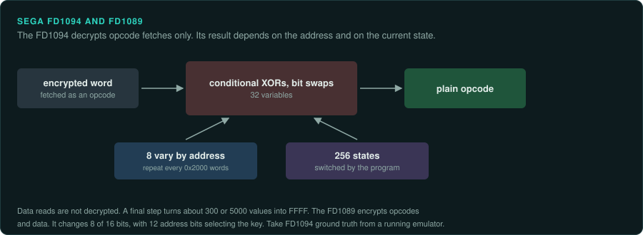
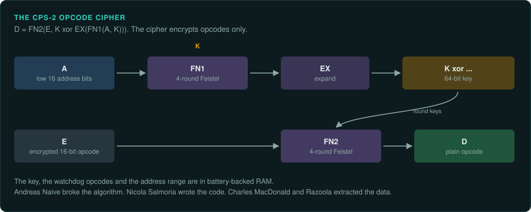
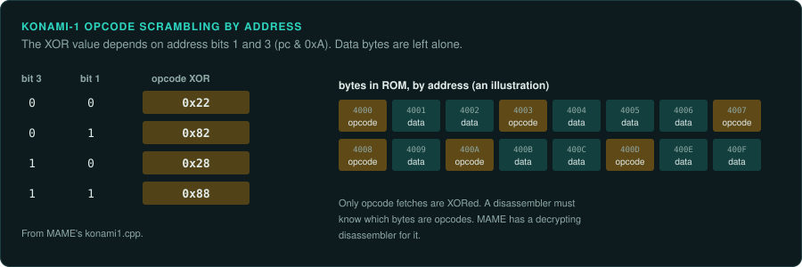
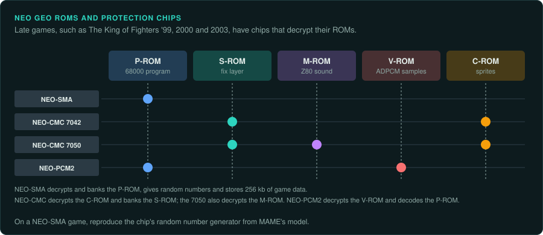
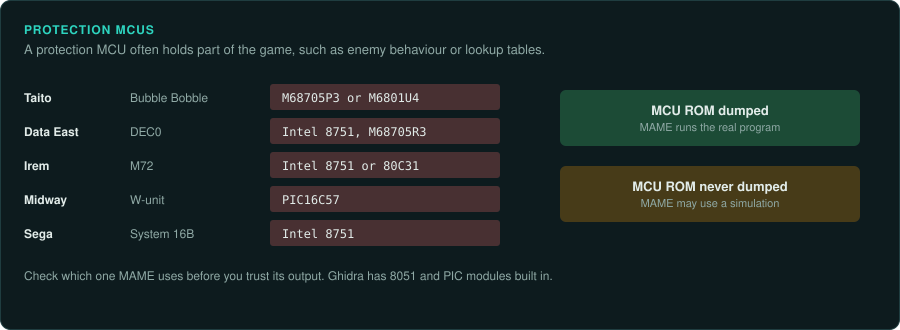

# Encryption and protection

Arcade encryption was usually built into a custom CPU and keyed from battery-backed RAM. When
the battery dies, the key is lost and the board "suicides". Preservation groups broke the
ciphers. They extracted keys from working boards. Later they wrote keys back into dead boards
so that the boards run again. MAME's source describes each algorithm. Each MAME driver
contains decryption code that an agent can follow. Decrypt the program before any disassembly.

The law on working around protection differs by country ([Legal](../LEGAL.md),
[the law worldwide](../preservation/law/README.md)). You decide which route to take.

| Scheme | Maker | CPU | Encrypts | Key store | On a dead battery |
|---|---|---|---|---|---|
| FD1094 | Sega | Custom 68000 | Program-space words only | 8 KB battery-backed RAM | Runs with a wrong key |
| FD1089A, FD1089B | Sega | Custom 68000 | Opcodes and data | 16 KB internal RAM | Stops |
| MC8123 and 315-5xxx parts | Sega | Custom Z80 | Not covered here | Not covered here | Not covered here |
| Kabuki | Capcom | Custom Z80 | Opcodes and data | Battery-backed RAM | Pin 28 low gives a plain Z80 |
| CPS-2 | Capcom | 68000 board | Opcodes only | SRAM in a custom IC | Blue or green screen |
| CPS-3 | Capcom | SH-2 derivative | Boot flash and program areas | SRAM on the CPU die | Thought to fall back to SFIII 2nd Impact keys |
| Konami-1 | Konami | Custom 6809 | Opcodes only | Fixed by address | No battery |
| NEO-CMC, NEO-PCM2, NEO-SMA | SNK and Playmore | Separate chips | Graphics, sound, samples, program | In the chip | Not covered here |

## Sega

### Hardware

System 16B configurations in MAME include FD1089A, FD1089B, FD1094, an MC8123 sound Z80 and an
Intel 8751 protection MCU. System 1 uses many encrypted Z80 parts (315-5033, 315-5041,
315-5048, 315-5051, 315-5065, 315-5098, 315-5178 and others) and the MC8123
([MAME: sega/segas16b.cpp](https://github.com/mamedev/mame/blob/master/src/mame/sega/segas16b.cpp);
[sega/system1.cpp](https://github.com/mamedev/mame/blob/master/src/mame/sega/system1.cpp)).

### Protection

**FD1094** is a custom 68000. It decrypts only words fetched from program space and leaves data
alone. It keeps its key in 8 KB of battery-backed RAM. Decryption is a chain of conditional XORs
and bit swaps controlled by 32 variables. Eight of them vary by address and repeat every 0x2000
words. The CPU has 256 internal "states" that the program can switch. A final step replaces
about 300 or about 5000 values with FFFF. This step stops tricks that dump the program through
PC-relative reads. When the battery dies the CPU still runs, with a wrong key
([MAME: sega/fd1094.cpp](https://github.com/mamedev/mame/blob/master/src/mame/sega/fd1094.cpp)).

**FD1089A and FD1089B** encrypt opcodes and data with related mappings. Only 8 of each 16 bits
change. Only 12 address bits select the key. MAME's notes call it clearly derived from the
Z80-based MC8123 and much weaker. Fewer than 128 bytes of its 16 KB internal RAM are enough to
decrypt a whole game. When the battery dies this CPU stops
([MAME: sega/fd1089.cpp](https://github.com/mamedev/mame/blob/master/src/mame/sega/fd1089.cpp)).

Later Sega boards use the 315-5881 crypt device and per-game key chips. They are on the
[early 3D](early-3d.md), [console-derived](console-derived.md) and [PC-based](pc-based.md)
pages.

### Tools

Follow MAME's FD1094 and FD1089 code to decrypt these CPUs. Who extracted the FD1094 keys, and
how, is not confirmed from a primary source.

### Projects to learn from

None listed yet.

### For an exact reimplementation

- An FD1094 program can switch state at run time. A static decrypt needs the state of each
  code region. Take ground truth from a running emulator.
- A dump from a dead-battery FD1094 board runs with a wrong key. Check that the set in use
  holds the right key.

## Capcom

### Hardware

CPS-1 QSound games use Kabuki for the sound Z80. CPS-2 and CPS-3 encrypt the main program. See
[Capcom CPS](capcom-cps.md) for the boards.

### Protection

**Kabuki** is a custom Z80 module that runs encrypted code with its key in battery-backed RAM.
With the battery removed, pulling pin 28 low makes it behave as a normal Z80. The cipher uses
swaps of adjacent bit pairs, rotations and an XOR. It treats opcodes and data differently
([MAME: capcom/kabuki.cpp](https://github.com/mamedev/mame/blob/master/src/mame/capcom/kabuki.cpp)).

**CPS-2** encrypts its main program. The key is stored in SRAM inside a battery-powered custom
IC. A board with a dead battery shows only a blue or green screen. The driver notes that no
CPS-2 game encrypted its sound program. Kabuki parts still appear as the sound Z80 on some
boards
([MAME: capcom/cps2.cpp](https://github.com/mamedev/mame/blob/master/src/mame/capcom/cps2.cpp)).

Andreas Naive broke the CPS-2 algorithm. Nicola Salmoria wrote the code. Charles MacDonald and
Razoola extracted data from the hardware. Only opcodes are encrypted. The cipher is two 4-round
Feistel networks over the 16-bit opcode and the low 16 address bits, with a 64-bit key:
D = FN2(E, K XOR EX(FN1(A, K))). The watchdog opcodes and the address range are also stored in
battery-backed RAM
([MAME: capcom/cps2crypt.cpp](https://github.com/mamedev/mame/blob/master/src/mame/capcom/cps2crypt.cpp)).
The full break came in January 2007 (secondary source)
([Capcom wiki (Wikipedia-derived)](https://capcom.fandom.com/wiki/CPS2)).

**CPS-3** decrypts inside the SH-2 derivative on the security cartridge. The key is stored in
battery-powered SRAM on the CPU die. The CPU monitors voltage and cart removal. It erases the
key on tampering. A dead cartridge is thought to fall back to keys identical to SFIII 2nd
Impact. Reflashing verified this. The data on the CD and SIMMs is not encrypted beyond the boot
flash and the program areas
([MAME: capcom/cps3.cpp](https://github.com/mamedev/mame/blob/master/src/mame/capcom/cps3.cpp)).

CPS-1 B-boards use protected PALs. MAME's ROM definitions hold images of the PAL type found on
the boards
([MAME: capcom/cps1.cpp](https://github.com/mamedev/mame/blob/master/src/mame/capcom/cps1.cpp)).

### Tools

Collectors make dead CPS-2 boards work again in several ways (secondary source)
([Capcom wiki](https://capcom.fandom.com/wiki/CPS2);
[shmups.system11.org forum](https://shmups.system11.org/viewtopic.php?p=1390355);
[MiSTer forum: Phoenix ROMs](https://mail.misterfpga.org/viewtopic.php?p=36552)).

- "Phoenix" ROM sets are modified game data. They run decrypted on boards whose key was lost.
  Their title screens show "PHOENIX" labels.
- Decrypted but otherwise unmodified sets exist, for example "Avalaunch" sets.
- Hardware key writers exist, for example InfiniKey.

In September 2016 ArcadeHacker, with Eduardo Cruz and others, published a CPS-2 "desuicide"
method. To make it, they reverse engineered the key-loading protocol. The code is on GitHub. It
needs only an Arduino and test clips to write a key back. A follow-up on 3 April 2017 described
at least 11 types of Capcom custom security silicon
([Hackaday: desuicide tag](https://hackaday.com/tag/desuicide)).

### Projects to learn from

MAME's `cps2crypt.cpp` describes the cipher in full. The ArcadeHacker desuicide code shows the
key-loading protocol.

### For an exact reimplementation

- A Phoenix set is a modified program. It is a poor reference for exact behaviour. Use a set
  that holds the original encrypted program and its key.
- A CPS-3 game needs the boot flash and program areas decrypted. The CD and SIMM data needs no
  further decryption.

## Konami

### Hardware

Konami-1 is a 6809 with scrambled opcodes
([MAME: konami/konami1.cpp](https://github.com/mamedev/mame/blob/master/src/mame/konami/konami1.cpp)).

### Protection

Opcode bytes are XORed with 0x22, 0x82, 0x28 or 0x88. The value depends on address bits 1 and 3
(`pc & 0xa`). Data bytes are left alone.

### Tools

MAME's Konami-1 device is a 6809 core with a decrypting disassembler (`SPLIT_DECRYPTION`). The
MAME debugger shows decrypted opcodes. Ghidra has no Konami-1 module. Decrypt the opcodes
first. Then load the result as 6809 code
([CPU families](../computers/cpu-families.md#the-6809)).

### Projects to learn from

None listed yet.

### For an exact reimplementation

- Data bytes are plain. A decrypted image must keep opcodes and data apart, because the XOR
  applies only to opcode fetches.

## SNK Neo Geo

### Hardware

Late Neo Geo games have protection chips. MAME lists them
([MAME: snk/neogeo.cpp](https://github.com/mamedev/mame/blob/master/src/mame/snk/neogeo.cpp)).
Example sets are The King of Fighters '99, 2000 and 2003.

### Protection

- **NEO-CMC 90G06CF7042** decrypts the C-ROM graphics and bank-switches the S-ROM.
- **NEO-CMC 90G06CF7050** adds decryption of the M-ROM sound program.
- **NEO-PCM2** (SNK 1999 and Playmore 2002) decrypts V-ROM samples and decodes the P-ROM.
- **NEO-SMA** decrypts and bank-switches the P-ROM program. It provides a random number
  generator. It stores 256 kb of game data.

### Tools

MAME's Neo Geo driver models each chip. Whether the NEO-CMC keys came from analysis or from
bootlegs is not confirmed.

### Projects to learn from

None listed yet.

### For an exact reimplementation

- A random number generator inside a protection chip is part of the game's behaviour.
  Reproduce it from MAME's model.

## Protection MCUs

### Hardware

Many makers used protection MCUs.

| Maker | Board or game | MCU |
|---|---|---|
| Taito | Bubble Bobble | M68705P3 or M6801U4 |
| Data East | DEC0 | Intel 8751, M68705R3 |
| Irem | M72 | Intel 8751 or 80C31 |
| Midway | W-unit | PIC16C57 |
| Sega | System 16B | Intel 8751 |

Sources: [MAME: taito/bublbobl.cpp](https://github.com/mamedev/mame/blob/master/src/mame/taito/bublbobl.cpp);
[dataeast/dec0.cpp](https://github.com/mamedev/mame/blob/master/src/mame/dataeast/dec0.cpp);
[irem/m72.cpp](https://github.com/mamedev/mame/blob/master/src/mame/irem/m72.cpp);
[williams/midwunit.cpp](https://github.com/mamedev/mame/blob/master/src/mame/williams/midwunit.cpp).

### Protection

A protection MCU often holds game logic such as enemy behaviour or lookup tables. If its ROM was
never dumped, MAME may use a simulation.

### Tools

Ghidra has built-in 8051 and PIC modules. Its MC6800 module holds the 6800 and 6805 specs. How the
Taito 68705 ROMs were dumped is not covered here.

### Projects to learn from

None listed yet.

### For an exact reimplementation

- Check whether MAME runs the MCU's dumped ROM or a simulation. A port built on a simulation
  has the same errors as the simulation.
- Treat the MCU program as part of the game. Trace it like the main CPU.
