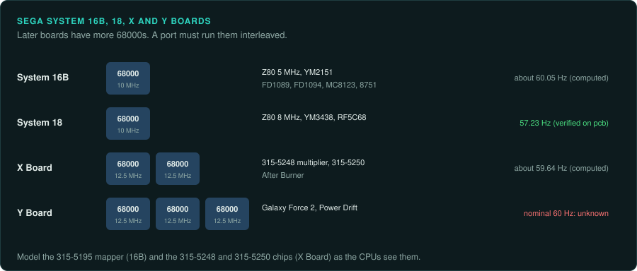

# Sega 2D boards

Sega's 68000 boards of the late 1980s ran beat 'em ups and sprite-scaling games. Many of them
encrypt the program inside a custom 68000, the FD1089 or the FD1094. System 18 has one of the
few refresh rates in MAME marked "verified on pcb". Sega System 1, the earlier Z80 board, is on
the [Z80 and 6502](z80-and-6502-era.md#sega-system-1) page.

| Board | Years | Main CPU and clock | Sound | Refresh | Protection | MAME status | Ghidra |
|---|---|---|---|---|---|---|---|
| System 16B | 1988 (Altered Beast) | 68000 at 10 MHz | Z80 at 5 MHz, YM2151 at 4 MHz | about 60.05 Hz (computed) | FD1089A, FD1089B, FD1094, MC8123, 8751 | In MAME | 68000 built in (after decryption) |
| System 18 | Not covered here | 68000 at 10 MHz | Z80 at 8 MHz, YM3438, RF5C68 | 57.23 Hz (measured) | Not covered here | In MAME | 68000 built in |
| X Board | Not covered here (After Burner) | Two 68000s at 12.5 MHz | Not covered here | about 59.64 Hz (computed) | Not covered here | In MAME | 68000 built in |
| Y Board | 1988 | Three 68000s at 12.5 MHz | Not covered here | nominal 60 Hz | Not covered here | In MAME | 68000 built in |

## System 16B

### Hardware

System 16B ran Altered Beast (1988). It uses a 68000 at 10 MHz, a Z80 at 5 MHz, a YM2151 at
4 MHz and a 315-5195 memory mapper. It shows 320 by 224 at about 60.05 Hz (computed)
([MAME: sega/segas16b.cpp](https://github.com/mamedev/mame/blob/master/src/mame/sega/segas16b.cpp)).

### Protection

System 16B configurations in MAME include FD1089A, FD1089B, FD1094, an MC8123 sound Z80 and an
Intel 8751 protection MCU. The [protection page](protection.md#sega) describes each cipher.

- The FD1094 decrypts program-space words only. It has 256 internal states that the program can
  switch.
- The FD1089 encrypts opcodes and data. Fewer than 128 bytes of its internal RAM are enough
  to decrypt a whole game.

### Tools

- Ghidra's 68000 module and Unicorn's M68K backend work on the program after decryption
  ([CPU families](../computers/cpu-families.md#the-68000)).
- Follow MAME's `fd1094.cpp` and `fd1089.cpp` to decrypt the program.
- The Intel 8751 MCU has a built-in Ghidra 8051 module.

### Projects to learn from

None listed yet.

### For an exact reimplementation

- Record which encrypted CPU the set uses.
- On an FD1094 game, take ground truth from a running emulator. A static decrypt needs the
  state of each code region.
- Model the 315-5195 memory mapper as the game programs it.

## System 18

### Hardware

System 18 has a 68000 at 10 MHz, a Z80 at 8 MHz, a YM3438 and an RF5C68 PCM chip. Its refresh
is 57.23 Hz, "verified on pcb"
([MAME: sega/segas18.cpp](https://github.com/mamedev/mame/blob/master/src/mame/sega/segas18.cpp)).

### Protection

Not covered here.

### Tools

As for System 16B.

### Projects to learn from

None listed yet.

### For an exact reimplementation

- Run the port at 57.23 Hz. MAME's value for this rate was measured on a real board.

## X Board

### Hardware

The X Board ran After Burner and other sprite-scaling games
([MAME: sega/segaxbd.cpp](https://github.com/mamedev/mame/blob/master/src/mame/sega/segaxbd.cpp)).

- Two 68000s run at 12.5 MHz from a 50 MHz master clock.
- The board also has a 315-5248 multiplier and a 315-5250 compare and timer chip.
- The screen shows 320 by 224 at about 59.64 Hz (computed).
- Some games add Z80s at 8 MHz for link and motor control.

### Protection

Not covered here.

### Tools

As for System 16B.

### Projects to learn from

None listed yet.

### For an exact reimplementation

- Model the 315-5248 multiplier and the 315-5250 chip as the CPUs see them. The game logic uses
  their results.
- Run both 68000s interleaved.
- On a game with link or motor Z80s, record what those CPUs send and receive.

## Y Board

### Hardware

The Y Board ran Galaxy Force 2 and Power Drift (both 1988). It runs three 68000s at 12.5 MHz.
MAME sets its refresh to a nominal 60 Hz with `set_refresh_hz(60)`. Its rate is not derived from
raw timing
([MAME: sega/segaybd.cpp](https://github.com/mamedev/mame/blob/master/src/mame/sega/segaybd.cpp)).

### Protection

Not covered here.

### Tools

As for System 16B.

### Projects to learn from

None listed yet.

### For an exact reimplementation

- Treat the Y Board's refresh rate as unknown. Measure it from a board or a recording before
  relying on it.
- Run the three 68000s interleaved.
