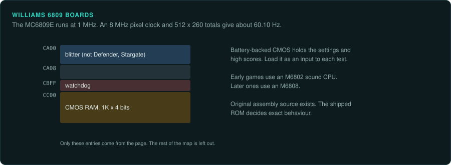
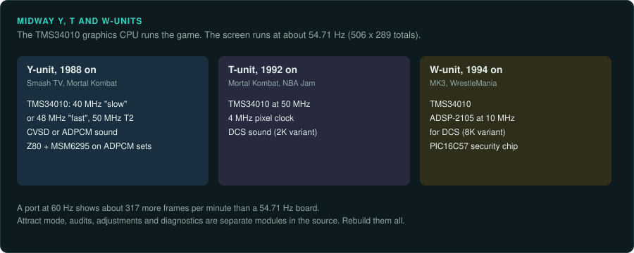
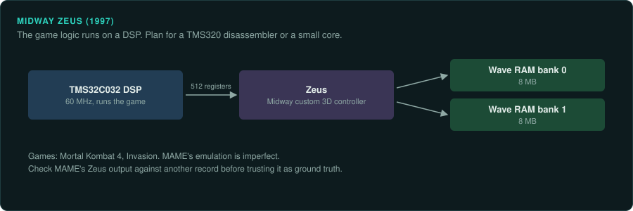

# Williams and Midway

Williams built 6809 boards for Defender and Robotron. Midway's Y, T and W-units ran their games
on the TMS34010 graphics CPU at the slowest refresh of the late 2D boards. Much of the original
assembly source for these games is now public. Midway Zeus, the later 3D board, runs its game on
a TI DSP with a custom 3D controller.

| Board | Years | Main CPU and clock | Sound | Refresh | Protection | MAME status | Ghidra |
|---|---|---|---|---|---|---|---|
| Williams 6809 | 1980 on | MC6809E at 1 MHz | M6802 or M6808 sound CPU | about 60.10 Hz (computed) | None listed | In MAME | Built in (MC6800 module) |
| Midway Y-unit | 1988 on | TMS34010 at 40, 48 or 50 MHz | Williams CVSD or ADPCM, Z80 at 4 MHz, MSM6295 | about 54.71 Hz (computed) | None listed | In MAME | Extension |
| Midway T-unit | 1992 on | TMS34010 at 50 MHz | DCS (2K variant) | Not covered here | None listed | In MAME | Extension |
| Midway W-unit | 1994 on | TMS34010 | DCS (8K variant) on an ADSP-2105 at 10 MHz | Not covered here | PIC16C57 | In MAME | Extension (TMS34010); none built in for the ADSP |
| Midway Zeus | 1997 on | TI TMS32C032 DSP at 60 MHz | Not covered here | Not covered here | None listed | Imperfect (2018 talk) | None built in |

## Williams 6809 boards

### Hardware

Williams' 6809 hardware ran Defender (1980) and Robotron 2084 (1982, Williams and Vid Kidz)
([MAME: williams/williams.cpp](https://github.com/mamedev/mame/blob/master/src/mame/williams/williams.cpp)).

- The MC6809E runs at 1 MHz.
- The pixel clock is 8 MHz. Totals of 512 by 260 give about 60.10 Hz (computed).
- Early games use an M6802 sound CPU. Later ones use an M6808.
- The memory map puts a blitter at CA00 to CA07. The driver notes that "Stargate and Defender
  do not have blitter".
- A watchdog is at CBFF.
- 1K by 4 bits of battery-backed CMOS RAM at CC00 to CFFF holds settings and high scores.

### Protection

None listed.

### Tools

Ghidra's MC6800 module holds the 6809 spec
([CPU families](../computers/cpu-families.md#the-6809)). Unicorn has no 6809 backend. Take
ground truth from MAME's debugger and Lua, or from a small 6809 core.

### Projects to learn from

- Defender's source is 6809 assembly files such as AMODE1.SRC, DEFA7.SRC and ROMC0.SRC
  ([historicalsource/defender](https://github.com/historicalsource/defender)).
- Robotron's is .ASM files such as RRSCRIPT.ASM, RRTEST1.ASM and RRTABLE.ASM, including
  diagnostic modules ([historicalsource/robotron](https://github.com/historicalsource/robotron)).
- The same account holds Joust, Sinistar and Stargate
  ([GitHub: historicalsource](https://github.com/historicalsource?tab=repositories)).
- Computer Archeology has a commented disassembly of Defender
  ([Computer Archeology: Arcade](https://www.computerarcheology.com/Arcade/)).

The repository descriptions are short game blurbs. The repositories give no licence or
provenance statement. No primary source shows an official release of the Defender or Robotron
source by Williams or Eugene Jarvis. GameFrame's rule against game material means a project does
not copy this source into its own repository. Treat it as third-party evidence
([Legal](../LEGAL.md)).

### For an exact reimplementation

- Load the CMOS settings and high scores as an input to each test
  ([practices](practices.md#nvram-and-dip-settings-as-test-inputs)).
- Model the blitter on games that have it. Defender and Stargate do not.
- The source shows what the programmers meant. It may not match the final revision, so use the
  shipped ROM for exact behaviour.

## Midway Y-unit and Z-unit

### Hardware

The Y-unit ran Smash TV (1990) and Mortal Kombat. NARC (1988) ran on the related Z-unit
([MAME: williams/midyunit.cpp](https://github.com/mamedev/mame/blob/master/src/mame/williams/midyunit.cpp)).

- The TMS34010 graphics CPU runs at 40 MHz on "slow" games: Smash TV, Trog and High Impact.
- It runs at 48 MHz on "fast" games: NARC, MK, Total Carnage and Strike Force.
- It runs at 50 MHz on Terminator 2.
- Sound is Williams CVSD or ADPCM. The ADPCM sets have a Z80 at 4 MHz and an MSM6295.
- Standard-resolution timing uses 506 by 289 totals, about 54.71 Hz (computed).

MAME sets the TMS34010's input clock. The chip's effective instruction rate is a fraction of
that clock (not confirmed).

### Protection

None listed.

### Tools

- The [Ghidra_TMS34010](https://github.com/ZPaul2Fresh8/Ghidra_TMS34010) extension adds the
  TMS34010. Its completeness is not confirmed.
- Ghidra has no built-in TMS34010 module. Unicorn has none either. Use MAME to produce
  ground truth.

### Projects to learn from

- Smash TV's source includes ADJUST.ASM, AUDIT.ASM, DEMO.ASM, DIAG.ASM, HSTD.ASM for the
  high-score table, and a MAKEFILE
  ([historicalsource/smashtv](https://github.com/historicalsource/smashtv)).
- The historicalsource account also holds NARC, Total Carnage and Trog
  ([GitHub: historicalsource](https://github.com/historicalsource?tab=repositories)).

### For an exact reimplementation

- Run the port at about 54.71 Hz. At 60 Hz a port shows about 317 more frames per minute
  ([practices](practices.md#refresh-rates-and-frame-drift)).
- Record which clock the game uses: 40, 48 or 50 MHz.
- Rebuild attract mode, audits, adjustments and diagnostics. They are separate modules in the
  source.

## Midway T-unit

### Hardware

The T-unit ran Mortal Kombat (1992) and NBA Jam (1993). It runs the TMS34010 at 50 MHz with a
4 MHz pixel clock. Sound is DCS (2K variant)
([MAME: williams/midtunit.cpp](https://github.com/mamedev/mame/blob/master/src/mame/williams/midtunit.cpp)).

### Protection

None listed.

### Tools

As for the Y-unit.

### Projects to learn from

- NBA Jam's source includes ATTRACT.ASM, AUDIT.ASM, ADJUST.ASM, DIAG.ASM, DIPSW.EQU,
  DIPEQU.ASM and batch build files
  ([historicalsource/nba-jam](https://github.com/historicalsource/nba-jam)).
- The historicalsource account also holds Mortal Kombat II, NBA Jam Tournament Edition, NBA
  Hangtime, Open Ice and Revolution X
  ([GitHub: historicalsource](https://github.com/historicalsource?tab=repositories)).

### For an exact reimplementation

- Read the DIP switch equates in the source as a list of settings to record per test.
- Model the DCS sound board as a second program.

## Midway W-unit

### Hardware

The W-unit ran Mortal Kombat 3 (1994) and WWF WrestleMania (1995). It adds an ADSP-2105 at
10 MHz for DCS sound (8K variant)
([MAME: williams/midwunit.cpp](https://github.com/mamedev/mame/blob/master/src/mame/williams/midwunit.cpp)).

### Protection

The board has a PIC16C57 security chip. Ghidra has a built-in PIC module
([protection](protection.md#protection-mcus)).

### Tools

As for the Y-unit. Ghidra has no built-in ADSP-21xx module.

### Projects to learn from

None listed beyond the T-unit sources.

### For an exact reimplementation

- Check whether MAME runs the PIC16C57's dumped program or a simulation.
- The ADSP-2105 sound program uses a different instruction set. Trace it separately.

## Midway Zeus

### Hardware

Midway Zeus (1997) ran Mortal Kombat 4 and Invasion. Its main CPU is a TI TMS32C032 DSP at
60 MHz. The Zeus chip is a Midway custom 3D controller. It has 512 registers in the CPU's
address space and 16 MB of Wave RAM in two banks
([MAME wiki, Midway Zeus](https://wiki.mamedev.org/index.php/Midway_Zeus)). Zeus 2 renders to a
32 bpp framebuffer with a different register layout
([Aaron Giles, December 2007 log](https://aarongiles.com/old/?m=200712)). A 2018 talk describes
Zeus as a microcoded VLIW design at 66 MHz
([Reverse Engineering Zeus Part 1 (siliconpr0n, 2018)](https://siliconpr0n.org/media/mtvre/2018-03-14_Reverse_Engineering_Zeus_Part_1.pdf)).

### Protection

None listed.

### Tools

- The 2018 talk calls MAME's support imperfect. The driver's current flags are
  unknown.
- Ghidra has no built-in TMS320 module. Unicorn has none either.

### Projects to learn from

- Aaron Giles used Cruis'n Exotica and The Grid as his Zeus 2 test cases.
- The siliconpr0n talk on reverse engineering Zeus.

### For an exact reimplementation

- Game logic runs on a DSP. Plan for a TMS320 disassembler or a small core.
- Check MAME's Zeus output against another record before trusting it as ground truth.
