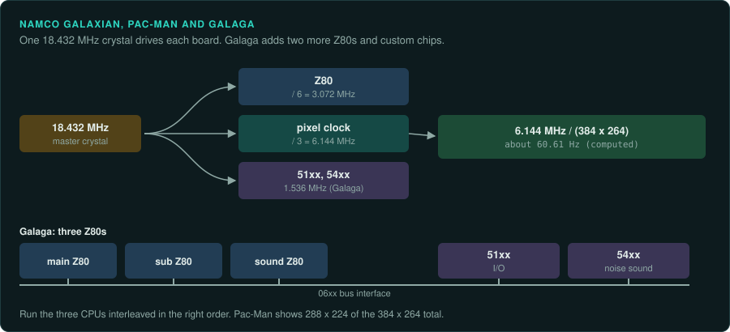
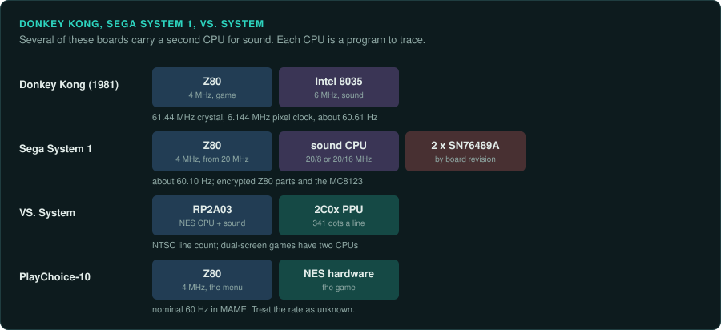
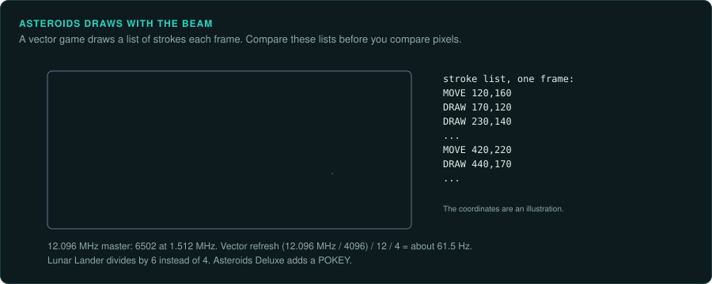

# Z80 and 6502 boards

The boards of 1979 to the mid-1980s run Z80 or 6502 programs, often with several CPUs on one
board. Namco and Nintendo boards use timings based on 18.432 MHz and run at about 60.61 Hz.
Atari's vector games draw lines with the beam of a vector display. Nintendo's arcade systems
reuse NES chips.

| Board | Years | Main CPU and clock | Sound | Refresh | Protection | MAME status | Ghidra |
|---|---|---|---|---|---|---|---|
| Namco Galaxian | 1979 | Z80 at 3.072 MHz | Not covered here | about 60.61 Hz (computed) | None listed | In MAME | Z80 built in |
| Namco Pac-Man | 1980 | Z80 at 3.072 MHz | Namco WSG | about 60.61 Hz (computed) | None listed | In MAME | Z80 built in |
| Namco Galaga | 1981 | Three Z80s at 3.072 MHz | Namco 54xx noise | about 60.61 Hz (computed) | None listed | In MAME | Z80 built in |
| Nintendo Donkey Kong | 1981 | Z80 at 4 MHz | Intel 8035 at 6 MHz | about 60.61 Hz (computed) | None listed | In MAME | Z80, 8048 built in |
| Atari Asteroids | 1979 | 6502 at 1.512 MHz | POKEY on Asteroids Deluxe | about 61.5 Hz (computed) | None listed | In MAME | 6502 built in |
| Sega System 1 | 1980s | Z80 at 4 MHz | Sound CPU, two SN76489A | about 60.10 Hz (computed) | Encrypted Z80 parts, MC8123 | In MAME | Z80 built in (after decryption) |
| Nintendo VS. System | 1980s | RP2A03 | In the RP2A03 | NTSC line count | Not covered here | In MAME | 6502 built in |
| Nintendo PlayChoice-10 | 1980s | Z80 at 4 MHz menu, plus NES hardware | NES | nominal 60 Hz | Not covered here | In MAME | Z80, 6502 built in |

## Namco Galaxian, Pac-Man and Galaga

### Hardware

Namco's early boards use the same 18.432 MHz crystal
([MAME: galaxian/galaxian.h](https://github.com/mamedev/mame/blob/master/src/mame/galaxian/galaxian.h);
[galaxian.cpp](https://github.com/mamedev/mame/blob/master/src/mame/galaxian/galaxian.cpp)).

- **Galaxian (1979)** uses an 18.432 MHz master clock with a Z80 at 3.072 MHz. Its 384 by 264
  totals give about 60.61 Hz (computed). Sidam bootlegs use a 12 MHz crystal instead.
- **Pac-Man (Namco, 1980; Midway licence in the US)** has one Z80 at 3.072 MHz and Namco's
  wavetable sound (WSG). Its screen line is `set_raw(18.432 MHz / 3, 384, 0, 288, 264, 0, 224)`.
  That gives 288 by 224 visible pixels at about 60.61 Hz (computed)
  ([MAME: pacman/pacman.cpp](https://github.com/mamedev/mame/blob/master/src/mame/pacman/pacman.cpp)).
- **Galaga (1981)** has three Z80s at 3.072 MHz each. Namco custom chips 51xx (I/O) and 54xx
  (noise sound) run at 1.536 MHz. They communicate through a 06xx bus interface. The timing
  matches Pac-Man
  ([MAME: namco/galaga.cpp](https://github.com/mamedev/mame/blob/master/src/mame/namco/galaga.cpp)).

### Protection

None listed.

### Tools

Ghidra decodes the Z80 with its built-in module. Unicorn has no Z80 backend. Take ground truth
from MAME's debugger and Lua, or from a small Z80 core
([CPU families](../computers/cpu-families.md#the-8080-z80-and-sm83)).

### Projects to learn from

Computer Archeology hosts commented disassemblies of Galaga, with the main, secondary and sound
CPUs on separate pages. It also has Frogger, Scramble, Time Pilot, Crazy Climber, Phoenix and
Moon Patrol. Its menu has code or hardware pages for Pooyan and The Pit
([Computer Archeology: Arcade](https://www.computerarcheology.com/Arcade/)).

### For an exact reimplementation

- Run the port at about 60.61 Hz.
- On Galaga, run the three CPUs interleaved in the right order. Some of the game's behaviour
  depends on this timing.
- Model the 51xx and 54xx custom chips as the CPUs see them.

## Nintendo Donkey Kong

### Hardware

Donkey Kong (1981) uses a 61.44 MHz crystal and a 6.144 MHz pixel clock, for about 60.61 Hz
(computed). Its Z80 runs at 4 MHz, "verified in schematics". An Intel 8035 at 6 MHz runs the
sound program ([MAME: nintendo/dkong.h](https://github.com/mamedev/mame/blob/master/src/mame/nintendo/dkong.h);
[dkong.cpp](https://github.com/mamedev/mame/blob/master/src/mame/nintendo/dkong.cpp)).

### Protection

None listed.

### Tools

Ghidra has built-in Z80 and 8048 modules. Unicorn has neither.

### Projects to learn from

Computer Archeology's menu has a Donkey Kong page
([Computer Archeology: Arcade](https://www.computerarcheology.com/Arcade/)).

### For an exact reimplementation

- Trace the 8035 sound program as well as the Z80 game program.

## Atari Asteroids and the vector games

### Hardware

Asteroids (1979) draws on a vector display. Its master clock is 12.096 MHz, with a 6502 at
1.512 MHz. MAME sets the vector refresh to (12.096 MHz / 4096) / 12 / 4, which is about 61.5 Hz
(computed). Lunar Lander divides by 6 instead of 4. Asteroids Deluxe adds a POKEY at master / 8
([MAME: atari/asteroid.cpp](https://github.com/mamedev/mame/blob/master/src/mame/atari/asteroid.cpp)).

### Protection

None listed.

### Tools

Ghidra decodes the 6502 with its built-in module. Its p-code for `ADC` is not exact, so do not
use Ghidra's emulation as ground truth
([CPU families](../computers/cpu-families.md#ghidras-6502-adc-is-not-exact)). Unicorn has no
6502 backend.

### Projects to learn from

- The historicalsource account holds original assembly source for Asteroids. It includes
  VECAN.XX, VECMAC.XX and VECINC.XX for the vector generator, with a map file ASTROD.MAP
  ([historicalsource/asteroids](https://github.com/historicalsource/asteroids)).
- The same account holds Asteroids Deluxe, Battlezone, Black Widow, Gravitar, Lunar Lander,
  Major Havoc (a disassembly), Quantum, Red Baron, Space Duel, Star Wars and Tempest
  ([GitHub: historicalsource](https://github.com/historicalsource?tab=repositories)). The
  repositories give no licence or provenance statement.
- Computer Archeology has commented disassemblies of Asteroids and Omega Race, and a Tempest
  page ([Computer Archeology: Arcade](https://www.computerarcheology.com/Arcade/)).

### For an exact reimplementation

- A vector game draws a list of beam strokes each frame. Compare these lists before you compare
  pixels.
- Run the port at the vector refresh, about 61.5 Hz on Asteroids. Lunar Lander uses a
  different divisor.

## Sega System 1

### Hardware

Sega System 1 (Flicky, Choplifter and others) uses a Z80 at 4 MHz from a 20 MHz master clock.
Its sound CPU and two SN76489A run at 20 / 8 or 20 / 16, depending on the board revision. The
screen runs at about 60.10 Hz (computed)
([MAME: sega/system1.cpp](https://github.com/mamedev/mame/blob/master/src/mame/sega/system1.cpp)).

### Protection

System 1 uses many encrypted Z80 parts (315-5033, 315-5041, 315-5048, 315-5051, 315-5065,
315-5098, 315-5178 and others) and the MC8123
([protection](protection.md#sega)).

### Tools

Decrypt the program with MAME's model of the part. Then load it as Z80 code in Ghidra.

### Projects to learn from

None listed yet.

### For an exact reimplementation

- Record the board revision. The sound clock divisor depends on it.
- Use the decryption for the exact encrypted part on the board.

## Nintendo VS. System and PlayChoice-10

### Hardware

Nintendo's arcade systems reuse NES chips. The **VS. System** uses an RP2A03 CPU and a 2C0x PPU
with 341 dots per line and the NTSC line count. Dual-screen versions use two CPUs and two
screens ([MAME: nintendo/vsnes.cpp](https://github.com/mamedev/mame/blob/master/src/mame/nintendo/vsnes.cpp)).
The **PlayChoice-10** runs its menu on a Z80 at 4 MHz beside the NES hardware. Both of its
screens are set to a nominal 60 Hz
([MAME: nintendo/playch10.cpp](https://github.com/mamedev/mame/blob/master/src/mame/nintendo/playch10.cpp)).

### Protection

Not covered here.

### Tools

A VS. game's code is NES code, so NES tools work on it
([tools for console work](../consoles/tools.md)).

### Projects to learn from

None listed yet.

### For an exact reimplementation

- On a dual-screen VS. game, run both CPUs and both screens.
- The PlayChoice-10 rate is nominal in MAME. Treat it as unknown.
