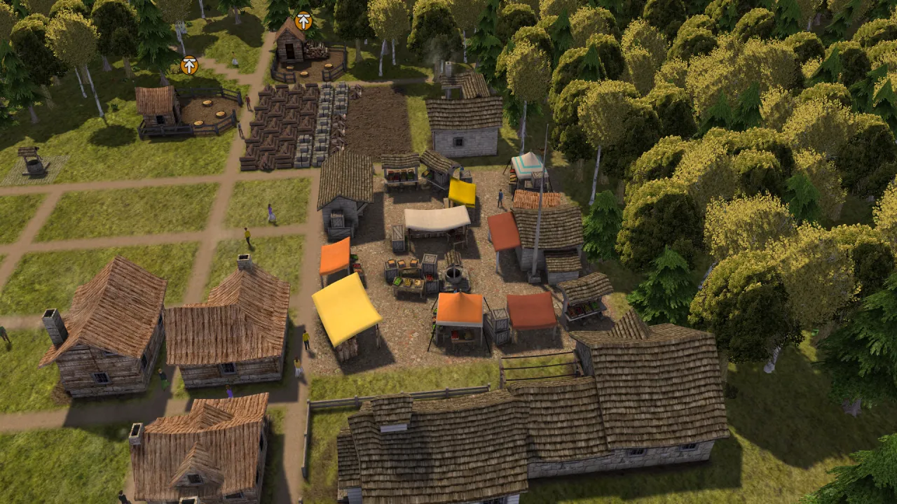

# Case study: Un-Banished

[Un-Banished](https://github.com/tanepiper/unbanished) is a 1:1 reimplementation of the
city-building game Banished (Shining Rock Software, 2014) in Rust, running on Windows, macOS,
Linux and in the browser on the player's own game files. GameFrame was extracted from it:
the skills, the Ghidra scripts and the emulator began there and were made generic here.

*Un-Banished drawing a large town with the original's interface, and a market in late summer.
Both are the port's own frames, made from the player's game files.*

## Why it is a useful example

Banished is a small but complete game: a C++ engine DLL that exports its class names, a game
EXE, a custom package format, a deterministic simulation with its own random number generator,
Direct3D 9 and 11 shaders, and a data-driven interface. Every step of the loop was needed.

## What the project did, step by step

- **Inventory:** two native x64 binaries (the game, and an engine runtime DLL whose exports
  include about 4,900 mangled C++ names), two renderer DLLs, four LZF-compressed packages.
- **Formats first:** all 170 resource types identified through the engine's type registry
  (type ids are CRC32 hashes of UTF-16 class names), each with a reader whose test parses every
  resource of its type to the last byte.
- **Decompile:** one headless Ghidra export of both binaries (about 20 minutes), searched as
  text by every later session.
- **Trace, emulate, port, verify:** 32 emulator scripts produced ground truth for the random
  generator, noise, terrain generation, path finding, tree growth, names, storage, animation and
  more; 22 test files compare the Rust code against them bit for bit. One example: the town name
  generator was checked on 3,000 names in sequence, which also proves that random draws happen
  in the same order.
- **Whole-system checks:** saves from the original load and continue; two runs with the same
  seed give identical frames; screenshots of the original (streamed from a Windows PC) are
  compared with an image-difference tool; every optimisation must leave saves and frames
  identical between versions.
- **A core and its additions:** after the reimplementation matched, the project split it into
  an exact core (the town, its rules, saves and player commands, with no drawing, sound or
  network) and additions built around it: multiplayer with a server, recordings, a test probe,
  mod sites and rule hooks for mods (WebAssembly plugins with no floats and a fixed budget).
  Each addition is a build option; a test builds the game without any of them and checks that
  it plays exactly as the full build; `--pure` turns them all off for one run. Doing this earlier
  would have been cheaper: see `re-port`, "Build it so it can be checked".
- **Releases:** each version is tagged by one workflow, which also builds the game on Windows,
  macOS and Linux runners and attaches a zip for each (`docs/OUTPUTS.md`), and rebuilds the
  website with the browser version.
- **GameFrame grew with the work:** each slow step or mistake became a tool or a rule
  (labels files, a readable-decompile tool, random-draw tracing and diffing, a deviations
  ledger, version comparison). Its "How it was made" page tells the story:
  https://github.com/tanepiper/unbanished/blob/main/docs/PROCESS.md

## Seeing and driving the original and the port

- **The original, streamed.** Banished ran on a Windows PC and streamed to the development
  machine with Steam Remote Play. An agent with computer-use access watched and pressed
  buttons; screenshots were filed with the settings that produced them and compared with the
  port's headless captures by blurred image difference, because the stream is compressed.
- **The probe.** A small command language that finds things on the screen (by the original's
  dialog and control names, or by text) and in the town, and presses buttons and types as a
  player would. The same commands work in the browser's console, in headless runs and in the test scenarios. Answers are JSON. It is the port's object model and its entry points
  ([A model to query](../observe/object-model.md)).
- **Baselines.** Test scenarios drive the game with the probe and record the answers; a changed answer is a change in what the game does. Each one must be explained.

## What GameFrame's later tools found in it

GameFrame's tools were later run on Banished's files, as a test of the tools and a second look at
the game:

- `tools/triage/hashnames.py` found the hash scheme with no hint. Run over the 5,812 extracted
  resources with names from the two binaries, CRC-32 of the UTF-16 name matched 6,323 values,
  against 629 expected by chance. It named 169 of the 170 registered types. The run also showed
  two gaps in the tool, both now fixed: names had to come from the file being searched, and an
  explicit value below 2^24 was left out.
- `tools/formats/shaders.py` found a Direct3D 9 and a Direct3D 11 version of every shader, and
  268 GLSL 3.3 programs in 67 resources, generated from the engine's own shading language. The
  project had not recorded the GLSL source.
- `tools/formats/skeleton.py` found the animation keys at first. It missed the skeleton, because
  Banished stores each bone as a record with a name. The tool now finds joints stored as records,
  and it finds the citizen's 27 bones by name.

## Brought up to GameFrame's standard

In October 2026 the project was brought up to the standard GameFrame now sets for a project. It
enables GameFrame's Claude Code plugin (skills, agents and gates), keeps its labels in `labels/`,
gives its state in `docs/CHECKLIST.md`, and runs GameFrame's tools from a clone with `tools/gf.sh`.
Its labels made from its own citations raised the labelled share of the game's code from 10.2 % to
28.2 % by size. Its report is `docs/develop/GAMEFRAME.md`.

## Numbers (October 2026)

About 130,000 lines of Rust; 2,050 of 9,846 original functions traced (68 % of the game's code
by size); 170 of 170 resource types; around 45 documented deviations.

## Where to look in it

| In Un-Banished | Corresponds to here |
|---|---|
| `AGENTS.md` | `templates/project/AGENTS.md` |
| `.claude/skills/banished-*` | `.claude/skills/re-*` |
| `tools/ghidra/`, `tools/emu/pe_emu.py` | `tools/ghidra/`, `tools/emu/pe_emu.py` (generalised) |
| `tools/triage/` (`decomp.py`, `fnindex.py`, `rngdiff.py`, `deviations.py`, `coverage.py`) | `tools/triage/decomp_query.py`, `tools/verify/seqdiff.py`, `tools/triage/deviations.py`, `tools/triage/coverage.py` |
| `tools/compat/`, `tools/test/run.py` | `re-verify` sections 3, 6 and 7 |
| `crates/sim`, the cargo features, `--vanilla` | `re-port`, "Build it so it can be checked" and "Additions the original does not have" |
| `labels/` (`names.tsv`, `fields.tsv`, `names-from-port.tsv`), `docs/CHECKLIST.md` | `labels/`, `docs/CHECKLIST.md`, `tools/triage/cite_labels.py` |
| `.claude/settings.json` (GameFrame's plugin), `tools/gf.sh` | The plugin (skills, agents, gates) and the toolkit, run from a clone |
| `docs/` (findings in evidence style) | `templates/project/docs/`, `re-land` |
