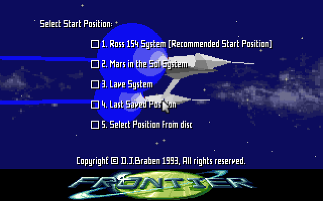
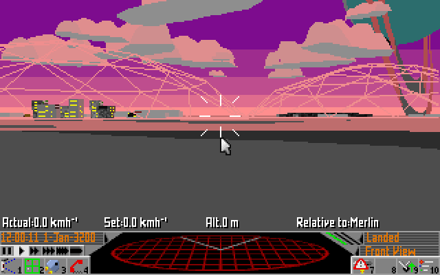

# Case study: Frontier: Elite II

A 1:1 reimplementation of **Frontier: Elite II** (DOS, 1993) in Rust and wgpu, for native
platforms and the browser, on the player's own copy of the game. The repository is private
while the work is in progress. It shows a different route. The port runs the
original inside itself and replaces it routine by routine.

*The project's own runtime running the player's copy of the game, headless: the start-position
menu, and the cockpit after choosing Ross 154. The maths library and the sound driver in
these runs are the native ports.*

## Why it is a useful example

Frontier is a [space simulation](../games/vehicle-sims.md): a galaxy generated from seeds, real
orbits, and a software 3D engine. The program is a DOS executable plus twenty code overlays
(loaded on demand into the same memory) and separate overlays for the maths library, the video
driver and the sound drivers. Much of the maths is hand-written assembly with values passed in
registers.

## What the project did

- **A runtime of its own.** The project wrote an in-process 386 real-mode CPU with the DOS,
  BIOS, EMS and VGA services the game uses. The original runs on it from boot to the cockpit,
  natively and in the browser, reading the player's files.
- **Oracle and scaffold at once.** Any original routine can be called with chosen inputs in `cargo test`. Its registers and memory are compared with the native port. The playable game runs the original code. Native ports are hooked in at the original routines' addresses as they are written. When nothing original runs any more, the runtime remains only as the
  oracle.
- **The maths library first.** All 47 routines of the maths overlay (float arithmetic, square
  roots, matrices, projection, the vertex transformer, face shading, 64-bit positions) were
  ported and checked, then run natively in the game with frames identical to the original over
  60 seconds.
- **Sound.** The AdLib driver was ported natively; its output is identical sample for sample to
  the original driver running on the runtime, through an OPL2 model at the chip's own rate.
- **Overlays.** The overlay loader was traced first, and its tables used to seed function
  discovery in Ghidra across all overlays.

## Tooling it built

| Need | Tool |
|---|---|
| Run the original as a reference, with a window | DOSBox Staging with a fixed configuration and a reset script |
| Run the original inside tests and the game | the project's 386 and DOS runtime |
| Replace routines one at a time | hooks at the original's addresses, with parity checks and shadow verification (run both, compare) |
| Analyse the overlays | Ghidra scripts that seed functions from the overlay tables and export ranges |

## What it teaches

- When the original is small enough to emulate, running it inside the port gives a playable
  game on day one and an oracle in every test.
- Replace the original from the bottom up (maths, then drawing, then rules), checking each
  routine as it replaces the original, while the game keeps running.
- Do the same for the drivers: a ported sound driver can be compared sample for sample.

OpenRCT2 and OpenLoco used the same idea on Windows: new code linked into the original
program, replacing it function by function ([Management](../games/management.md)).
