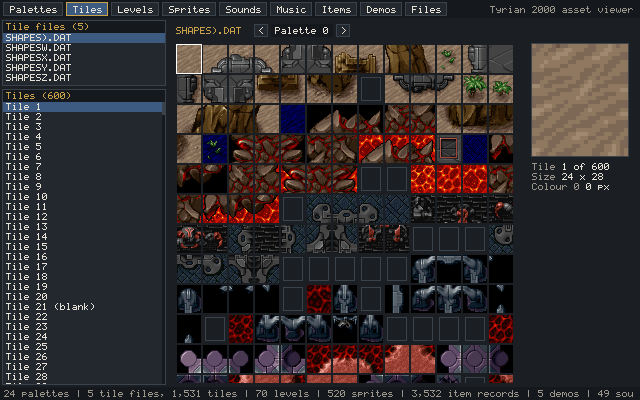
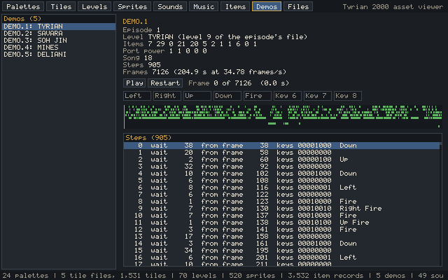

# Case study: Tyrian 2000

Tyrian 2026 is a clean-room, 1:1 reimplementation of **Tyrian 2000** (version 3.0, DOS, 1999)
in Rust, for Windows, macOS, Linux and the browser. It reads the player's own copy of the game.
The repository is private while the work is in progress. It is GameFrame's main test of the
16-bit DOS tools: most of `tools/dos/` and `tools/emu/dos_env/` came from it.

*The project's asset viewer, drawn by the port's own readers. Above, the tiles of one tile
file. Below, a recorded demo: each step waits a number of frames and holds a set of keys,
which is the input record the port replays ([Inputs](../observe/inputs.md)).*

## Why it is a useful example

Tyrian is a vertical shoot 'em up ([Arcade action](../games/arcade-action.md)): a stream with
controls, at a fixed frame rate, with levels driven by event scripts. It was written in Borland
Pascal 7 for 16-bit real mode, and the shipped program kept its Turbo Debugger symbols, so
every variable and procedure has its original name. It has demos (input per frame), an AdLib
music driver, Turbo Pascal's 6-byte `Real` arithmetic, and its own drawing to VGA memory.

## What the project did

- **Names first.** The debug symbols became labels for Ghidra and generated Rust: every
  variable of the data segment at its original offset (`Globals`), every record type in its
  original layout. The port and the checks share one definition of the state.
- **Formats.** Item tables, levels, tiles, sprites, sounds, music and demos: each reader is
  checked on every byte of every file.
- **The main loop in fragments.** The frame (`MAIN`, about 19 KB of code) is split into about
  twenty parts in the original's order. For each part, a headless run of the original saves
  the data segment, the stack and the screen before and after that part, frame by frame. The
  port runs the same part from the "before" image and must produce the "after" image exactly.
  Captures also save the VGA display (the HUD is drawn straight onto it), the heap blocks the
  frame draws from and into, and the open DOS files (the demo being read).
- **Then the whole frame.** Once every part matched, they were wired into one frame function
  and checked against whole-frame captures. That caught state the parts' own tests never saw
  (temporaries the caller keeps in globals). The timer interrupt's counters are left out of the comparison. The BIOS clock is an input.
- **Fuzzing from real states.** Demo frames do not reach every branch. Fuzzers start from
  captured states, change them at random (new enemies, shots, events) and compare the
  original and the port on thousands of frames.
- **Arithmetic the original did in software.** Every `Real` routine the game uses was called
  on random and edge-case operands (hundreds of thousands of calls per routine, division
  852,000) and ported to match.
- **Sound and timing.** The music driver's register writes to the OPL2 chip were compared for
  41 songs; the music tempo was measured against DOSBox recordings.

## Tooling it built

| Need | Tool |
|---|---|
| Names and types from Borland debug symbols | `tdinfo.py`, `td_rust.py` (in GameFrame) |
| One routine, run headless | `dos_emu` (in GameFrame) |
| The whole program, run headless, frame by frame | `dos_env` (in GameFrame), and the project's `truth/fragment.py` |
| The program with a window and a debugger | DOSBox-X, driven over its debugger channel (`dbx_control.py`) |
| File formats measured from the original's reads | `fileio_trace.py` on DOSBox-X file logs |
| An asset viewer for every format, native and in the browser | the project's `apps/viewer` |

## What it teaches

- When debug symbols exist, generate code from them before writing any by hand.
- Port a long main loop in fragments, each checked from captured states, in the original's
  order. A fragment that matches stays matched while the rest is written.
- Demos give the common paths; fuzzing from real states gives the rest. Fuzz by risk: maths,
  random draws and branchy code, not every routine.
- Check the whole loop body once the parts match: the wiring is where the last bugs hide.
