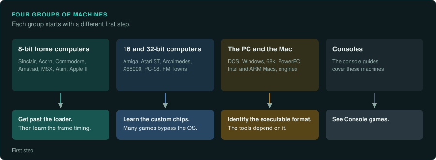
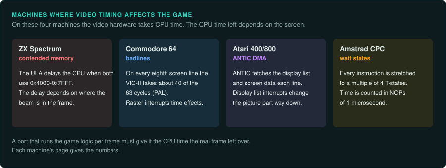

# Home computers and the PC



This section covers the home computers, the PC and the Mac that games were written for. Each
page covers one family of machines. An exact reimplementation of a game needs three facts
about its machine: the CPU family and its arithmetic quirks, the memory and banking state when
the code ran, and the timing the game was written against. On 8-bit machines the game logic
depends on that timing.

## Ask your agent

Start on a home computer game. Copy this prompt into your coding agent:

```text
In my GameFrame project, start work on a game for <machine>.

1. Read docs/computers/README.md, docs/computers/cpu-families.md and the page for <machine>.
2. Identify the media image format and the exact release. Record its checksum.
3. Set up the emulator with a debugger that the page names. Tell me what it needs before you
   install anything.
4. Run the game past its loader and save a memory snapshot once the game code is in memory.
5. Record the CPU, the memory banking and the frame timing in docs/FINDINGS.md.
```

## Across all machines

- [CPU families](cpu-families.md): the eleven CPU families, their byte order, Ghidra, Unicorn
  and Capstone support, small cores for ground truth, and the arithmetic traps.

## 8-bit home computers

- [Sinclair ZX81 and ZX Spectrum](sinclair.md): paging ports, contended memory per model,
  frame lengths, TZX and the snapshot formats, SkoolKit.
- [BBC Micro and Acorn Electron](acorn-8bit.md): sideways ROMs, the 8271 and 1770 disk
  controllers, UEF and SSD, Elite on the 6502.
- [Commodore VIC-20 and C64](commodore-8bit.md): `$01` banking, VIC-II cycles and badlines,
  SID revisions, 1541 drive code, the image formats, the VICE monitor.
- [Amstrad CPC](amstrad-cpc.md): NOP-time timing, CRTC types, gate array interrupts, CDT and
  extended DSK.
- [MSX, PC-8801 and Sharp X1](msx-and-japan-8bit.md): slots, MegaROM mappers, D88, openMSX.
- [Atari 400/800, XL and XE](atari-8bit.md): ANTIC display lists, display list interrupts,
  PORTB banking, ATR, XEX and ATX, Altirra.
- [Apple II](apple-ii.md): soft switches, the language card, GCR disk protection, WOZ.
- [Other 8-bit computers](other-8bit.md): the Dragon and CoCo, the Oric, the TI-99/4A.

## 16-bit and 32-bit home computers

- [Commodore Amiga](amiga.md): OCS, ECS and AGA, the Copper, Blitter and Paula, takeover
  games, ADF and IPF, Copylock, ghidra-amiga, WinUAE.
- [Atari ST family](atari-st.md): the Shifter, the STE additions, ST, MSA and STX images, the
  Hatari debugger, glFrontier and ReDMCSB.
- [Acorn Archimedes and Risc PC](acorn-32bit.md): 26-bit ARM2 and ARM3 code, MEMC, VIDC and
  IOC, the ARMv4 floor in Ghidra.
- [Japanese 16-bit and 32-bit computers](japan-16-32bit.md): the X68000, PC-98 and FM Towns.

## The PC and the Mac

- [The IBM PC and compatibles](ibm-pc.md): the eras and their executable formats, Tandy
  paths, compiler fingerprints, copy protection, what runs where today.
- [The Macintosh](macintosh.md): 68k resource forks and the A5 world, PEF, Mach-O, Rosetta,
  the emulator for each era, Marathon and Aleph One.
- [Engine-era PC games](modern-pc-engines.md): Unity with Mono and IL2CPP, Unreal `.pak`
  files, Godot `.pck` files, anti-cheat, Linux builds as a second binary.

## The shape of each page

Each family page opens with one short paragraph. Then it has one section per machine. Each
machine section has the same headings in the same order.

1. **Hardware**: the years, the CPU, memory and banking, the video and sound chips, timing.
2. **How games were made and loaded**: languages, loaders, operating systems.
3. **Media and image formats**: tape, disk and cartridge images, and what each one keeps.
4. **Tools**: emulators with debuggers, Ghidra and Unicorn support.
5. **Projects to learn from**: disassemblies, source releases and reimplementations.
6. **For an exact reimplementation**: what to settle before porting.

An agent can load one page and act from it alone. The [CPU families](cpu-families.md) page
holds the facts that several pages share.

A fact marked "(not confirmed)" has one source and lacks a second. Treat it as a lead and
check it before you rely on it.

## Four groups of machines



The machines split into four groups with different first steps.

| Group | First step | Pages |
|---|---|---|
| 8-bit home computers | Get past the loader, then learn the frame timing | Sinclair to other 8-bit |
| 16-bit and 32-bit home computers | Learn the custom chips, because many games bypass the OS | Amiga, Atari ST, Acorn 32-bit, Japanese 16/32-bit |
| The PC and the Mac | Identify the executable format of the era. The loader and the tools depend on it | IBM PC, Macintosh, engine-era games |
| Consoles | See [Console games](../consoles/README.md) | |

## Snapshot after the loader



The first job on a tape or disk game is usually to get past the loader. Run the game under an
emulator until the game code sits in memory. Then take a snapshot. A reimplementation does not
need to copy the protection code that runs before the game starts. It therefore normally
starts from the decrypted image in memory. Keep the lossless media image (TZX, G64, WOZ, EDSK,
ATX, IPF, STX) as the record of what shipped.

Copy protection is described factually on each page. The law on working around it differs by
country ([Legal](../LEGAL.md), [the law worldwide](../preservation/law/README.md)). You decide
which route to take.

## How games were written on 8-bit machines



Commercial games were mostly hand-written assembly. BASIC appears in loaders and in budget and
type-in games. Tape was the main medium in the UK and Europe. Disk was the main medium in the
US and Japan. Cartridges were common on the MSX, the VIC-20 and the Atari.

On four machines the game logic depends closely on exact timing. The Spectrum has contended
memory. The C64 has VIC-II badlines and raster interrupts. The Atari has ANTIC DMA and display list interrupts.
The CPC has wait states that round every access to 4 cycles.

## Related pages

- [CPUs and floating point](../hardware/cpus.md): the x86 generations and the x87 FPU.
- [Hardware of the era](../hardware/README.md): PC graphics, sound, memory and storage.
- [DOS games](../DOS.md): 16-bit programs, Borland debug symbols, the DOS emulators.
- [Console games](../consoles/README.md) and [tools for console work](../consoles/tools.md).
- [Software engines and middleware](../engines/README.md).
- The skills for each step: [re-inventory](../../.claude/skills/re-inventory/SKILL.md),
  [re-observe](../../.claude/skills/re-observe/SKILL.md),
  [re-ghidra](../../.claude/skills/re-ghidra/SKILL.md),
  [re-emulate](../../.claude/skills/re-emulate/SKILL.md),
  [re-format](../../.claude/skills/re-format/SKILL.md),
  [re-port](../../.claude/skills/re-port/SKILL.md) and
  [re-verify](../../.claude/skills/re-verify/SKILL.md).

## Not covered yet

The Sinclair QL (68008) and the SAM Coupé (Z80B) belong with these machines. Their pages
still need sources.
