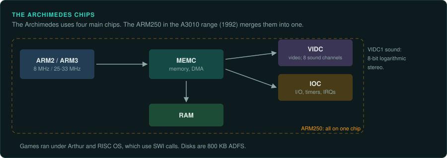
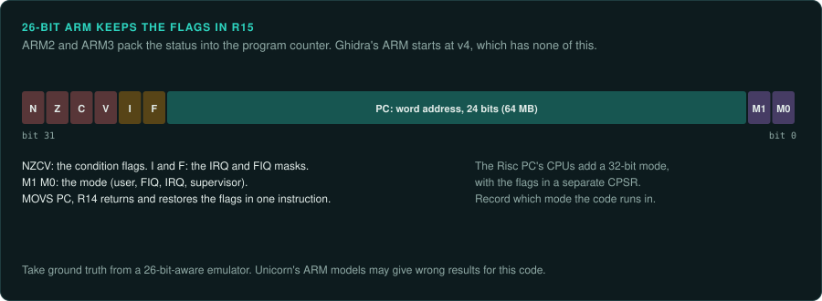

# Acorn Archimedes and Risc PC

Acorn's 32-bit machines use ARM ([CPU families](cpu-families.md#arm)). The ARM2 and ARM3 run a 26-bit address mode with the flags in R15. Old Archimedes games depend on it. Ghidra's ARM
languages start at v4, so this code has no exact built-in match. A game that uses RISC OS can
be traced at its SWI calls.

## Acorn Archimedes

### Hardware

| Model | Year | CPU | OS |
|---|---|---|---|
| A305, A310, A440 | July 1987 | ARM2 at 8 MHz | Arthur |
| A3000 | 1989 | | RISC OS 2 |
| A5000 | 1991 | ARM3 at 25 or 33 MHz | |
| A3010 range | 1992 | ARM250 at 12 MHz | |

The range ran Arthur, RISC OS 2 and RISC OS 3.

Source: [Wikipedia: Acorn Archimedes](https://en.wikipedia.org/wiki/Acorn_Archimedes).

- The chips are MEMC, VIDC and IOC. The ARM250 merges ARM2, IOC, VIDC and MEMC on one chip.
- VIDC1 gives eight channels of 8-bit logarithmic stereo sound.
- ARM2 and ARM3 use the 26-bit address mode with the flags in R15.

### How games were made and loaded

Games ran under Arthur and RISC OS, which use SWI calls. Disks are 800 KB ADFS. The A5000 was
the first model with an HD drive and reads MS-DOS and ST disks.

### Media and image formats

Archimedes disk image formats still need sources.

### Tools

- Ghidra's ARM languages start at v4. ARMv2 and ARMv3 code has no exact built-in match.
- Unicorn is based on QEMU and likely lacks the 26-bit mode.
- Archimedes code may need an emulator that knows the 26-bit mode, such as Arculator.
- RISC OS module loaders for Ghidra and the debuggers of Arculator and RPCEmu still need
  sources.

### Projects to learn from

None listed yet.

### For an exact reimplementation

- Treat every instruction that reads or writes R15 as touching the flags as well as the PC.
- Load the code into Ghidra as ARM v4 with care. Mark each place where 26-bit behaviour changes
  the result.
- Take ground truth from a 26-bit-aware emulator. Unicorn's ARM models may give wrong results
  for this code.

## Acorn Risc PC

### Hardware

| Fact | Value |
|---|---|
| Years | Launched 15 April 1994; to 2003 |
| CPU | ARM610, ARM710, StrongARM up to 300 MHz |
| RAM | To 256 MiB |
| Video | VIDC20 |
| OS | RISC OS 3.50–3.71 |

Source: [Wikipedia: Risc PC](https://en.wikipedia.org/wiki/Risc_PC).

The Risc PC's CPUs added a 32-bit mode.

### How games were made and loaded

None listed yet.

### Media and image formats

None listed yet.

### Tools

Ghidra's ARM languages start at v4. No mapping of the ARM610 and ARM710 to a Ghidra language
or a Unicorn model is listed yet. The RPCEmu debugger still needs a source.

### Projects to learn from

None listed yet.

### For an exact reimplementation

- Record whether the code runs in 26-bit or 32-bit mode. Older games run in 26-bit mode.
