# BBC Micro and Acorn Electron

Acorn's 8-bit machines use the 6502 family ([CPU families](cpu-families.md#the-6502-line)).
The BBC Micro pages sideways ROMs into its memory map. Its disk controller changed between models. The Elite on the 6502 project documents
the BBC version of Elite in detail.

## BBC Micro A, B, B+ and Master

### Hardware

| Model | Launch | CPU |
|---|---|---|
| Model A, Model B | 1 December 1981 | 6502A at 2 MHz |
| B+ | Mid-1985 | Rockwell 6512A (not confirmed) |
| Master | 1986 | 65SC12 (not confirmed) |

RAM across the range runs from 16 KB to 128 KB.

Sources: [Wikipedia: BBC Micro](https://en.wikipedia.org/wiki/BBC_Micro),
[Wikipedia: BBC Master](https://en.wikipedia.org/wiki/BBC_Master).

- **Video.** A 6845 CRTC drives modes 0–6. The SAA5050 drives Teletext mode 7. A Video ULA
  sits beside them (not confirmed) ([BeebWiki: Video ULA](https://beebwiki.mdfs.net/Video_ULA)).
- **Sound.** An SN76489.
- **ROM.** The MOS sits in a 16 KB ROM. The last official version is OS 1.2. Four 16 KB
  sideways ROM sockets can be expanded to sixteen
  ([Wikipedia: BBC Micro](https://en.wikipedia.org/wiki/BBC_Micro)).
- **Memory map.** ROMSEL at `&FE30` pages a ROM into `&8000`–`&BFFF`. The MOS sits at
  `&C000`–`&FFFF` and SHEILA I/O at `&FE00` (not confirmed)
  ([BeebWiki: Paged ROM](https://beebwiki.mdfs.net/Paged_ROM)).
- **Disk controller.** The B+ moved from the Intel 8271 to the WD1770. That change broke some
  software ([Wikipedia: BBC Micro](https://en.wikipedia.org/wiki/BBC_Micro)). Many protected
  disks work on one model and fail on another because of it.

### How games were made and loaded

Games came on tape and on disk. The change from the 8271 to the 1770 disk controller broke some
software, including disk protection.

### Media and image formats

| Format | What it holds |
|---|---|
| UEF | Chunked tape format (not confirmed) |
| SSD | Single-sided DFS sector image (not confirmed) |
| DSD | Double-sided DFS sector image (not confirmed) |

Source: [BeebWiki: UEF](https://beebwiki.mdfs.net/Uniform_Emulator_Format).

### Tools

- **b-em** ([github.com/stardot/b-em](https://github.com/stardot/b-em)), **BeebJit**
  ([github.com/scarybeasts/beebjit](https://github.com/scarybeasts/beebjit)) and **B2**
  ([github.com/tom-seddon/b2](https://github.com/tom-seddon/b2)) have debuggers.
- Ghidra has the 6502 built in. Its `ADC` p-code is not exact
  ([arithmetic traps](cpu-families.md#ghidra-s-6502-adc-is-not-exact)). Unicorn has no 6502.
  Use py65, mos6502 or floooh/chips for ground truth.

Stardot ([stardot.org.uk](https://stardot.org.uk/forums/)) and BeebWiki
([beebwiki.mdfs.net](https://beebwiki.mdfs.net/)) are the community references.

### Projects to learn from

**Mark Moxon's "Elite on the 6502"** documents the BBC Micro, Electron, Master, C64, Apple II
and NES versions of Elite, with about 130 deep dives ([bbcelite.com](https://www.bbcelite.com/)).
Its source reassembles byte for byte to the original. A port can check its results against
that source. Ian Bell's site hosts the original BBC source discs (not confirmed)
([iancgbell.clara.net/elite](http://www.iancgbell.clara.net/elite/)). Before you copy anything
from such a project, check whether it includes game bytes and what its licence is.

### For an exact reimplementation

- Record the model, the MOS version and which sideways ROMs are fitted.
- Record the disk controller (8271 or 1770) of the capture machine.
- Record the ROMSEL state for each code region that runs from paged ROM.

## Acorn Electron

### Hardware

| Fact | Value |
|---|---|
| Launch | 1983 |
| CPU | 6502 |
| RAM | 32 KB, 4 bits wide |
| Video and sound | One ULA for both (not confirmed) |

The Electron's RAM is 4 bits wide. The CPU drops to an effective 1 MHz or less when it touches
RAM. It has no mode 7 and one sound channel (not confirmed)
([Wikipedia: Acorn Electron](https://en.wikipedia.org/wiki/Acorn_Electron)).

### How games were made and loaded

Elite on the 6502 covers the Electron version of Elite. No other sources are listed yet.

### Media and image formats

UEF for tape, as on the BBC Micro (not confirmed).

### Tools

Elkulator covers the Electron. Ghidra and Unicorn support is as for the BBC Micro.

### Projects to learn from

[Elite on the 6502](https://www.bbcelite.com/) includes the Electron version.

### For an exact reimplementation

- Model the slower RAM access. The BBC Micro's timing does not fit the Electron.
