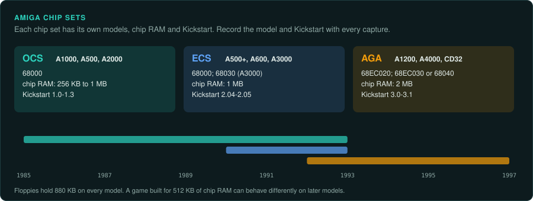
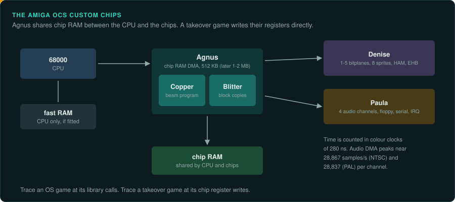
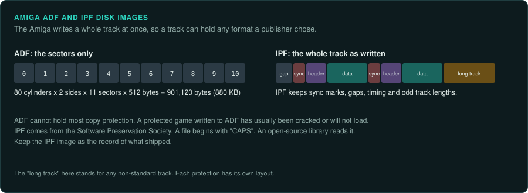

# Commodore Amiga

The Amiga uses the big-endian 68000 line ([CPU families](cpu-families.md#the-68000)). Many
games skip the OS and drive the custom chips directly. A game that uses the AmigaOS libraries
can be traced at the OS call boundary. Trace a takeover game at its hardware register writes.
Its port must reproduce the effect of each chip operation.

## The chip sets

| Models | Years | CPU | Chip RAM | Chip set | Kickstart |
|---|---|---|---|---|---|
| A1000, A500, A2000 | 1985–1992 | 68000 | 256 KB to 1 MB | OCS | 1.0–1.3 |
| A500+, A600, A3000 | 1990–1992 | 68000; 68030 in the A3000 | 1 MB, plus fast RAM on the A3000 | ECS | 2.04–2.05 |
| A1200, A4000, CD32 | 1992–1996 | 68EC020; 68EC030 or 68040 in the A4000 | 2 MB | AGA | 3.0–3.1 |

Floppies hold 880 KB. Sources:
[Wikipedia: Amiga models and variants](https://en.wikipedia.org/wiki/Amiga_models_and_variants),
[Wikipedia: Original Chip Set](https://en.wikipedia.org/wiki/Original_Chip_Set).

## Amiga with OCS

### Hardware

The facts below come from
[Wikipedia: Original Chip Set](https://en.wikipedia.org/wiki/Original_Chip_Set). That article
asks for more citations. The Amiga Hardware Reference Manual should confirm the Copper, sprite
and HAM details. The exact PAL and NTSC CPU clocks also need that manual.

- **Agnus** is the chip RAM DMA controller. It arbitrates between the CPU and the custom chips.
  It holds the Blitter and the Copper. The original Agnus addresses 512 KB of chip RAM. Later
  "Fat Agnus" revisions raised this to 1 MB and then 2 MB.
- **Timing.** The chips count time in colour clocks of 280 ns.
- The **Blitter** combines up to three sources into a destination, over blocks up to
  1,024x1,024 pixels.
- The **Copper** runs a program of three instructions (MOVE, WAIT, SKIP) synchronised to the
  beam. It restarts every frame, so raster effects come from a Copper list for each frame.
- **Denise** gives 1 to 5 bitplanes for 2 to 32 colours from 4,096. It adds Extra-Halfbrite
  and HAM with a sixth plane, and eight sprites 16 pixels wide.
- **Paula** handles interrupts, four 8-bit DMA audio channels, the floppy and the serial port.
  Audio DMA peaks at about 28,867 samples/s per channel on NTSC and 28,837 on PAL.
- Displays are 200 lines on NTSC and 256 on PAL.

### How games were made and loaded

Many games take over the machine and drive the chips directly. A takeover game times itself from
the vertical blank, 50 Hz on PAL and 60 Hz on NTSC.

Rob Northen's **Copylock** protected disks on the Amiga, the ST and the PC. Its trace vector
decoder decrypts each instruction, runs it, then encrypts it again
([Wikipedia: Rob Northen copylock](https://en.wikipedia.org/wiki/Rob_Northen_copylock);
[Wikipedia: Trace vector decoder](https://en.wikipedia.org/wiki/Trace_vector_decoder)). CAPS
reverse engineered the Amiga Copylock in June 2001 and counted over 500 titles using it
([SPS Copylock Unlocked](https://softpres.org/wip:2001-06-07);
[Part 2](https://softpres.org/wip:2001-06-08)). Later keydisks carried a unique serial number
in the disk format
([Codetapper interview with Rob Northen](https://codetapper.com/amiga/interviews/rob-northen)).

Read a self-decrypting game from emulator memory after it has decrypted itself.

### Media and image formats

| Format | What it holds |
|---|---|
| ADF | Plain sector images; cannot hold most copy protection |
| IPF | Low-level track data; begins with "CAPS"; often made from KryoFlux captures; has an open-source library |

Sources: [Wikipedia: Amiga Disk File](https://en.wikipedia.org/wiki/Amiga_Disk_File),
[IANA: IPF](https://www.iana.org/assignments/media-types/application/vnd.softpres-ipf-disk-image).
IPF comes from the Software Preservation Society. SPS notes that automatic format scripting
cannot handle the Amiga's free-form track format
([SPS news 2005-08-05](https://softpres.org/news:2005-08-05)).

### Tools

- **BartmanAbyss/ghidra-amiga** loads hunk executables, Kickstart ROMs and WinUAE state files,
  with NDK 3.9 symbols. It is forked from lab313ru's ghidra_amiga_ldr and builds on work by
  Vladimir Kononovich and Martin Atkins
  ([BartmanAbyss on GitHub](https://www.github.com/BartmanAbyss);
  [amiga-news 2022](https://amiga-news.de/en/news/AN-2022-09-00023-EN.html)). A 2023 update
  targeted Ghidra 10.3.1 ([amiga-news 2023](https://amiga-news.de/en/news/AN-2023-06-00122-EN.html)).
  One user reports that the Ghidra 12.0.1 build loaded in 12.1.3 only after editing its version
  line ([Sebastian Bergmann](https://amiga.sebastian-bergmann.de/2026/08/29/disassembling-my-1994-self/)).
- amitools' Python hunk library also loads hunk binaries
  ([lab313ru/amitools_dbg](https://github.com/lab313ru/amitools_dbg)).
- **WinUAE** has a debugger, opened with Shift+F12. `fp "name"` runs until a named process
  starts ([markwrobel.dk](https://markwrobel.dk/post/amiga-machine-code-part1-debugger)). It
  supports memory watchpoints.
- The VS Code Amiga extension can step Copper lists through FS-UAE
  ([vscode-amiga-assembly wiki](https://github-wiki-see.page/m/prb28/vscode-amiga-assembly/wiki/Debugging-emulator)).
- MAME's debugger also has watchpoints
  ([MAME docs](https://docs.mamedev.org/debugger/watchpoint.html)).
- vAmiga's debugger is not documented here.
- Unicorn runs the 68000 code but none of the custom chips.

### Projects to learn from

- **rawgl** by cyxx reimplements the Another World engine. It reads Amiga, Atari, DOS,
  Windows 3.1, 3DO and anniversary data. It was archived on 28 June 2025
  ([cyxx/rawgl](https://github.com/cyxx/rawgl)).
- **OpenFodder** is a GPL-3.0 engine for Cannon Fodder 1 and 2 on Amiga, CD32 and DOS CD. Its
  README does not say how it was made ([OpenFodder](https://github.com/OpenFodder/openfodder)).
- **pyDM** is a Python port of Amiga Dungeon Master, built from the ReDMCSB Amiga V3.x branch
  ([pyDM](https://codeberg.org/CyCl0ne/pyDM)). ReDMCSB is on the [Atari ST](atari-st.md) page.

### For an exact reimplementation

- Record the model and the Kickstart version with every capture. An OCS game built for 512 KB
  of chip RAM behaves differently from an ECS or AGA build.
- Decide whether the game uses the OS or takes over the machine. Trace an OS game at the
  library calls. Trace a takeover game at its chip register writes.
- Pick one TV standard. A takeover game times itself from the vertical blank, at 50 Hz or 60 Hz.
- Reproduce the Copper list, the Blitter operations and the audio DMA at that frame rate.
- Take ground truth for a function that touches only RAM from Unicorn's 68000
  ([re-emulate](../../.claude/skills/re-emulate/SKILL.md)). Anything that reads chip registers
  needs a full trace from WinUAE or MAME.
- Keep the IPF image as the record of what shipped. Read a Copylock game from memory after it
  decrypts itself.

## Amiga with ECS

### Hardware

The ECS models are the A500+, A600 and A3000 (1990–1992), with 1 MB of chip RAM and Kickstart
2.04–2.05. The A3000 has a 68030 and fast RAM.

### How games were made and loaded

No differences from OCS are listed yet.

### Media and image formats

No differences from OCS are listed yet.

### Tools

No differences from OCS are listed yet.

### Projects to learn from

None listed yet.

### For an exact reimplementation

- Record the model and the Kickstart version. An ECS build can differ from the OCS build of the
  same game.

## Amiga with AGA

### Hardware

The AGA models are the A1200, A4000 and CD32 (1992–1996), with 2 MB of chip RAM and Kickstart
3.0–3.1. The A1200 has a 68EC020. The A4000 has a 68EC030 or a 68040.

### How games were made and loaded

No differences from OCS are listed yet.

### Media and image formats

No differences from OCS are listed yet.

### Tools

No differences from OCS are listed yet. Ghidra's default 68000 language is a 68040 superset. Ghidra also has 68020 and 68030 languages.

### Projects to learn from

OpenFodder covers the CD32 version of Cannon Fodder.

### For an exact reimplementation

- Record the model and the Kickstart version. An AGA build can differ from the OCS build of the
  same game.
