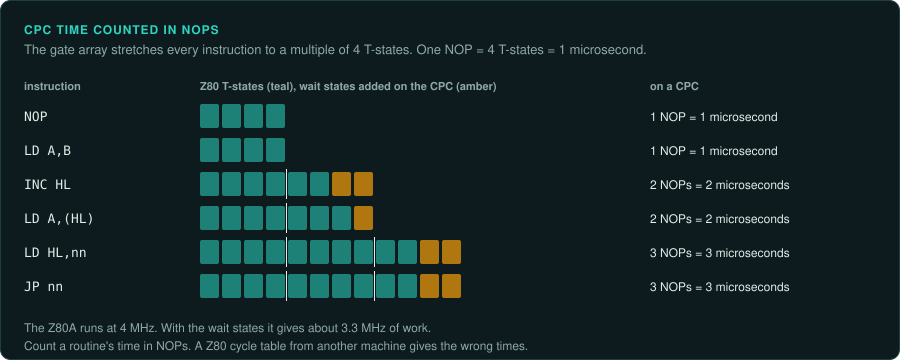
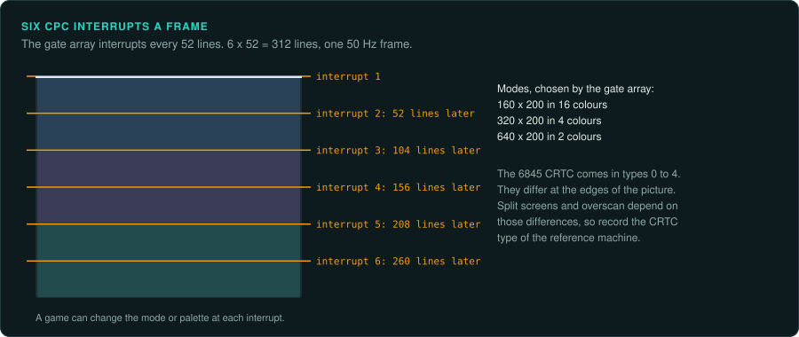

# Amstrad CPC

The Amstrad CPC uses the Z80 ([CPU families](cpu-families.md#the-8080-z80-and-sm83)). Wait
states stretch every instruction to a multiple of 4 T-states. The CRTC type changes the edges
of the picture. Games with split screens or overscan depend on those edges. CPC tapes use the TZX structure.

## CPC 464, 664, 6128 and the Plus range

### Hardware

| Model | Launch |
|---|---|
| CPC 464 | June 1984 |
| CPC 664 | April 1985 |
| CPC 6128 | Mid-1985 |
| Plus range and GX4000 | September 1990 |

| Fact | Value |
|---|---|
| CPU | Z80A at 4 MHz; wait states give about 3.3 MHz |
| RAM | 64 or 128 KB |
| Video | 6845 CRTC plus gate array; 27 colours (4096 on the Plus) |
| Modes | 160x200 in 16 colours, 320x200 in 4, 640x200 in 2, at 50 Hz |
| Sound | AY-3-8912 |
| Disks | 3-inch, typically 180 KB per side |

Source: [Wikipedia: Amstrad CPC](https://en.wikipedia.org/wiki/Amstrad_CPC).

**Timing.** Every instruction is stretched to a multiple of 4 T-states. The unit is the "NOP
time" of 1 microsecond (not confirmed)
([CPCWiki: CPU timing](https://www.cpcwiki.eu/index.php/Z80)). CRTC types 0 to 4 differ at the
edges. Games with split screens and overscan depend on these differences (not confirmed)
([CPCWiki: CRTC](https://www.cpcwiki.eu/index.php/CRTC)). The gate array interrupts every 52
lines, six times a frame (not confirmed)
([CPCWiki: Gate Array](https://www.cpcwiki.eu/index.php/Gate_Array)).

### How games were made and loaded

Games came on tape and on 3-inch disk. Disk protection is described on
[CPCWiki: Copy protection](https://www.cpcwiki.eu/index.php/Copy_protection).

### Media and image formats

| Format | What it holds |
|---|---|
| CDT | Tape in the TZX structure, with timings scaled by 4/3.5 ([TZX format](https://worldofspectrum.net/TZXformat.html)) |
| Extended DSK | Disk with the size and status of each sector; keeps many protections (not confirmed) ([CPCWiki: DSK format](https://www.cpcwiki.eu/index.php/Format:DSK_disk_image_file_format)) |

### Tools

- **WinAPE** ([winape.net](http://www.winape.net/)) and **Caprice32**
  ([github.com/ColinPitrat/caprice32](https://github.com/ColinPitrat/caprice32)) have
  debuggers.
- Ghidra has the Z80 built in. Neither Unicorn nor Capstone supports the Z80. For ground truth
  use a small core such as iz80 ([CPU families](cpu-families.md#tools-per-family)).

CPCWiki ([cpcwiki.eu](https://www.cpcwiki.eu/)) is the community reference.

### Projects to learn from

None listed yet.

### For an exact reimplementation

- Count time in NOP units of 4 T-states. A Z80 cycle table from another machine gives the wrong
  times.
- Record the CRTC type of the reference machine if the game uses split screens or overscan.
- If the game times its frame from the gate array's six interrupts per frame, the port must do
  the same.
- Keep the extended DSK or CDT image as the record of what shipped.
