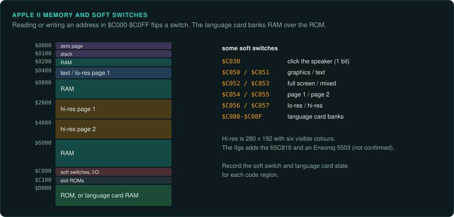
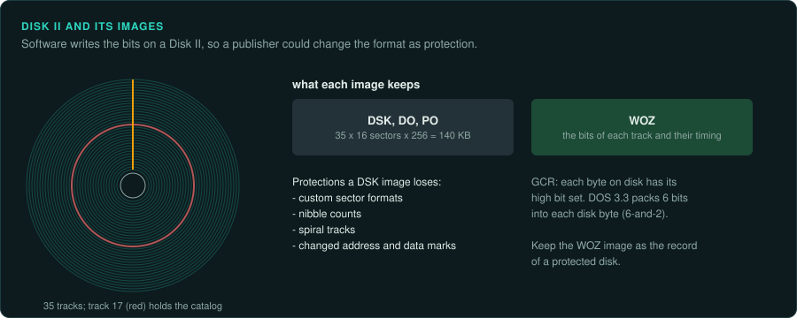

# Apple II

The Apple II uses the 6502, later the 65C02, and the 65C816 in the IIgs
([CPU families](cpu-families.md#the-6502-line)). Soft switches select the video modes and the
memory banks. The Disk II's encoding is controlled by software, so publishers wrote their own
disk formats as copy protection.

## Apple II, IIe and IIgs

### Hardware

| Model | Launch | CPU |
|---|---|---|
| Apple II | 10 June 1977 | 6502 at 1.023 MHz |
| Later models, IIe | | 65C02 |
| IIgs | 1986 | 65C816 at 2.8 MHz (not confirmed) |

Sources: [Wikipedia: Apple II (original)](https://en.wikipedia.org/wiki/Apple_II_(original)),
[Wikipedia: Apple II](https://en.wikipedia.org/wiki/Apple_II),
[Wikipedia: Apple IIGS](https://en.wikipedia.org/wiki/Apple_IIGS).

About six million Apple IIs were sold.

- **RAM.** 4–48 KB, more on the IIe and IIgs.
- **Video.** Lo-res and hi-res modes. Hi-res is 280x192 with six visible colours.
- **Sound.** A 1-bit speaker, toggled at `$C030`. The IIgs has an Ensoniq 5503 DOC
  (not confirmed).
- **Memory map.** Soft switches fill `$C000`–`$C0FF`. The language card banks RAM over
  `$D000`–`$FFFF` ([AppleWin](https://github.com/AppleWin/AppleWin)).

### How games were made and loaded

Disk II and Apple DOS arrived in late 1978, with 140 KB per side
([Wikipedia: Apple II (original)](https://en.wikipedia.org/wiki/Apple_II_(original))). Disk II
encoding is GCR controlled by software. Publishers wrote custom sector formats, nibble counts
and spiral tracks as copy protection.

### Media and image formats

| Format | What it holds |
|---|---|
| WOZ | Bit-level tracks and timing; protected disks run from it (not confirmed) |
| DSK, DO, PO | Only the 140 KB of sectors (not confirmed) |

Source: [WOZ reference](https://applesaucefdc.com/woz/reference2/).

### Tools

- **AppleWin** ([github.com/AppleWin/AppleWin](https://github.com/AppleWin/AppleWin)) is an
  Apple II emulator.
- Ghidra has the 6502 and 65C02 built in. Its `ADC` p-code is not exact
  ([arithmetic traps](cpu-families.md#ghidra-s-6502-adc-is-not-exact)). The IIgs's 65C816 needs
  a community extension. Unicorn has neither. Use py65, mos6502 or floooh/chips for 6502
  ground truth.
- For IIgs code, track the m and x flags. Capstone's `MOS65XX_65816` mode needs the width set
  for each function.

### Projects to learn from

- Jordan Mechner released the Apple II Prince of Persia source in 2012 (not confirmed)
  ([github.com/jmechner/Prince-of-Persia-Apple-II](https://github.com/jmechner/Prince-of-Persia-Apple-II)).
- [Elite on the 6502](https://www.bbcelite.com/) documents the Apple II version of Elite.

### For an exact reimplementation

- Record the soft switch and language card state for each code region.
- Keep the WOZ image as the record of a protected disk. A DSK image loses the protection.
- On the IIgs, record the m and x flag state at the entry of each function.
