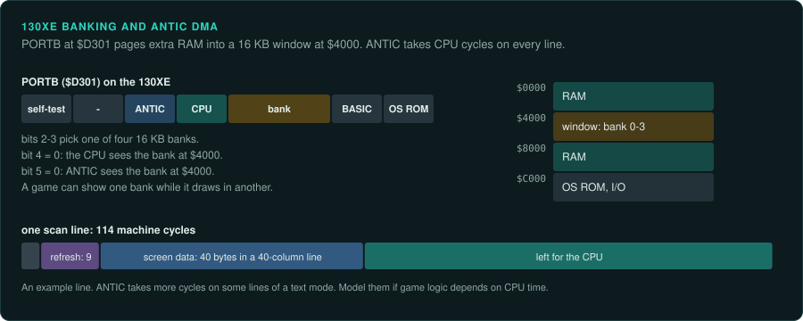

# Atari 400/800, XL and XE

The Atari 8-bit computers use the 6502 family ([CPU families](cpu-families.md#the-6502-line)).
ANTIC runs a display list and takes DMA cycles from the CPU on each line. Display list
interrupts change the picture part way down the screen. Game logic on these machines often
depends on exact cycle timing.

## Atari 400, 800, XL and XE

### Hardware

| Model | Launch |
|---|---|
| 400 and 800 | November 1979 |
| XL range | From 1983 |
| XE range | From 1985, to 1987 |

| Fact | Value |
|---|---|
| CPU | 6502B or SALLY 6502C, 1.79 MHz (NTSC) or 1.77 MHz (PAL) |
| RAM | Up to 128 KB, banked on the 130XE |
| Video | ANTIC runs a display list with one instruction per mode line; CTIA or GTIA does colour and player/missile graphics |
| Sound and I/O | POKEY does sound, the keyboard and serial I/O |

Source: [Wikipedia: Atari 8-bit](https://en.wikipedia.org/wiki/Atari_8-bit_computers).

The details below are (not confirmed)
([Altirra Hardware Reference Manual](https://www.virtualdub.org/altirra.html)).

- Banking on the 130XE uses PIA PORTB at `$D301`, with a 16 KB window at `$4000`.
- Display list interrupts are enabled through NMIEN.
- ANTIC DMA steals cycles on each line.

### How games were made and loaded

Cartridges were common on the Atari. Games also came on tape and disk.

### Media and image formats

The formats below are (not confirmed).

| Format | What it holds |
|---|---|
| ATR | A sector image |
| XEX | A DOS executable |
| CAS | A tape |
| ATX | A protected-disk image with timing and weak sectors |

### Tools

- **Altirra** has a debugger and ships its own hardware reference
  ([virtualdub.org/altirra.html](https://www.virtualdub.org/altirra.html)).
- Ghidra has the 6502 built in. Its `ADC` p-code is not exact
  ([arithmetic traps](cpu-families.md#ghidra-s-6502-adc-is-not-exact)). Unicorn has no 6502.
  Use py65, mos6502 or floooh/chips for ground truth.

AtariAge is the main community forum ([atariage.com](https://atariage.com/)).

### Projects to learn from

None listed yet.

### For an exact reimplementation

- Record the display list and every display list interrupt. Together they set the mode and
  colours of each screen line.
- Model the cycles ANTIC DMA takes on each line if game logic depends on CPU time.
- Record the PORTB bank state for each code region on a 130XE.
- Record whether the build is PAL or NTSC. PAL and NTSC versions are often separate builds.
- Keep the ATX image as the record of a protected disk.
