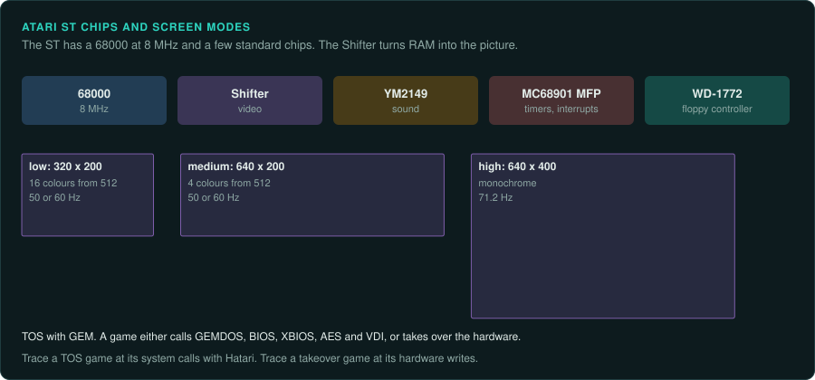
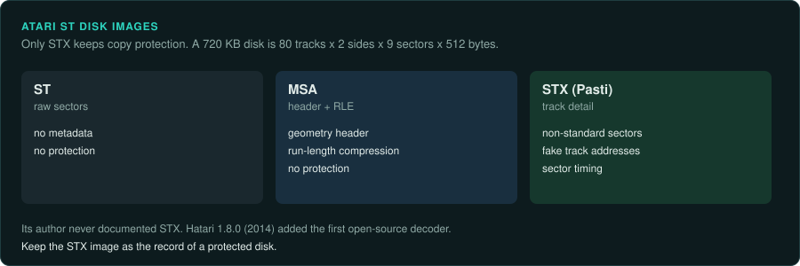
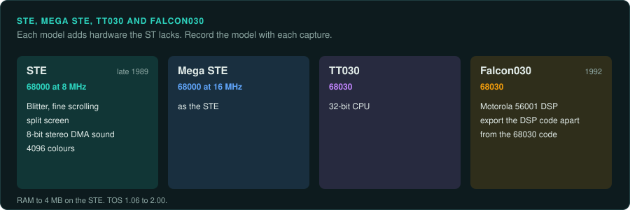

# Atari ST family

The Atari ST uses the big-endian 68000 line ([CPU families](cpu-families.md#the-68000)). Like
the Amiga, many ST games skip the OS and drive the hardware directly. A game that uses TOS and
GEM can be traced at its GEMDOS, BIOS, XBIOS, AES and VDI calls. Hatari, an ST emulator, has the best
documented debugger of these machines.

## Atari 520ST and 1040ST

### Hardware

| Fact | Value |
|---|---|
| Years | 520ST shipped in June 1985; 1040ST from 1986 |
| CPU | 68000 at 8 MHz |
| RAM | 512 KB or 1 MB |
| Video | Shifter: 320x200 in 16 colours and 640x200 in 4, from 512; 640x400 mono at 71.2 Hz |
| Sound | YM2149 |
| Other chips | MC68901 MFP, WD-1772 floppy controller |
| OS and media | TOS with GEM; 360 or 720 KB floppies |

Source: [Wikipedia: Atari ST](https://en.wikipedia.org/wiki/Atari_ST).

### How games were made and loaded

Games either use TOS and GEM or take over the hardware. Rob Northen's Copylock protected disks
on the ST as on the Amiga ([Wikipedia: Rob Northen copylock](https://en.wikipedia.org/wiki/Rob_Northen_copylock)).
SPS supports Copylock ST and Speedlock timing tracks
([SPS 2002-10-28](https://softpres.org/wip:2002-10-28); [SPS Speedlock](https://softpres.org/wip:2003-06-01)).

### Media and image formats

| Format | What it holds |
|---|---|
| ST | Raw data with no metadata and no protection |
| MSA | Adds a geometry header and RLE compression |
| STX (Pasti) | Non-standard sectors, fake track addresses and sector timing |

Sources: [fplanque.com](https://www.fplanque.com/tech/retro/atari/atari-st-fd-image-file-formats/),
[8bitchip forum](https://forum.8bitchip.info/atari-faq/disk-imaging-popular-formats/).
Its author never documented STX. Hatari 1.8.0 (2014) added the first open-source decoder
([IANA: Pasti STX](https://www.iana.org/assignments/media-types/application/vnd.pasti-stx-disk-image);
[st-computer.org](https://en.st-computer.org/news/2014/07/06/hatari-1-8-0-supports-pasti/)).

### Tools

**Hatari** has these debugger features
([Hatari debugger manual](https://hatari.tuxfamily.org/doc/debugger.html)):

- conditional breakpoints with up to four conditions;
- CPU and DSP disassembly;
- symbol loading;
- profiling with Callgrind output;
- tracing of GEMDOS, BIOS, XBIOS, AES and VDI calls;
- command scripts that run at startup and on breakpoints.

The scripts let an agent drive captures
([re-observe](../../.claude/skills/re-observe/SKILL.md)). No Ghidra loader for ST PRG files is
known. Steem SSE's debugger is not documented here. Unicorn runs 68000 code but none of the
ST's chips.

### Projects to learn from

- **glFrontier.** Tom Morton started from the ST version of Frontier: Elite II. He stripped
  the hardware access from the assembly and changed a 68k assembler to emit C or i386 assembly
  ([virtuallyfun.com](https://virtuallyfun.com/?p=59);
  [Aminet readme](https://se.aminet.net/game/actio/frontier-elite2-gl.aros.readme)).
- **fe2-intro** reproduces the Frontier intro
  ([watsonmw/fe2-intro](https://github.com/watsonmw/fe2-intro)).
- **ReDMCSB** is reconstructed Dungeon Master and Chaos Strikes Back source by forum user
  ChristopheF. Its build scripts make ST and Amiga executables, with an option to drop copy
  protection ([dungeon-master.com forum](https://www.dungeon-master.com/forum/viewtopic.php?p=163896)).
  DM/CSB version 3 was built with Think C on Apple hardware
  ([dungeon-master.com forum](https://www.dungeon-master.com/forum/viewtopic.php?p=162234)).
  ReDMCSB says its builds match the original binaries. No second source confirms this.

### For an exact reimplementation

- Decide whether the game uses TOS or takes over the machine. Trace a TOS game at its system
  calls with Hatari's call tracing.
- Keep the STX image as the record of a protected disk. A plain ST image loses the protection.
- Read a self-decrypting game from emulator memory after it decrypts itself.
- Take ground truth for a function that touches only RAM from Unicorn's 68000
  ([re-emulate](../../.claude/skills/re-emulate/SKILL.md)). Anything that reads chip registers
  needs a full trace from Hatari.

## Atari STE, Mega STE, TT030 and Falcon030

### Hardware

| Fact | Value |
|---|---|
| Years | STE in late 1989; to 1993 |
| CPU | 68000, at 16 MHz on the Mega STE; 68030 on the TT and the Falcon |
| RAM | To 4 MB on the STE |
| STE additions | Blitter, fine scrolling, split screen, 8-bit stereo DMA PCM, 4096 colours |
| Falcon030 (1992) | Adds a Motorola 56001 DSP |
| OS | TOS 1.06 to 2.00 |

Source: [Wikipedia: Atari ST](https://en.wikipedia.org/wiki/Atari_ST).

### How games were made and loaded

No differences from the ST are listed yet.

### Media and image formats

As for the ST: ST, MSA and STX.

### Tools

Hatari disassembles DSP code as well as CPU code. It can disassemble code for the Falcon's 56001
([Hatari debugger manual](https://hatari.tuxfamily.org/doc/debugger.html)).

### Projects to learn from

None listed yet.

### For an exact reimplementation

- Record the model. An STE game can use the Blitter and DMA sound that the ST lacks.
- On the Falcon, export the DSP code apart from the 68030 code.
