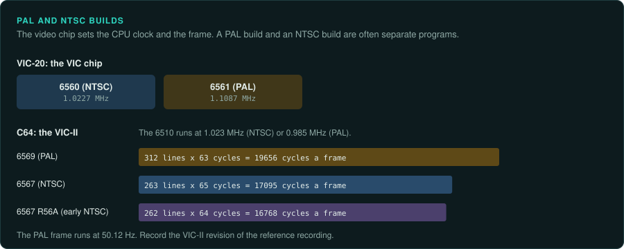
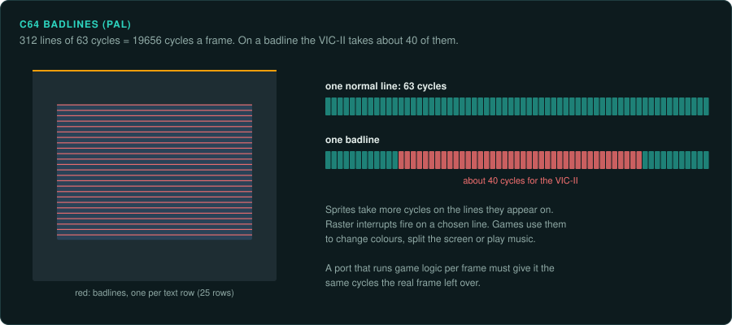

# Commodore VIC-20 and C64

Commodore's 8-bit machines use the 6502 family ([CPU families](cpu-families.md#the-6502-line)).
On the C64, the visible ROMs and I/O depend on the 6510's port at `$01` and on the cartridge
lines. The VIC-II steals cycles on badlines. PAL and NTSC versions of a game are often separate
builds. The 1541 disk drive has its own 6502. Fast loaders run code on it.

## Commodore VIC-20

### Hardware

| Fact | Value |
|---|---|
| Years | 1980 in Japan, 1981 worldwide, to 1985; US$299.95 |
| CPU | 6502 |
| RAM | 5 KB |
| Video | VIC chip, 22x23 text; 6560 (NTSC) at 1.0227 MHz and 6561 (PAL) at 1.1087 MHz (not confirmed) |
| Sound | Three voices plus noise, in the VIC chip |

Sources: [Wikipedia: VIC-20](https://en.wikipedia.org/wiki/Commodore_VIC-20),
[Wikipedia: MOS VIC](https://en.wikipedia.org/wiki/MOS_Technology_VIC).

### How games were made and loaded

The VIC-20 was the first computer to sell a million. Many of its titles were ROM cartridges
([Wikipedia: VIC-20](https://en.wikipedia.org/wiki/Commodore_VIC-20)).

### Media and image formats

Many titles were ROM cartridges. No image format details are listed yet.

### Tools

Ghidra has the 6502 built in. Unicorn has no 6502. No emulator is listed yet.

### Projects to learn from

None listed yet.

### For an exact reimplementation

- Record whether the dump is a PAL or an NTSC build. The VIC chip's clock differs between them.

## Commodore 64

### Hardware

| Fact | Value |
|---|---|
| Years | Shown at CES in January 1982; sold from August 1982 |
| CPU | 6510 at 1.023 MHz (NTSC) or 0.985 MHz (PAL) |
| RAM | 64 KB, plus 1 KB of colour RAM |
| Video | VIC-II with eight sprites |
| Sound | SID 6581 or 8580 |

Source: [Wikipedia: Commodore 64](https://en.wikipedia.org/wiki/Commodore_64).

**Banking.** The 6510's on-chip port at `$01` switches the BASIC, KERNAL and character ROMs and
the `$D000` I/O area in and out
([Wikipedia: Commodore 64](https://en.wikipedia.org/wiki/Commodore_64)). The map below is
(not confirmed) ([C64 Wiki: Memory Map](https://www.c64-wiki.com/wiki/Memory_Map)).

| Address | Contents |
|---|---|
| `$A000`–`$BFFF` | BASIC ROM |
| `$D000`–`$DFFF` | I/O or character ROM |
| `$E000`–`$FFFF` | KERNAL ROM |
| `$D000` | VIC-II |
| `$D400` | SID |
| `$DC00`, `$DD00` | CIA 1, CIA 2; CIA 2 selects the VIC-II's 16 KB bank |

Which ROMs and I/O are visible depends on `$01` and on the cartridge lines. A disassembly must
record the bank state for each code region.

**Timing.** The figures below are (not confirmed)
([Christian Bauer, The MOS 6567/6569 VIC-II](https://www.zimmers.net/cbmpics/cbm/c64/vic-ii.txt)).

| VIC-II | Lines | Cycles per line | Notes |
|---|---|---|---|
| 6569 (PAL) | 312 | 63 | 19656 cycles per frame at 50.12 Hz |
| 6567 (NTSC) | 263 | 65 | |
| 6567 R56A (early NTSC) | 262 | 64 | |

Badlines steal 40 cycles every eighth line (not confirmed). Games also use raster interrupts.

**Sound.** The two SID revisions differ audibly, mainly in the filter (not confirmed)
([Wikipedia: SID](https://en.wikipedia.org/wiki/MOS_Technology_6581)).

### How games were made and loaded

Cartridges auto-start on the "CBM80" signature at `$8000`
([Wikipedia: Commodore 64](https://en.wikipedia.org/wiki/Commodore_64)).

The 1541 drive has its own 6502 and ROM. Fast loaders and disk protections run custom code on
the drive. Novaload, Freeload, Cyberload and Vorpal are fast loaders. Protections use bad
sectors, half tracks and density changes (not confirmed) ([Codebase64](https://codebase64.org/)).

### Media and image formats

The formats below are (not confirmed)
([VICE manual: file formats](https://vice-emu.sourceforge.io/vice_17.html)).

| Format | What it holds |
|---|---|
| PRG | A program file with a 2-byte load address |
| T64 | A tape container |
| TAP | Raw tape pulse lengths |
| D64 | A 683-sector disk image of 174,848 bytes |
| G64 | A GCR track image that keeps protection |
| CRT | A cartridge, with its hardware type |

### Tools

- **VICE** has a monitor with breakpoints and a remote monitor protocol
  ([vice-emu.sourceforge.io](https://vice-emu.sourceforge.io/)). An agent can drive captures
  through the remote monitor with a script
  ([re-observe](../../.claude/skills/re-observe/SKILL.md)).
- **CCS64** runs on Windows.
- Ghidra has the 6502 built in. Its `ADC` p-code is not exact
  ([arithmetic traps](cpu-families.md#ghidra-s-6502-adc-is-not-exact)). Unicorn has no 6502.
  Use py65, mos6502 or floooh/chips for ground truth.
- cc65's da65 disassembles 6502 code.

Codebase64 and C64-Wiki ([c64-wiki.com](https://www.c64-wiki.com/)) are the community
references.

### Projects to learn from

[Elite on the 6502](https://www.bbcelite.com/) documents the C64 version of Elite.

### For an exact reimplementation

- Record the bank state (`$01` and the cartridge lines) for every code region you load into
  Ghidra.
- Record whether the build is PAL or NTSC, and which VIC-II revision it ran on. The cycles per
  frame differ.
- Record the SID revision of the reference recording.
- Code that runs on the 1541 is part of the loader. Get past it, then snapshot the game in
  memory ([snapshot after the loader](README.md#snapshot-after-the-loader)).
- Keep the G64 image as the record of what shipped. G64 keeps the protection.
