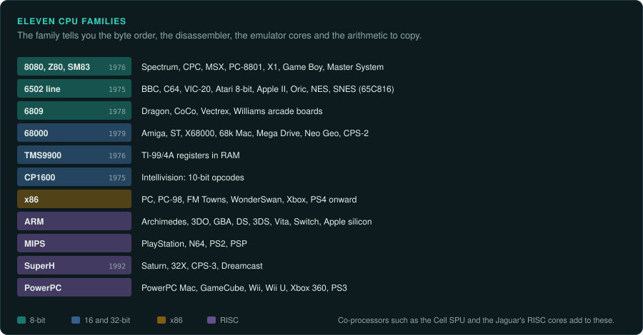
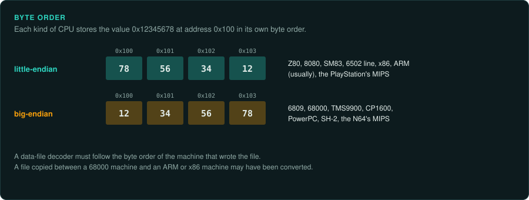
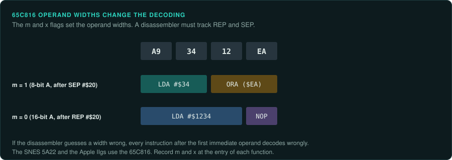
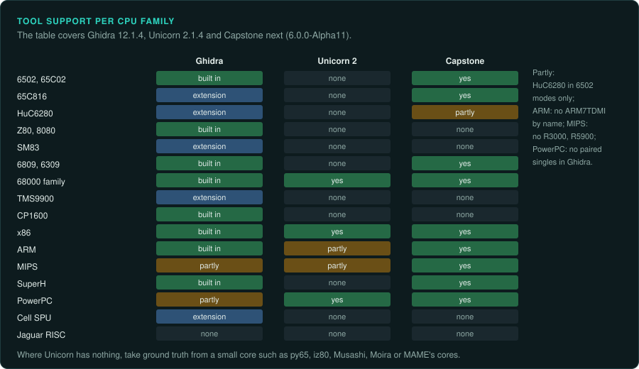
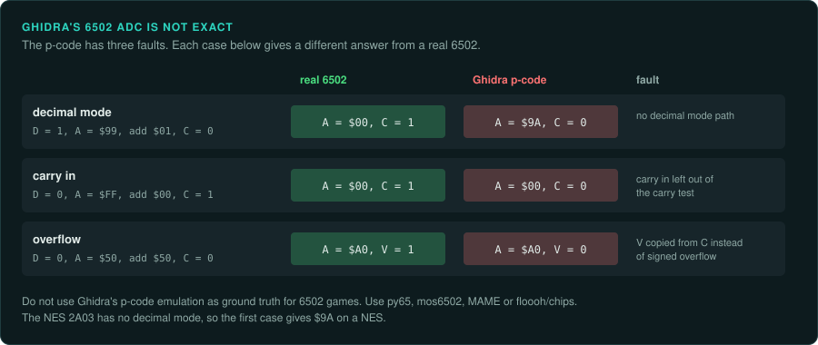

# CPU families

Eleven CPU families cover almost every game platform: the 8080/Z80/SM83 line, the 6502 line,
the 6809, the 68000, the TMS9900, the CP1600, x86, ARM, MIPS, SuperH and PowerPC. A few
one-off co-processors add to them, such as the Cell SPU and the Jaguar's RISC cores. The CPU
family tells you the byte order, the disassembler to use, the emulator cores that can give
ground truth, and the arithmetic a port must copy. This page covers every family except the x86 details,
which are in [CPUs and floating point](../hardware/cpus.md).

## Byte order

Every 8-bit family here is little-endian except the 6809. Every 16-bit console CPU except x86
is big-endian. A data-file decoder must follow the byte order of the machine that wrote the
file ([re-format](../../.claude/skills/re-format/SKILL.md)). A file copied between a 68000
machine and an ARM or x86 machine may have been converted to the other byte order.

## The 8080, Z80 and SM83

The **Z80** launched in July 1976 and runs Intel 8080 code. It adds an alternate register set
(AF', BC', DE', HL'), the index registers IX and IY, and the I and R registers. Its
undocumented instructions include the 8-bit halves of IX and IY
([Wikipedia: Zilog Z80](https://en.wikipedia.org/wiki/Zilog_Z80)). Ghidra's Z80 spec defines
those IXL, IXH, IYL and IYH halves
([z80.slaspec](https://github.com/NationalSecurityAgency/ghidra/blob/master/Ghidra/Processors/Z80/data/languages/z80.slaspec)).
The Z80 has no multiply instruction.

The Game Boy's **Sharp SM83** is a cut-down relative. Its registers are AF, BC, DE, HL, SP and
PC. The flags Z, N, H and C sit in bits 7 to 4. Only DAA reads N and H
([Pan Docs: CPU Registers and Flags](https://gbdev.io/pandocs/CPU_Registers_and_Flags.html)).
The Game Boy Advance carries both an ARM7TDMI and an SM83 for older cartridges
([Copetti: Game Boy Advance](https://www.copetti.org/writings/consoles/game-boy-advance/)).

The Z80 runs the ZX81, Spectrum, CPC, MSX, PC-8801 and X1, and several consoles.

## The 6502 line

The **6502** appeared in September 1975. It has 8-bit A, X, Y and S registers, a status
register P and a 16-bit PC. Zero page (`$00`–`$FF`) takes a one-byte address and runs faster.
The stack is fixed at `$0100`–`$01FF`. The NMOS part leaves 105 of 256 opcodes undefined. Its
`JMP ($xxFF)` indirect bug was fixed in the 65C02. The 6507 (Atari 2600) has 8 KB of address
space and no interrupts. The 6510 (C64) adds an I/O port at `$0000`/`$0001`
([Wikipedia: MOS Technology 6502](https://en.wikipedia.org/wiki/MOS_Technology_6502)).

The NES **2A03** is a 6502 core without decimal mode, with an APU and OAM DMA at `$4014`. The
PAL RP2A07 uses a different clock divider ([NESdev Wiki: 2A03](https://www.nesdev.org/wiki/2A03)).
The PC Engine's **HuC6280** is a 65C02-style core with extra instructions, an MMU that maps
64 KB onto 2 MB, a timer and a PSG
([Wikipedia: Hudson Soft HuC6280](https://en.wikipedia.org/wiki/Hudson_Soft_HuC6280)).

The **65C816** (1985) resets into a 65C02-like emulation mode. In native mode the m and x
flags set the widths of the accumulator and the index registers. Addresses become 24-bit, with
DB and DP registers. The SNES 5A22 and the Apple IIgs use it
([Wikipedia: WDC 65C816](https://en.wikipedia.org/wiki/WDC_65C816)). The same opcode bytes
decode differently by those flags. A disassembler must track the REP and SEP state. If the
disassembler guesses a width wrong, the instructions after the first immediate operand decode
wrongly.

The 6502 family runs the BBC Micro and Electron, VIC-20, C64, Atari 8-bit, Oric and Apple II.

## The 6809

The **6809** (1978) joins A and B into a 16-bit D register. It has X, Y, U and S, an 8-bit
direct page register and an 8x8 hardware multiply. Its PC-relative addressing suits
position-independent code. It ran the Vectrex, Williams arcade games, the Dragon and the CoCo.
The Hitachi 6309 adds registers, block moves and division
([Wikipedia: Motorola 6809](https://en.wikipedia.org/wiki/Motorola_6809)). Ghidra describes it
as big-endian
([6800.ldefs](https://github.com/NationalSecurityAgency/ghidra/blob/master/Ghidra/Processors/MC6800/data/languages/6800.ldefs)).

## The 68000

The **68000** (September 1979) has eight 32-bit data registers and eight address registers.
A7 is split into user and supervisor stack pointers. It has a 16-bit ALU, a 24-bit address
bus, an X (extend) flag, MULU and MULS, DIVU and DIVS, BCD instructions and an address-error
exception. It ran the Mega Drive (7.6 MHz), the Saturn's sound CPU, the Neo Geo, the Jaguar,
the Amiga, the Atari ST, the X68000 and boards such as System 16 and CPS-2
([Wikipedia: Motorola 68000](https://en.wikipedia.org/wiki/Motorola_68000)).

## The TMS9900

The **TMS9900** (June 1976) is a 16-bit big-endian CPU with only PC, WP and ST on the chip. Its
sixteen general registers are held in RAM at the workspace pointer. BLWP saves WP, PC and ST into
workspace registers 13 to 15
([Wikipedia: TMS9900](https://en.wikipedia.org/wiki/Texas_Instruments_TMS9900)). A register
read in its disassembly is a memory read. To trace a function, trace the workspace RAM.

## The CP1600

The **CP1600** (February 1975) addresses only 16-bit words and uses 10 bits of each opcode. R7
is the program counter and R6 the stack pointer. SDBD builds a 16-bit operand from two 10-bit
ROM reads. Ghidra describes it as `CP1600:BE:16:default`
([Wikipedia: CP1600](https://en.wikipedia.org/wiki/General_Instrument_CP1600);
[CP1600.ldefs](https://github.com/NationalSecurityAgency/ghidra/blob/master/Ghidra/Processors/CP1600/data/languages/CP1600.ldefs)).
It ran the Intellivision.

## x86

The x86 generations, the x87 FPU, MMX, 3DNow! and SSE are on
[CPUs and floating point](../hardware/cpus.md). The 16-bit DOS details are on
[DOS games](../DOS.md). x86 runs the PC, the PC-98, the FM Towns, the WonderSwan, the Xbox and
the consoles from the PS4 on.

## ARM

On **ARM**, nearly every 32-bit instruction carries a 4-bit condition. Thumb code is 16-bit,
with eight registers and no conditional execution. The two kinds mix in one program
([Copetti: Game Boy Advance](https://www.copetti.org/writings/consoles/game-boy-advance/)). The
early Archimedes ARM2 and ARM3 use a 26-bit address mode with the flags in R15. Old Archimedes
games depend on it ([Acorn 32-bit](acorn-32bit.md)).

## MIPS

The PlayStation's R3000A-compatible core runs at 33.87 MHz. It has no FPU, a fixed-point GTE,
a load delay slot and a branch delay slot
([Copetti: PlayStation](https://www.copetti.org/writings/consoles/playstation/)). The N64's
VR4300 is MIPS III and always runs in kernel mode
([Copetti: Nintendo 64](https://www.copetti.org/writings/consoles/nintendo-64/)). The PS2's
R5900 adds 128-bit MMI SIMD and two vector units
([Wikipedia: Emotion Engine](https://en.wikipedia.org/wiki/Emotion_Engine)).

## SuperH

**SuperH** (1992) uses fixed 16-bit instructions and one branch delay slot. The SH-2 ran the
Saturn, the 32X and CPS-3. The SH-4 ran the Dreamcast
([Wikipedia: SuperH](https://en.wikipedia.org/wiki/SuperH)).

## PowerPC

The GameCube's Gekko adds about 50 paired-single instructions. The Wii's Broadway and the Wii
U's Espresso descend from it
([Wikipedia: Gekko](https://en.wikipedia.org/wiki/Gekko_(processor))). The Xbox 360's Xenon
has three in-order big-endian cores with VMX128
([Wikipedia: Xenon](https://en.wikipedia.org/wiki/Xenon_(processor))). PowerPC also ran the
PowerPC Macs ([Macintosh](macintosh.md)).

## Co-processors

The PS3's **Cell** pairs one PPE with SPUs. Each SPU has its own 128-bit instruction set, a
256 KiB local store and access to main memory only by DMA
([Wikipedia: Cell](https://en.wikipedia.org/wiki/Cell_(processor))).

The Jaguar's **Tom and Jerry** are 32-bit RISC cores at 26.591 MHz with 4 KB and 8 KB of local
RAM. A flaw in the memory controller makes it hard to run their code from main RAM. Many
developers ran their code on the 68000 instead
([Wikipedia: Atari Jaguar](https://en.wikipedia.org/wiki/Atari_Jaguar)). Tom has two banks of
thirty-two 32-bit registers (not confirmed)
([Jagdox general](https://www.mulle-kybernetik.com/jagdox/general.html)).

## Tools per family

The support below is for Ghidra release `Ghidra_12.1.4_build`, Unicorn 2.1.4 and Capstone's
`next` branch at 6.0.0-Alpha11
([Ghidra processors](https://github.com/NationalSecurityAgency/ghidra/tree/master/Ghidra/Processors);
[Unicorn headers](https://github.com/unicorn-engine/unicorn/tree/master/include/unicorn);
[capstone.h](https://github.com/capstone-engine/capstone/blob/next/include/capstone/capstone.h)).

| Family | Main platforms | Ghidra built in | Ghidra extension | Unicorn 2 | Capstone (`next`) | Small cores for ground truth |
|---|---|---|---|---|---|---|
| 6502, 65C02 | Atari 2600, Atari 8-bit, 7800, C64, VIC-20, BBC, Apple II, NES, Lynx | `6502`, `65C02` ([6502.ldefs](https://github.com/NationalSecurityAgency/ghidra/blob/master/Ghidra/Processors/6502/data/languages/6502.ldefs)) | | None | `MOS65XX_6502`, `_65C02`, `_W65C02` | [py65](https://github.com/mnaberez/py65) (BSD-3), [mre/mos6502](https://github.com/mre/mos6502) (BSD-3), [floooh/chips](https://github.com/floooh/chips) (zlib) |
| 65C816 | SNES, Apple IIgs | None | [achan1989/ghidra-65816](https://github.com/achan1989/ghidra-65816) (archived), [kaayzouee/ghidra-65816](https://github.com/kaayzouee/ghidra-65816) | None | `MOS65XX_65816` with LONG_M and LONG_X widths | MAME g65816 |
| HuC6280 | PC Engine, PC Engine CD | None | [TiCoKH/Ghidra_HuC6280](https://github.com/TiCoKH/Ghidra_HuC6280) | None | 6502 modes only | MAME h6280 |
| Z80, 8080 | Spectrum, CPC, MSX, PC-8801, ColecoVision, Master System, Game Gear | `z80`, `z180` and others ([z80.ldefs](https://github.com/NationalSecurityAgency/ghidra/blob/master/Ghidra/Processors/Z80/data/languages/z80.ldefs)); 8080 through `8085` ([8085.ldefs](https://github.com/NationalSecurityAgency/ghidra/blob/master/Ghidra/Processors/8085/data/languages/8085.ldefs)) | | None | None | [iz80](https://github.com/ivanizag/iz80) (BSD-3, passes ZEXALL), [redcode/Z80](https://github.com/redcode/Z80) (LGPL-3.0), [superzazu/z80](https://github.com/superzazu/z80) (MIT) |
| SM83 | Game Boy, Game Boy Color | None | [Gekkio/GhidraBoy](https://github.com/Gekkio/GhidraBoy) (archived), fork [minorum/ghidra-sm83](https://github.com/minorum/ghidra-sm83) | None | None | MAME lr35902, [mooneye-gb](https://github.com/Gekkio/mooneye-gb) (GPL-3.0) |
| 6809, 6309 | Dragon, CoCo, Vectrex | Under `MC6800` ([6800.ldefs](https://github.com/NationalSecurityAgency/ghidra/blob/master/Ghidra/Processors/MC6800/data/languages/6800.ldefs)); H6309 is "missing many instructions"; the folder also holds the 6805 ([6805.ldefs](https://github.com/NationalSecurityAgency/ghidra/blob/master/Ghidra/Processors/MC6800/data/languages/6805.ldefs)) | | None | `M680X_6809`, `_6309` and others | MAME m6809 |
| 68000 family | Amiga, ST, X68000, 68k Mac, Mega Drive, Sega CD, Jaguar, CD-i | Default language is a 68040 superset, plus 68020, 68030, ColdFire, CPU32 ([68000.ldefs](https://github.com/NationalSecurityAgency/ghidra/blob/master/Ghidra/Processors/68000/data/languages/68000.ldefs)) | | M68000 to M68060 and ColdFire ([m68k.h](https://github.com/unicorn-engine/unicorn/blob/master/include/unicorn/m68k.h)) | `M68K` | [Musashi](https://github.com/kstenerud/Musashi) (MIT-style), [Moira](https://github.com/dirkwhoffmann/Moira) (MIT) |
| TMS9900 | TI-99/4A | None | [gnulnulf/Ghidra-TMS9900](https://github.com/gnulnulf/Ghidra-TMS9900) | None | None | MAME tms9900 |
| CP1600 | Intellivision | Yes | | None | None | MAME cp1610 |
| x86 | PC, PC-98, FM Towns, WonderSwan, Xbox, PS4 onward | Real mode, 16-bit protected, 32, 64, SMM ([x86.ldefs](https://github.com/NationalSecurityAgency/ghidra/blob/master/Ghidra/Processors/x86/data/languages/x86.ldefs)) | | x86 16, 32 and 64 | `X86` | GameFrame's `tools/emu` |
| ARM | Archimedes, 3DO, GBA, DS, 3DS, Vita, Switch | ARM v4 to v8 with Thumb, little- and big-endian ([ARM.ldefs](https://github.com/NationalSecurityAgency/ghidra/blob/master/Ghidra/Processors/ARM/data/languages/ARM.ldefs)); AARCH64 v8.5-A, "missing some 8.5 vector" ([AARCH64.ldefs](https://github.com/NationalSecurityAgency/ghidra/blob/master/Ghidra/Processors/AARCH64/data/languages/AARCH64.ldefs)) | | ARM926, 946, 1176, 11MPCore, Cortex; no ARM7TDMI by name ([arm.h](https://github.com/unicorn-engine/unicorn/blob/master/include/unicorn/arm.h)) | `ARM`, `AARCH64` | Full emulators |
| MIPS | PlayStation, N64, PS2, PSP | MIPS32/64, big- and little-endian; no R3000, R5900 or Allegrex language ([mips.ldefs](https://github.com/NationalSecurityAgency/ghidra/blob/master/Ghidra/Processors/MIPS/data/languages/mips.ldefs)) | [ghidra-emotionengine-reloaded](https://github.com/chaoticgd/ghidra-emotionengine-reloaded) (R5900), [ghidra-allegrex](https://github.com/kotcrab/ghidra-allegrex) (PSP) | MIPS32 and MIPS64 (R4000, VR5432); no R5900 ([mips.h](https://github.com/unicorn-engine/unicorn/blob/master/include/unicorn/mips.h)) | `MIPS`, `MIPS3` | [PCSX2](https://github.com/PCSX2/pcsx2), [PPSSPP](https://github.com/hrydgard/ppsspp) |
| SuperH | Saturn, 32X, Dreamcast | SH-1, SH-2, SH-2A big-endian; SH-4 big- and little-endian ([superh.ldefs](https://github.com/NationalSecurityAgency/ghidra/blob/master/Ghidra/Processors/SuperH/data/languages/superh.ldefs); [SuperH4.ldefs](https://github.com/NationalSecurityAgency/ghidra/blob/master/Ghidra/Processors/SuperH4/data/languages/SuperH4.ldefs)) | [Ghidra-SegaSaturn-Processor](https://github.com/VGKintsugi/Ghidra-SegaSaturn-Processor) (archived) | None | `SH2`, `SH2A`, `SH3`, `SH4` | MAME sh, [Flycast](https://github.com/flyinghead/flycast) (GPL-2.0) |
| PowerPC | PowerPC Mac, GameCube, Wii, Wii U, Xbox 360, PS3 PPE | 32/64 with AltiVec; no paired singles or VMX128 ([ppc.ldefs](https://github.com/NationalSecurityAgency/ghidra/blob/master/Ghidra/Processors/PowerPC/data/languages/ppc.ldefs); [ppc_instructions.sinc](https://github.com/NationalSecurityAgency/ghidra/blob/master/Ghidra/Processors/PowerPC/data/languages/ppc_instructions.sinc)) | [ghidra-gekko-broadway-lang](https://github.com/aldelaro5/ghidra-gekko-broadway-lang) (paired singles) | 601 to 7457, 750CL, 970 ([ppc.h](https://github.com/unicorn-engine/unicorn/blob/master/include/unicorn/ppc.h)) | `PPC`, with a paired-singles mode `CS_MODE_PS` | [Dolphin](https://github.com/dolphin-emu/dolphin), [Xenia](https://github.com/xenia-project/xenia), [RPCS3](https://github.com/RPCS3/rpcs3) |
| Cell SPU | PS3 | None | [aerosoul94/GhidraSPU](https://github.com/aerosoul94/GhidraSPU) | None | None | RPCS3 |
| Jaguar RISC | Jaguar | None | None known ([GitHub search](https://github.com/search?q=ghidra+jaguar&type=repositories)) | None | None | MAME jaguar |

### Ghidra

Ghidra's processor list holds 39 folders
([Ghidra processors](https://github.com/NationalSecurityAgency/ghidra/tree/master/Ghidra/Processors)).

- Its ARM languages start at v4. The ARMv2 and ARMv3 cores of the Archimedes and the 3DO's
  ARM60 have no exact built-in match.
- Its MIPS spec models branch delay slots with `delayslot` (47 uses). The spec has no
  load-delay modelling
  ([mips32Instructions.sinc](https://github.com/NationalSecurityAgency/ghidra/blob/master/Ghidra/Processors/MIPS/data/languages/mips32Instructions.sinc)).
- The default 68000 language accepts 68040 instructions that a real 68000 would fault on.
- The original [beardypig/ghidra-emotionengine](https://github.com/beardypig/ghidra-emotionengine)
  is archived. [astrelsky/ghidra-emotionengine](https://github.com/astrelsky/ghidra-emotionengine/blob/master/README.md)
  shows how to build on the MIPS module.
- An archived module such as GhidraBoy needs a pinned version that matches the Ghidra release.
  Or use the active fork.

Loaders for platforms and console loaders are on [tools for console work](../consoles/tools.md).
The commands for a headless export are in the
[re-ghidra](../../.claude/skills/re-ghidra/SKILL.md) skill.

### Unicorn

Unicorn 2 offers ten architectures, all based on QEMU targets
([unicorn.h](https://github.com/unicorn-engine/unicorn/blob/master/include/unicorn/unicorn.h);
[qemu/target](https://github.com/unicorn-engine/unicorn/tree/master/qemu/target);
[Unicorn README](https://raw.githubusercontent.com/unicorn-engine/unicorn/master/README.md)).
It covers only the 32-bit and 64-bit families (68000, ARM, MIPS, PowerPC, x86). It has no
8-bit CPU at all. Unicorn is GPL-2.0.

- QEMU's MIPS headers define `CPU_R5900`. Unicorn's CPU table has no R5900 entry
  ([mips-defs.h](https://github.com/unicorn-engine/unicorn/blob/master/qemu/target/mips/mips-defs.h);
  [translate_init.inc.c](https://github.com/unicorn-engine/unicorn/blob/master/qemu/target/mips/translate_init.inc.c)).
- Code search finds no `ps_madd` and no `VMX128` in the repository
  ([Unicorn repository](https://github.com/unicorn-engine/unicorn)).
- QEMU executes MIPS32 semantics. PS1 code that reads a stale register in a load delay slot
  would likely give a different result. This is untested.
- For the GBA, the ARM946 or TI925T models are the nearest to the ARM7TDMI.
- Unicorn emulates CPUs only. Any function that touches custom chips needs stubs.

GameFrame's Unicorn tools and how to use them are in the
[re-emulate](../../.claude/skills/re-emulate/SKILL.md) skill.

### Capstone and other disassemblers

Capstone's `next` branch lists ARM, AARCH64, MIPS, x86, PPC, M68K, M680X, MOS65XX, SH, TRICORE
and others. It has no Z80, R5900 or Allegrex mode
([capstone.h](https://github.com/capstone-engine/capstone/blob/next/include/capstone/capstone.h)).
For 65816 code, set the Capstone width mode from the M and X flag state of each function.

The 8-bit families also have these tools:

- [cc65](https://github.com/cc65/cc65) (zlib), with the da65 disassembler.
- [SkoolKit](https://github.com/skoolkid/skoolkit) (GPL-3.0) for the Spectrum.
- [radare2](https://github.com/radareorg/radare2) and [rizin](https://github.com/rizinorg/rizin)
  (LGPL-3.0).

### Small cores and licences

For CPUs that Unicorn lacks, MAME's m6809, g65816, tms9900, cp1610, jaguar and m68000 core
files carry `license:BSD-3-Clause` headers. MAME as a whole is GPL-2.0
([MAME COPYING](https://github.com/mamedev/mame/blob/master/COPYING);
[mame/src/devices/cpu](https://github.com/mamedev/mame/tree/master/src/devices/cpu)). Those BSD
and MIT cores can be combined with GameFrame's Apache-2.0 code. GPL emulators can still be used
as separate external tools. [TomHarte/CLK](https://github.com/TomHarte/CLK) (MIT) covers many systems.
[ares](https://github.com/ares-emulator/ares) covers many consoles.

## Arithmetic traps

### Ghidra's 6502 ADC is not exact

Ghidra's 6502 spec computes `ADC` as `C = carry(A, op1); A = A + op1 + tmpC; resultFlags(A);
V = C;`
([6502.slaspec lines 127–138](https://github.com/NationalSecurityAgency/ghidra/blob/master/Ghidra/Processors/6502/data/languages/6502.slaspec#L127-L138)).
That p-code has three faults.

- It has no decimal mode path.
- It leaves the incoming carry out of the carry-out test.
- It copies V from C. A real 6502 computes V as signed overflow.

The missing decimal mode changes results. `$99 + $01` gives `$00` with carry set in BCD, and `$9A` in binary
([Wikipedia: MOS Technology 6502](https://en.wikipedia.org/wiki/MOS_Technology_6502)). The NES
2A03 has no decimal mode, so the same code gives different results on a stock 6502
([NESdev Wiki: 2A03](https://www.nesdev.org/wiki/2A03)). Do not use Ghidra's p-code emulation
as ground truth for 6502 games. Take ground truth from a tested core such as py65, mos6502, MAME
or floooh/chips. The NMOS flag behaviour in decimal mode (N, V and Z) still needs a primary
source.

### Other families

- Ghidra's Z80 spec implements DAA in full. It uses N to tell addition from subtraction
  ([z80.slaspec line 1234](https://github.com/NationalSecurityAgency/ghidra/blob/master/Ghidra/Processors/Z80/data/languages/z80.slaspec#L1234)).
- The 8080's DAA is defined only after an addition
  ([Wikipedia: Zilog Z80](https://en.wikipedia.org/wiki/Zilog_Z80)).
- The SM83 sets carry on a subtraction borrow, as the Z80 and x86 do. The 6502 and ARM do the
  reverse ([Pan Docs](https://gbdev.io/pandocs/CPU_Registers_and_Flags.html)).
- The 68000's ABCD, SBCD and NBCD use the separate X flag
  ([Wikipedia: Motorola 68000](https://en.wikipedia.org/wiki/Motorola_68000)).
- The ARM7TDMI has no hardware divide. GBA games call the BIOS for division, square root and
  arctangent ([Copetti: Game Boy Advance](https://www.copetti.org/writings/consoles/game-boy-advance/)).
- Games on the 6502, Z80, SM83 and ARM7 call software multiply and divide routines. Emulate
  those routines to get exact results.
- The SH-1 traps on the SH-2's 64-bit multiplies
  ([Wikipedia: SuperH](https://en.wikipedia.org/wiki/SuperH)).
- The PS1 has only fixed point
  ([Copetti: PlayStation](https://www.copetti.org/writings/consoles/playstation/)). The N64 FPU
  follows IEEE 754 ([Copetti: Nintendo 64](https://www.copetti.org/writings/consoles/nintendo-64/)).
- The PS2's EE FPU "isn't IEEE 754 compliant"
  ([Wikipedia: Emotion Engine](https://en.wikipedia.org/wiki/Emotion_Engine)). PCSX2's
  developers report results that differ from x86 by a few bits. Full accuracy would need a
  slow software FPU
  ([PCSX2: Nightmare on Floating-Point Street](https://pcsx2.net/blog/2006/nightmare-on-floating-point-street);
  [PCSX2: What's clamping](https://pcsx2.net/blog/2009/whats-clamping-why-do-we-need-it)).
  Their documents liken PS2 add and subtract to SSE round-toward-zero without INF or NaN
  ([PCSX2 wiki VU documentation](https://wiki.pcsx2.net/Special:MobileDiff/38317)).
- Cell SPU single precision rounds toward zero, treats denormals as zero and has no INF or NaN
  (not confirmed)
  ([IBM Cell SDK 3.0](https://arcb.csc.ncsu.edu/~mueller/cluster/ps3/SDK3.0/docs/accessibility/sdkpt/cbet_3codemapeqv.html)).
  Each original SPE gives about 1.8 GFLOPS in double precision
  ([Wikipedia: Cell](https://en.wikipedia.org/wiki/Cell_(processor))).
- A port of PS2 or SPU float code that uses host IEEE floats will give slightly different
  results. It needs a software float model.
- Gekko paired-single results depend on the quantised load and store (GQR) setup. Check the
  details in Dolphin's code.
- On x86, a PC port must copy Turbo Pascal's 6-byte Real arithmetic and each compiler's
  calling convention ([Turbo Pascal](https://en.wikipedia.org/wiki/Turbo_Pascal);
  [CPUs and floating point](../hardware/cpus.md); [Calling conventions](../ABI.md)).
