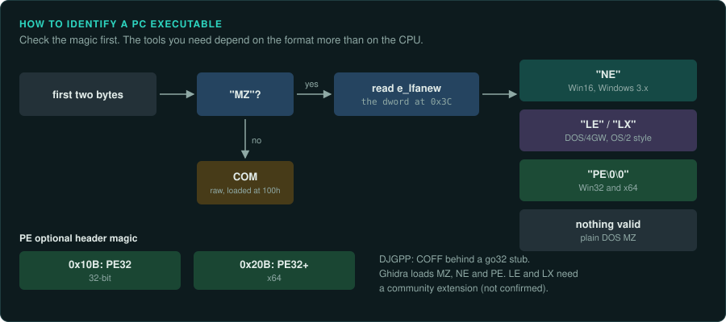
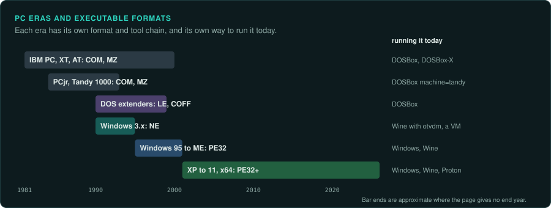
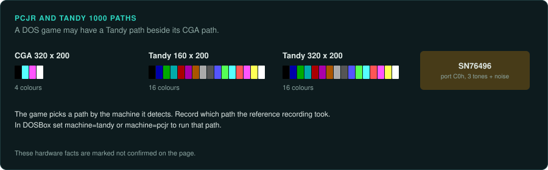
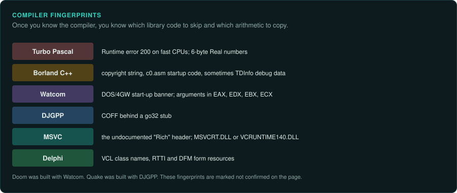
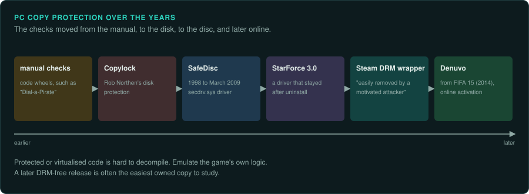

# The IBM PC and compatibles

On the PC, identify the executable format first. The tools you need depend on the format more
than on the CPU. Each PC era has its own executable format and tool chain. DOS used COM and MZ, Win16 used NE, DOS extenders used LE
and LX, Win32 used PE32 and x64 uses PE32+. Check the magic first: MZ, then the header at
`e_lfanew` for NE, LE, LX or PE. GameFrame's `tools/triage` and `tools/dos` already cover MZ
and NE ([re-inventory](../../.claude/skills/re-inventory/SKILL.md)). The x86 CPUs and the PC's
hardware are on [CPUs and floating point](../hardware/cpus.md) and
[Hardware of the era](../hardware/README.md).

| Era | Years | Hardware | Executable | Running it today |
|---|---|---|---|---|
| IBM PC, XT, AT | 1981–1984 | 8088 at 4.77 MHz; 80286 in the AT; MDA or CGA; PC speaker on the 8253 PIT (not confirmed) | COM, MZ | DOSBox, DOSBox-X |
| PCjr, Tandy 1000 | 1984 on | CGA modes plus 160x200x16 and 320x200x16; SN76496 sound at port C0h (not confirmed) | COM, MZ | DOSBox `machine=tandy` or `pcjr` |
| DOS extenders | About 1990 to the late 1990s | 386 and later | LE (DOS/4GW), COFF behind a go32 stub (DJGPP) (not confirmed) | DOSBox |
| Windows 3.x | 1990–1995 | | NE (not confirmed) | Wine with winevdm/otvdm, or a 32-bit Windows VM |
| Windows 95 to ME | 1995–2001 | DirectX from 1995 (not confirmed) | PE32 | Windows, Wine |
| Windows XP to 11, x64 | 2001 on | AMD64 from 2003 (not confirmed) | PE32+ (magic `0x20B`) (not confirmed) | Windows, Wine, Proton |

Sources: [IBM Personal Computer](https://en.wikipedia.org/wiki/IBM_Personal_Computer),
[IBM PC XT](https://en.wikipedia.org/wiki/IBM_Personal_Computer_XT),
[IBM PC AT](https://en.wikipedia.org/wiki/IBM_Personal_Computer_AT),
[Tandy Graphics Adapter](https://en.wikipedia.org/wiki/Tandy_Graphics_Adapter),
[Texas Instruments SN76489](https://en.wikipedia.org/wiki/Texas_Instruments_SN76489),
[IBM PCjr](https://en.wikipedia.org/wiki/IBM_PCjr), [COM file](https://en.wikipedia.org/wiki/COM_file),
[DOS MZ executable](https://en.wikipedia.org/wiki/DOS_MZ_executable),
[Linear Executable](https://en.wikipedia.org/wiki/Linear_Executable),
[DJGPP](https://www.delorie.com/djgpp/), [Windows 3.0](https://en.wikipedia.org/wiki/Windows_3.0),
[New Executable](https://en.wikipedia.org/wiki/New_Executable),
[Windows 95](https://en.wikipedia.org/wiki/Windows_95),
[Portable Executable](https://en.wikipedia.org/wiki/Portable_Executable),
[DirectX](https://en.wikipedia.org/wiki/DirectX), [Windows XP](https://en.wikipedia.org/wiki/Windows_XP),
[x86-64](https://en.wikipedia.org/wiki/X86-64),
[Windows XP Professional x64 Edition](https://en.wikipedia.org/wiki/Windows_XP_Professional_x64_Edition),
[PE Format, Microsoft Learn](https://learn.microsoft.com/en-us/windows/win32/debug/pe-format).

Ghidra has built-in loaders for MZ, NE and PE. LE and LX need a community extension
(not confirmed) ([Ghidra file formats overview](https://www.mintlify.com/NationalSecurityAgency/ghidra/processors/file-formats)).

## IBM PC, XT and AT

### Hardware

1981–1984. An 8088 at 4.77 MHz, or an 80286 in the AT. MDA or CGA video. The PC speaker is
driven by the 8253 PIT (not confirmed). The x86 generations are on
[CPUs and floating point](../hardware/cpus.md). The video modes are on
[2D graphics](../hardware/graphics-2d.md), and the speaker on [Sound](../hardware/sound.md).

### How games were made and loaded

Games are COM and MZ programs under DOS. The compiler leaves fingerprints in the binary
([compilers](#compilers-and-their-fingerprints)).

### Media and image formats

COM and MZ executables. The 16-bit details are on [DOS games](../DOS.md).

### Tools

DOSBox and DOSBox-X run these programs. GameFrame's `tools/dos` and its DOS emulators cover
MZ programs ([DOS games](../DOS.md), [re-emulate](../../.claude/skills/re-emulate/SKILL.md)).

### Projects to learn from

None listed yet.

### For an exact reimplementation

- Follow the [DOS games](../DOS.md) method.
- Find timing loops calibrated to the CPU's speed ([CPUs and floating point](../hardware/cpus.md#timing)).

## PCjr and Tandy 1000

### Hardware

1984 on. CGA modes plus 160x200 in 16 colours and 320x200 in 16 colours. SN76496 sound at port
C0h (not confirmed).

### How games were made and loaded

Some games detect Tandy hardware and draw Tandy graphics even when CGA is chosen
([Tandy Graphics Adapter](https://en.wikipedia.org/wiki/Tandy_Graphics_Adapter)). Sierra's
King's Quest (1984) was commissioned by IBM for the PCjr (not confirmed)
([King's Quest I](https://en.wikipedia.org/wiki/King%27s_Quest_I)).

### Media and image formats

COM and MZ executables.

### Tools

DOSBox with `machine=tandy` or `machine=pcjr`.

### Projects to learn from

None listed yet.

### For an exact reimplementation

- A Tandy path is a separate rendering and sound path in the same binary. Choose which path is ground truth. Write the choice in the project's `AGENTS.md`.
- Find the hardware test that picks the path. Run the reference capture with the machine type
  that matches your choice.

## DOS extenders

### Hardware

About 1990 to the late 1990s, on a 386 or later. Memory and extenders are on
[Memory, storage, input and networks](../hardware/other.md).

### How games were made and loaded

Watcom bundled DOS/4GW, which prints a start-up banner. Watcom's default 32-bit convention
passes arguments in EAX, EDX, EBX and ECX. Doom was built with Watcom. Quake was built with
DJGPP. These fingerprints are (not confirmed)
([Watcom C/C++](https://en.wikipedia.org/wiki/Watcom_C/C%2B%2B);
[DOS/4G](https://en.wikipedia.org/wiki/DOS/4G); [DJGPP](https://en.wikipedia.org/wiki/DJGPP)).

### Media and image formats

LE for DOS/4GW. COFF behind a go32 stub for DJGPP (not confirmed).

### Tools

DOSBox runs these programs. Ghidra needs a community extension for LE and LX (not confirmed).
GameFrame's DPMI support is described on [DOS games](../DOS.md).

### Projects to learn from

None listed yet.

### For an exact reimplementation

- Identify the extender from its banner and its stub.
- Copy the compiler's calling convention ([Calling conventions](../ABI.md)).

## Windows 3.x

### Hardware

1990–1995. No hardware details beyond the PC's are listed yet.

### How games were made and loaded

Programs are NE executables (not confirmed). WinG shipped on 21 September 1994. It let
Windows 3.x programs write bitmap memory directly. Developers used it to port DOS games. DirectX
and CreateDIBSection later replaced it. Doom95, SimCity 2000, SimTower and Civilization II are
among the games listed as using it ([WinG](https://en.wikipedia.org/wiki/WinG)).

### Media and image formats

NE executables. GameFrame's `tools/dos` covers NE ([DOS games](../DOS.md)).

### Tools

- Microsoft states that "64-bit Windows does not support running 16-bit Windows-based
  applications". Such attempts fail with ERROR_BAD_EXE_FORMAT
  ([Running 32-bit Applications, Microsoft Learn](https://learn.microsoft.com/en-us/windows/win32/winprog64/running-32-bit-applications)).
- Windows 11 has no 32-bit edition, so no current Windows runs 16-bit code (not confirmed)
  ([Virtual DOS machine](https://en.wikipedia.org/wiki/Virtual_DOS_machine);
  [Windows 11](https://en.wikipedia.org/wiki/Windows_11)).
- Run these programs with Wine and winevdm/otvdm, or in a 32-bit Windows VM.

### Projects to learn from

None listed yet.

### For an exact reimplementation

- Record whether the game draws through WinG.
- Capture the reference run in Wine or a 32-bit VM. A 64-bit Windows cannot run it.

## Windows 95 to ME

### Hardware

1995–2001. DirectX from 1995 (not confirmed). The 3D cards and APIs are on
[3D accelerators](../hardware/graphics-3d.md).

### How games were made and loaded

Programs are PE32 executables. Engine-era games are on [Engine-era PC games](modern-pc-engines.md).

### Media and image formats

PE32 executables. Disc protection is described [below](#copy-protection-over-the-years).

### Tools

Windows and Wine run these programs. GameFrame's PE tools and emulator cover them
([re-inventory](../../.claude/skills/re-inventory/SKILL.md),
[re-emulate](../../.claude/skills/re-emulate/SKILL.md)).

### Projects to learn from

See [case studies](../case-studies/README.md) and [Software engines and middleware](../engines/README.md).

### For an exact reimplementation

- Read the FPU control word the game runs with
  ([CPUs and floating point](../hardware/cpus.md#the-x87-fpu)).
- Identify the compiler and its runtime ([compilers](#compilers-and-their-fingerprints)).

## Windows XP to 11 on x64

### Hardware

2001 on. AMD64 from 2003 (not confirmed).

### How games were made and loaded

Programs are PE32 or PE32+ executables. WOW64 runs 32-bit code on x64 and ARM64. A 32-bit
process cannot load a 64-bit DLL for execution
([Running 32-bit Applications, Microsoft Learn](https://learn.microsoft.com/en-us/windows/win32/winprog64/running-32-bit-applications)).
Steam launched in September 2003 and GOG in 2008. GOG often repackages old games with DOSBox
or ScummVM (not confirmed) ([Steam (service)](https://en.wikipedia.org/wiki/Steam_(service));
[GOG.com](https://en.wikipedia.org/wiki/GOG.com)).

### Media and image formats

PE32+ executables have the optional-header magic `0x20B` (not confirmed).

### Tools

Windows, Wine and Proton run these programs. Unicorn runs x86-64 code.

### Projects to learn from

None listed yet.

### For an exact reimplementation

- A GOG release may wrap the original DOS program in DOSBox. Study the original program inside.
- A later DRM-free release is often the easiest owned copy to study, because it has no DRM code.

## Compilers and their fingerprints

Each compiler leaves recognisable code and strings in the binary. Once you know the compiler,
you know which library code a port can skip and which arithmetic rules it must copy. These fingerprints are widely documented. Each one
below is (not confirmed).

| Compiler | Fingerprint |
|---|---|
| Turbo Pascal | Programs fail with "Runtime error 200" on fast CPUs, because the CRT unit's delay calibration divides by zero ([Runtime error 200](https://en.wikipedia.org/wiki/Turbo_Pascal#CRT_Delay_problem)). Real numbers use a 6-byte Real ([Turbo Pascal](https://en.wikipedia.org/wiki/Turbo_Pascal)) |
| Borland C++ | A copyright string, its `c0.asm` startup code and sometimes appended TDInfo debug data ([Borland C++](https://en.wikipedia.org/wiki/Borland_C%2B%2B)) |
| Watcom | Bundled DOS/4GW with its start-up banner; arguments in EAX, EDX, EBX and ECX ([Watcom C/C++](https://en.wikipedia.org/wiki/Watcom_C/C%2B%2B)) |
| DJGPP | COFF behind a go32 stub ([DJGPP](https://en.wikipedia.org/wiki/DJGPP)) |
| MSVC | The undocumented "Rich" header; imports from CRTs such as MSVCRT.DLL or VCRUNTIME140.DLL ([Microsoft Visual C++](https://en.wikipedia.org/wiki/Microsoft_Visual_C%2B%2B)) |
| Delphi | VCL class names, RTTI and DFM form resources ([Delphi](https://en.wikipedia.org/wiki/Delphi_(software))) |

The Borland debug symbols are on [DOS games](../DOS.md). .NET and Unity are on
[Engine-era PC games](modern-pc-engines.md).

## Copy protection over the years

Protection checks moved over the years toward the disc, and later to online activation.

- Manual checks and code wheels came first, such as Monkey Island's "Dial-a-Pirate", with
  malformed floppy tracks alongside (not confirmed)
  ([Copy protection](https://en.wikipedia.org/wiki/Copy_protection)).
- Rob Northen's Copylock protected disks on the PC as on the Amiga and the ST
  ([Amiga](amiga.md)).
- SafeDisc appeared in 1998 and was discontinued in March 2009. Its `secdrv.sys` driver had a
  privilege flaw patched in December 2007. Microsoft said in 2015 that SafeDisc games would
  not run on Windows 10. SecuROM games would not run there either
  ([SafeDisc](https://en.wikipedia.org/wiki/SafeDisc)).
- StarForce 3.0 installed a driver that stayed after uninstall. In 2006 Heroes of Might and
  Magic V and GTR2 replaced it with SecuROM ([StarForce](https://en.wikipedia.org/wiki/StarForce)).
- Valve says the Steam DRM wrapper "by itself is not an anti-piracy solution" and is "easily
  removed by a motivated attacker"
  ([Steam DRM, Steamworks documentation](https://partner.steamgames.com/doc/features/drm)).
- Denuvo's first game was FIFA 15 in September 2014. It needs online activation, binds a token
  to the hardware and is integrated with the game's code. Publishers have removed it by patch
  ([Denuvo](https://en.wikipedia.org/wiki/Denuvo)).

Protected or virtualised code is hard to decompile. Unicorn emulation is most useful on the
game's own logic. A later DRM-free release is often the easiest owned copy to study. The law
on working around protection varies by country ([Legal](../LEGAL.md),
[the law worldwide](../preservation/law/README.md)). You decide which route to take.
