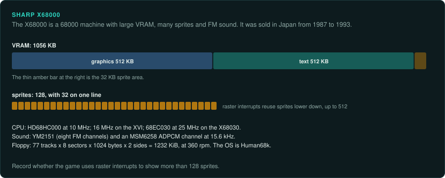
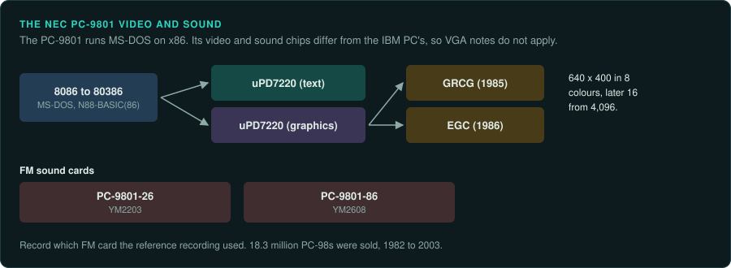
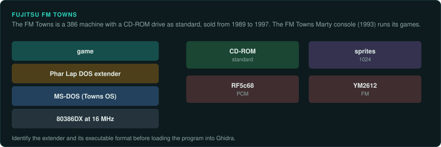

# Japanese 16-bit and 32-bit computers

The X68000 uses the big-endian 68000 line. The PC-9801 and the FM Towns use x86
([CPU families](cpu-families.md)). Each machine has its own custom video and sound chips.
The PC-98's chips differ from the IBM PC's, even though the CPU and the OS match. A game that
uses Human68k or MS-DOS can be traced at its OS calls. A game that drives the chips must be traced
at its hardware register writes.

## Sharp X68000

### Hardware

| Fact | Value |
|---|---|
| Years | Released in March 1987, in Japan only; to 1993 |
| CPU | HD68HC000 at 10 MHz; 16 MHz on the XVI; 68EC030 at 25 MHz on the X68030 |
| RAM | 1–4 MB, to 12 MB |
| VRAM | 1056 KB, split into graphics, text and sprite areas |
| Sprites | 128, 32 per line; raster interrupts can raise that to 512 |
| Sound | YM2151 with eight FM channels; MSM6258 ADPCM channel at 15.6 kHz |

Source: [Wikipedia: X68000](https://en.wikipedia.org/wiki/X68000).

### How games were made and loaded

The OS is Human68k, an MS-DOS-like OS made by Hudson Soft. Floppies hold 77 tracks of 8 sectors
of 1024 bytes at 360 rpm, 1232 KiB in all
([Wikipedia: X68000](https://en.wikipedia.org/wiki/X68000)).

### Media and image formats

The XDF, DIM and HDM image formats still need sources.

### Tools

- Use MAME's debugger when no other debugger is available.
- The XM6, PX68k and Unz debuggers still need sources.
- Ghidra has the 68000 built in. Unicorn runs 68000 code but none of the X68000's chips.

### Projects to learn from

None listed yet.

### For an exact reimplementation

- Record whether the game uses raster interrupts to show more than 128 sprites.
- Record the model. The XVI and X68030 run faster.

## NEC PC-9801

### Hardware

| Fact | Value |
|---|---|
| Years | Launched in October 1982; the line ended on 30 September 2003 |
| Sales | 18.3 million units |
| CPU | 8086 at 5 MHz; later V30, 80286, 80386 |
| RAM | 128 KB to 640 KB at first |
| Video | Two μPD7220 controllers, for text and graphics separately; 640x400 in 8 colours, later 16 from 4,096 |
| Blitters | GRCG (1985) and EGC (1986) |
| Sound | FM on the PC-9801-26 card (YM2203) and the PC-9801-86 card (YM2608) |

Source: [Wikipedia: PC-98](https://en.wikipedia.org/wiki/PC-98).

### How games were made and loaded

The PC-98 runs x86 code under MS-DOS and N88-BASIC(86). Its display and sound hardware differ
from the IBM PC's.

### Media and image formats

| Kind | Formats |
|---|---|
| Floppy | FDI, FDD, D88/D98, HDM, NFD |
| Hard disk | HDI, NHD |

Sources: [libretro: Neko Project II Kai](https://docs.libretro.com/library/neko_project_ii_kai/),
[Batocera wiki](https://wiki.batocera.org/systems:pc98).

### Tools

- **Neko Project II Kai** emulates the PC-98. It needs BIOS, font and sound ROMs.
- GameFrame's DOS tools help with the CPU and DOS layer ([DOS games](../DOS.md)). The
  hardware layer needs its own notes.
- Ghidra has x86 real mode built in. Unicorn runs x86 16-bit code
  ([re-emulate](../../.claude/skills/re-emulate/SKILL.md)).

### Projects to learn from

None listed yet.

### For an exact reimplementation

- Use the DOS method for the program and its calls ([DOS games](../DOS.md)).
- Write separate notes for the μPD7220, GRCG and EGC. The IBM PC's VGA notes do not apply
  ([2D graphics](../hardware/graphics-2d.md)).
- Record which FM sound card the reference recording used.

## Fujitsu FM Towns

### Hardware

| Fact | Value |
|---|---|
| Years | Released on 28 February 1989; to 1997 |
| Sales | About 500,000 |
| CPU | 80386DX at 16 MHz |
| Sound | RF5c68 PCM, YM2612 FM |
| Sprites | 1024 |
| Media | CD-ROM drive as standard |

Source: [Wikipedia: FM Towns](https://en.wikipedia.org/wiki/FM_Towns).

The FM Towns Marty console (1993) runs Towns games.

### How games were made and loaded

Towns OS is MS-DOS with the Phar Lap DOS extender
([Wikipedia: FM Towns](https://en.wikipedia.org/wiki/FM_Towns)).

### Media and image formats

Games came on CD-ROM. No image format details are listed yet.

### Tools

- A game built on the Phar Lap extender needs a loader for extended DOS programs. That differs
  from a real-mode MZ load ([DOS games](../DOS.md)).
- Ghidra has 32-bit x86 built in. Unicorn runs 32-bit x86 code.

### Projects to learn from

None listed yet.

### For an exact reimplementation

- Identify the extender and its executable format before loading the program into Ghidra
  ([IBM PC](ibm-pc.md#dos-extenders)).
- Write separate notes for the FM Towns sprite and sound hardware.
