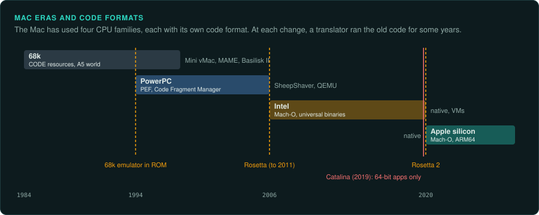
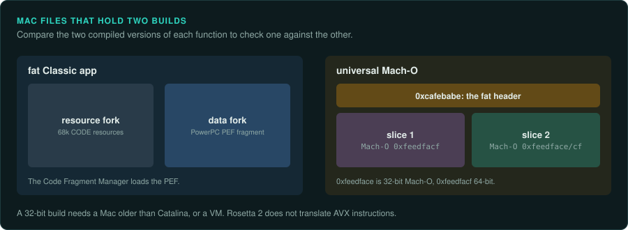

# The Macintosh

The Mac has had four CPU families, each with its own code format. 68k code is stored in resource
forks, PowerPC code in PEF fragments, and Intel and Apple silicon code in Mach-O files. macOS
since Catalina cannot run 32-bit apps, so most older Mac games now run only in an emulator or
on old hardware. A fat or universal file holds two compiled versions of the same game. You can
compare the two versions of each function.

| Era | Years | CPU | Code format | Emulator |
|---|---|---|---|---|
| 68k Classic Mac OS | 1984–1998 (Mac OS 8.1 is the last 68k release) | 68000, 68020, 68030, 68040 | CODE resources in the resource fork, A5 world, A-line traps | Mini vMac, MAME, Basilisk II |
| PowerPC Classic and early OS X | 1994–2006 | 601 to G5 | PEF loaded by the Code Fragment Manager; fat apps carry both | SheepShaver, QEMU |
| Intel | 2006–2020 | x86, x86-64 | Mach-O, universal binaries | Native, VMs |
| Apple silicon | 2020 on | ARM64 | Mach-O | Native; Rosetta 2 for x86-64 |

## 68k Macintosh

### Hardware

The Macintosh 128K arrived on 24 January 1984, the Mac II in March 1987 and the Quadra 700 and
900 in October 1991 (not confirmed)
([Macintosh 128K](https://en.wikipedia.org/wiki/Macintosh_128K);
[Macintosh II](https://en.wikipedia.org/wiki/Macintosh_II);
[Macintosh Quadra](https://en.wikipedia.org/wiki/Macintosh_Quadra)). The CPUs run from the
68000 to the 68040 ([CPU families](cpu-families.md#the-68000)). Mac OS 8.1 (January 1998) was
the last release for 68k Macs ([Basilisk II](https://en.wikipedia.org/wiki/Basilisk_II)).

### How games were made and loaded

68k application code is stored as CODE resources in the resource fork. The details below are
(not confirmed)
([Inside Macintosh: Mac OS Runtime Architectures](https://developer.apple.com/library/archive/documentation/mac/runtimehtml/RTArch-110.html)).

- CODE 0 holds the jump table.
- The globals and the jump table sit around register A5, the "A5 world".
- The Segment Loader loads segments on demand.
- Toolbox calls are A-line traps.

Myst (1993) was built with HyperCard (not confirmed) ([Myst](https://en.wikipedia.org/wiki/Myst)).

### Media and image formats

Forks are lost on file systems other than the Mac's. Archives therefore use MacBinary, BinHex,
AppleSingle/AppleDouble or DiskCopy images (not confirmed)
([Resource fork](https://en.wikipedia.org/wiki/Resource_fork)).

### Tools

- Ghidra does not understand resource forks. On macOS, open a fork by adding `..namedfork/rsrc`
  to the path. Import the CODE resources as raw binaries. Add the A-trap names to the 68000
  spec by hand. RetroGhidra has a basic Classic Mac loader
  ([A-Traps in Ghidra, 68kMLA](https://68kmla.org/bb/goto/post?id=466137);
  [68kmla.org thread](https://68kmla.org/bb/goto/post?id=510430)).
- resource_dasm decodes many classic resource types and disassembles 68k and PPC code resources
  (not confirmed) ([resource_dasm](https://github.com/fuzziqersoftware/resource_dasm)).
- The emulators below are (not confirmed). Basilisk II (GPL, 1999) emulates 68k Macs up to Mac
  OS 8.1 ([Basilisk II](https://en.wikipedia.org/wiki/Basilisk_II)). Mini vMac covers the Mac
  Plus era ([Mini vMac](https://www.gryphel.com/c/minivmac/)). MAME has Mac drivers
  ([MAME](https://www.mamedev.org/)).
- Executor and Advanced Mac Substitute reimplement the 68k Mac OS without Apple ROMs
  (not confirmed) ([Executor](https://en.wikipedia.org/wiki/Executor_(software));
  [Advanced Mac Substitute](https://www.v68k.org/advanced-mac-substitute/)).
- Unicorn runs 68k code (not confirmed) ([Unicorn Engine](https://www.unicorn-engine.org/)). A
  function from a single CODE segment could run under Unicorn with the A5 world and the needed
  traps stubbed. That is how `tools/emu/dos_env` stubs DOS
  ([re-emulate](../../.claude/skills/re-emulate/SKILL.md)).

### Projects to learn from

Bungie's Marathon (1994) (not confirmed) ([Marathon](https://en.wikipedia.org/wiki/Marathon_(video_game))).
Bungie released the Marathon 2 source in January 2000, and Aleph One was developed from it. The
trilogy's data became freeware in 2005. "Classic Marathon 2" was re-released on Steam on
Aleph One ([Marathon 2: Durandal](https://en.wikipedia.org/wiki/Marathon_2:_Durandal);
[Aleph One on GitHub](https://github.com/Aleph-One-Marathon/alephone)). Aleph One is a fan
engine. For an exact match, study the shipped binary.

### For an exact reimplementation

A 68k Mac binary needs three steps before analysis. No mainstream loader does all three.

1. Extract the resource fork.
2. Split the CODE resources.
3. Rebuild the A5 jump table.

Then name the A-line traps, so that each Toolbox call shows as a named call.

## PowerPC Macintosh

### Hardware

The first Power Macs launched on 14 March 1994 with a 68k emulator in ROM (not confirmed)
([Power Macintosh](https://en.wikipedia.org/wiki/Power_Macintosh)). The CPUs run from the 601 to
the G5 ([CPU families](cpu-families.md#powerpc)).

### How games were made and loaded

PEF is Apple's RISC executable format for Classic Mac OS. The Code Fragment Manager loads it.
PowerPC Mac OS X kept it for Carbon apps
([Preferred Executable Format](https://en.wikipedia.org/wiki/Preferred_Executable_Format)). Fat
Classic apps held 68k CODE resources and a PPC fragment together (not confirmed)
([Fat binary](https://en.wikipedia.org/wiki/Fat_binary)). The Classic environment ran Mac OS 9
apps up to 10.4 and never on Intel (not confirmed)
([Classic environment](https://en.wikipedia.org/wiki/Classic_Environment)).

### Media and image formats

As for 68k Macs: MacBinary, BinHex, AppleSingle/AppleDouble or DiskCopy images (not confirmed).

### Tools

- Ghidra ships a PEF loader
  ([Ghidra API: PefLoader 11.4](https://ghidradocs.com/11.4_PUBLIC/docs/GhidraAPI_javadoc/api/ghidra/app/util/opinion/PefLoader.html);
  [PefLoader 12.1.3](https://ghidradocs.com/12.1.3_PUBLIC/docs/GhidraAPI_javadoc/api/ghidra/app/util/opinion/PefLoader.html)).
- The emulators below are (not confirmed). SheepShaver (GPL, final release 2.5 in September
  2022) runs Mac OS 7.5.2 to 9.0.4 and has no MMU emulation
  ([SheepShaver](https://en.wikipedia.org/wiki/SheepShaver)). QEMU's g3beige and mac99 machines
  run Mac OS 9 and OS X up to 10.5
  ([QEMU PowerPC Mac documentation](https://www.qemu.org/docs/master/system/ppc/powermac.html)).
- Unicorn runs PowerPC code (not confirmed).

### Projects to learn from

The Marathon games and Aleph One, as above.

### For an exact reimplementation

- In a fat app, compare the 68k and PPC versions of each function. Both were compiled from the
  same source.

## Intel Macintosh

### Hardware

Intel Macs arrived in January 2006 (not confirmed)
([Mac transition to Intel processors](https://en.wikipedia.org/wiki/Mac_transition_to_Intel_processors)).

### How games were made and loaded

Rosetta translated PowerPC code from Mac OS X 10.4.4 until Lion removed it in 2011
([Rosetta](https://en.wikipedia.org/wiki/Rosetta_(software))). macOS Catalina (7 October 2019)
runs only 64-bit apps ([macOS Catalina](https://en.wikipedia.org/wiki/MacOS_Catalina)).

### Media and image formats

Mach-O magic is `0xfeedface` or `0xfeedfacf`. Universal files use `0xcafebabe`
([Mach-O](https://en.wikipedia.org/wiki/Mach-O)).

### Tools

Ghidra has a built-in Mach-O loader (not confirmed)
([Ghidra file formats overview](https://www.mintlify.com/NationalSecurityAgency/ghidra/processors/file-formats)).
Unicorn runs x86 code.

### Projects to learn from

None listed yet.

### For an exact reimplementation

- A universal file carries two compiled versions of the same game. Use the second one as a check
  on each function.
- A 32-bit Intel build needs a Mac older than Catalina or a VM.

## Apple silicon Macintosh

### Hardware

ARM64 Macs, from 2020 ([CPU families](cpu-families.md#arm)).

### How games were made and loaded

Rosetta 2 shipped with Big Sur. Apple said at WWDC 2025 that most of it will go in macOS 28
(2027), keeping support for older unmaintained games. The article gives both 27 and 28 as the
version ([Rosetta](https://en.wikipedia.org/wiki/Rosetta_(software))). Rosetta 2 does not translate
kernel extensions or AVX instructions (not confirmed)
([About the Rosetta translation environment, Apple](https://developer.apple.com/documentation/apple-silicon/about-the-rosetta-translation-environment)).

### Media and image formats

Mach-O, as for Intel Macs.

### Tools

Ghidra has AARCH64 built in. Unicorn runs ARM64 code.

### Projects to learn from

None listed yet.

### For an exact reimplementation

- Record whether the reference run used native ARM64 code or x86-64 code under Rosetta 2.
