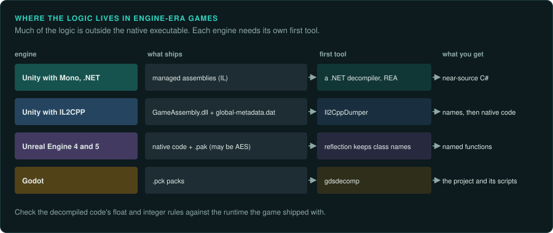

# Engine-era PC games

In engine-era PC games much of the logic is outside the native executable. It is in managed
assemblies, in C++ generated from them, or in packed asset files. This page has one section per
engine or runtime. For these games the tools depend on the engine more than on the hardware.
Each section uses the headings of the machine pages that apply.
[Software engines and middleware](../engines/README.md) describes the engines and how to
recognise each one.

## .NET and Unity with Mono

### How games were made and loaded

.NET assemblies decompile to near-source C#
([.NET Framework](https://en.wikipedia.org/wiki/.NET_Framework);
[Mono](https://en.wikipedia.org/wiki/Mono_(software))).

### Tools

The REA tools inspect managed assemblies ([re-rea](../../.claude/skills/re-rea/SKILL.md)).

### For an exact reimplementation

- Read the decompiled C# for the logic. Check its floating-point and integer rules against the
  runtime the game shipped with.

## Unity with IL2CPP

### How games were made and loaded

Unity's IL2CPP "converts all managed assemblies into standard C++ code". That code is compiled
to an executable or a DLL
([IL2CPP overview, Unity Manual](https://docs.unity3d.com/Manual/il2cpp-introduction.html)).

### Media and image formats

On Windows the output is `GameAssembly.dll` plus `global-metadata.dat` (not confirmed).

### Tools

Il2CppDumper rebuilds names from the metadata (not confirmed)
([Il2CppDumper](https://github.com/Perfare/Il2CppDumper)).

### For an exact reimplementation

- Rebuild the names first. Then trace the native code as for any PE program
  ([re-trace](../../.claude/skills/re-trace/SKILL.md)).

## Unreal Engine 4 and 5

### How games were made and loaded

Unreal Engine 4 and 5 pack assets in `.pak` files, which may be AES-encrypted. UObject
reflection keeps class names in the binary (not confirmed)
([Unreal Engine](https://en.wikipedia.org/wiki/Unreal_Engine)).

### Media and image formats

`.pak` files, which may be AES-encrypted (not confirmed).

### Tools

More on Unreal is in [Unreal](../engines/unreal.md).

### For an exact reimplementation

- Use the class names that reflection keeps to name the functions.

## Godot

### How games were made and loaded

Godot packs `.pck` files (not confirmed) ([Godot](https://godotengine.org/)).

### Media and image formats

`.pck` files (not confirmed).

### Tools

gdsdecomp recovers projects (not confirmed) ([gdsdecomp](https://github.com/bruvzg/gdsdecomp)).

### For an exact reimplementation

- Recover the project, then read the game's scripts for the logic.

## Anti-cheat

Kernel-level anti-cheat can block debuggers (not confirmed)
([Anti-cheat software](https://en.wikipedia.org/wiki/Anti-cheat_software)). Protected or
virtualised code is hard to decompile. Unicorn emulation is most useful on the game's own logic
([re-emulate](../../.claude/skills/re-emulate/SKILL.md)).

## Linux builds as a second binary

Linux ports came from Loki Software between 1998 and 2002. Most Linux players now use Proton
(2018) and the Steam Deck (2022). These facts are (not confirmed)
([Loki Entertainment Software](https://en.wikipedia.org/wiki/Loki_Entertainment_Software);
[Proton](https://en.wikipedia.org/wiki/Proton_(software));
[Steam Deck](https://en.wikipedia.org/wiki/Steam_Deck)).

Linux builds sometimes keep more symbols than Windows builds. Use a Linux build as a second
binary. Compare its functions with the Windows build to name them.
