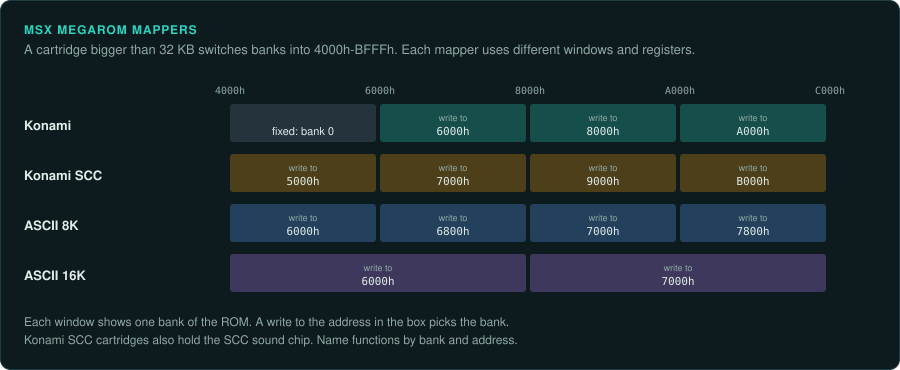
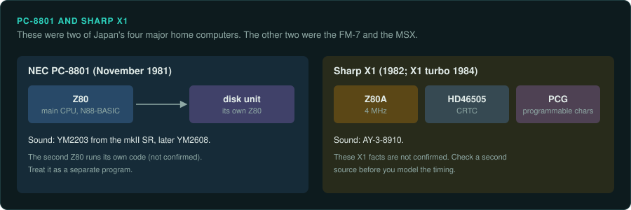

# MSX, PC-8801 and Sharp X1

These machines use the Z80 ([CPU families](cpu-families.md#the-8080-z80-and-sm83)). The MSX maps memory through slots and subslots. Its MegaROM cartridges switch banks with a mapper.
The PC-8801 and the X1 were two of Japan's four major home computers, with the FM-7 and the
MSX.

## MSX, MSX2, MSX2+ and turbo R

### Hardware

| Fact | Value |
|---|---|
| Years | Announced by ASCII on 16 June 1983; first machine on sale 21 October 1983; MSX2 in 1985; MSX2+ in 1988 (Japan only); to 1990 |
| CPU | Z80A at 3.58 MHz; R800 on the turbo R |
| RAM | 8–64 KB; 64–512 KB on MSX2; up to 4 MB per slot through a memory mapper |
| Video | TMS9918 family, V9938, V9958; European machines use the TMS9929A (not confirmed) |
| Sound | AY-3-8910 or YM2149; Konami's SCC chip inside some cartridges adds five channels |

Sources: [Wikipedia: MSX](https://en.wikipedia.org/wiki/MSX), [MSX Wiki](https://www.msx.org/wiki/).

**Slots.** Slots and subslots are selected through the PPI at port `A8h` and the register at
`FFFFh`. VRAM is reached only through VDP ports `98h` and `99h` (not confirmed)
([MSX Wiki: Slots](https://www.msx.org/wiki/Slots)).

### How games were made and loaded

Cartridges were common on the MSX. MegaROM cartridges use bank-switching mappers: Konami,
Konami SCC, ASCII 8K and ASCII 16K. An emulator needs the right mapper type to run a dump
(not confirmed) ([MSX Wiki: MegaROM mappers](https://www.msx.org/wiki/MegaROM_Mappers)).

### Media and image formats

Images are ROM dumps with a mapper type, DSK disks and CAS tapes (not confirmed)
([openMSX manual](https://openmsx.org/manual/)).

### Tools

- **openMSX** has a Tcl console and a separate debugger ([openmsx.org](https://openmsx.org/)).
  An agent can drive captures through the Tcl console with a script
  ([re-observe](../../.claude/skills/re-observe/SKILL.md)).
- Ghidra has the Z80 built in. Unicorn has no Z80. For ground truth use a small core such as
  iz80 ([CPU families](cpu-families.md#tools-per-family)).

The MSX Resource Center is at [msx.org](https://www.msx.org/).

### Projects to learn from

None listed yet.

### For an exact reimplementation

- Record the mapper type of the cartridge. Name functions by bank and address.
- Record the slot layout of the reference machine.
- Record which VDP the reference machine has. European machines use the TMS9929A.

## NEC PC-8801

### Hardware

| Fact | Value |
|---|---|
| Launch | November 1981 |
| CPU | Z80 |
| Sound | YM2203 from the mkII SR, later YM2608 |

Its disk unit has a second Z80 (not confirmed). Source:
[Wikipedia: PC-8800 series](https://en.wikipedia.org/wiki/PC-8800_series).

### How games were made and loaded

The PC-8801 ran N88-BASIC. Ys, Thexder, Snatcher and the Dragon Slayer series first appeared on
it ([Wikipedia: PC-8800 series](https://en.wikipedia.org/wiki/PC-8800_series)).

### Media and image formats

D88 is the usual disk image (not confirmed).

### Tools

MAME covers the PC-8801, with a shared debugger and Lua scripting
([MAME debugger](https://docs.mamedev.org/debugger/index.html)). Ghidra has the Z80 built in.

### Projects to learn from

None listed yet.

### For an exact reimplementation

- The disk unit's second Z80 runs its own code (not confirmed). Treat it as a separate program.
- Record the sound chip of the reference model.

## Sharp X1

### Hardware

| Fact | Value |
|---|---|
| Years | 1982; X1 turbo in 1984 (not confirmed) |
| CPU | Z80A at 4 MHz (not confirmed) |
| Video | HD46505 CRTC, PCG (not confirmed) |
| Sound | AY-3-8910 (not confirmed) |

Source: [Wikipedia: Sharp X1](https://en.wikipedia.org/wiki/Sharp_X1).

### How games were made and loaded

None listed yet.

### Media and image formats

None listed yet.

### Tools

MAME covers the X1, with a shared debugger and Lua scripting
([MAME debugger](https://docs.mamedev.org/debugger/index.html)). Ghidra has the Z80 built in.

### Projects to learn from

None listed yet.

### For an exact reimplementation

- Confirm the CPU clock and the chips from a second source before you model timing.
