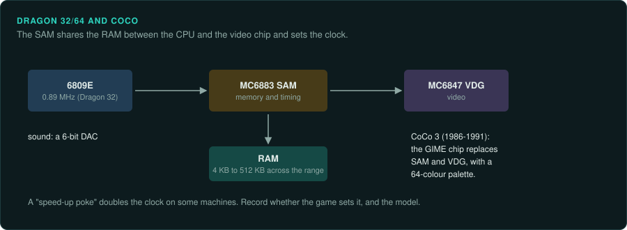
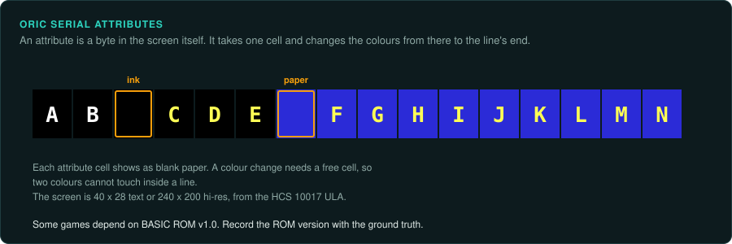

# Other 8-bit computers

This page covers three smaller families. The Dragon and the CoCo use the 6809E, the Oric uses
the 6502, and the TI-99/4A uses the 16-bit TMS9900
([CPU families](cpu-families.md)). On the Oric some games depend on the BASIC ROM version.
On the TI-99/4A the general registers are held in RAM.

## Dragon 32/64 and TRS-80 Color Computer

### Hardware

| Machine | Years | CPU | Video |
|---|---|---|---|
| TRS-80 CoCo | Announced July 1980 at US$399 | 6809E | MC6847 VDG |
| CoCo 3 | 1986–1991 | 6809E, double speed | GIME, 64-colour palette |
| Dragon 32 | August 1982 | 6809E at 0.89 MHz | MC6847 VDG |

RAM across the range runs from 4 KB to 512 KB. Dragon Data went out of business in 1984. Sources:
[Wikipedia: TRS-80 Color Computer](https://en.wikipedia.org/wiki/TRS-80_Color_Computer),
[Wikipedia: Dragon 32/64](https://en.wikipedia.org/wiki/Dragon_32/64).

The details below are (not confirmed) ([Dragon Wiki](https://archive.worldofdragon.org/)).

- Both machines use the MC6883 SAM for memory and timing.
- Sound comes from a 6-bit DAC.
- A "speed-up poke" doubles the clock on some machines.

### How games were made and loaded

OS-9 ran on the CoCo
([Wikipedia: TRS-80 Color Computer](https://en.wikipedia.org/wiki/TRS-80_Color_Computer)).

### Media and image formats

None listed yet.

### Tools

- **XRoar** emulates both machines ([6809.org.uk/xroar](https://www.6809.org.uk/xroar/)).
- Ghidra has the 6809 built in under `MC6800`. Its H6309 language is "missing many
  instructions". Unicorn has no 6809. MAME's m6809 core is BSD-3-Clause
  ([CPU families](cpu-families.md#small-cores-and-licences)).
- The 6809 is big-endian. Decode data files in that byte order.

World of Dragon is the community site ([worldofdragon.org](https://worldofdragon.org/)).

### Projects to learn from

None listed yet.

### For an exact reimplementation

- Record whether the game sets the speed-up poke. The clock rate changes with it.
- Record the model. The CoCo 3's GIME differs from the VDG of the earlier machines.

## Oric-1 and Atmos

### Hardware

| Fact | Value |
|---|---|
| Years | Oric-1 on 1 September 1982; Atmos on 1 February 1984 |
| CPU | 6502A at 1 MHz |
| RAM | 16 or 48 KB |
| Video | ULA HCS 10017; serial attributes take one character cell each |
| Sound | AY-3-8912 |

Source: [Wikipedia: Oric](https://en.wikipedia.org/wiki/Oric_(computer)).

A 6522 VIA drives the AY, the keyboard, the printer and the tape (not confirmed)
([Defence Force Oric wiki](https://wiki.defence-force.org/)).

### How games were made and loaded

Some games depend on BASIC ROM v1.0
([Wikipedia: Oric](https://en.wikipedia.org/wiki/Oric_(computer))).

### Media and image formats

None listed yet.

### Tools

- **Oricutron** is the emulator ([github.com/pete-gordon/oricutron](https://github.com/pete-gordon/oricutron)).
- Ghidra has the 6502 built in. Its `ADC` p-code is not exact
  ([arithmetic traps](cpu-families.md#ghidra-s-6502-adc-is-not-exact)).

Defence Force is the community site ([defence-force.org](https://www.defence-force.org/)).

### Projects to learn from

None listed yet.

### For an exact reimplementation

- Record the BASIC ROM version with the ground truth. Some games depend on v1.0.

## Texas Instruments TI-99/4A

### Hardware

The TI-99/4A uses the TMS9900, a 16-bit big-endian CPU with only PC, WP and ST on the chip. Its
sixteen general registers are held in RAM at the workspace pointer. BLWP saves WP, PC and ST into
workspace registers 13 to 15
([Wikipedia: TMS9900](https://en.wikipedia.org/wiki/Texas_Instruments_TMS9900)).

### How games were made and loaded

None listed yet.

### Media and image formats

None listed yet.

### Tools

- Ghidra needs a community extension,
  [gnulnulf/Ghidra-TMS9900](https://github.com/gnulnulf/Ghidra-TMS9900).
- Unicorn and Capstone have no TMS9900. MAME's tms9900 core is BSD-3-Clause
  ([CPU families](cpu-families.md#small-cores-and-licences)).

### Projects to learn from

None listed yet.

### For an exact reimplementation

- A register read in the disassembly is a memory read. Trace the workspace RAM along with the
  function.
- Record the workspace pointer at the entry of each function you emulate.
