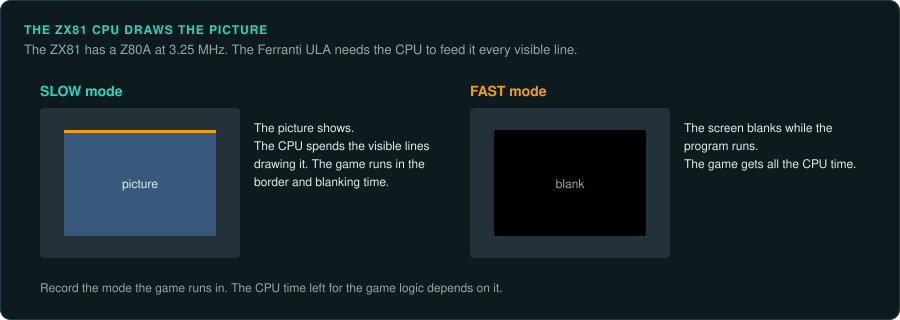
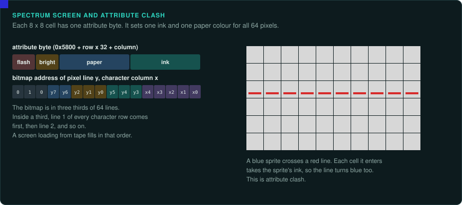
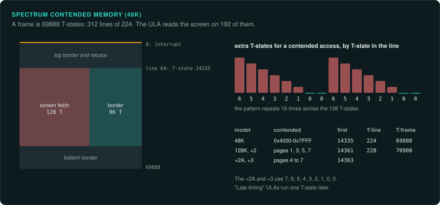
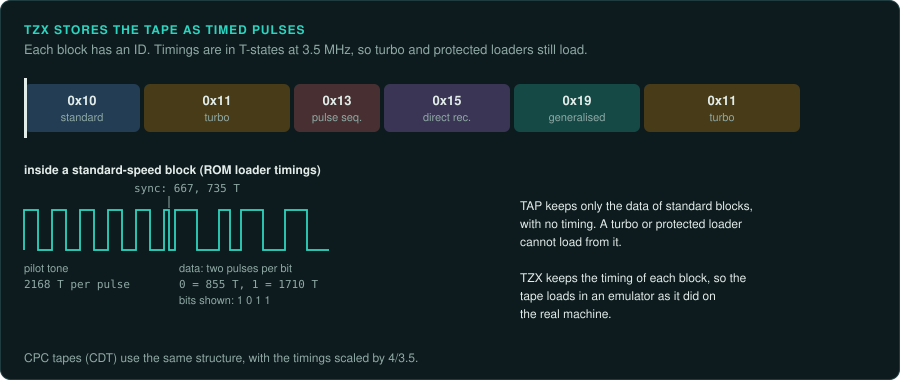

# Sinclair ZX81 and ZX Spectrum

The Sinclair machines use the Z80 ([CPU families](cpu-families.md#the-8080-z80-and-sm83)). On
the ZX81 the CPU also generates the display. On the Spectrum, the ULA delays the CPU when both
use contended memory. An instruction's timing therefore depends on where the ULA is in the
frame. The contention tables differ by model. Spectrum games came mostly on tape, often with
turbo or protected loaders.

## Sinclair ZX81

### Hardware

| Fact | Value |
|---|---|
| Years | 1981–1984; launched in the UK on 5 March 1981 at £69.95 assembled |
| Sales | Over 1.5 million |
| CPU | Z80A, 3.25 MHz (the source also says 3.5 MHz) |
| RAM | 1 KB, with a 16 KB pack |
| Video | Ferranti ULA; the CPU generates the display |

The CPU generates the display, so FAST mode blanks the screen to run faster
([Wikipedia: ZX81](https://en.wikipedia.org/wiki/ZX81)).

### How games were made and loaded

Games loaded from tape at roughly 250–300 bit/s
([Wikipedia: ZX81](https://en.wikipedia.org/wiki/ZX81)).

### Media and image formats

The ZX81's tape encoding differs from the Spectrum's. TZX does not describe it natively
([TZX format](https://worldofspectrum.net/TZXformat.html)).

### Tools

EightyOne covers the ZX81 (debugger features not confirmed).

### Projects to learn from

None listed yet.

### For an exact reimplementation

- Record whether the game runs in FAST mode or with the display on. The CPU time left for the
  game depends on it.

## ZX Spectrum 48K, 128K, +2, +2A and +3

### Hardware

| Model | Launch | CPU | RAM |
|---|---|---|---|
| 48K | 23 April 1982 | Z80A, 3.5 MHz | 16 or 48 KB |
| 128K | Spain September 1985, UK January 1986 | 3.5469 MHz (not confirmed) | 128 KB as eight 16 KB pages |
| +2 | 1986 (Amstrad) | As the 128K | 128 KB |
| +3 | 1987 | As the 128K | 128 KB |
| +2A | Late 1988 | As the 128K | 128 KB |

Sources: [Wikipedia: ZX Spectrum](https://en.wikipedia.org/wiki/ZX_Spectrum),
[Sinclair Wiki: ZX Spectrum 128](https://sinclair.wiki.zxnet.co.uk/wiki/ZX_Spectrum_128).

The ULA gives 256x192 pixels with 8x8 attribute cells. The 128K models add an AY-3-8912 sound
chip.

**Memory map and paging.** The 48K map puts ROM at `0x0000`–`0x3FFF`, the screen bitmap at
`0x4000`–`0x57FF` and the attributes at `0x5800`–`0x5AFF` (not confirmed)
([Sinclair Wiki](https://sinclair.wiki.zxnet.co.uk/wiki/ZX_Spectrum_48K)). On 128K models,
port `0x7FFD` selects the RAM page at `0xC000`, the shadow screen, the ROM and a lock bit. The
+2A and +3 add port `0x1FFD` for all-RAM modes (not confirmed)
([Sinclair Wiki: ZX Spectrum 128](https://sinclair.wiki.zxnet.co.uk/wiki/ZX_Spectrum_128)).

**Contended memory.** The ULA delays CPU accesses to contended memory while it reads the
screen. The delays differ by model
([Sinclair Wiki: Contended memory](https://sinclair.wiki.zxnet.co.uk/wiki/Contended_memory)).

| Model | Contended area | First contended T-state | Delay pattern per 8 T-states | T-states per line |
|---|---|---|---|---|
| 48K | `0x4000`–`0x7FFF` | 14335 after the interrupt | 6,5,4,3,2,1,0,0 | 224 |
| 128K, +2 | Pages 1, 3, 5 and 7 | 14361 | As the 48K | 228 |
| +2A, +3 | Pages 4 to 7, only when MREQ is active | 14363 | 7,6,5,4,3,2,1,0,0 | |

"Late timing" ULAs run one T-state later than the 48K figure.

**Frames.** A frame lasts 69888 T-states on the 48K and 70908 on the 128K, with one maskable
interrupt per frame. Most games use IM 2 (not confirmed)
([World of Spectrum FAQ](https://worldofspectrum.org/faq/reference/48kreference.htm)).

### How games were made and loaded

Spectrum tapes carried turbo and protected loaders such as Speedlock and Alkatraz. A loader was
often a BASIC stub followed by machine code that decrypts the next stage (not confirmed)
([Sinclair Wiki: Tape protection schemes](https://sinclair.wiki.zxnet.co.uk/wiki/Tape_protection_schemes)).
The +3 used 3-inch disks protected with non-standard sectors (not confirmed)
([CPCWiki: Copy protection](https://www.cpcwiki.eu/index.php/Copy_protection)).

### Media and image formats

| Format | What it holds |
|---|---|
| TZX | Tape with exact timing; keeps turbo and protected loaders |
| TAP | Only standard ROM-loader blocks |
| PZX | Tape (read by SkoolKit) |
| SNA, Z80 | Snapshots |
| SZX | Snapshot with fuller machine state |
| RZX | A recording of input for replay (not confirmed) |

TZX was designed to keep turbo and protected loaders working. Revision 1.20 stores pilot, sync and bit timings in
T-states at 3.5 MHz. It also stores pulse sequences, direct recordings and generalised symbol
encodings. Block `0x10` is standard timing and `0x11` turbo. Block `0x13` is a pulse sequence
used by some protections. Block `0x15` is a direct recording and `0x19` generalised data
([TZX format](https://worldofspectrum.net/TZXformat.html)). The snapshot formats are described
on the [Sinclair Wiki: file formats](https://sinclair.wiki.zxnet.co.uk/wiki/Category:File_formats)
page (not confirmed).

### Tools

- **SkoolKit** reads TAP, TZX and PZX tapes and Z80 and SZX snapshots. It also plays RZX recordings. Its `tap2sna.py` simulates tape loading. Its `trace.py` traces execution and can
  write AY output as WAV ([SkoolKit](https://skoolkit.ca/)). SkoolKit is GPL-3.0.
- **Fuse** ([fuse-emulator.sourceforge.net](https://fuse-emulator.sourceforge.net/)),
  **ZEsarUX** ([github.com/chernandezba/zesarux](https://github.com/chernandezba/zesarux)) and
  **SpecEmu** ([specemu.zxe.io](http://www.specemu.zxe.io/)) have debuggers.
- ZEsarUX has a remote protocol that a script can drive.
- Ghidra has the Z80 built in. Unicorn has no Z80. For ground truth use a small core such as
  iz80 ([CPU families](cpu-families.md#tools-per-family)).

The community references are Spectrum Computing
([spectrumcomputing.co.uk](https://spectrumcomputing.co.uk/)), World of Spectrum
([worldofspectrum.org](https://worldofspectrum.org/)) and the Sinclair Wiki
([sinclair.wiki.zxnet.co.uk](https://sinclair.wiki.zxnet.co.uk/)).

### Projects to learn from

SkoolKit's published disassemblies include Skool Daze, Back to Skool, Contact Sam Cruise,
Manic Miner, Jet Set Willy, Hungry Horace and the 48K ROM
([SkoolKit disassemblies](https://skoolkit.ca/disassemblies/)). Each one reassembles byte for
byte to the original. A port can check its results against them. Before you copy anything from
a disassembly, check whether it includes game bytes and what its licence is.

### For an exact reimplementation

- Record the model. The contention tables and the frame length differ between the 48K, the
  128K and the +2A/+3.
- Record whether the ULA has early or late timing.
- Get past the loader in an emulator, then snapshot the game in memory
  ([snapshot after the loader](README.md#snapshot-after-the-loader)).
- Keep the TZX image as the record of what shipped.
- If the game must match frame timing, model the contention table for the model you chose.
