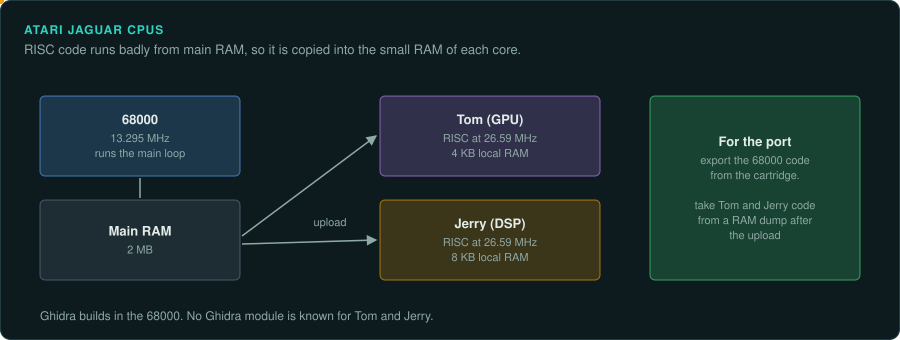
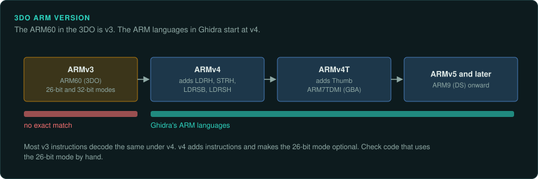

# Jaguar and 3DO

The Atari Jaguar and the 3DO do not belong to the main console families. Jaguar games run
much of their code on two RISC co-processors. Ghidra has no module for them. The 3DO uses an ARMv3 CPU, older than
any ARM language Ghidra builds in. The handhelds are in the [Handhelds](../handhelds/README.md)
section.

## The platforms

| Platform | Year | CPU | Media | Ghidra module or loader | Emulator with a debugger |
|---|---|---|---|---|---|
| Atari Jaguar | November 1993 | 68000 at 13.295 MHz; Tom and Jerry RISC at 26.59 MHz | Cartridge | 68000; no Tom or Jerry module | BigPEmu (closed), Virtual Jaguar |
| 3DO | October 1993 | ARM60 (ARMv3) at 12.5 MHz | CD; Portfolio OS | ARM v4 and up only | Opera (not confirmed) |

## Atari Jaguar

### Hardware

The 68000 runs at 13.295 MHz. Tom and Jerry are 32-bit RISC cores at 26.591 MHz, with 4 KB and
8 KB of local RAM. The console has 2 MB of RAM. A memory controller flaw makes it awkward to run
RISC code from main RAM, so developers ran more of their code on the 68000
([Wikipedia: Atari Jaguar](https://en.wikipedia.org/wiki/Atari_Jaguar)). The main loop runs on
the 68000 and uploads RISC code ([Game Tech Wiki: Jaguar](https://emulation.gametechwiki.com/index.php/Jaguar)).
Tom has two banks of thirty-two 32-bit registers (not confirmed)
([Jagdox general](https://www.mulle-kybernetik.com/jagdox/general.html)).

### Tools

Ghidra builds in the 68000. No Ghidra module is known for Tom and Jerry
([GitHub search](https://github.com/search?q=ghidra+jaguar&type=repositories)). MAME's jaguar
core file carries a BSD-3-Clause header.

BigPEmu is Rich Whitehouse's closed-source Jaguar emulator, written for Digital Eclipse's
Atari 50. Whether it has a debugger is unknown. Virtual Jaguar is the open alternative, now
maintained by Joseph Mattiello, with GPU, DSP and blitter timing models
([Game Tech Wiki: Jaguar](https://emulation.gametechwiki.com/index.php/Jaguar)).

### For an exact reimplementation

Game code is split across the 68000 and the RISC cores. Find and export each CPU's code
separately. The RISC code is often taken from a RAM dump after the 68000 uploads it.

## 3DO

### Hardware

The ARM60 is an ARMv3 core at 12.5 MHz. The Madam and Clio chips hold the cel engine. Games run
on the Portfolio OS
([3DO Interactive Multiplayer](https://en.wikipedia.org/wiki/3DO_Interactive_Multiplayer)).

### Tools

Ghidra's ARM languages start at v4, so the ARM60 has no exact built-in match. Opera runs the
games (not confirmed).

### Projects to learn from

rawgl by cyxx reimplements the Another World engine and reads the 3DO data among others. It was
archived on 28 June 2025 ([cyxx/rawgl](https://github.com/cyxx/rawgl)).
