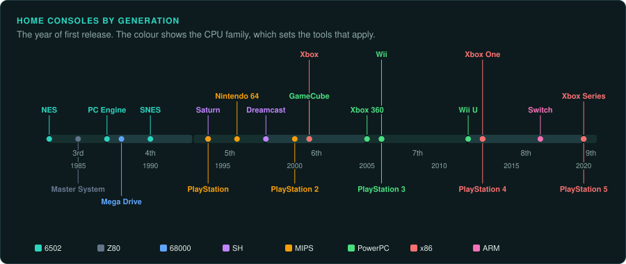
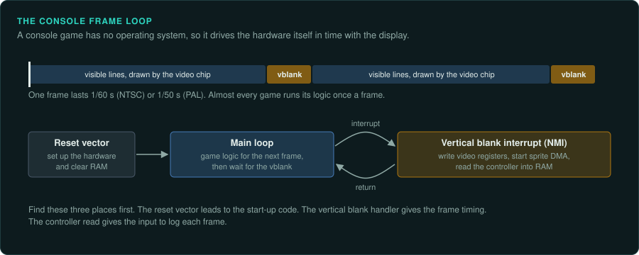
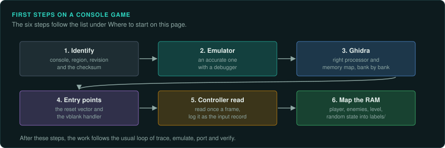

# Console games



A home console game runs on fixed hardware with little or no operating system. The game
controls the hardware directly. It writes to the video chip's registers, starts DMA transfers,
reads the controllers from memory-mapped ports and times everything to the display's vertical
blank. So reverse engineering and porting a console game use different methods from PC work.

This section covers how to study home console games and how to bring them to other systems. The
work follows GameFrame's playbook. The tools and the hardware details differ from PC work. The handhelds,
from the Game & Watch to the Switch, are in [Handhelds](../handhelds/README.md). The arcade
boards are in [Arcade](../arcade/README.md).

## Ask your agent

Start on a console game. Copy this prompt into your coding agent:

```text
In my GameFrame project, start work on a game for <console>.

1. Read docs/consoles/README.md, docs/consoles/tools.md and the platform page for <console>.
2. Record the region, the revision and the checksum of the ROM or disc image.
3. Load the code into Ghidra with the right processor and memory map, and label the hardware
   registers.
4. Find the reset vector, the vertical blank handler and the controller read.
5. Map the main variables in RAM with the emulator's RAM search. Write them into labels/.
```

## Platforms by generation



- [Early consoles](early-consoles.md): the Odyssey, Atari 2600, Intellivision, ColecoVision,
  Atari 5200 and 7800, and Vectrex.
- [Console platforms](platforms.md): the home consoles from the NES to the sixth generation,
  with their CPUs, video and sound chips, and what each means for the work.
- [CD add-ons](cd-add-ons.md): the Sega CD, 32X, PC Engine CD and Philips CD-i.
- [Jaguar and 3DO](32-bit-oddities.md): the Atari Jaguar and the 3DO, with their RISC
  co-processors and the ARMv3 CPU.
- [Seventh generation onward](modern.md): from the Xbox 360 to the PS5, with their signed
  executables, loaders and emulator status.

## Doing the work

- [Tools for console work](tools.md): Ghidra processors and loaders, emulators with debuggers,
  Unicorn's architectures, and splitting tools.
- [Routes to a port](porting.md): reimplementation, matching decompilation, static
  recompilation and emulation, and how to replace each part of the hardware.
- [Matching decompilation](matching-decomp.md): how the decompilation projects work, and when
  that route is worth its cost.

## How console work differs from PC work



| Topic | PC games | Console games |
|---|---|---|
| The program | An EXE with imports, sometimes symbols | A ROM or a disc image; code at fixed addresses, often banked; no imports |
| The CPU | x86 | 6502, 65816, Z80, 68000, MIPS, SH-2, SH-4, PowerPC, ARM; often two or more CPUs |
| Hardware access | Through drivers and APIs | Direct writes to memory-mapped registers |
| Time | A timer interrupt or the frame | The vertical blank, at 60 Hz (NTSC) or 50 Hz (PAL) |
| Graphics | A frame buffer | Often tiles, sprites and layers built by a video chip; frame buffers from the 32-bit generation |
| Sound | A sound card or an API | A sound chip or a separate sound CPU with its own program |
| Saves | Files | Battery-backed RAM in the cartridge, memory cards, passwords |
| Ground truth | Run the EXE in an emulator or on a PC | Run the ROM in an accurate emulator with a debugger |
| Source and symbols | Sometimes symbols, rarely source | Sometimes symbol maps on discs and in prototypes; leaked source exists for some games; GameFrame's method does not use it ([Legal](../LEGAL.md)) |

## Where to start



1. Identify the console, the region and the exact revision of the game. Regions differ in
   timing (50 or 60 Hz), text and sometimes code. Record the checksum of the ROM or disc.
2. Get an accurate emulator with a debugger running the game ([Tools](tools.md)).
3. Load the code into Ghidra with the right processor and memory map. For banked cartridges,
   load each bank at the address it runs at.
4. Find the reset vector and the vertical blank interrupt handler. From them you can find the
   main loop and the frame timing.
5. Find the controller read. It is usually one function called once a frame, storing the
   buttons in RAM. Log those buttons each frame as the input record ([Inputs](../observe/inputs.md)).
6. Map the RAM: which addresses hold the player, the enemies, the level, the random state.
   Use the emulator's RAM watch and RAM search to find these addresses. Write them into `labels/`.

Then follow the usual loop: trace, emulate, port, verify.
