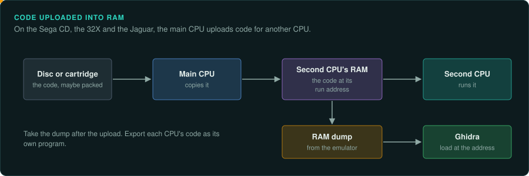
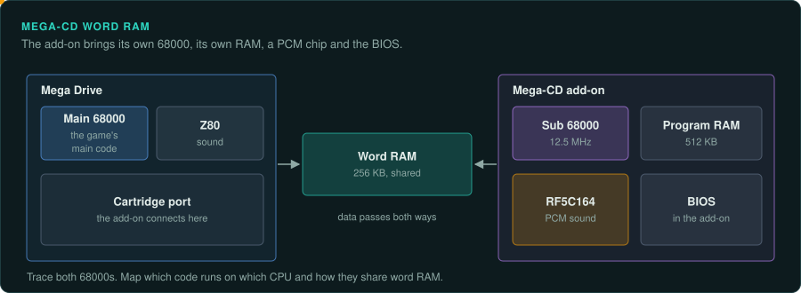
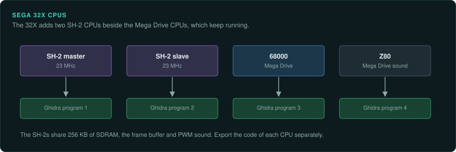
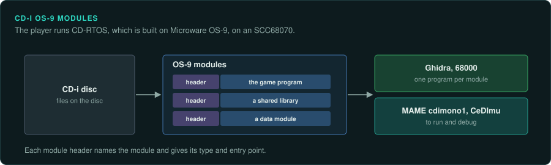

# CD add-ons

These add-ons give the base console a second CPU or a BIOS. Game code runs on that second CPU. An emulator needs the add-on's BIOS. The Philips CD-i is
a standalone player, but its programs are OS-9 modules on a 68000-family CPU.

## The platforms

| Platform | Year | CPU | Media | Ghidra module or loader | Emulator with a debugger |
|---|---|---|---|---|---|
| Mega-CD / Sega CD | December 1991 (JP) | Second 68000 at 12.5 MHz | CD; BIOS on the add-on | 68000 | Genesis Plus GX, PicoDrive, ares, MAME (not confirmed) |
| Sega 32X | November 1994 | Two SH-2 at 23 MHz | Cartridge | SuperH SH-2 | PicoDrive, MAME (not confirmed) |
| PC Engine CD-ROM² | December 1988 (JP) | HuC6280 at 7.16 MHz | CD; needs a System Card BIOS | 65C02 is close; [Ghidra_HuC6280](https://github.com/TiCoKH/Ghidra_HuC6280) | Mednafen, Mesen 2 |
| Philips CD-i | December 1991 | SCC68070 at 15.5 MHz (not confirmed) | CD; programs are OS-9 modules | 68000 | MAME cdimono1, CeDImu |

Sources for the table: [Sega CD](https://en.wikipedia.org/wiki/Sega_CD),
[32X](https://en.wikipedia.org/wiki/32X), [TurboGrafx-CD](https://en.wikipedia.org/wiki/TurboGrafx-CD),
[CD-i](https://en.wikipedia.org/wiki/CD-i).

The Sega CD and 32X split game code across two or more CPUs. Find and export each CPU's code
separately. The second CPU's code is often taken from a RAM dump after the main CPU uploads it.

## Mega-CD / Sega CD

### Hardware

The add-on has a second 68000 at 12.5 MHz. It holds 512 KB of program RAM and 256 KB of word
RAM shared with the Mega Drive. An RF5C164 makes PCM sound. The BIOS is in the add-on. The
size of the backup RAM is not confirmed.

### Tools

Ghidra builds in the 68000. Its default 68000 language is a 68040 superset, which accepts
instructions a real 68000 would fault on. Unicorn emulates the 68000, so a function that runs
only on the CPU can be run headless with stubs for the custom chips
([Tools](tools.md#gameframe-s-unicorn-emulator)). Genesis Plus GX, PicoDrive, ares and MAME
run the add-on (not confirmed).

### For an exact reimplementation

Trace both 68000s. Map which code runs on which CPU and how they share word RAM.

## Sega 32X

### Hardware

The 32X adds two SH-2 CPUs at 23 MHz, 256 KB of SDRAM, a frame buffer and PWM sound. The
Mega Drive's own 68000 and Z80 keep running beside them.

### Tools

Ghidra builds in the SH-2 under SuperH. Unicorn has no SuperH, so take ground truth from a
full emulator such as PicoDrive or MAME (not confirmed). MAME's sh core is another source of ground truth.

### For an exact reimplementation

A 32X game can run code on four CPUs: two SH-2s, the 68000 and the Z80. Export each CPU's code
separately.

## PC Engine CD-ROM²

### Hardware

The HuC6280 runs at 7.16 MHz. It is a 65C02-style core with extra instructions, an MMU that maps
64 KB onto 2 MB, a timer and a PSG
([Wikipedia: Hudson Soft HuC6280](https://en.wikipedia.org/wiki/Hudson_Soft_HuC6280)). The CD
unit needs a System Card BIOS. The Super System Card adds RAM, and the Arcade Card adds 2 MB.

### Tools

HuC6280 code disassembles mostly correctly with Ghidra's 65C02 language. The block-transfer and
MMU instructions come out wrong without the
[Ghidra_HuC6280](https://github.com/TiCoKH/Ghidra_HuC6280) extension. Capstone has only the 6502
modes. Mednafen and Mesen 2 run the games. Mednafen has a debugger in its SDL front end
([Mednafen docs](https://mednafen.github.io/documentation/)). MAME's h6280 core is a source of
ground truth.

### For an exact reimplementation

Record which System Card the game needs. The card sets which BIOS the game runs on and how much RAM it has.

## Philips CD-i

### Hardware

The CPU is an SCC68070 at 15.5 MHz (not confirmed). The system runs CD-RTOS, which is built on
Microware OS-9. Programs are OS-9 modules.

### Tools

Load the modules with Ghidra's 68000 language. MAME's cdimono1 driver and CeDImu run the
programs.
