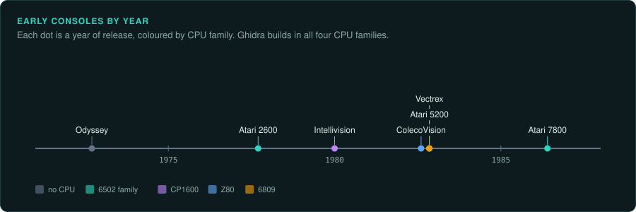
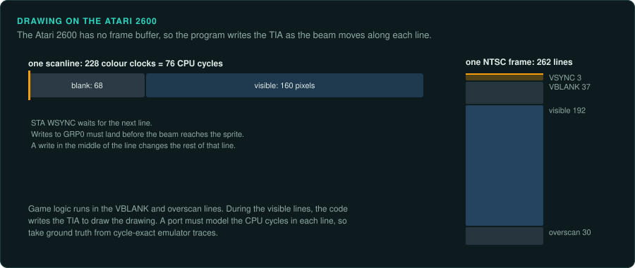
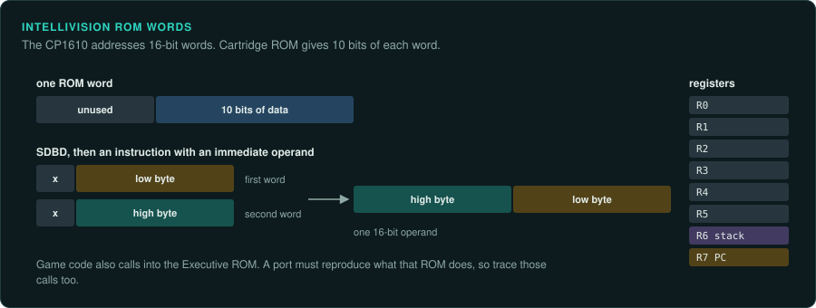
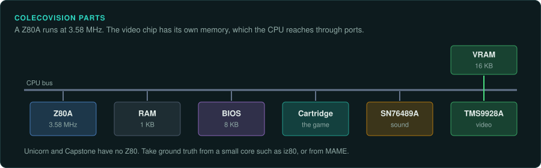
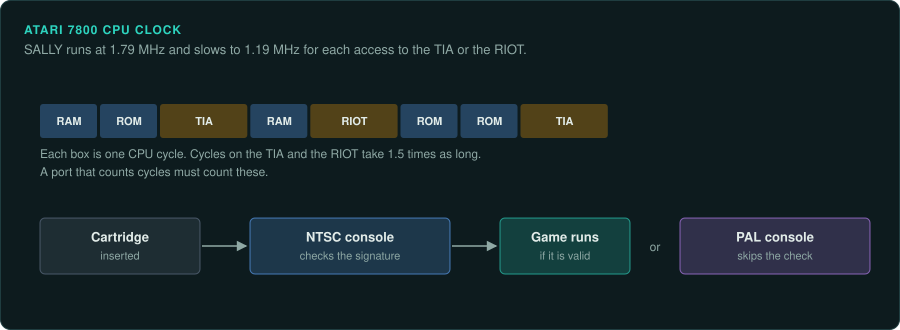
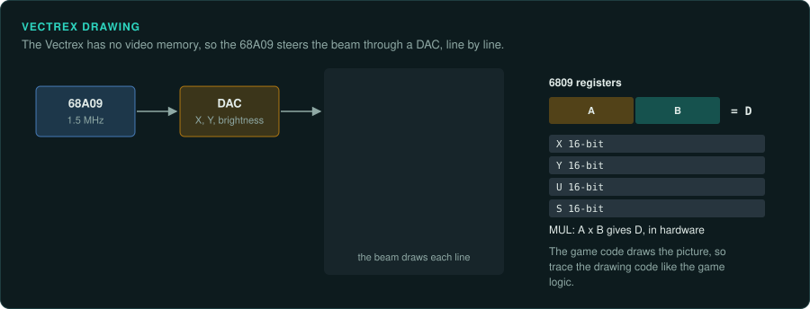

# Early consoles

The first and second generation consoles have tiny ROMs, no operating system and well-known
CPUs. Most of them use a 6502 family CPU, a Z80, a 6809 or the CP1600. Ghidra builds in all four.
On several of these machines the game logic depends on exact CPU timing. Take ground truth from
cycle-exact emulator traces.

## The consoles

| Console | Year | CPU | Media | Ghidra module or loader | Emulator with a debugger |
|---|---|---|---|---|---|
| Magnavox Odyssey | September 1972 | None | Cards that rewire jumpers | Not applicable | None |
| Atari 2600 | September 1977 | 6507 at 1.19 MHz | 4 KB cartridge space, with bank switching (F8, F6, E0, 3F) | 6502 | Stella |
| Intellivision | 1979 test, 1980 national | CP1610, about 894.886 kHz (not confirmed) | Cartridge with 10-bit ROM | CP1600 | jzIntv |
| ColecoVision | August 1982 | Z80A at 3.58 MHz | Cartridge; 8 KB BIOS | Z80 | MAME |
| Atari 5200 | November 1982 | SALLY 6502C at 1.79 MHz | Cartridge | 6502 | MAME, Altirra (not confirmed) |
| Atari 7800 | 1984 test, May 1986 | SALLY at 1.79 MHz, 1.19 MHz on TIA and RIOT access | Cartridge; NTSC cartridges are signed | 6502 | MAME |
| Vectrex | November 1982 | 68A09 at 1.5 MHz | Cartridge | 6809 under MC6800, plus [ghidra-vectrex-loader](https://github.com/nevesnunes/ghidra-vectrex-loader) | MAME |

MAME's debugger works across all these CPUs
([MAME docs: debugger](https://docs.mamedev.org/debugger/index.html)).

## Magnavox Odyssey

### Hardware

The Odyssey has no CPU. It is built from discrete transistor and diode logic, and game cards
rewire jumpers ([Magnavox Odyssey](https://en.wikipedia.org/wiki/Magnavox_Odyssey)).

### For an exact reimplementation

The Odyssey has no software to reverse engineer. A port has to simulate the circuit, as for
the discrete-logic arcade games.

## Atari 2600

### Hardware

The 6507 is a 6502 with 8 KB of address space and no interrupts
([Wikipedia: MOS Technology 6502](https://en.wikipedia.org/wiki/MOS_Technology_6502)). The TIA
makes the video and the sound. The RIOT holds 128 bytes of RAM. A cartridge has 4 KB of address space. Larger games use bank-switching schemes such as F8, F6, E0 and 3F
([Atari 2600](https://en.wikipedia.org/wiki/Atari_2600);
[Atari 2600 hardware](https://en.wikipedia.org/wiki/Atari_2600_hardware)).

There is no frame buffer. The program writes TIA registers in time with each scanline. This
is called "racing the beam".

### Tools

Stella has a debugger built on DiStella, with breakpoints, TIA and RIOT views and scanline
stepping (not confirmed) ([Stella](https://stella-emu.github.io/)). Load the code with
Ghidra's 6502 language. Ghidra's 6502 `ADC` p-code is not exact, so take ground truth from a
tested core ([Tools](tools.md#disassembly-and-decompilation)).

### Projects to learn from

Commented 2600 disassemblies appear on AtariAge (not confirmed) ([AtariAge](https://atariage.com/)).

### For an exact reimplementation

A port must model the CPU cycles in each scanline. Take ground truth from cycle-exact
emulator traces. Record the cartridge's bank-switching scheme, because a function's address
identifies it only together with its bank.

## Intellivision

### Hardware

The CP1610 addresses only 16-bit words and uses 10 bits of each opcode. R7 is the program
counter and R6 the stack pointer. SDBD builds a 16-bit operand from two 10-bit ROM reads
([Wikipedia: CP1600](https://en.wikipedia.org/wiki/General_Instrument_CP1600)). The STIC makes
the video. An AY-3-8914 makes the sound. Game code calls into the Executive ROM
([Intellivision](https://en.wikipedia.org/wiki/Intellivision)).

Sources give different clock speeds. One gives about 894.886 kHz, the NTSC colour clock
divided by 4. The CPU article gives about 2 MHz for the CP1610.

### Tools

Ghidra builds in the CP1600 as `CP1600:BE:16:default`
([CP1600.ldefs](https://github.com/NationalSecurityAgency/ghidra/blob/master/Ghidra/Processors/CP1600/data/languages/CP1600.ldefs)).
jzIntv has a command-line debugger (not confirmed)
([jzIntv](http://spatula-city.org/~im14u2c/intv/)). Unicorn has no CP1600. MAME's cp1610 core
file carries a BSD-3-Clause header.

### For an exact reimplementation

Many games call into the Executive ROM, so a port must reproduce what that ROM does. Trace
the calls into it as well as the cartridge code.

## ColecoVision

### Hardware

The Z80A runs at 3.58 MHz. A TMS9928A with 16 KB of VRAM makes the video. An SN76489A makes
the sound. The console has 1 KB of RAM and an 8 KB BIOS
([ColecoVision](https://en.wikipedia.org/wiki/ColecoVision)).

### Tools

Ghidra builds in the Z80. Unicorn and Capstone have no Z80, so take ground truth from a small
core such as [iz80](https://github.com/ivanizag/iz80) (BSD-3, passes ZEXALL) or from MAME.

## Atari 5200

### Hardware

The SALLY 6502C runs at 1.79 MHz. ANTIC, GTIA and POKEY make the video and sound. The console has 16 KB of RAM ([Atari 5200](https://en.wikipedia.org/wiki/Atari_5200)).

## Atari 7800

### Hardware

SALLY runs at 1.79 MHz and drops to 1.19 MHz when it accesses the TIA or the RIOT. MARIA makes
the video. The TIA makes the sound. The console has 4 KB of RAM
([Atari 7800](https://en.wikipedia.org/wiki/Atari_7800)).

### For an exact reimplementation

NTSC cartridges are signed. The console checks the signature. PAL 7800s skip the signature
check.

## Vectrex

### Hardware

The 68A09 runs at 1.5 MHz. An AY-3-8912 makes the sound. The console has 1 KB of RAM. The
CPU drives the vector beam through a DAC ([Vectrex](https://en.wikipedia.org/wiki/Vectrex)).
The 6809 joins A and B into a 16-bit D register. It has an 8x8 hardware multiply
([Wikipedia: Motorola 6809](https://en.wikipedia.org/wiki/Motorola_6809)).

### Tools

Ghidra builds in the 6809 under `MC6800`, and describes it as big-endian
([6800.ldefs](https://github.com/NationalSecurityAgency/ghidra/blob/master/Ghidra/Processors/MC6800/data/languages/6800.ldefs)).
[ghidra-vectrex-loader](https://github.com/nevesnunes/ghidra-vectrex-loader) loads cartridges.
Capstone has an `M680X_6809` mode. Unicorn has no 6809. MAME's m6809 core file carries a
BSD-3-Clause header.

### For an exact reimplementation

The CPU drives the beam, so game code does the drawing. Trace the drawing code like the game
logic.
