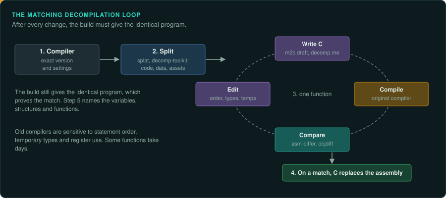
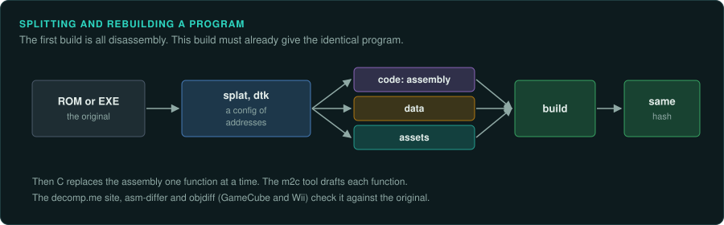
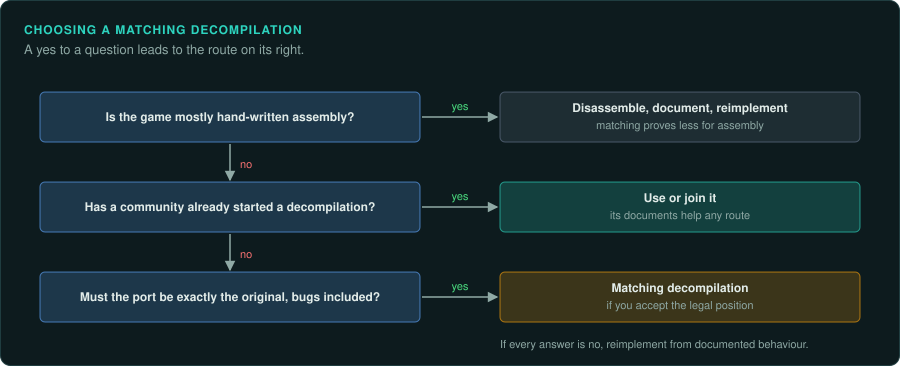

# Matching decompilation

A matching decompilation is C or C++ source code that, compiled with the original compiler and
settings, produces a program identical byte for byte to the original. Community projects have
done this for many console games, among them Super Mario 64, The Legend of Zelda: Ocarina of
Time and Majora's Mask, and Paper Mario. For games written in assembly, the same idea gives a
matching disassembly that assembles to the identical ROM, as pret's Pokémon Red does. This page
describes how these projects work and when to choose this route.

## How it works

1. **Identify the compiler.** Find the exact compiler and version the game was built with: SGI
   IDO 5.3 or 7.1 for many N64 games, GCC 2.x versions from the PsyQ SDK for the PlayStation,
   Metrowerks CodeWarrior versions for the GameCube, Microsoft's for the Xbox. Compiler
   signatures in the code, library versions and leftover strings help to identify it.
2. **Split the program.** Tools (splat, decomp-toolkit) split the ROM or executable into
   files of code, data and assets, following a configuration of addresses. The project builds
   them back into an identical program from disassembly at first.
3. **Decompile one function at a time.** For each function, write C that compiles to the same
   instructions. Tools give a first draft (m2c), and decomp.me lets many people try candidate C
   against the original compiler in a browser. asm-differ and objdiff show where the output
   still differs.
4. **Replace the assembly.** When a function matches, its C replaces its assembly in the
   build. The build still produces the identical program, which proves the match.
5. **Name and document.** Matching code starts with generic names. The project then names
   variables, structures and functions, as in any reverse engineering.

## What it gives

- A proof of behaviour. The match shows that the C behaves exactly like the original,
  including every bug.
- A base for ports. Once the code is C, it can be built for other systems with a new hardware
  layer (as the SM64 PC port did).
- A complete map of the program. Later projects on the same game can use it.

## What it costs

- Matching is slow. Compilers of the time are sensitive to the order of statements, the types
  of temporary variables and the use of registers. Some functions take days to match.
- It needs the original compiler, which often runs only in an emulator or an old system.
- The resulting source is derived from the original program. Projects have different views of what may be published. The law differs by country. The
  user decides whether to publish such code ([Legal](../LEGAL.md)).

## When to choose it

| Situation | Route |
|---|---|
| The game is in C, the compiler is known and available, and a community already started a decompilation | Contribute to or use the decompilation's documents |
| You need a port that is exactly the original, bugs included, and can accept the legal position | Matching decompilation |
| The game is mostly hand-written assembly (most 8-bit and 16-bit games) | Matching proves less when the source was assembly; disassemble, document and reimplement |
| You want new code you can publish freely | Reimplementation, using decompilation projects' documents as references |

## How GameFrame fits in

GameFrame's playbook applies to every route. Its toolkit helps a matching project with tasks
the matching tools do not cover:

- `decomp_query.py` and the Ghidra export for searching the whole program as text.
- Emulated ground truth (`re-emulate`) to check a ported function's results on many inputs
  before it matches byte for byte.
- `seqdiff.py` to compare random draws or events between the original and a build.
- The evidence labels and documents, for knowledge that the C code alone does not record.
