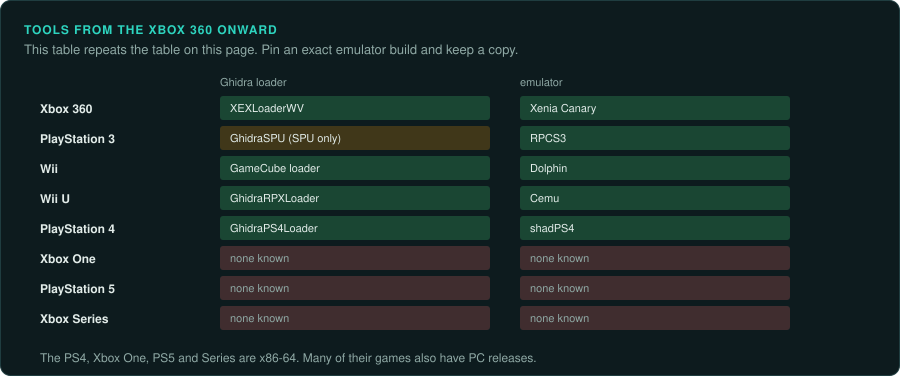
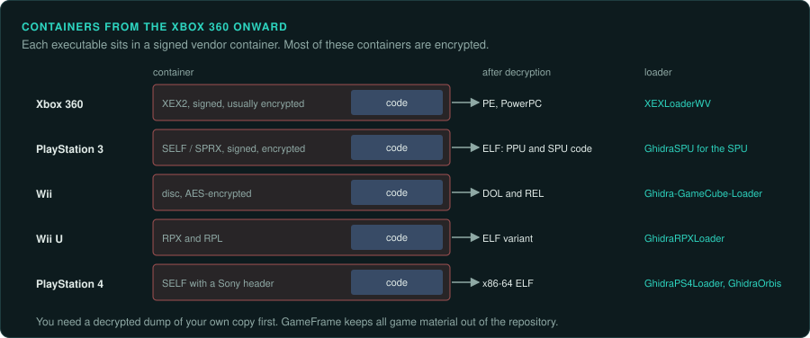
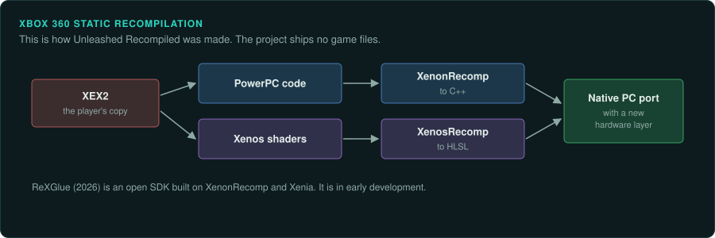
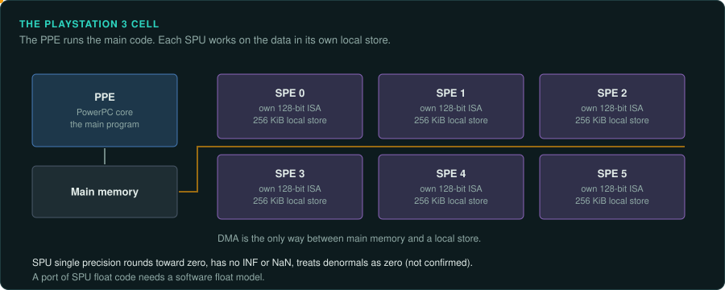
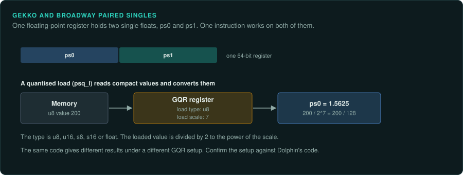

# Seventh generation onward

From the Xbox 360 on, every platform ships signed executables in a vendor format such as XEX, SELF or RPX. Most of them are encrypted. Before any analysis, you need a decrypted dump
and the right Ghidra loader. This page covers the home consoles. The DS, 3DS, PSP, Vita and Switch
are in the [Handhelds](../handhelds/README.md) section.

## The platforms

| Platform | Year | CPU | Executable | Ghidra module or loader | Emulator with a debugger |
|---|---|---|---|---|---|
| Xbox 360 | 22 November 2005 | Xenon, 3 PowerPC cores at 3.2 GHz, VMX128, big-endian | XEX2, signed, usually encrypted, wraps PE | [XEXLoaderWV](https://github.com/zeroKilo/XEXLoaderWV) | Xenia Canary |
| PlayStation 3 | November 2006 | Cell: PPE plus six SPEs for games | SELF and SPRX (EBOOT.BIN) | [GhidraSPU](https://github.com/aerosoul94/GhidraSPU) for SPU; no SELF loader confirmed | RPCS3 |
| Wii | 19 November 2006 | Broadway PowerPC at 729 MHz; Starlet ARM9 runs IOS | DOL and REL; discs AES-encrypted | [Ghidra-GameCube-Loader](https://github.com/Cuyler36/Ghidra-GameCube-Loader), paired-singles module | Dolphin |
| Wii U | 18 November 2012 | Espresso, 3 PowerPC cores at 1.24 GHz | RPX and RPL ELF variants | [GhidraRPXLoader](https://github.com/cemu-project/GhidraRPXLoader) | Cemu |
| PlayStation 4 | 15 November 2013 | 8 Jaguar x86-64 cores at 1.6 GHz | SELF with x86-64 ELF | [GhidraPS4Loader, GhidraOrbis](https://p.codekk.com/detail/64e02e470c2d5a3fbe2aa984) | shadPS4 |
| Xbox One | 22 November 2013 | 8 Jaguar cores at 1.75 GHz | Encrypted XVC containers | None known | None known |
| PlayStation 5 | 12 November 2020 | Zen 2, 8 cores to 3.5 GHz | | None known | None known |
| Xbox Series X and S | 10 November 2020 | Zen 2, 8 cores to 3.8 GHz | | None known | None known |

No emulator is known to run commercial Xbox One, PS5 or Series games. The PS4, Xbox One, PS5
and Series are x86-64. Many of their games also have PC releases, which may be easier to
study.

## Keys and encrypted executables

- PS3 SELF files are signed and encrypted. RPCS3 needs the official firmware and a disc key
  (not confirmed) ([psdevwiki: SELF](https://www.psdevwiki.com/ps3/SELF_-_SPRX);
  [RPCS3 quickstart](https://rpcs3.net/quickstart)).
- XEX2 files are decrypted with the console-family key
  ([XEXLoaderWV](https://github.com/zeroKilo/XEXLoaderWV)).
- PS4 loaders need a decrypted ELF without the Sony header.
- Wii discs are AES-encrypted.

Recompilation projects such as Unleashed Recompiled and the GoldenEye 360 recompilation ship no
game files and need the user's own copy
([tbreak](https://tbreak.com/goldeneye-007-xbox-360-pc-recompilation/)). GameFrame follows the
same rule and keeps all game material out of the repository.

The Switch keys and the yuzu settlement are on the
[Switch family](../handhelds/switch-family.md#keys-and-the-yuzu-settlement) page. The 3DS keys
are on the [Nintendo DS and 3DS](../handhelds/ds-and-3ds.md) page. The user decides how to
obtain and use their own keys and dumps.

## Emulator status

Repositories can disappear, so pin an exact emulator
build and keep a local copy.

- Dolphin has a full debugger, shared with the GameCube ([Dolphin](https://dolphin-emu.org/)).
- RPCS3 has a PPU and SPU debugger (not confirmed) ([RPCS3](https://rpcs3.net/)).
- Cemu has been open source since 2022. Its organisation maintains the RPX loader.
- Xenia Canary is the active Xbox 360 branch. Secondary coverage reports near-daily commits into
  July 2026. The original repository gets fewer commits
  ([tech-insider](https://tech-insider.org/?p=20173); [Snapcraft: xenia-canary](https://snapcraft.io/xenia-canary)).
- shadPS4 runs Bloodborne. Reported versions are v0.16.0 in June 2026 and v0.19.0 in October
  2026 ([Wikipedia: ShadPS4](https://en.wikipedia.org/wiki/ShadPS4);
  [itechguides](https://www.itechguides.com/what-the-bloodborne-pc-port-is-and-how-it-works/)).
- The handheld emulators (PPSSPP, Vita3K, Azahar and the Switch forks) are on the
  [Handhelds](../handhelds/README.md) pages.

## Xbox 360

### Hardware

Xenon has three in-order big-endian PowerPC cores at 3.2 GHz with VMX128
([Wikipedia: Xenon](https://en.wikipedia.org/wiki/Xenon_(processor))). Executables are XEX2 files
that wrap a PE. They are signed and usually encrypted
([Xbox 360 technical specifications](https://en.wikipedia.org/wiki/Xbox_360_technical_specifications)).

### Tools

[XEXLoaderWV](https://github.com/zeroKilo/XEXLoaderWV) loads XEX2 files. Neither Ghidra's PowerPC module nor Unicorn supports VMX128.

### Projects to learn from

hedge-dev's XenonRecomp (PowerPC to C++) and XenosRecomp (shaders to HLSL) produced Unleashed
Recompiled, a native PC port of Sonic Unleashed revealed in March 2025. It ships without game
files and was inspired by N64: Recompiled
([Unleashed Recompiled README](https://cdn.jsdelivr.net/gh/hedge-dev/unleashedrecomp@main/README.md);
[Time Extension, March 2025](https://www.timeextension.com/news/2025/03/this-new-unofficial-pc-port-of-sonic-unleashed-could-be-the-best-version-of-the-game-yet)).
ReXGlue (2026) is an open SDK built on XenonRecomp and Xenia, with early ports such as Blue
Dragon and Ninja Gaiden 2. It is "in early development"
([Time Extension, March 2026](https://www.timeextension.com/news/2026/03/i-hold-my-work-to-a-strict-standard-the-driving-force-behind-xbox-360-recomp-tool-rexglue-speaks-out);
[Notebookcheck](https://www.notebookcheck.net/ReXGlue-SDK-debut-sparks-Xbox-360-to-PC-ports-for-Blue-Dragon-more.1231442.0.html)).

## PlayStation 3

### Hardware

The Cell pairs one PPE with SPUs. Games get six SPEs. Each SPU has its own 128-bit instruction
set, 256 KiB of local store and DMA-only access to main memory
([Wikipedia: Cell](https://en.wikipedia.org/wiki/Cell_(processor));
[psdevwiki](https://www.psdevwiki.com/ps3/)). Executables are SELF and SPRX files.

### Tools

[GhidraSPU](https://github.com/aerosoul94/GhidraSPU) adds the SPU. No SELF loader is
confirmed. RPCS3 runs the games.

### Projects to learn from

PS3Recomp is a PS3 static recompiler. One guide says its first playable games appeared in
October 2026 without public downloads. No primary source confirms the claim of "more than three
thousand games" ([Generation Amiga, June 2026](https://www.generationamiga.com/2026/06/15/ps3recomp-the-new-tool-bringing-native-playstation-3-ports-closer-to-pc/);
[Held Games](https://heldgames.com/tags/ps3recomp)).

### For an exact reimplementation

Cell SPU single precision rounds toward zero, treats denormals as zero and has no INF or NaN
(not confirmed) ([IBM Cell SDK 3.0](https://arcb.csc.ncsu.edu/~mueller/cluster/ps3/SDK3.0/docs/accessibility/sdkpt/cbet_3codemapeqv.html)).
Host IEEE floats give different results from SPU floats. A port of SPU float code needs a
software float model. Export the PPE and SPU code separately.

## Wii and Wii U

### Hardware

The Wii's Broadway is a PowerPC at 729 MHz. A Starlet ARM9 runs IOS. Executables are DOL and REL files. Discs are AES-encrypted ([Wii](https://en.wikipedia.org/wiki/Wii)). The Wii U's
Espresso has three PowerPC cores at 1.24 GHz. Its executables are RPX and RPL ELF variants
([Wii U](https://en.wikipedia.org/wiki/Wii_U)). Broadway and Espresso descend from the
GameCube's Gekko ([Wikipedia: Gekko](https://en.wikipedia.org/wiki/Gekko_(processor))).

### Tools

The Wii uses the GameCube's tools: [Ghidra-GameCube-Loader](https://github.com/Cuyler36/Ghidra-GameCube-Loader)
for DOL and REL, and [ghidra-gekko-broadway-lang](https://github.com/aldelaro5/ghidra-gekko-broadway-lang)
for paired singles ([WiiBrew: Ghidra](https://wiibrew.org/wiki/Ghidra)). Dolphin runs the games.
[GhidraRPXLoader](https://github.com/cemu-project/GhidraRPXLoader) loads Wii U files. Cemu runs them.

### Projects to learn from

Super Mario Galaxy was reported 100% decompiled in late September 2026. It is the first Wii game
to be fully decompiled. A PC port called AstroCore is in progress. The project uses
decomp-toolkit
([Android Authority](https://androidauthority.com/super-mario-galaxy-decompiled-pc-port-3717193);
[GitHub: Petari](https://github.com/Gota7/Petari); [decomp.dev](https://decomp.dev/)).

### For an exact reimplementation

Gekko paired-single results depend on the quantised load and store (GQR) setup. Confirm it
against Dolphin's code. The PowerPC consoles share tooling, so you can treat big-endian
PowerPC as one family.

## PlayStation 4

### Tools

GhidraPS4Loader and GhidraOrbis load PS4 files
([codekk](https://p.codekk.com/detail/64e02e470c2d5a3fbe2aa984)). They need a decrypted ELF
without the Sony header. shadPS4 is the emulator
([PlayStation 4 technical specifications](https://en.wikipedia.org/wiki/PlayStation_4_technical_specifications)).

## Matching decompilations not yet done

No completed PS4 matching decompilation is known.
