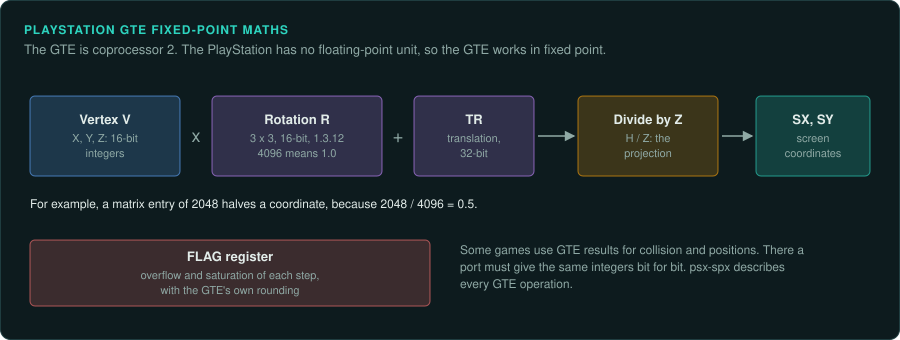
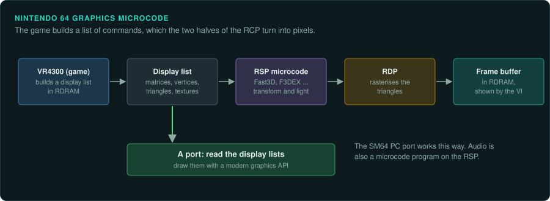
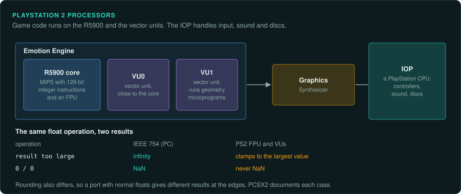

# Console platforms

Each console has its own CPU, video chip, sound hardware and conventions. This page lists the
home consoles most often studied, with what each means for reverse engineering and porting. The
details here are summaries. Each section names the community documents for that console,
which are far more complete.

Other consoles have their own pages:

- [Early consoles](early-consoles.md): the Odyssey to the Vectrex.
- [Jaguar and 3DO](32-bit-oddities.md): the Atari Jaguar and the 3DO.
- [CD add-ons](cd-add-ons.md): the Sega CD, 32X, PC Engine CD and CD-i.
- [Seventh generation onward](modern.md): the Xbox 360, PS3, Wii, Wii U, PS4, Xbox One, PS5
  and Series consoles.

The Game Boy, Game Boy Advance and the other handhelds are in the
[Handhelds](../handhelds/README.md) section.

## 8-bit and 16-bit consoles

| Console | Year | CPU | Video | Sound |
|---|---|---|---|---|
| NES / Famicom | 1983 | Ricoh 2A03 (6502 core without decimal mode), 1.79 MHz | PPU: tiles, 64 sprites, one background layer | Built into the 2A03 (2 pulse, triangle, noise, sample channel) |
| Sega Master System | 1985 | Zilog Z80 | VDP: tiles and sprites | SN76489 |
| PC Engine / TurboGrafx-16 | 1987 | HuC6280 (65C02 variant) | HuC6270 VDC | Six wave channels |
| Sega Mega Drive / Genesis | 1988 | Motorola 68000, plus a Z80 for sound | VDP: two scrolling layers, sprites | YM2612 FM and SN76489 |
| Super Nintendo / Super Famicom | 1990 | Ricoh 5A22 (65C816), plus the SPC700 sound CPU | PPU: up to four layers, Mode 7 rotation and scaling | S-DSP with eight sample channels |

**What to know.**

- **Banking.** Cartridges hold more than the CPU can address, so a mapper chip switches banks.
  On the NES, mappers such as MMC1 and MMC3 decide which banks are visible. A function's
  address alone does not identify it; you also need the bank. Name functions as `bank:address`.
- **Hand-written assembly.** Most games of this generation were written in assembly. Expect no
  calling convention, values passed in registers and flags, and code that jumps into the
  middle of other code.
- **The frame.** Almost every game runs its logic once per vertical blank (60 Hz in NTSC
  regions, 50 Hz in PAL regions). A frame that takes too long causes a "lag frame", where the
  logic skips a frame. Speedrunners study lag frames closely.
- **Coprocessors in cartridges.** Some SNES cartridges carry extra chips: the Super FX (a RISC
  CPU for 3D, as in Star Fox), DSP-1 (maths), SA-1 (a faster 65C816). Trace their code
  as well.
- **PC Engine.** HuC6280 code disassembles mostly correctly with Ghidra's 65C02 language. The
  block-transfer and MMU instructions need the
  [Ghidra_HuC6280](https://github.com/TiCoKH/Ghidra_HuC6280) extension. The CD unit is on the
  [CD add-ons](cd-add-ons.md) page.
- **Community documents.** NESdev Wiki (NES), SNESdev Wiki and fullsnes (SNES), Plutiedev and
  Sega Retro (Mega Drive). Pan Docs and GBATEK cover the [Game Boy family](../handhelds/game-boy.md).

## 32-bit and 64-bit consoles

| Console | Year | CPU | Graphics | Notes |
|---|---|---|---|---|
| Sega Saturn | 1994 | Two Hitachi SH-2, plus a 68000 for sound | VDP1 (sprites and quads) and VDP2 (backgrounds) | Hard to program; games use both SH-2s unevenly |
| Sony PlayStation | 1994 | MIPS R3000A, little-endian, 33.9 MHz, no floating-point unit | GPU drawing triangles and quads into a frame buffer; the GTE coprocessor for 3D maths | Fixed-point 3D; textures without perspective correction |
| Nintendo 64 | 1996 | NEC VR4300 (MIPS III, 64-bit capable, big-endian) | RCP: the RSP (vector processor running microcode) and the RDP (rasteriser) | Graphics and audio are microcode programs on the RSP |

**What to know.**

- **PlayStation GTE.** The Geometry Transformation Engine is coprocessor 2. It does matrix
  multiplications, perspective projection and lighting in fixed point, with its own rounding
  and its own overflow flags. A port of a PlayStation game's 3D must reproduce the GTE's
  results exactly where the game uses them for logic (collision, positions). The psx-spx
  document describes every GTE operation.
- **No floating point on the PlayStation.** Everything is integer or fixed point. Integer maths
  has no rounding mode, so exact ports are easier.
- **N64 microcode.** The game sends display lists to the RSP, which runs microcode (Fast3D,
  F3DEX and others). The microcode transforms and lights vertices and passes triangles to the
  RDP. A port interprets the display lists. The SM64 PC port is one project that does this.
- **N64 floating point.** The VR4300 has an FPU with single and double precision. Games are
  mostly single precision. MIPS has no 80-bit intermediates, so the C code's float maths maps
  well to modern 32-bit floats. Check that the port's compiler does not use fused multiply-add.
- **Saturn.** The two SH-2s share the work. Each has its own cache. Find which code runs on which CPU
  and how they synchronise. Few games of this platform have been studied in depth.
- **Community documents.** psx-spx (PlayStation), N64brew Wiki (Nintendo 64), SegaXtreme and
  the Saturn hardware manuals.

## The sixth generation

| Console | Year | CPU | Graphics | Notes |
|---|---|---|---|---|
| Sega Dreamcast | 1998 | Hitachi SH-4 with a fast vector FPU | PowerVR CLX2 (tile-based) | Some games use Windows CE |
| Sony PlayStation 2 | 2000 | Emotion Engine: MIPS R5900 core with 128-bit integer instructions, and two vector units (VU0, VU1) | Graphics Synthesizer | The IOP (a PlayStation CPU) handles input, sound and discs |
| Nintendo GameCube | 2001 | IBM Gekko (PowerPC 750 with paired-single floats) | Flipper | Wii (2006) uses the similar Broadway and Hollywood |
| Microsoft Xbox | 2001 | Intel Pentium III-class x86 | NVIDIA NV2A (close to a GeForce 3) | Programs are XBE files; code is close to a PC game's |

**What to know.**

- **PS2 floating point is not IEEE 754.** The R5900's FPU and the vector units have no
  infinities or NaNs, clamp large values, and round differently. A port that uses normal
  floats gets different results at the edges. PCSX2's code and documents describe the
  differences.
- **Vector unit microprograms.** PS2 games run their own programs on VU1 for geometry. Trace
  those programs like the rest of the game's code.
- **GameCube paired singles.** The Gekko can do two single-precision operations in one
  instruction, with its own quantisation instructions for loading and storing compressed
  values. Ghidra needs an extension to read them. The Wii shares the paired singles and the DOL and REL formats. It is covered on the [Seventh generation onward](modern.md) page.
- **Xbox.** The code is x86 and uses a version of DirectX 8. Much of the PC advice applies.
- **Compilers.** Games for these consoles were mostly written in C and C++ with known
  compilers (GCC versions for PS2, Metrowerks CodeWarrior for GameCube, MSVC for Xbox).
  If you know the compiler, you can recognise library code. Matching decompilation also needs
  the compiler ([Matching decompilation](matching-decomp.md)).

## Arcade boards

Arcade games ran on boards built for one game or one family of games. They have their own
section, [Arcade](../arcade/README.md). MAME's driver for each board is the main record of
that board.
