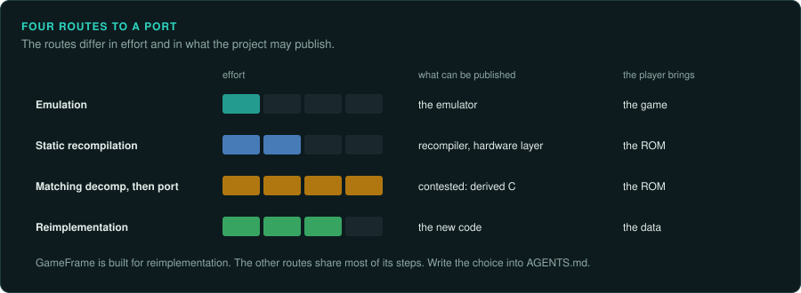
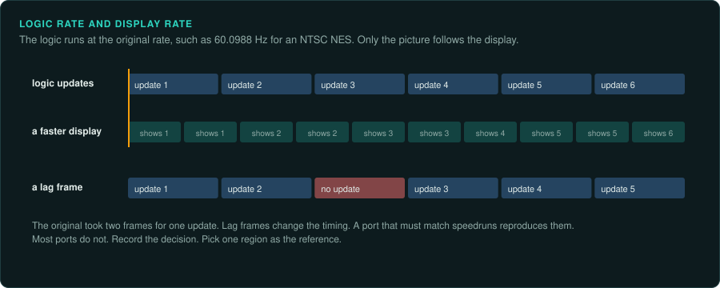
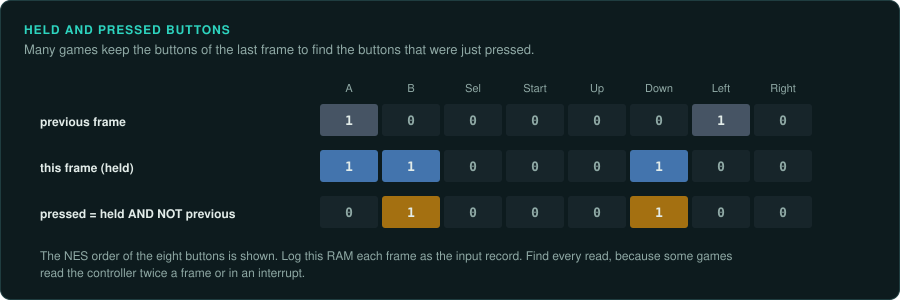
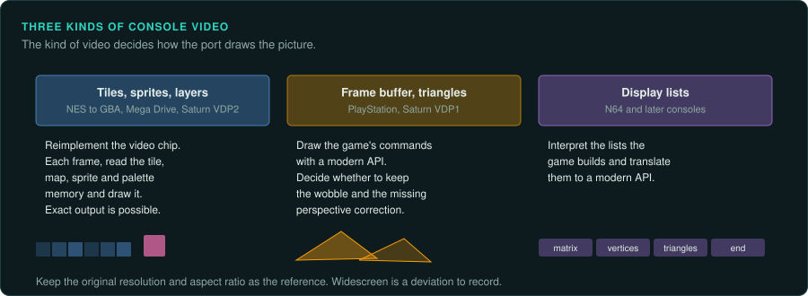
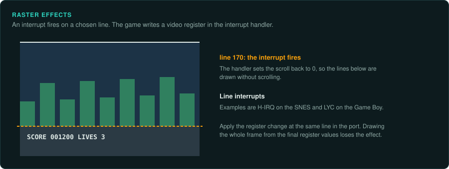
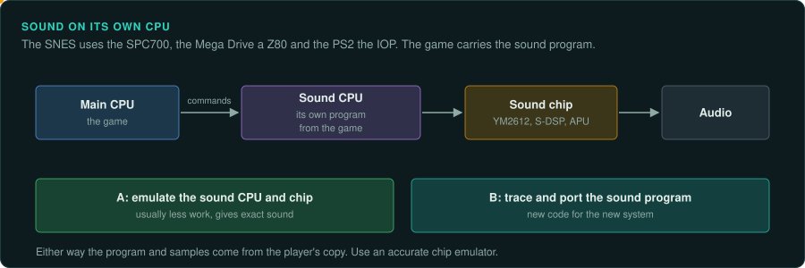
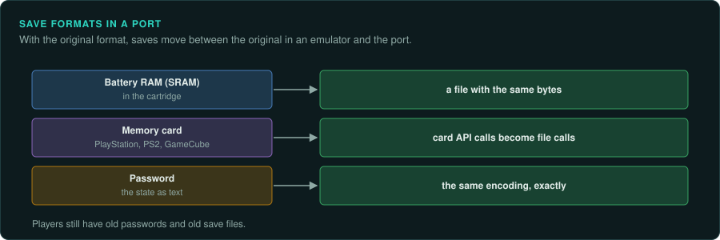
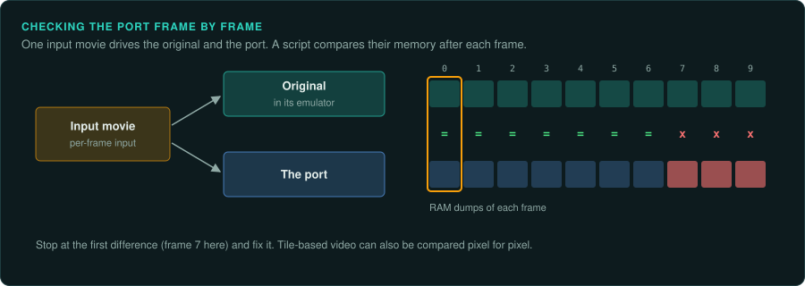

# Routes to a port



There are four ways to bring a console game to other systems. They differ in effort, in how
close the result is to the original, and in what the project may publish. Choose one at the
start and write it in the project's `AGENTS.md`.

| Route | What it is | Examples | Effort | What can be published |
|---|---|---|---|---|
| Emulation | Run the original code on an emulated console | every emulator | Low for one game, once an emulator exists | The emulator; the player brings the game |
| Static recompilation | Translate the original machine code into C or another language automatically, and link it with a reimplementation of the hardware | N64Recomp (Zelda 64: Recompiled) | Medium; most of the work is in the hardware layer | The recompiler and the hardware layer; the player's ROM is translated on their machine |
| Matching decompilation, then a port | Write C that compiles to the identical original binary, then build it for a new system | the SM64 and Ocarina of Time decompilations and their PC ports | Very high | Contested: the C is derived from the original program ([Legal](../LEGAL.md)) |
| Reimplementation | Write new code from documented behaviour, checked against the original | most projects in GameFrame's case studies | High | The new code; the player brings the game's data |

GameFrame is designed for reimplementation. The other routes share most of its steps
(finding functions, capturing ground truth, replacing hardware). GameFrame's toolkit helps
with them too.

## Ask your agent

Choose a route to a port. Copy this prompt into your coding agent:

```text
In my GameFrame project, help me choose how to port this console game.

1. Read docs/consoles/porting.md and docs/consoles/matching-decomp.md.
2. Tell me what each route would take for this game: reimplementation, matching
   decompilation, static recompilation or emulation.
3. List for each route what we could publish and what the player must provide.
4. Wait for my choice. Then write it into the project's AGENTS.md.
```

## Replacing the hardware

Every route needs code on the new system that replaces the console's hardware. Split the work by device.

### The frame and the clock



- The game's logic runs once per vertical blank. Keep one logic update per frame, at the
  original's rate (60.0988 Hz for an NTSC NES, 59.94 Hz or 50 Hz for most others). Find the
  exact rate for your console and region.
- If the port runs at a different display rate, run the logic at the original rate and show
  the latest frame, or interpolate only the picture. Never change how often the logic runs.
- Lag frames happen when the original took more than one frame for its work. They change the
  game's timing. Decide whether the reimplementation reproduces them. A port that must match
  speedrun behaviour needs them. Most ports do not. Record the decision.
- PAL versions often run slower, or change speeds and timers to compensate. Pick one region as
  the reference.

### Input



- The controller is read once a frame into RAM, often with a "pressed this frame" mask
  computed from the previous frame. Log that RAM as the input record. Port the read, and feed it
  from the new system's controllers.
- Some games read the controller more than once a frame, or in an interrupt. Find every read.
- Input movies from emulators are per-frame input. Use them to drive both the original and
  the port for comparisons.

### Video





| Console video | How to port it |
|---|---|
| Tiles, sprites and layers (NES to GBA, Mega Drive, Saturn VDP2) | Reimplement the video chip's rendering: read the game's tile, map, sprite and palette memory each frame and draw it. Exact output is possible, including sprite limits and priorities |
| Frame buffer with triangles (PlayStation, Saturn VDP1) | Render the game's draw commands with a modern API. Decide whether to keep the original's look (no perspective correction, wobbling vertices from integer coordinates) or improve it |
| Display lists for a programmable GPU (N64, later consoles) | Interpret the display lists the game builds, and translate them to a modern API |

- Raster effects, where the game changes video registers during the frame, need the scanline
  timing. Find the interrupts that fire on a line (the SNES's H-IRQ, the Game Boy's LYC) and
  apply their register changes at the same line in the port.
- Keep the original's resolution and aspect ratio as the reference. Widescreen and higher
  resolutions are deviations; record them.

### Sound



- Sound often runs on a separate CPU with its own program (the SNES's SPC700, the Mega Drive's
  Z80, the PS2's IOP). The game includes that program. Either emulate the sound CPU and its
  chip with the original program, or trace and port the sound program.
- Emulating the sound CPU and chip is usually less work and gives exact sound. The program and
  samples still come from the player's copy.
- Sound chips (YM2612, the NES APU, the S-DSP) have accurate emulators. Use one rather than
  writing your own.

### Saves



- Battery-backed RAM (SRAM) in cartridges: map it to a file. Keep the same layout, so saves
  move between the original (through an emulator) and the port.
- Memory cards (PlayStation, PS2, GameCube): the game uses a card API in its libraries. Port the API calls to files. Keep the save data's format.
- Passwords: the password encodes the game's state. Port the encoding exactly; players still
  have old passwords.

### Libraries

Games from the 32-bit generation on were linked with the console maker's libraries (Sony's
libraries for the PlayStation, Nintendo's SDK for the N64 and GameCube). Identify them by
signatures and label them. Port the library functions the game calls. Do not copy
the libraries into the port.

## Checking the port



Use the same checks as for PC games ([Running the original](../observe/running-the-original.md)):

1. Play an input movie in the original's emulator, and dump RAM every frame.
2. Play the same movie in the port, and dump the same variables.
3. Compare frame by frame. Stop at the first difference.
4. Compare pictures of the same frames. Tile-based video can be compared pixel by pixel.
